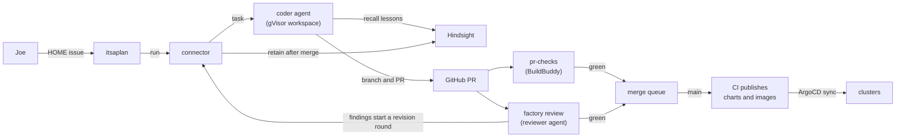

# Homelab

Personal monorepo. A software factory writes, reviews, merges and deploys the
changes. I set the goals and make the decisions it cannot.

## How a change ships



| Part | Role | Code |
| --- | --- | --- |
| itsaplan | Tracker. Project HOME holds every open task and Joe's decisions | [chart](projects/factory/chart/) |
| Connector | Relates an issue, its agent session and its PR. Starts revision rounds and enqueues | [connector](projects/factory/connector/) |
| Coder and reviewer | kagent agents on separate GitHub Apps. Each run gets an isolated gVisor workspace | [architecture](projects/factory/ARCHITECTURE.md) |
| Credential broker | Relays model calls and mints GitHub tokens. Credentials never enter a workspace | [broker](projects/factory/broker/) |
| Hindsight | Long-term memory that the coder shares between runs | [hindsight](projects/platform-factory/hindsight/) |

Every PR needs `pr-checks` and `factory review`, whoever wrote it. Joe decides
changes to the review rules themselves ([REVIEW.md](REVIEW.md)). The rules for
every change are in [AGENTS.md](AGENTS.md).

## Today and direction

The factory runs on the factory home cluster: three k3s nodes at home. Older
workloads still run on the GKE hub and move off it.

| Area | Today | Direction | Tracks |
| --- | --- | --- | --- |
| Factory and its platform | Factory home cluster | Unchanged | [factory-cluster](projects/factory-cluster/) |
| Private apps (monolith, Grimoire, MCP gateway) | GKE hub, scaled to zero. Its code is at tag `hub-final` | Factory home cluster | [HOME-128](https://factory-plan.jomcgi.dev/factory/issue/HOME-128), [HOME-262](https://factory-plan.jomcgi.dev/factory/issue/HOME-262), [decision](https://factory-plan.jomcgi.dev/factory/issue/HOME-178#comment-2358) |
| Public site jomcgi.dev | Static site on Cloudflare with its data on R2 | Unchanged | [HOME-178](https://factory-plan.jomcgi.dev/factory/issue/HOME-178), [decision](https://factory-plan.jomcgi.dev/factory/issue/HOME-178#comment-2358) |
| Deploy | ArgoCD from Git. Kargo promotes the hub pipelines | Kargo for every app. Cilium, 1Password Connect, ArgoCD, cert-manager and Kargo stay on ArgoCD. Verified Freight closes the HOME issue | [HOME-116](https://factory-plan.jomcgi.dev/factory/issue/HOME-116) |
| Pod-to-pod identity | Cilium network policy | SPIFFE workload identity | [HOME-254](https://factory-plan.jomcgi.dev/factory/issue/HOME-254) |
| Model choice | One fixed model for each agent | Trial arms compared on production outcomes | [HOME-244](https://factory-plan.jomcgi.dev/factory/issue/HOME-244) |

The tracker links need a sign-in. Each domain's `ARCHITECTURE.md` records its
current state, its direction and the reasons.

## Systems

- [**Factory**](projects/factory/): the umbrella chart, connector, broker and reviewer above. Reusable for other repositories through a repository binding.
- [**Capacity forecast**](projects/capacity-forecast/): shadow memory forecasts for factory reviewers, with a baseline comparison in Grafana.
- [**Factory home cluster**](projects/factory-cluster/): node bootstrap and ArgoCD root. [platform-factory](projects/platform-factory/) holds one Application for each shared component.
- [**Public site**](projects/jomcgi-site/): static Astryx pages on a Cloudflare Worker. It replaced the monolith's public pages.
- [**Trips**](projects/trips/) stages a Go service for private photo uploads and a daily export of approved trip points and photo derivatives.
- [**Scotland connector**](projects/scotland-connector/): Go service that answers Scottish dark-sky and walk-weather questions over REST and MCP.
- [**Design system**](projects/design-system/): the shared `--ds-*` token contract the frontends build against.
- [**Build system**](bazel/): Bazel rules for Helm and OCI images. Builds run remotely on BuildBuddy.
- **Retired hub code**: the monolith (knowledge graph, Discord bot, private apps) and its public tier, EmberVM, the Firecracker guests, oom-inference, the OCI Model Cache operator, Sextant, model-bench and the GKE hub overlays were deleted with the hub (HOME-262). Tag [`hub-final`](https://github.com/jomcgi-org/homelab/tree/hub-final) keeps them.

## Applications

Public apps at [jomcgi.dev/app](https://jomcgi.dev/app):

- [**Trip tracker**](projects/trips/): travel routes rebuilt from photo EXIF data, with elevation profiles.
- [**Stargazing**](projects/stars-forecast/): stargazing spots in Scotland with cloud-cover and darkness forecasts.
- [**Hiking routes**](projects/hikes/): Scottish route finder with weather-based recommendations.
- [**Grimoire**](projects/grimoire/): D&D campaign manager with a public rules and lore explorer. See the [factory migration plan](projects/grimoire/ARCHITECTURE.md).

## Infrastructure patterns

See [docs/security.md](docs/security.md) for the security model and
[docs/observability.md](docs/observability.md) for instrumentation.

| Area | GKE hub | Factory home cluster |
| --- | --- | --- |
| Ingress | Cloudflare Tunnel to Envoy Gateway; Cloudflare Access on private routes | Cloudflare Tunnel to Envoy Gateway; Authentik sign-in on every route except Authentik's own sign-in endpoints |
| Network | GKE Dataplane V2 | Cilium: default-deny, egress allowlists by domain name, WireGuard |
| Sandboxing | None since EmberVM's removal (HOME-476) | gVisor workspaces from Agent Substrate |
| Storage | GCE persistent disks, Cloudflare R2, GCS | Local disks; Garage and CloudNativePG keep three copies |
| Secrets | 1Password Operator; nothing in Git | 1Password Operator; nothing in Git |
| Observability | OpenTelemetry collector to Honeycomb | The same collector, plus Prometheus, Grafana and Discord alerts |
| GitOps | ArgoCD and Kargo; `kubectl` is read-only | ArgoCD; Kargo pipelines come next |

Both clusters build amd64, non-root images with apko. `ci` validates locally
and BuildBuddy runs PR checks remotely.

## Repo layout

```
projects/               # Services, operators and sites, each with its deploy config (major dirs shown)
├── factory/            #   Software factory: umbrella chart, connector, broker, reviewer
├── factory-cluster/    #   Factory home cluster: k3s node bootstrap and ArgoCD root
├── platform-factory/   #   Factory home cluster Applications (Cilium, Authentik, Garage, Hindsight, Kargo)
├── factory-explore/    #   Sparkles browser UI, read-only kubectl and time-limited Kubernetes API proxy
├── factory-explore-site/ #   Wrangler Job that publishes the UI to Cloudflare
├── factory-landing/    #   Private landing page at factory.jomcgi.dev
├── factory-public/     #   Garage bucket and R2 mirror for public factory data
├── factory-storyboard/ #   Public factory snapshot schema and invented fixtures
├── hikes/              #   Factory jobs that publish WalkHighlands routes and daylight forecasts
├── jomcgi-site/        #   Public jomcgi.dev: static Astryx pages on a Cloudflare Worker
├── platform/           #   Shared charts (ArgoCD, Envoy Gateway, OTel collector, Renovate)
├── scotland-connector/ #   Scottish dark-sky and walk-weather service
└── design-system/      #   Shared design tokens
bazel/                  # Build rules, tools and images
docs/                   # Cross-domain documentation and runbooks
```

The [agent reference](docs/agents/reference.md) has the commands and a map of
where to look next.

## What's next

Open work is in the itsaplan project
[HOME](https://factory-plan.jomcgi.dev/factory/HOME).

---

Built by [Joe McGinley](https://github.com/jomcgi). [MPL-2.0](LICENSE).
