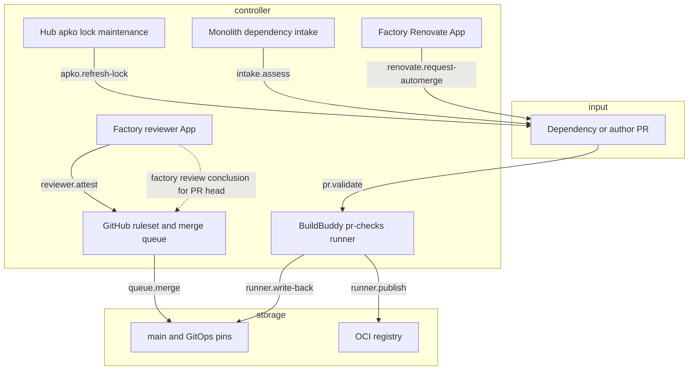

# STPA Control Analysis: CI and supply chain

_security @ d27644169_

_Auto-generated STPA safety model: unsafe states this system can reach and control actions that get it there. Single or multiple lenses: logic (mission failure), security (deliberate attack), governance (data safety)._

<b>How to read this</b>: STPA primer and diagram legend

**STPA** (System-Theoretic Process Analysis, Leveson) treats the system as controllers issuing control actions to controlled processes, with feedback flowing back. Instead of "what component fails," it asks "what control action, given or withheld at the wrong time, drives the system into an unsafe state?" Unsafe means a violation of this system's reason to exist. Multiple lenses (logic, security, governance) analyze the same control structure for different safety questions: mission failure, deliberate attack, data-processing violations. A finding appearing in multiple lenses is expected and correct.

Read top-down: Losses are outcomes we must prevent; Hazards are states leading to loss; diagrams show control structure (solid = control action, dashed = feedback); Unsafe Control Actions table is the core; Unsafe Feedback covers data channels (absent, stale, corrupted, spoofed). Every claim cites path:line; unbuilt elements are marked. Semantic stable IDs mean regenerating changes only findings that changed.

## Control structure

### Logical view

### Physical view

_No physical control structure modeled._

## Control actions

| ID | View | Control action | Controller → Process | Maturity | Evidence |
|----|----|----|----|----|----|
| `apko.refresh-lock` | logical | Propose refreshed base-image locks | `apko` → `pr` | built | projects/platform/renovate/values-gke.yaml:6 |
| `intake.assess` | logical | Assess changed files, dependency comparison and advisories | `intake` → `pr` | built | projects/monolith/factory/orchestration/dependency_prs.py:398 |
| `pr.validate` | logical | Submit the PR head for BuildBuddy checks | `pr` → `runner` | built | buildbuddy.yaml:16 |
| `queue.merge` | logical | Admit the validated queue candidate to main | `queue` → `main` | built | projects/factory/connector/github/client.go:695 |
| `renovate.request-automerge` | logical | Request native auto-merge as jomcgi-factory-renovate | `renovate` → `pr` | built | renovate.json:216-234 |
| `reviewer.attest` | logical | Post factory review on the queue candidate | `reviewer` → `queue` | built | projects/factory/reviewer/review/engine.go:3486 |
| `runner.publish` | logical | Publish images and charts from main | `runner` → `registry` | built | buildbuddy.yaml:217 |
| `runner.write-back` | logical | Write published versions into deployment pins | `runner` → `main` | built | buildbuddy.yaml:225 |

## Lens: security

**Scope.** From upstream packages, base images and PR-controlled build inputs through review, queue validation and OCI publication to the pins consumed by ArgoCD.

Maturity detail

- **Built:** BuildBuddy runs pr-checks on PR heads, queue candidates and main. The factory Renovate App requests native auto-merge. Hub apko maintenance is suspended. The monolith dependency evidence path is distinct from the required factory review.

### Losses

| ID | Loss |
|----|------|
| `L.release-integrity` | Unreviewed software gains deploy authority on a cluster. |

### Hazards

| ID | View | Hazard (unsafe state) | → Losses | Maturity | Status | Issue |
|----|----|----|----|----|----|----|
| `unvalidated-release` | logical | A merge or deployment refers to inputs other than those validated. | L.release-integrity | built | enforced-prod | HOME-89 |

### Unsafe control actions

| ID | View | Control action | Guideword | Unsafe condition | Severity | → Hazards | Status | Issue | Evidence |
|----|----|----|----|----|----|----|----|----|----|
| `apko.refresh-lock.provided` | logical | `apko.refresh-lock` | provided | An unattended refresh could change image inputs during retirement. The hub CronWorkflow consumes the suspend flag and automatic merge is disabled. | high | unvalidated-release | shipped-off | #7945 | projects/platform/renovate/values-gke.yaml:6 |
| `intake.assess.provided` | logical | `intake.assess` | provided | Accepting a partial dependency graph would hide transitive changes. The intake parser refuses missing or truncated evidence. | high | unvalidated-release | enforced-dev | HOME-89 | projects/monolith/factory/orchestration/dependency_prs.py:398 |
| `pr.validate.provided` | logical | `pr.validate` | provided | A success for a different tree could admit an untested build. PR checks use the PR head and queue pushes trigger a separate candidate build. Same-repository jobs cross the runner credential boundary (buildbuddy.yaml:44). | high | unvalidated-release | enforced-prod | HOME-89 | buildbuddy.yaml:16 |
| `queue.merge.provided` | logical | `queue.merge` | provided | Enqueue after the reviewed head moves would change the candidate. The connector supplies expectedHeadOid and the ruleset requires pr-checks and factory review. | high | unvalidated-release | enforced-prod | HOME-89 | projects/factory/connector/github/client.go:695 |
| `renovate.request-automerge.provided` | logical | `renovate.request-automerge` | provided | Requesting auto-merge for a protected path or major update would remove the manual decision. Renovate restricts eligible update classes and overrides eligibility for protected paths. | high | unvalidated-release | enforced-prod | HOME-14, HOME-61 | renovate.json:216-234 |
| `reviewer.attest.provided` | logical | `reviewer.attest` | provided | A pass for another PR revision could authorize changed code. The reviewer matches the reviewed head to the queued PR head. | high | unvalidated-release | enforced-prod | HOME-89 | projects/factory/reviewer/review/engine.go:3486 |
| `runner.publish.provided` | logical | `runner.publish` | provided | Publishing during PR validation would promote candidate artifacts. The runner selects publication on main and build verification on PR and queue runs. | high | unvalidated-release | enforced-prod | HOME-89 | buildbuddy.yaml:217 |
| `runner.write-back.provided` | logical | `runner.write-back` | provided | Advancing a pin before publication would direct GitOps to an unconfirmed release. The runner passes publication records to write-back after publishing. | high | unvalidated-release | enforced-prod | HOME-89 | buildbuddy.yaml:225 |

### Unsafe feedback

*Data channels (absent, stale, corrupted, spoofed) whose failure drives a controller into a hazard.*

| ID | View | Channel | Guideword | Unsafe condition | Severity | → Hazards | Status | Issue | Evidence |
|----|----|----|----|----|----|----|----|----|----|
| `reviewer-feedback.stale` | logical | `reviewer` → `queue`: factory review conclusion for PR head | stale | A stale approval could pass the queue candidate. The reviewer compares the head SHA before posting the merge-group check. | high | unvalidated-release | enforced-prod | HOME-89 | projects/factory/reviewer/review/engine.go:3486 |
