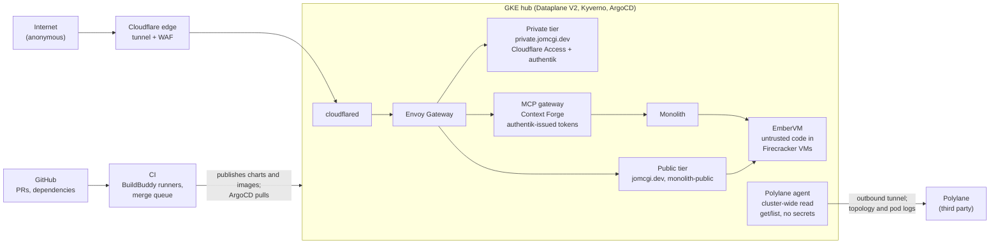

# Homelab Threat Model

_Reviewed against commit 8e4107491 (2026-10-19); listed issue states checked the same day._

Open security findings across everything the cluster hosts, ranked.
The live list is the
[`security-finding` label](https://github.com/jomcgi-org/homelab/issues?q=label%3Asecurity-finding+is%3Aopen);
[security.md](security.md#findings-and-threat-model)
records why this page exists, and the
[maintenance runbook](runbooks/threat-model-maintenance.md) is the
procedure for updating it. A project's deep model is the security lens in
that project's STPA.md.

## Assets

| Asset | Where it lives |
| --- | --- |
| Credentials held for workloads | 1Password Operator; the EmberVM egress sidecar holds the model-provider and git tokens it injects |
| Personal data: knowledge graph, notes, calendar, chat history | Postgres, behind the monolith (the personal API and agent platform) |
| Tenant state: a memory snapshot is the full process state of a workload | EmberVM's object store |
| Compute and the host: every node, `/dev/kvm` | The cluster |
| Public-site integrity: jomcgi.dev says what Joe published | The public tier |

## Trust boundaries

| Surface | Untrusted input | Deep model |
| --- | --- | --- |
| Public tier | Anyone on the internet | [monolith STPA, security lens](../projects/monolith/STPA.md); [public-tier checklist](runbooks/public-tier-checklist.md) |
| Private tier | Signed-in humans, service tokens, GitHub webhooks (HMAC-gated) | [monolith STPA, security lens](../projects/monolith/STPA.md) |
| MCP gateway | Agents, including prompt-injected ones | [monolith STPA, security lens](../projects/monolith/STPA.md) |
| EmberVM | Untrusted code, by design | [embervm STPA, security lens](../projects/embervm/STPA.md) |
| Supply chain and CI | PRs, dependencies, base images | None yet |
| Polylane agent | None inbound; it reads the cluster and sends out | None yet |
| Cluster baseline | Everything above sits on it | [security.md](security.md) |

## Open findings

Ranked by what an attacker gets. Each issue holds the detail.
Closed trackers leave this index even when closed without remediation;
residual concerns remain in the scoped security and MCP documentation.

1. **A Firecracker escape is not contained in production**
   ([#5255](https://github.com/jomcgi-org/homelab/issues/5255)).
   The jailer is built: each VM monitor runs chrooted as its own uid in
   its own cgroup and PID namespace, and a brick that cannot contain
   guests refuses to start. It is armed per stage, embervm-dev first and
   production after a dev soak
   ([#6965](https://github.com/jomcgi-org/homelab/issues/6965)); until
   then the monitor runs as root in a privileged pod, and an escape hands
   over the node and the fleet's storage credential.
   Tenants share bricks and Kubernetes nodes by design, and CPU side
   channels between co-resident guests are an accepted risk: nothing pins
   a guest to cores or isolates SMT siblings. Whether the Spot brick
   nodes run SMT is set in gcloud, not in git, and is unverified.
2. **A compromised public-tier pod can reach every in-cluster endpoint**
   ([#5276](https://github.com/jomcgi-org/homelab/issues/5276)).
   The destination-scoped Cilium egress template was removed by #5816. It
   never enforced on the GKE hub, which exposes no Cilium policy CRD. No
   egress policy renders for the public tier there; replacement enforcement
   remains tracked in #5276.
3. **The private monolith pod has no enforced egress policy**
   ([#5277](https://github.com/jomcgi-org/homelab/issues/5277)).
   The native policy is built but disabled in the hub values; the pod
   holding every backend secret can send anywhere the node can reach.
4. **One storage credential can delete any tenant's artifacts**
   ([#4691](https://github.com/jomcgi-org/homelab/issues/4691)).
   Encryption stops reads of tenant state; shared base images stay
   plaintext, and deletes and overwrites are open to every holder of
   the shared credential.
5. **The egress allowlist is shared across every EmberVM workload**
   ([#5320](https://github.com/jomcgi-org/homelab/issues/5320)).
   A destination added for one workload is reachable, with injected
   credentials, from every egress-enabled workload.
6. **Production promotion has no functional check**
   ([#4745](https://github.com/jomcgi-org/homelab/issues/4745)).
   Promotion waits for rollout health and a short soak, and only
   EmberVM runs a conformance test first. A change that deploys
   cleanly but misbehaves promotes.
