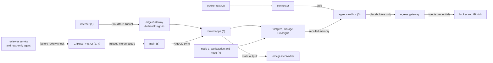

# Homelab Threat Model

_Reviewed against commit 395eb4e5f._

This page holds the structure of the threat model for both clusters: what
is worth protecting, who attacks it, and where untrusted input crosses a
boundary. The factory home cluster comes first. The GKE hub rows are marked.
`HOME-N` names an issue in itsaplan, the private tracker.
[security.md](security.md#findings-and-threat-model) records why this page
has this shape, and the
[maintenance runbook](runbooks/threat-model-maintenance.md) is the procedure
for changing it. A project's deep model is the security lens in that
project's `STPA.md`.

## Assets

| Asset | Where it lives |
| --- | --- |
| Merge authority on `main` | The GitHub ruleset, the reviewer App's `factory review` check, Joe's approval |
| Deploy authority | ArgoCD on the factory home cluster. What merges is what runs |
| Hub: deploy authority | ArgoCD and Kargo on the GKE hub |
| Provider and GitHub credentials | The credential broker; 1Password through the 1Password Operator |
| Agent memory and tracker text | Hindsight and itsaplan. Private: they must not reach the public repository or site |
| Cluster state and backups | etcd, three Postgres clusters, Garage |
| Public-site integrity: jomcgi.dev says what Joe published | The jomcgi-site Worker |
| Hub: personal data (knowledge graph, notes, calendar, chat history) | Postgres, behind the monolith |
| Hub: credentials held for workloads | 1Password Operator; the EmberVM egress sidecar |
| Hub: tenant state and compute | EmberVM's object store; the hub nodes |

## Attacker positions

| # | Position | What it controls |
| --- | --- | --- |
| 1 | Anonymous internet | Requests to every published hostname |
| 2 | Author of untrusted content | A fork PR, an issue or comment, a Discord message, a web page or CI log that an agent reads |
| 3 | A prompt-injected or misbehaving agent | Everything inside one sandbox |
| 4 | A compromised upstream | An image, chart, module or action that the repository uses |
| 5 | One merged commit | Any file on `main`, and so what ArgoCD deploys |
| 6 | A compromised application pod | That pod's network position, identity and data |
| 7 | A device on the home LAN, or a compromised operator session on node-1 | The node network; the operator's credentials |

## Trust boundaries

Numbers in the diagram are attacker positions. A control ID names an
invariant, a statement that is always true and the mechanism that enforces
it. HOME-301 tracks the invariant files; until they merge, the list is in
that issue.

| Boundary | Untrusted input | Controls | Deep model |
| --- | --- | --- | --- |
| Cloudflare Tunnel to the edge Gateway to routed apps | Anyone on the internet | PLAT-2, PLAT-3 | None yet |
| GitHub to `main` to ArgoCD | PRs, dependencies, CI logs | ROOT-1, FACT-4, FACT-9, FACT-10, FACT-11 | None yet |
| Tracker to connector to agent sandbox | Issue text, repository content, pages an agent reads | FACT-1, FACT-2, PLAT-5, PLAT-6 | None yet |
| Sandbox to egress gateway to broker and GitHub | A prompt-injected agent | FACT-3, FACT-5, FACT-6, FACT-7, FACT-8 | None yet |
| Reviewer service and its read-only agent | The PR under review | FACT-4, FACT-9, FACT-10 | None yet |
| Shared data plane: Postgres, Garage, Hindsight | A compromised application pod; recalled memory text | PLAT-1, PLAT-7, PLAT-8, LIB-1 to LIB-5 | None yet |
| node-1 as workstation and node | A home LAN device; an operator session | CLUS-1, CLUS-2, CLUS-3 | None yet |
| jomcgi-site Worker as the public output path | Data that the factory publishes | The `data/sources.json` list of published objects ([jomcgi-site README](../projects/jomcgi-site/README.md)); `public_content.py` in the CI Format stage | None yet |

The factory has no STPA security lens yet.

### GKE hub

HOME-93 and HOME-89 track the hub model. Until that work lands, these
surfaces keep their deep models:

| Surface | Untrusted input | Deep model |
| --- | --- | --- |
| Public tier | Anyone on the internet | [monolith STPA, security lens](../projects/monolith/STPA.md); [public-tier checklist](runbooks/public-tier-checklist.md) |
| Private tier | Signed-in humans, service tokens, GitHub webhooks (HMAC-gated) | [monolith STPA, security lens](../projects/monolith/STPA.md) |
| MCP gateway | Agents, including prompt-injected ones | [monolith STPA, security lens](../projects/monolith/STPA.md) |
| EmberVM | Untrusted code, by design | [embervm STPA, security lens](../projects/embervm/STPA.md) |
| Polylane agent | None inbound; it reads the cluster and sends out | None yet |
| Cluster baseline | Everything above sits on it | [security.md](security.md) |

## Open findings

Findings are recorded privately. Fix work is in the itsaplan project HOME.
