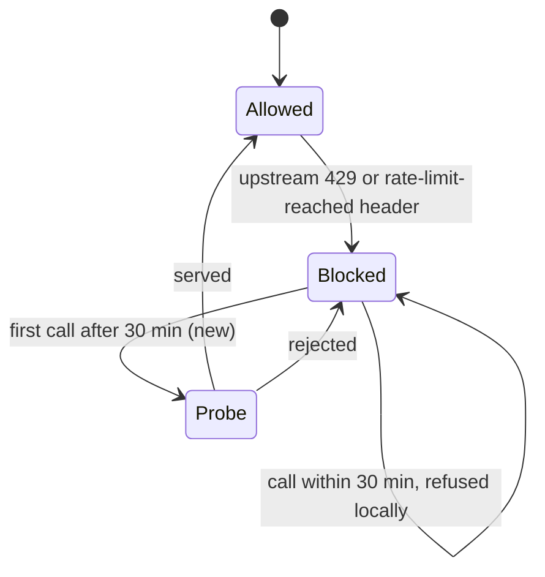

# Pull request descriptions

Every PR on this repository uses one description shape, whoever writes it.
Renovate's dependency PRs keep Renovate's format. People and the
`factory review` check read the description as the change's
stated goal. Merges rebase, so commit messages carry the history. The
description serves review, and it records why the change exists.

The hard bans and voice rules in [writing.md](../writing.md) apply.

## Title

A Conventional Commit subject that names the outcome. When a HOME issue
tracks the work, end the title with its key in parentheses:
`fix(factory): block Codex calls only when the backend refuses them (HOME-110)`.
PR lists, the merge queue and notifications show only the title, so the key
maps a PR to its issue without opening it. Merges rebase, so the title never
reaches history. Commit subjects stay plain Conventional Commits, and
`Refs HOME-N` in the commit body stays the record.

The connector titles a factory PR with the head commit's subject when it
opens the PR. HOME-114 makes it append the key.

## Body

Sections come in this order, under these exact headings, so a reader or a
parser finds each one in the same place. Leave out a section that has
nothing to say. Never write "None" or "N/A". Aim for about 300 words
outside diagrams and `<details>` blocks. A longer body often means the PR
holds more than one change.

```markdown
<One or two sentences: what changes, and the problem it fixes.>

## Why

<The problem and its evidence: counts, times, log lines, links.>

## Change

<A diagram, when the change moves a flow, boundary, state or owner.>

- `path/or/component`: what it does now, and why.

## Review focus

<The part to check hardest, and your question about it.>

## Evidence

- `<command>`: <result, such as "8 of 8 pass">.
- Not verified: <check or claim>, <why>, <what covers it instead>.

## Rollout

- Restarts: <what the render diff restarts>.
- Rollback: <the lever>.
- After merge: <the live check, and where its result is recorded>.
- Gate: <the "Joe decides" item, with the decision's link>.

## Review findings

- `<finding id>` (<head>): fixed in <sha> | disputed: <reason> | justified: <link to Joe's decision>.

## Related

Refs HOME-N
- Follows #N: <what it built>.
- Decision: <link to where Joe made it>.
```

| Section | Include | Holds |
|---------|---------|-------|
| Lead | always | The outcome in the reader's terms. GitHub shows it in notifications, and reviewers read it first. |
| Why | always | Evidence over assertion: "17 requests in 48 hours, all 503" over "egress was flaky". Name a rejected approach only when a reviewer would ask for it. |
| Change | always | One bullet per behaviour, keyed by the path or component a reviewer opens. Each bullet describes something the diff shows. Explain a choice the code does not make obvious. Byte-equal copies, locks and render hashes share one bullet that names what the render diff contains. |
| Review focus | when one part carries the risk | One or two lines that point at the code or decision to check hardest. In a study of 80,000 PRs, stating the feedback you want went with 1.72 times the odds of merging ([arXiv 2602.14611](https://arxiv.org/abs/2602.14611)). |
| Evidence | always | Each line is a command and its result, with a failure's error inline. Raw output goes in a `<details>` block. List each check or claim you could not verify, and why. A docs-only change says so in one line. |
| Rollout | deployable changes | What restarts, what data or schema changes, the rollback lever, and the live check after merge. The reviewer rates the risk from these facts. |
| Review findings | after a round raised findings | One line per finding ID, with the head it was raised on and the answer. The reviewer's PR comment holds the detail. A high finding about state the reviewer cannot read clears with Joe's decision (below). |
| Related | always | `Refs HOME-N` on its own line when a HOME issue tracks the work, then one line per link. A small explicit request can use its PR as the record (`docs/agents/ship.md`). |

After each review round, read the whole description against the new head.
Fix every claim that the head no longer supports.

The reviewer cannot read live clusters, secret stores or outside services.
When a high finding depends only on such state, give the evidence you have
and ask Joe. His decision is a comment from his account on the PR that
names the finding ID, the evidence he accepts and the check after rollout
(`REVIEW.md`, "Clearing a finding without a fix"). A session on his account
posts it only with the answer Joe gave in that session. Run the check after
rollout and record its result where the decision says.

## Links

Link anything a reviewer would otherwise search for. State the decisive
fact inline as well: links rot, and a reader should understand the PR
without following one. Prefix each line in Related with how it relates:

- `Follows`: the PR or issue this builds on.
- `Fixes`: the PR that introduced the bug, with its subject.
- `Blocks`, `Blocked by` or `Replaces`: another PR or issue.
- `Closes`: a GitHub issue this PR resolves. GitHub closes it on merge.
- `Decision`: where Joe made a decision that the change relies on.
- `Evidence`: a log query, dashboard or comment that holds the proof.

A repository autolink turns `HOME-N` in issues, PRs, commit messages and
release notes into a link to
`https://factory-plan.jomcgi.dev/factory/issue/HOME-N`, so write the bare
key there. It does not work inside a code span or in Markdown files in the
repository.

## Diagrams

Draw one when the change moves a request flow, a trust boundary, a state
machine or ownership between components. Skip it for a one-component fix, a
docs change or a version bump. GitHub renders Mermaid in PR bodies. Follow
[writing.md](../writing.md) "Diagrams", and also:

- Mark what the PR adds with `(new)` in the label. Draw the old path too
  only when its removal matters.
- A mismatch between the diagram and the diff is a finding.

#8095's quota block, drawn for its Change section:



## Language

Descriptions follow [writing.md](../writing.md) "Simplified Technical
English".

## Leave out

- A change the diff does not contain. In a study of 23,247 agent PRs,
  descriptions that did not match their code merged 28% of the time,
  against 80% for the rest. Claims of missing work were the largest kind of
  mismatch ([arXiv 2601.04886](https://arxiv.org/abs/2601.04886)).
- File-by-file narration of the diff, or the order the work happened in.
- Self-rated risk ("Low", "High") and adjectives about the change.
- Template text left in place: an empty heading, a placeholder or a bare
  `HOME-N`.
- "Tests pass" without the command and the count.
- Log output past the decisive lines. Longer output goes in a
  `<details>` block.
- Plans with no tracker item. File a HOME issue and link it.
- Instructions to the reviewer. Review focus points at code. It never asks
  the reviewer to skip a check or to approve.

## Factory PRs

The connector writes the body of a PR it opens and rewrites it after every
turn. Today that body holds only provenance: the issue, run, session and
delivery attempt (`prBody` in
`projects/factory/connector/dispatch/delivery.go`). The coder's final
message reaches only the itsaplan issue, so the reviewer sees no stated
intent beyond the issue key.
[HOME-114](https://factory-plan.jomcgi.dev/factory/issue/HOME-114) puts the
coder's description, in this shape, at the top of the body.
