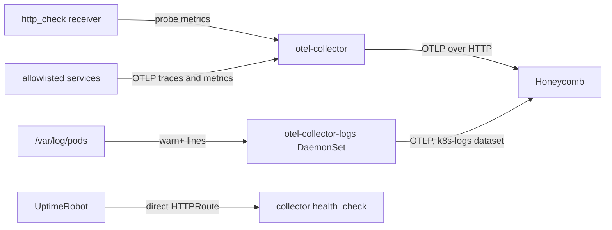

# Observability

One OpenTelemetry Collector Deployment on the GKE hub (`homelab-hub`, the only
cluster) exports admitted telemetry to Honeycomb, and a node-level DaemonSet
from the same chart ships warning-and-above pod logs. The hub sends synthetic
probe metrics plus OTLP traces and metrics from the services on its allowlist.
Alerting is one Honeycomb trigger on the public `/health` composite plus
monolith health components that post to Discord (see Alerting below).

## Signal paths

The collector exports over OTLP/HTTP (`honeycomb.protocol: "http"` in
`values-gke.yaml`): the hub's gRPC dials to `api.honeycomb.io` were cancelled
before completing while HTTPS from the same pod network worked.

The hub Application (`projects/platform-gke/otel-collector/application.yaml`)
applies `values.yaml` then `values-gke.yaml` from
`projects/platform/otel-collector/`. `values-prod.yaml` in the same directory
is the residual home overlay and deploys nowhere.

## Probe targets

The collector's `http_check` receiver probes these targets every 60 seconds and
ships the resulting metrics to Honeycomb:

| Target | Signal |
| ------ | ------ |
| `https://jomcgi.dev/health` | Composite public health |
| `https://jomcgi.dev/` | Public page reachability |
| `https://argocd-server.argocd.svc:443/healthz` | Argo CD, in-cluster, with the pinned serving CA from #6542 |

Targets live under `httpcheck.targets` in `values-gke.yaml`. Public targets use
HTTPS. Stage a new in-cluster target behind a dedicated default-off flag until
the service is live, and revalidate it against the destination's current
reachability and access controls. With the CA mount on, the render fails when
the pinned cert is empty or null. Turning the mount off is not guarded, so keep
it on while the `ca_file` target is enabled. The pinned Argo CD leaf expires
2027-08-30 and must be re-pinned from `argocd-secret` `tls.crt` before then.

The metrics pipeline accepts `http_check` and, when `allowedServices` is
non-empty, the shared OTLP receiver. The allowlist filters traces only.

`loom.enabled` defaults off in all overlays. When enabled after #6605, it
appends the in-cluster query-api `/docs` probe and adds `loom/loom-pg` to the
shared 30-minute CNPG backup checker. Without the shared targets enabled, the
same job checks only Loom. Its ServiceAccount gets only the configured named
Clusters, through namespace-scoped Roles. It emits
`cnpg.backup.last_success_age_seconds` through the collector's OTLP/HTTP Service,
using creation age plus `cnpg.backup.has_successful_backup=false` for a
never-backed-up cluster. Creation age is not evidence of a successful backup.
The flag requires HTTP probes and the shared OTLP receiver to be enabled, and
is independent of the Argo CD CA mount. The rendered upstream Loom chart has no
NetworkPolicies; reachability still needs live validation. Switch the probe
to `/healthz` when weave-hand/loom#694 ships. See
[Loom staged monitoring](../projects/loom/deploy/README.md#staged-monitoring-6604)
for the enable order and live acceptance checks.

## Collector metamonitoring

UptimeRobot checks `https://jomcgi.dev/health/otel-collector`. The `HTTPRoute`
sends traffic directly to the collector's `health_check` extension on port
13133 and rewrites the path to `/`. The public frontend is not on this path.

## Trace admission is deny-by-default

`allowedServices` defaults to an empty list in `values.yaml`. Read
`values-gke.yaml` for the services the hub admits; this document does not list
them, because that list changes and a copy here would go stale.

While the list is empty the rendered collector has:

- no `otlp` receiver
- no traces pipeline
- no container or Service ports for OTLP gRPC on 4317 or OTLP HTTP on 4318

A service that dials the collector without being listed gets connection
refused. The gate is a property of the rendered config, not a convention about
what nobody has pointed at it.

Admitting a service is a one-line `allowedServices` override in
`values-gke.yaml`, using the exact OpenTelemetry `service.name`. A non-empty
allowlist renders the OTLP receiver, trace pipeline, ports, allowlist filter, and
tail sampler. The workload must also configure its exporter endpoint.

Those two edits have to agree. The filter drops any span whose `service.name` is
not on the list, so a service whose `OTEL_SERVICE_NAME` differs from its
allowlist entry exports successfully and has every span discarded, with nothing
reporting the mismatch.

When at least one trace service is admitted, the shared OTLP receiver also feeds
the metrics pipeline. The trace allowlist remains specific to the traces
pipeline.

## Workloads configure exporters

Kyverno's disabled OTel injection template and values have been removed.
The chart provides no cluster-wide exporter injection.

The OpenTelemetry Operator chart was retired in #6914.
`projects/platform-gke/` carries no Application for it.
Each workload configures its own exporter endpoint. The private monolith's
OTLP/HTTP trace endpoint is set in `projects/monolith/deploy/values.yaml`, and
the service is admitted through the allowlist above.

The public stats ticker (`/app/notes/stats`) reads a snapshot the
`observability.stats_rollup` job fills from the Kubernetes API, Postgres and
GitHub. The repository removes the DCGM source and GPU presentation in #7028:
the hub has no GPU pool, and the home GPU operator was retired in #6914.
Rollout verification remains on #7028. Snapshot reads and the public read-only
boundary are unchanged.

## Pod logs

A node-level log agent (a DaemonSet in the same chart, enabled on the hub by
`logs.enabled` in `values-gke.yaml`) tails `/var/log/pods` for the namespaces in
`logs.namespaces` and exports warning-and-above lines directly to the Honeycomb
`k8s-logs` dataset, using the same ingest key as the gateway. It does not pass
through the gateway, so it opens no OTLP logs path for workloads.

Levels come from JSON `level`/`severity`/`levelname` fields, a leading level
token on plain-text lines (Python, zap console, Envoy, logfmt), or, for lines
with no level at all, an error/traceback heuristic whose matches are marked
`log.level_source=heuristic`. Everything below WARN is dropped at the node.
Lines carrying `trace_id` pivot to the trace datasets; pod logs from other
namespaces, and anything below WARN, still stay only in the pod logs.

## Alerting

Honeycomb's free plan allows exactly one trigger. It is spent on
`jomcgi.dev /health composite unhealthy` (`aJgkA4vC2m8`), kept as code in
[`projects/platform/honeycomb/`](../projects/platform/honeycomb/README.md)
and applied with its `sync.py`, which refuses to plan more than one trigger.
It fires when the httpcheck probe of `https://jomcgi.dev/health` is non-2xx
for two consecutive 5-minute evaluations and notifies the Discord webhook
recipient "Discord homelab alerts".

Everything else alerts from the monolith. Operational health components in
`projects/monolith/factory/ops_health.py` are registered as **advisory**
components of the private `/api/health`: a failing one is listed under
`degraded` and the response stays 200. They are advisory because they describe
capacity, providers and the factory lane rather than whether the monolith can
serve. The kubelet probes hit `/healthz`, which runs no deep components, so
none of them can restart a pod. They are not composed into the public tier,
so they never move the public `/health` composite or its Honeycomb trigger.

The monolith leader evaluates them every 60 seconds and posts one Discord
message (through `shared.notify`, to `agent.discord.defaultChannelId` unless
`healthAlerts.channelId` is set) when a component flips unhealthy or recovers,
and a reminder every 6 hours while it stays unhealthy
(`projects/monolith/factory/health_alerts.py`). The last announced state
is kept in the `platform_probe` table (`health_alert.<component>`), so a normal
leader handover retains deduplication and reminder timing. State advances after
successful enqueue. A crash between enqueue and the state write can duplicate
a message; this is not an exactly-once delivery guarantee. A component whose data cannot be
read reports `status: unknown`, stays healthy and never causes a transition.
Settings are the chart's `healthAlerts` values.

| Component | Unhealthy when | Data source |
| --------- | -------------- | ----------- |
| `embervm_capacity` | Every EmberVM brick class is at 0 desired replicas, or session creates have failed continuously for more than 15 minutes (failures spanning 15 minutes with no success between) | `noded-brick` Deployments in the `embervm` namespace (monolith ClusterRole read); create outcomes each replica records in `platform_probe` (`embervm.session_create`, `embervm.session_create.failing_since`). Recorded failures: 429, 5xx, timeouts, transport errors. Other 4xx (restore denials) are the caller's and not recorded |
| `agent_turns` | For Codex (luna, terra, sol, astra) or Claude (opus, sonnet, fable, and sessions with no model): at least 2 turns attempted in the last 60 minutes and none delivered | `agent_sessions.agent_turns` joined to `agent_sessions.agent_sessions`. Delivered means a clean terminal reason (`completed`, `end_turn`, `stop`, `user_interrupt`). Interrupted turns and turns cancelled before dispatch are not attempts. Spark and pi are not covered |
| `codex_quota_fresh` | The token broker's latest Codex quota observation is older than 60 minutes (or missing, or the broker is unreachable) **and** at least one Codex turn was attempted in the last 60 minutes | Broker `GET /quota` (the monolith's existing 30-second cached poll) and the same turn counts. The demand condition keeps idle nights quiet; the cost is that a fault that stops Codex work from being attempted at all is left to `agent_turns` and `embervm_capacity` |
| `factory_stuck` | A factory receipt has been `uncertain` for more than 2 hours, or a `queued` receipt at the live policy's repo and generation is not `admission_eligible` (the #6483 trap). Intake receipts while intake is off and older-generation receipts are not flagged | `swarm.factory_receipt` and the `swarm.factory_control` policy. Uncertain age is measured from the receipt's `updated_at` |
| `cnpg_backups` (staged off) | A fresh checker observation reports no successful backup, even for a newly created cluster, or a successful backup strictly older than 129600 seconds (36 hours). Exactly 36 hours passes | `otel-collector/cnpg-backup-status`, key `observation.json`, written by the same checker that emits the age metric. Required targets: `monolith/monolith-pg`, `authentik/authentik-pg`, `mcp/context-forge-pg`; optional `loom/loom-pg` only when the producer's Loom gate includes it. This checks base-backup status, not WAL archival |

Each check is cached for 60 seconds per process, bounded to 10 seconds with a
5-second Postgres statement timeout, and never raises.

Not covered: Kubernetes health, ArgoCD state, network-policy denials, and the
log-based conditions drafted as disabled trigger specs in #6511 (egress-proxy
request denied, EmberVM control-plane errors, Kargo promotion failed).
Container restarts in `monolith-public` are posted by the monolith's pod
restart watcher, and chart lag is the advisory `cd` component.

## Staged Loom monitoring

Loom's probe and backup-age telemetry remain default-off pending #6605 and
the [staged monitoring checks in #6604](../projects/loom/deploy/README.md#staged-monitoring-6604).
There are no Loom probe, backup-age or checker-absence Honeycomb trigger specs;
the [one-trigger policy](../projects/platform/honeycomb/README.md) reserves the
only trigger for the public health composite. The signals are available for
investigation after enablement and do not create Loom alert notifications.
The shared checker and private backup advisory below are staged separately
under #7002 and can include Loom after its own gate is enabled. They provide
no Loom probe or checker-absence alert.

## Staged shared backup advisory

The collector's `backupCheck.enabled` and `backupCheck.status.enabled`, and the
monolith's `healthAlerts.cnpgBackups.enabled`, default off in chart defaults and
checked-in deployment overlays. No backup alert rollout is claimed by this
repository change. The existing public Honeycomb trigger is unchanged; no
additional trigger is needed for the Discord advisory.

The checker reads each configured Cluster once, exports that observation, then
patches one precreated ConfigMap through the Kubernetes API with its existing
ServiceAccount token and cluster CA. Its Roles grant only `get` on exact
namespace/name Cluster objects and `get`/`patch` on the single status ConfigMap.
There is no application status-write endpoint, new credential, or database
migration. The private monolith reads that object through its existing
ConfigMap read permission and never scans Clusters itself. The producer
disables redirects and does not log exception bodies or bearer values.

`observation.json` carries a version and per-target identity, observation time,
successful-backup timestamp (or null), creation/backup age, success indication,
and collector acceptance. A failed target does not stop the others. Read or
parse failures become error observations without an age metric. Transport
failure or OTLP partial rejection leaves `export_ok=false`. A known stale or
never-backed-up target still degrades the advisory; a healthy target cannot
clear an alert until its export succeeds. A status patch failure exits nonzero
and leaves the previous snapshot to expire. The next scheduled run retries
collection and publication; there is no in-job retry loop.

Observations are fresh for at most 7200 seconds, with a 60-second per-process
health cache. Missing targets, absent snapshots, stale observations, malformed
fields, future timestamps and unreadable sources report `status: unknown`.
Unknown does not baseline, recover, or update the durable alert state. It also
does not send a new Discord checker-absence alert: inspect the private health
detail and CronJob failures. A known failure on another fresh target still
alerts. Recovery requires fresh valid successful-backup evidence and successful
metric export for every required target and any included Loom target. The
consumer recomputes backup age from the timestamp between checker runs.

One job renders whether shared targets, Loom, or both are enabled. Scheduling,
image and resource settings retain the existing `loom.backupCheck` keys for
compatibility: every 30 minutes, `Forbid` concurrency, no job retries, and a
120-second active deadline. At most four targets make eight read/export
requests and one status patch. Each has a 10-second wall-clock and socket
deadline and a 1 MiB response cap, leaving 30 seconds for startup and parsing.
The hub Application ignores `/data/observation.json` on this exact ConfigMap
during both diff and sync (`RespectIgnoreDifferences=true`). A renamed handoff
must update that ignore rule and both charts together.

A later authorized enablement PR must enable the two collector flags and the
monolith reader, preserving the existing OTLP admission path. Keep
`loom.enabled=false` until #6605's independent acceptance is complete. The
operational checklist on #7002 still requires rollout and scheduled-run
verification, effective named-object RBAC (including additive bindings), metric
and advisory arrival, non-destructive failure/recovery tests, unknown and
deduplication checks across leader handover, health endpoint isolation, and
conditional Loom validation. Do not apply trigger specs or fire live alert
tests as part of this staged delivery.

## Configuration

- Collector chart and default admission policy:
  `projects/platform/otel-collector/values.yaml`
- Hub overrides, probe targets, pod-log namespaces and the Honeycomb protocol:
  `projects/platform/otel-collector/values-gke.yaml`
- Honeycomb trigger specs and `sync.py`: `projects/platform/honeycomb/`
- Monolith health components and Discord alerts:
  `projects/monolith/factory/ops_health.py`,
  `projects/monolith/factory/health_alerts.py`, chart values `healthAlerts`
