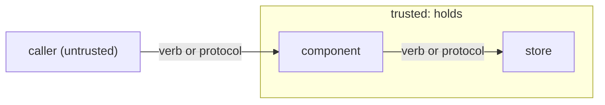

# <Domain> architecture

<!--
Template for projects/<domain>/ARCHITECTURE.md. Rules: docs/writing.md
"Document types". Delete every comment before you commit.
Limits: 600 lines for the file, 60 lines for a section without a diagram.
-->

<Five sentences or fewer. What the domain does, for whom, and where it runs.>

<!--
The diagram marks each trust boundary: where untrusted input enters, and
which component holds a credential.
-->

| Component | Role | Code | Pin | Untrusted input | Credentials held |
| --- | --- | --- | --- | --- | --- |
| <name> | <one line> | `<path>` | <version, stated only here> | <who can send it text or code, or "none"> | <which credentials, or "none"> |

## <Component or flow>

<!-- One section for each component. Present tense: what runs now. -->

<What it does. Draw each flow, state machine and trust boundary.>

<!--
A sentence that names a security control gives its state: live, staged off
or designed. "Live" means you saw it deployed.
-->

**Why.** <The reason, the option rejected, and a link to the decision.>

## Direction

Decided and not yet live. A row leaves when the work ships or its issue
closes.

| Direction | Tracks | State |
| --- | --- | --- |
| <outcome> | HOME-N | <`staged off` behind `<flag>`, or `designed`> |

## Decision history

| Decision | Date | Record |
| --- | --- | --- |
| <one line> | <YYYY-MM-DD> | <link to Joe's comment or the HOME issue> |
