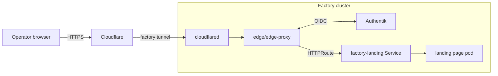
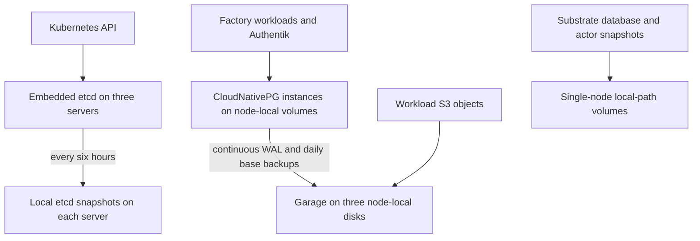

# Factory home cluster architecture

Three k3s servers host the software factory and its operator tools. ArgoCD reconciles the platform from Git. A private request to the landing page at `factory.jomcgi.dev` follows this path.

| Component | Role | Code | Pin source | Untrusted input | Credentials held |
| --- | --- | --- | --- | --- | --- |
| k3s | API and embedded etcd | `nodes/` | `nodes/install-node.sh` | API requests | Server token and cluster CA |
| Cloudflare Tunnel | Publishes edge hostnames through an outbound connection | [factory-edge](../platform-factory/factory-edge/) | [cfgate](../platform-factory/cfgate/) | Internet traffic | Tunnel credentials |
| Envoy | Applies route authentication and forwards requests | [edge](../platform-factory/edge/) | Edge chart | HTTP requests and tokens | OIDC client secret |
| Authentik | Issues tokens and enforces group membership | [authentik](../platform-factory/authentik/) | Authentik Application | Login requests | Signing keys and client secrets |
| Garage | Replicates workload objects and database archives | [garage](../platform-factory/garage/) | Garage StatefulSet | S3 requests | RPC secret and admin token |
| CloudNativePG | Manages the three application database clusters | [cloudnative-pg](../platform-factory/cloudnative-pg/) | Operator Application | Database connections | Scoped database and archive credentials |

## Ingress and identity

The tunnel publishes the route to Envoy from the labelled `edge` namespace. Envoy applies a gateway-wide Authentik policy to browser applications. Authentik's own route serves the login flow, and the Kubernetes API route validates a bearer ID token. The API server checks the token again and applies RBAC. Edge admission policies restrict which namespaces and routes can configure the proxy. Cilium policies grant the proxy egress to each backend.

| Hostname | Route | Sign-in |
| --- | --- | --- |
| factory.jomcgi.dev | `factory-landing/factory-landing` | Envoy OIDC (client `factory-edge`), only `authentik Admins` |
| factory-argocd.jomcgi.dev | `argocd/argocd-server` | Envoy OIDC (client `factory-edge`), then ArgoCD's OIDC (client `factory-argocd`); both admit only `authentik Admins` |
| factory-auth.jomcgi.dev | `edge/authentik` | Authentik itself, with MFA required |
| factory-plan.jomcgi.dev | `factory/factory-itsaplan` (`/backend` to the api, `/` to the web app) | Envoy OIDC (client `factory-edge`), then itsaplan's OIDC (client `factory-itsaplan`, invite-only) or its break-glass admin; both admit only `authentik Admins` |
| factory-grafana.jomcgi.dev | `grafana/grafana` | Envoy OIDC (client `factory-edge`), then Grafana's OIDC (client `factory-grafana`); both admit only `authentik Admins` |
| factory-agents.jomcgi.dev | `edge/kagent` to `kagent/kagent-ui:8080` | Envoy OIDC (client `factory-edge`), only `authentik Admins`; access token forwarded to kagent |
| factory-kube.jomcgi.dev | `edge/kube-api` to `default/kubernetes:443` | No browser sign-in: Envoy checks the bearer ID token from client `factory-kubectl` for group `authentik Admins` or `factory-kube-viewers`, then the API server checks it again and RBAC applies (see the [kubectl procedure](README.md#kubectl-through-authentik)) |

The permanent sentinel route keeps the OAuth2 filter on the listener during application rollouts. The edge chart creates a placeholder OIDC Secret before applying the policy. Authentik’s initializer supplies the client secret.

## State and recovery

Each server retains 20 etcd snapshots. Recovery of encrypted cluster state also requires the server token. Garage replicates each object across the three nodes. CloudNativePG uses separate buckets for `kagent-pg`, `factory-db` and `authentik-pg`, with 14 days of archives. Losing the whole cluster can take both the databases and these archives. Substrate's own database and snapshots depend on their individual nodes.

## Reconciliation and workloads

The [root](root/) delegates to the [platform Application list](../platform-factory/kustomization.yaml). Cilium supplies pod networking, WireGuard and default-deny policies. Connect supplies secrets from 1Password. Agent Substrate runs sandboxed actors using gVisor. Kargo's controller is installed for promotion. Prometheus stores local metrics for Grafana, Alertmanager sends alerts to Discord, and the OpenTelemetry collectors export selected telemetry to Honeycomb.

## Nodes and sandboxing

The [host firewall](nodes/factory-firewall.nft) uses a separate nftables table, `inet factory_fw`, with a default-drop input policy. On the wired interfaces, cluster peers can reach WireGuard and the listed node services. Pods and decrypted WireGuard traffic arrive on Cilium interfaces. Operators reach node-1 over Tailscale. Node bootstrap disables rpcbind.

Each node runs a k3s server with embedded etcd. The quorum tolerates one unavailable server. Node bootstrap pins k3s and runsc, configures zram for memory pressure and enables the certificates API used by Substrate. Cilium attaches to the wired interfaces and replaces kube-proxy. The local-path provisioner places volumes on individual nodes. Garage and the CNPG instances implement replication at the application level.

The Substrate control plane and atelet run in `ate-system`. Workers run in labelled binding namespaces. The credential provider restricts each configured atespace to injectable Secrets in its allowed namespace. The rendered manifests and grant list are in [Substrate](../platform-factory/substrate/). Substrate keeps actor metadata in its own PostgreSQL and snapshots in rustfs.

## Direction

| Direction | Tracks | State |
| --- | --- | --- |
| Make Substrate database and actor state recoverable after node loss | — | Designed |
| Extend actor internet access through scoped credential grants | — | Partially implemented |
| Copy etcd snapshots and token, Garage data and CNPG archives off site and test recovery | — | Designed |
| Move Substrate snapshots to Garage and its PostgreSQL to CloudNativePG | — | Designed |
| Migrate all three CNPG archives to the barman-cloud plugin before upgrading to 1.31 | — | Designed |
| Introduce a Kargo Warehouse, verification and rollback, then migrate applications individually | HOME-116 | Designed |
| Rotate the Substrate CA before 2027-11-13 | [#7831](https://github.com/jomcgi-org/homelab/issues/7831) | Planned |
| Verify Authentik replication and backups, escrow its secrets and drill an isolated restore | [#7952](https://github.com/jomcgi-org/homelab/issues/7952) | Acceptance pending |
| Spread cloudflared replicas explicitly across nodes | — | Designed |
| Alert on stuck connector runs, CNPG archive and backup age, and alert-path heartbeat | HOME-141 (connector) | Designed |
| Preserve Prometheus metrics across cluster loss | — | Designed |

## Decision history

| Decision | Date | Record |
| --- | --- | --- |
| Use the rebuilt home nodes for the factory with Authentik sign-in and replicated Garage storage | November 2026 | [Factory cluster checklist #7817](https://github.com/jomcgi-org/homelab/issues/7817) |
