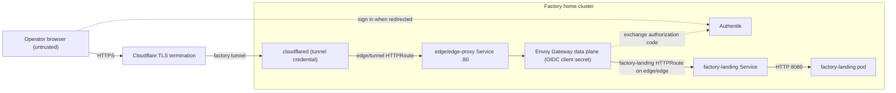
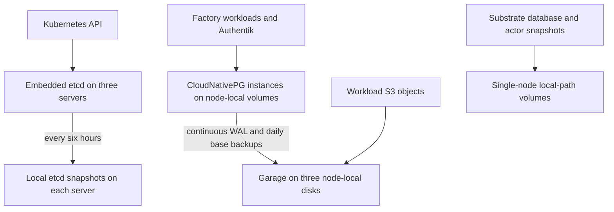

# Factory home cluster architecture

Three k3s servers host the software factory and its operator tools. ArgoCD reconciles the platform from Git. For a request to `https://factory.jomcgi.dev/`, Cloudflare terminates TLS and sends the request down the factory tunnel. Envoy Gateway enforces Authentik sign-in before routing the request to a landing-page pod.

The [tunnel route](../platform-factory/edge-tunnel/resources/route.yaml) selects the proxy Service. The [landing page route](../factory-landing/chart/templates/httproute.yaml) attaches to the edge Gateway and selects the application Service.

| Component | Role | Code | Pin | Untrusted input | Credentials held |
| --- | --- | --- | --- | --- | --- |
| k3s | API and embedded etcd | `nodes/` | v1.37.2+k3s1 | API requests | Server token and cluster CA |
| Cloudflare Tunnel | Publishes edge hostnames through an outbound connection | [factory-edge](../platform-factory/factory-edge/) | cloudflared 2026.10.7 | Internet traffic | Tunnel credentials |
| Envoy | Applies route authentication and forwards requests | [edge](../platform-factory/edge/) | Envoy Gateway 1.8.3 | HTTP requests and tokens | OIDC client secret |
| Authentik | Issues tokens and enforces group membership | [authentik](../platform-factory/authentik/) | 2026.5.6 | Login requests | Signing keys and client secrets |
| Garage | Replicates workload objects and database archives | [garage](../platform-factory/garage/) | 2.5.0 | S3 requests | RPC secret and admin token |
| CloudNativePG | Manages application database clusters | [cloudnative-pg](../platform-factory/cloudnative-pg/) | Operator chart 0.29.0 | Cluster specifications | Scoped database and archive credentials |

## Ingress and identity

The tunnel publishes the route to Envoy from the labelled `edge` namespace. Envoy applies a gateway-wide Authentik policy to browser applications. Authentik's own route serves the login flow, and the Kubernetes API route validates a bearer ID token. The API server checks the token again and applies RBAC. Edge admission policies restrict which namespaces and routes can configure the proxy. Cilium policies grant the proxy egress to each backend.

Gateway OIDC admits `factory-operators` and `authentik Admins` to the landing page, runbooks and operator applications. ArgoCD, Grafana and itsaplan also have application sign-in. The kagent route forwards the access token. [Identity blueprints](../platform/authentik/factory-blueprints/) · [Published hosts](../platform-factory/edge-tunnel/resources/route.yaml)

| Route control | State | Scope |
| --- | --- | --- |
| Authentik login | On | Public flow and enrollment paths allow the browser to complete MFA. |
| Kubernetes API JWT and backend TLS | On | Envoy checks the kubectl audience and allowed groups. The API server authenticates the request and applies RBAC. |
| Explore API JWT | On | This route accepts bearer tokens for the separate factory-explore client. |
| Scotland connector sign-in | Off | The public forecast route rejects Worker subrequests and rate limits by IP. |
| Broker admin OIDC | Staged off | The factory chart gates the route and token-forwarding policy together with `codexAdminRouteEnabled`. |

**Why.** Publishing one proxy keeps route owners from choosing an unauthenticated origin. Browser redirects work for operator tools, while kubectl needs bearer authentication. Scotland serves public data by explicit decision. [Tunnel route](../platform-factory/edge-tunnel/resources/route.yaml) · [kubectl decision](https://github.com/jomcgi-org/homelab/pull/8237#issuecomment-6975000416) · [Scotland decision](https://factory-plan.jomcgi.dev/factory/issue/HOME-259#comment-3908)

The permanent sentinel route keeps the OAuth2 filter on the listener during application rollouts. The edge chart creates a placeholder OIDC Secret before applying the policy. Authentik’s initializer supplies the client secret.

## State and recovery

Each server retains 20 etcd snapshots. Recovery of encrypted cluster state also requires the server token. Garage replicates each object across the three nodes. The [Grimoire cluster](../platform-factory/grimoire-data/resources/database.yaml) archives to its own Garage bucket for 14 days. CloudNativePG also uses separate buckets for `kagent-pg`, `factory-db` and `authentik-pg`, with 14 days of archives for `factory-db` and `authentik-pg` and 1 day for `kagent-pg`, whose WAL volume would otherwise fill the nodes ([decision](https://factory-plan.jomcgi.dev/factory/issue/HOME-450#comment-4597)). Losing the whole cluster can take both the databases and these archives. Substrate's own database and snapshots depend on their individual nodes.

**Why.** Three etcd members preserve quorum during one server failure. Database and object replicas protect node-local data, while shorter kagent retention bounds disk usage. [Server configuration](nodes/k3s-config.yaml) · [Archive decision](https://factory-plan.jomcgi.dev/factory/issue/HOME-450#comment-4597)

## Reconciliation and workloads

The [root](root/) delegates to the [platform Application list](../platform-factory/kustomization.yaml). Cilium supplies pod networking, WireGuard and default-deny policies. Connect supplies secrets from 1Password. Agent Substrate runs sandboxed actors using gVisor. Kargo's controller is installed for promotion. Prometheus stores local metrics for Grafana, Alertmanager sends alerts to Discord, and the OpenTelemetry collectors export selected telemetry to Honeycomb.

**Why.** Bootstrap installs Cilium first so pods have networking, then ArgoCD adopts the installation and reconciles the platform from Git. [Bootstrap](bootstrap-gitops.sh) · [Applications](../platform-factory/kustomization.yaml)

## Nodes and sandboxing

The [host firewall](nodes/factory-firewall.nft) uses a separate nftables table, `inet factory_fw`, with a default-drop input policy. On the wired interfaces, cluster peers can reach WireGuard and the listed node services. Pods and decrypted WireGuard traffic arrive on Cilium interfaces. Operators reach node-1 over Tailscale. Node bootstrap disables rpcbind.

Each node runs a k3s server with embedded etcd. The quorum tolerates one unavailable server. Node bootstrap pins k3s and runsc, configures zram for memory pressure and enables the certificates API used by Substrate. Cilium attaches to the wired interfaces and replaces kube-proxy. The local-path provisioner places volumes on individual nodes. Garage and the CNPG instances implement replication at the application level.

The Substrate control plane and atelet run in `ate-system`. Workers run in labelled binding namespaces. The credential provider restricts each configured atespace to injectable Secrets in its allowed namespace. The rendered manifests and grant list are in [Substrate](../platform-factory/substrate/). Substrate keeps actor metadata in its own PostgreSQL and snapshots in rustfs.

## Security controls

**On** describes the checked-in configuration. **Staged off** means a switch disables an implemented control. **Off** means the configuration lacks the stated guarantee. Deployment evidence is recorded separately in the [cluster](INVARIANTS.yaml) and [platform](../platform-factory/INVARIANTS.yaml) inventories.

| Control | State | Scope and rationale |
| --- | --- | --- |
| Secret encryption and API audit | On | k3s encrypts Secrets and rotates metadata-only audit logs to keep request bodies out of the log. [Server arguments](nodes/k3s-config.yaml) · [Audit policy](nodes/audit-policy.yaml) |
| Explicit anonymous-access hardening | Off | The shared node configuration does not explicitly disable anonymous authentication on both API server and kubelet. CLUS-2 remains unproven. |
| Host firewall and WireGuard | On | nftables restricts wired ingress while permitting cluster peers and Cilium traffic. [Firewall](nodes/factory-firewall.nft) · [Cilium](../platform-factory/cilium/) |
| Namespaced private image credentials | On | GHCR pull secrets belong to workloads. Spegel shares public registry pulls across the LAN to conserve uplink bandwidth. [Registry configuration](nodes/registries.yaml) |
| Default-deny pod networking | On | Peer-specific policies allow backend traffic and restrict access to Connect, ArgoCD Redis and the repo-server. [Network policies](../platform-factory/network-policy/resources/) |
| Gateway OIDC and route admission | On | Namespace and hostname checks protect route ownership. A permanent route keeps sign-in available during rollouts. [Admission](../platform-factory/edge-admission/resources/policies.yaml) · [Edge chart](../platform-factory/edge/chart/) |
| Envoy patch and Backend extension APIs | Off | Either extension could bypass gateway authentication. [Edge values](../platform-factory/edge/chart/values.yaml) |
| Worker isolation, controller identity and credential grants | On | gVisor isolates actor code. The gateway attests actors, admission protects the controller identity, and provider grants select injectable Secrets by namespace and label. [Substrate policies](../platform-factory/substrate/resources/) · [Provider grants](../platform-factory/substrate/values/substrate.yaml) |
| Garage bucket claim admission | On | Namespace and writer checks constrain who obtains bucket access. [Claim policy](../platform-factory/garage/resources/claim-admission.yaml) |
| Credential namespace admission | On | ESO restricts generator placement and Secret reads so roots stay separate from consumers. Universal short-lived consumer credentials remain designed (off). [Credential design](../platform-factory/external-secrets/README.md) |
| Chart content checks | On | CI checks rendered application images, namespace, host access and Service exposure before deployment. [PLAT-13](../platform-factory/INVARIANTS.yaml) |
| Cluster-wide enforcement of restricted Pod Security, digest-only images, quotas and prohibition of node-address Services | Off | The platform inventory records these broader controls as designed. |
| Off-site recovery of every backup | Off | The public-data R2 mirror covers selected objects. Recovery of all databases, etcd snapshots and the server token requires an independent copy. [Operator procedures](README.md) |

## Direction

| Direction | Tracks | State |
| --- | --- | --- |
| Publish the broker admin route after the listener, ingress policy and callback are ready | [HOME-405](https://factory-plan.jomcgi.dev/factory/issue/HOME-405) | Staged off behind `codexAdminRouteEnabled` |
| Introduce Kargo promotion with verification and rollback | [HOME-116](https://factory-plan.jomcgi.dev/factory/issue/HOME-116) | Designed |
| Escrow Authentik secrets and drill an isolated restore | [#7952](https://github.com/jomcgi-org/homelab/issues/7952) | Designed |

## Decision history

| Decision | Date | Record |
| --- | --- | --- |
| Use the rebuilt home nodes for the factory with Authentik sign-in and replicated Garage storage | November 2026 | [Factory cluster checklist #7817](https://github.com/jomcgi-org/homelab/issues/7817) |
| Use short-lived service account tokens for local node-1 operator sessions with the existing session RBAC | 2026-11-21 | [HOME-710](https://factory-plan.jomcgi.dev/factory/issue/HOME-710#comment-9315) |

See [Platform architecture §1, Clusters](../platform/ARCHITECTURE.md#1-clusters) for how the factory and hub divide workloads, and the [agent reference](../../docs/agents/reference.md) for the operator documentation index.
