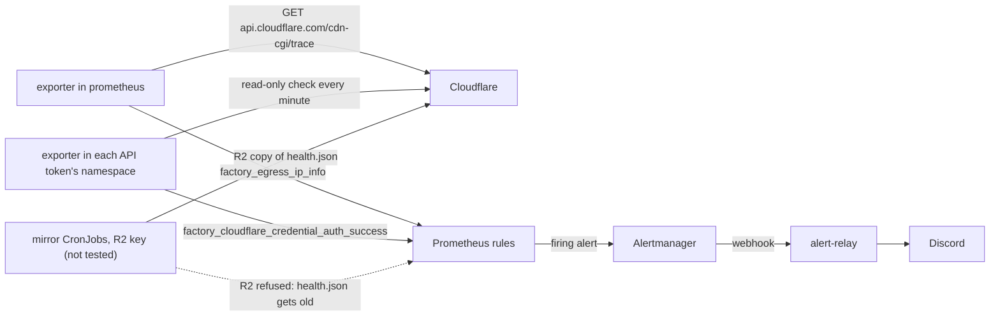

# Factory home cluster

For the request path, storage layout and planned changes, see the [cluster architecture](ARCHITECTURE.md).

## Operator inputs

Before bootstrap, provide the following inputs.

1. **1Password Connect server** `factory` with read access to the `k8s-homelab`
   vault. Its credentials file and an access token are the inputs to
   `bootstrap-gitops.sh`. They are credentials for the secret broker itself, so
   they cannot come from the broker.
2. **1Password item** `k8s-homelab/factory-cloudflare-api-token`, with a field
   `CLOUDFLARE_API_TOKEN` holding a Cloudflare API token that has:
   Account: Cloudflare Tunnel:Edit; Zone `jomcgi.dev`: DNS:Edit and Zone:Read.
3. **DHCP reservations** for node-1 (192.168.4.80), node-2 (192.168.4.81) and node-3 (192.168.4.76).

## GKE hub migration

[HOME-128](https://factory-plan.jomcgi.dev/factory/issue/HOME-128) inventories
all six Applications in the [hub application list](../gke-apps/kustomization.yaml).
The rows put the lower-risk cutovers first and list the data, credentials,
routes and factory prerequisites for each workload. Use the listed issues
for work already tracked. File the remaining embedding, agent tool and MCP
gateway migrations from their rows before scheduling those cutovers.

| Hub Application | State | Credentials and routes | Destination and prerequisites |
| --- | --- | --- | --- |
| [scotland-connector](../gke-apps/scotland-connector/) | R2 forecast and walk snapshots in `stars`. The connector stores no local state. | `r2-s3-public-read`. The old `jomcgi.dev/scotland` MCP and API paths redirect to `scotland-mcp.jomcgi.dev`. | **Moved.** Keep the factory connector and redirects. The hub Deployment is set to zero in Git. Switch its remaining data reads with [HOME-521](https://factory-plan.jomcgi.dev/factory/issue/HOME-521) and [HOME-522](https://factory-plan.jomcgi.dev/factory/issue/HOME-522). |
| [monolith-public](../gke-apps/monolith-public/) | Shared `monolith-pg` and its GCS backups. Public datasets and private Grimoire objects in R2. | Read-scoped Postgres login, R2 credentials and Turnstile. Serves legacy `jomcgi.dev` paths and signed illustration routes. | **Drop after replacement.** Move public pages and data to the static Worker and R2, and gated Grimoire routes to the factory. Verify the legacy redirects and catch-all in [HOME-261](https://factory-plan.jomcgi.dev/factory/issue/HOME-261). |
| [inference](../gke-apps/inference/) | No database or PVC. The model comes from a GHCR image volume. | `ghcr-read-permissions`. Cluster-only embedding Service. | **Move for remaining consumers.** Place and size the embedding workload on factory nodes, then check each remaining consumer with the same model. The hub chart selects the EmberVM Spot pool. Keep that pool available while any hub consumer still needs the Service. |
| [monolith](../gke-apps/monolith/) | Shared `monolith-pg` PVCs, GCS backups and app R2 buckets. Includes Grimoire and Trips rows with separate private objects. | Application Postgres and object credentials, Authentik, and app-specific integrations. Serves `private.jomcgi.dev` and gated friends paths. | **Move by app.** Rehearse private data restores, test authenticated paths under factory edge policy, and transfer each writer and schedule once. Keep the shared database and objects for rollback. See [Grimoire](https://factory-plan.jomcgi.dev/factory/issue/HOME-398) and [Trips](https://factory-plan.jomcgi.dev/factory/issue/HOME-554). |
| [monolith-agents](../gke-apps/monolith-agents/) | Shared `monolith-pg` and knowledge data. No separate database to copy. | Scoped Postgres and Authentik bearer credentials. No public hostname. | **Move remaining tool consumers.** Verify which tools have factory replacements and that they preserve each caller's permissions. Move those callers before stopping the hub profile. |
| [context-forge-gateway](../gke-apps/context-forge-gateway/) | Separate `context-forge-pg` PVCs and GCS backups. Stores registrations and tool access mappings. | `context-forge` and `preview-oidc` 1Password items. `mcp.jomcgi.dev` and the gated friends preview route. | **Move after MCP backends.** Restore the gateway database and check registrations, team mapping, OAuth callbacks and tool visibility against the factory backends before moving the hostnames. |

The factory has a Kargo controller. Before each remaining cutover, configure
its Warehouse, Stage and verification under [HOME-116](https://factory-plan.jomcgi.dev/factory/issue/HOME-116).
Promote the factory revision through that pipeline, then verify Argo CD
sync and health and run the data and route checks in the workload's issue.
Record the prior hub revision and replica count before changing traffic or
suspending writers so the previous deployment can be restored.

After the cutovers, [HOME-262](https://factory-plan.jomcgi.dev/factory/issue/HOME-262)
tracks the scale-down. Suspend recurring jobs and verify zero workload pods
before scaling the node pools to zero. Verify that each persistent volume
has a retain policy or a recent snapshot, and record the costs of the
retained resources there.

## Bootstrap and rebuild

The scripts run from node-1, with SSH and passwordless sudo on the nodes.
They are idempotent. The host firewall admits only the node IPs and the
tailnet, so reach node-1 over Tailscale and run them there; another LAN
machine cannot reach the nodes.

```bash
# 1. Wipe a node's previous install (destructive; confirm with its hostname).
ssh node-2 'sudo bash -s -- --yes node-2' < projects/factory-cluster/nodes/reset-node.sh

# 2. Install or upgrade k3s and gVisor on all nodes; writes ~/.kube/factory.yaml.
projects/factory-cluster/nodes/bootstrap-nodes.sh

# 3. Hand the cluster to ArgoCD (once).
OP_CREDENTIALS_FILE=~/factory-1password-credentials.json \
OP_CONNECT_TOKEN=... \
  projects/factory-cluster/bootstrap-gitops.sh

# 4. Generate Agent Substrate's CAs, JWT keys and snapshot-store key (once).
projects/factory-cluster/bootstrap-substrate.sh
```

Nodes register after step 2 but stay NotReady: there is no CNI yet. Step 3
installs Cilium first, then creates the two 1Password bootstrap Secrets,
installs Connect and ArgoCD from this repository's charts, and applies
`factory-root-application.yaml`. From then on, merged changes under
`projects/platform-factory/` deploy automatically, and ArgoCD adopts the
Cilium, Connect and ArgoCD installs.

For the HOME-463 rollout, wait for the collector DaemonSet with the audit
pipeline to roll out. On each node, allocating the 8 GiB image alongside
the original `/var/lib/ate` tree must leave more than 10% of nodefs free.
The tree must fit in the formatted image in both bytes and inodes. The
bootstrap checks capacity before stopping k3s. Run step 2 from node-1,
check that each server rejoins healthy before continuing, then verify audit
events from each server in Honeycomb.

To upgrade k3s or gVisor, change the pins in `nodes/install-node.sh` and rerun
step 2. It restarts one node at a time.

To turn off zram swap and pod swap, remove them from `nodes/` first. Then, on
each node, delete the files that `install-node.sh` installed, because a rerun
does not remove them, and release the device:

```bash
ssh node-2 'sudo rm -f /etc/systemd/zram-generator.conf \
  /var/lib/rancher/k3s/agent/etc/kubelet.conf.d/50-swap.conf \
  /etc/systemd/system/k3s.service.d/10-gogc.conf &&
  sudo systemctl daemon-reload && sudo swapoff /dev/zram0'
```

Rerun step 2 to restart k3s without them. Without the generator configuration,
no zram swap starts at the next boot.

To change only the host firewall, copy `nodes/factory-firewall.nft` to
`/etc/factory/firewall.nft` on each node and run
`sudo systemctl reload factory-firewall`; k3s keeps running. A reload swaps
the rules in one nft transaction, so a file that fails to parse leaves the
running rules in place. Do not use `restart`: it deletes the table first. Rerunning step 2
also applies it, but restarts k3s on each server, one at a time. To turn the
firewall off on a node, run
`ssh node-2 'sudo systemctl disable --now factory-firewall'`. Stopping the unit
deletes only its own table. Add a node IP to the `nodes` set in
`nodes/factory-firewall.nft` before the node joins.

A lost cluster is rebuilt with steps 2 to 4. That recreates everything in
Git and new Substrate keys, but not Substrate's state: its PostgreSQL (actors,
templates, atespaces) and its actor snapshots have no backup yet, so they are
lost with the cluster or with the node holding their volume. The Substrate
CRDs, namespaces and snapshot volume are marked `Delete=false`, so deleting
or renaming the ArgoCD Application does not remove them.

Kubernetes Secrets are encrypted at rest (`secrets-encryption: true` in
`nodes/k3s-config.yaml`). etcd snapshots are encrypted with the cluster token
on each server (`/var/lib/rancher/k3s/server/token`); keeping a copy off the nodes is part of
the [backup plan](ARCHITECTURE.md#direction).

## Retire a lost factory node

Before fencing, open an authorized SSH session on a surviving factory k3s
server (for example, node-2 when retiring node-1). The bootstrap kubeconfig
points to node-1. Use the surviving server's local API and credentials for
the entire procedure. In that shell run:

```bash
factory_kubectl() { sudo k3s kubectl --kubeconfig /etc/rancher/k3s/k3s.yaml --server=https://127.0.0.1:6443 "$@"; }
factory_kubectl get --raw=/readyz
factory_kubectl get nodes -o wide
```

Proceed only if readiness returns `ok` and the Node names and addresses match
the factory inventory. Keep this shell open for the commands below.

1. Match the factory Node to the physical host using inventory. Disconnect its
   power and keep it disconnected, or verify power-off through independent
   management and prevent restart. Record the host identifier, fencing method,
   verification time and operator in the incident.
2. Before removing the Node, capture its name and UID, the affected pod names,
   namespaces and UIDs, and the recovery hold for each affected issue. Set
   `NODE` and `ISSUE` to the identified Node name and issue key.

   ```bash
   factory_kubectl get node "$NODE" -o custom-columns=NAME:.metadata.name,UID:.metadata.uid
   factory_kubectl get pods -A --field-selector "spec.nodeName=$NODE" -o custom-columns=NS:.metadata.namespace,NAME:.metadata.name,UID:.metadata.uid
   factory_kubectl -n factory exec deploy/factory-connector -- connector recovery inspect "$ISSUE"
   ```

   Match the hold's session and historical attempts to the workers. Record how
   every possible execution copy, including copies under historical principals,
   was fenced and how retired or in-flight dispatchers were quiesced.
   **Stop before Node deletion or recovery confirmation if any fence is unproven.**
   A `NotReady` Node, missing pod or `READY` session can coexist with a running worker.
3. Verify the Node still has the recorded UID, then remove the fenced Node with
   `factory_kubectl delete node "$NODE"`. Keep the host and old dispatchers fenced.
4. Inspect again. For each affected `pending` hold, verify its snapshot still
   matches the evidence and wait until `NotBefore`. Set `HOLD_ID` and `HASH` from
   its exact `ID` and `Fingerprint`, and `EVIDENCE` to the incident reference.
   Choose `ACTION=retry` for replacement or `ACTION=cancel` to close the target
   without replacement.

   ```bash
   factory_kubectl -n factory exec deploy/factory-connector -- \
     connector recovery confirm-fenced "$HOLD_ID" --fingerprint "$HASH" \
     --action "$ACTION" --by "$USER" --evidence "$EVIDENCE" --confirm-all-copies-fenced
   ```

   Inspect again to verify the connector revalidated the `attested` hold and
   marked it `consumed`. If the fingerprint changes, reconcile the new snapshot
   with the fencing evidence before confirming. Keep old copies fenced after consumption.

## Network policy

Ordering matters inside an Application. A pod that starts before its policy
exists is dropped until the policy lands; for a Job that can mean failing
outright. Envoy Gateway's certgen Job is a Helm pre-install hook, which ArgoCD
runs before any ordinary resource, so its policy is a PreSync hook as well.
Authentik's policies carry an earlier sync wave than its secret Job.

A backend behind the edge Gateway needs an egress rule on the Envoy proxy
(`projects/platform-factory/edge/chart/templates/network-policy.yaml`) and an
ingress rule from the proxy in its own namespace.

To see what a policy drops:

```bash
KUBECONFIG=~/.kube/factory.yaml kubectl -n kube-system exec ds/cilium -c cilium-agent -- \
  hubble observe --verdict DROPPED -f
```

That shows one node; run it against each agent pod for the whole cluster.

## Dependency updates

Follow [Renovate operations](../platform/renovate/README.md) for the current
credential, the manual run and the required checks.

## factory.jomcgi.dev

Keep the edge OIDC Secret populated throughout a rollout and retain the permanent sentinel route while changing application routes.

To publish another hostname, change these together in one PR: the hostname
list in `projects/platform-factory/edge-tunnel/resources/route.yaml`, the
`factory-edge` provider's `redirect_uris` in
`projects/platform/authentik/factory-blueprints/factory-auth.yaml`, the app's
HTTPRoute on `edge/edge` and its namespace in `routeNamespaces`, its hostname
ownership rule in `edge-admission`, and the proxy egress and backend ingress policies. A route
that needs the access token uses the shared OIDC template in a policy in
`edge`, with a ReferenceGrant in the backend namespace. Token forwarding
stays off the gateway-wide policy.

To take the edge down, delete the `edge-tunnel` Application first, so
nothing is published while the rest goes, then `authentik`,
`cloudnative-pg` and `edge`, and `edge-admission` last. If Envoy Gateway's
controller goes before its Gateway, the `edge` GatewayClass keeps its
finalizer; clear it by name. The admission policies and bindings, and
`authentik/authentik-secrets` (which holds `AUTHENTIK_SECRET_KEY`), carry
`Delete=false`, so deleting their Applications leaves them; delete them by
name once the edge is gone and the key is no longer wanted. The namespaces
and CRDs stay behind.

### Authentik first run

Authentik starts with no admin password, and the internet cannot reach the
setup flow. Set it up through a port-forward:

```bash
KUBECONFIG=~/.kube/factory.yaml kubectl -n authentik port-forward svc/authentik-server 9000:80
# open http://localhost:9000/if/flow/initial-setup/ and set akadmin's email and password
```

Then sign in at https://factory.jomcgi.dev. The first sign-in enrols a
second factor; choose TOTP. A WebAuthn key enrolled over the port-forward is
bound to `localhost` and fails on factory-auth.jomcgi.dev. The admin and user
interfaces are reachable only through the port-forward.

### T3 browser access

Node bootstrap installs the socket units on node-1. After verifying that the
admission guard is live, run
`sudo bash projects/factory-cluster/nodes/install-t3-socket.sh --activate`
on node-1. The installer creates an empty `t3-relay` group at GID 65532 for
the relay and starts the socket without restarting k3s.

Publish the hostname in the tunnel only after the relay Deployment is
available, the socket accepts connections, and the production admission guard
denies a non-relay socket mount.

The relay mounts only the dedicated socket directory and has no network egress.
T3 listens on `127.0.0.1:3773`. Tailscale Serve uses that listener for mobile.

Before use, check that unauthenticated requests to the UI, API and WebSocket
start sign-in, and that an authenticated `factory-operators` account without
`authentik Admins` receives 403. Confirm that an admin can pair and reconnect
from the browser, and that mobile pairing still works. To withdraw the
cluster relay, use `sudo systemctl disable --now t3-cluster.socket` and
`sudo systemctl stop t3-cluster.service`. Revert the Git change to withdraw
the route and DNS.

### kubectl through Authentik

| Authentik group | Access |
| --- | --- |
| `authentik Admins` | `cluster-admin` |
| `factory-kube-viewers` | Reads workloads, events and pod logs in the namespaces that `kube-access/resources/viewers.yaml` lists. No Secrets, ConfigMaps, exec, port-forward or writes. Lists namespaces and nodes |

To give a person read-only access, add their account to
`factory-kube-viewers` in the Authentik admin interface (through the
port-forward in "Authentik first run"). Do not list members in the
repository, because it is public. To remove access, remove them from the
group. Their current token stops working at the edge and the API server
within ten minutes, when kubelogin refreshes it.

Each person's kubeconfig:

```yaml
apiVersion: v1
kind: Config
clusters:
  - name: factory
    cluster:
      server: https://factory-kube.jomcgi.dev
users:
  - name: factory-authentik
    user:
      exec:
        apiVersion: client.authentication.k8s.io/v1
        command: kubectl
        args:
          - oidc-login
          - get-token
          - --oidc-issuer-url=https://factory-auth.jomcgi.dev/application/o/factory-kubectl/
          - --oidc-client-id=factory-kubectl
          - --oidc-extra-scope=email
          - --oidc-extra-scope=profile
          - --oidc-extra-scope=offline_access
        # Required by the v1 exec API. kubelogin signs in through the
        # browser, so it needs no terminal input.
        interactiveMode: Never
contexts:
  - name: factory
    context:
      cluster: factory
      user: factory-authentik
current-context: factory
```

Install kubelogin first (`kubectl krew install oidc-login`, or
`brew install kubelogin`). The first command opens a browser at
factory-auth.jomcgi.dev. Cloudflare's certificate is publicly trusted, so the
kubeconfig carries no CA.

The API server reads `nodes/authentication-config.yaml` from
`/etc/rancher/k3s/authentication-config.yaml`, and reloads it while it runs.
Adding or removing its `kube-apiserver-arg` in `nodes/k3s-config.yaml` needs
a k3s restart: rerun step 2 of "Bootstrap and rebuild". The API server
fetches Authentik's keys from factory-auth.jomcgi.dev, through Cloudflare. A
watch or `logs -f` with no traffic for about 100 seconds ends at Cloudflare;
run it again.

### kubectl from node-1

Node-1 operator sessions use the local k3s API. The node-1 helper asks k3s
for a ten-minute token for `kube-system/factory-node1-sessions`, then returns
the token and its expiry to kubectl. The account reuses the two
`factory-sessions` roles. Its grants cover cluster reads, the tracker
relay and the named tracker Secret. The helper uses the root-only k3s
kubeconfig with a fixed TokenRequest and takes no arguments. The operator's
existing passwordless sudo access runs the helper.
[Joe's decision](https://factory-plan.jomcgi.dev/factory/issue/HOME-710#comment-9315)

After the `kube-access` Application reconciles, install the helper and config
from the reviewed revision. Run this on node-1 from the repository root:

```sh
sudo install -o root -g root -m 0755 projects/factory-cluster/nodes/factory-session-token.py /usr/local/sbin/factory-session-token
sudo install -D -o root -g root -m 0644 /var/lib/rancher/k3s/server/tls/server-ca.crt /etc/factory/k3s-server-ca.crt
sudo install -D -o root -g root -m 0644 projects/factory-cluster/nodes/factory-session-kubeconfig.yaml /etc/factory/kube-session.yaml
KUBECONFIG=/etc/factory/kube-session.yaml kubectl auth whoami
KUBECONFIG=/etc/factory/kube-session.yaml bash projects/platform-factory/kube-access/check-session-access.sh
```

Check that the username is
`system:serviceaccount:kube-system:factory-node1-sessions` and the access
check passes. Open the named tracker relay and check the tracker sign-in
using the [tracker procedure](../../docs/agents/reference.md#api-access).
Use `/etc/factory/kube-session.yaml` for that check too. Then back up any
previous `~/.kube/factory-sessions.yaml` outside the repo and link that path
to `/etc/factory/kube-session.yaml`. Refresh the CA copy
after a k3s server CA rotation.

To revert, prepare a sessions kubeconfig from the
[interactive Authentik setup](#kubectl-through-authentik). Set kubelogin's
`--token-cache-dir` to a new absolute path under the operator's home
directory. Use that cache only for the sessions identity. Sign in with the
dedicated non-admin account. Run `kubectl auth whoami` with the prepared
config and confirm the account is in `authentik:factory-kube-sessions`.
Run `check-session-access.sh` with the same config. Replace
`~/.kube/factory-sessions.yaml` only after both checks pass.

Remove the local helper and config. Use GitOps to remove the service
account and its entries from the session role bindings.

### Break-glass

When Authentik or the edge is down, kubectl through factory-kube.jomcgi.dev
stops working. The client certificate in `~/.kube/factory.yaml` on node-1
does not depend on either. SSH to node-1 over Tailscale and use it there;
the host firewall refuses the apiserver to other LAN machines.

ArgoCD's local `admin` account is disabled. With the cluster kubeconfig,
use kubectl directly, or the ArgoCD CLI without its API server:

```bash
KUBECONFIG=~/.kube/factory.yaml kubectl config set-context --current --namespace argocd
KUBECONFIG=~/.kube/factory.yaml argocd app list --core
```

## Object storage

Check Garage membership and provisioning.

```bash
KUBECONFIG=~/.kube/factory.yaml kubectl -n garage exec garage-0 -- /garage -c /etc/garage/garage.toml status
KUBECONFIG=~/.kube/factory.yaml kubectl -n garage logs job/garage-bootstrap
```

If the log reports a key that exists in Garage with a different secret,
garage-init leaves both sides as they are. Delete the Garage key
(`garage key delete`), then run provisioning again so that Garage imports
the Kubernetes Secret's credentials. To get a new key instead, empty the
Secret's data.

garage-init never changes an existing layout. If a Garage pod loses its
metadata volume, it comes back with a new node ID, and garage-init logs
`WARNING: nodes without a role`. Replace the node from a Garage pod to get
three-way replication back: `garage layout assign` the new node ID with the
old node's zone and capacity, `garage layout remove` the old ID, then
`garage layout apply` the next version.

## Postgres

If `kagent-postgres-owner` or `kagent-postgres-readwrite` in the `kagent`
namespace is recreated, it stays empty until you sync the `kagent-postgres`
Application in ArgoCD: its PostSync Job `kagent-pg-setup` writes both
connection strings again. After either connection string changes, use ArgoCD
to restart the kagent controller Deployment. The controller reads both
Secrets at startup. Admission policy denies a direct `kubectl rollout restart`.

A CloudNativePG instance that starts before its Garage key exists caches
the missing credentials and archives nothing until it restarts, so
`kagent-pg-wait-for-key` (wave -1) holds the Cluster back until garage-init
has filled `kagent-pg-s3`, at most one 10-minute run on a fresh install.
If it gives up after 30 minutes (garage-init failing, say), the sync fails
and ArgoCD does not retry the same revision; once
`kubectl -n garage logs job/garage-bootstrap` shows the key, sync again:

```bash
KUBECONFIG=~/.kube/factory.yaml kubectl -n argocd patch app kagent-postgres --type merge \
  -p '{"operation":{"initiatedBy":{"username":"operator"},"sync":{"syncOptions":["CreateNamespace=true","ServerSideApply=true","RespectIgnoreDifferences=true"]}}}'
```

Each incarnation of the Cluster archives under its own `serverName`
(`kagent-pg-v1`) in the bucket. A Cluster created with `initdb` refuses to
archive into a prefix that already holds WALs ("expected empty archive"),
so if the Cluster is deleted and recreated while Garage survives, either
restore it from the old prefix (`bootstrap.recovery` with an
`externalClusters` entry pointing at `kagent-pg-v1`) or, to start empty,
bump `serverName` to the next version in `resources/cluster.yaml`. The old
prefix ages out only by hand.

Retry the Authentik sync if `authentik-pg-wait-for-key` exceeds its 30-minute deadline. Check that garage-init filled all three fields in `authentik/authentik-pg-s3`.

After rollout, confirm three healthy instances, `ContinuousArchiving=True`
and a completed base backup in Garage. Recovery also needs the existing
`authentik-secrets`, including `AUTHENTIK_SECRET_KEY` and the OIDC client
secrets. Their 1Password copies and an isolated restore drill remain on
[#7952](https://github.com/jomcgi-org/homelab/issues/7952). The same archive
incarnation rule and migration to the barman-cloud plugin before CNPG 1.31
apply to Authentik and `factory-db`.

### factory-db

Run `python3 -m pytest -q projects/platform-factory/factory-db/provisioning_test.py`
to check provisioning. The test runs the initializer against the declared Secret
placeholders and RBAC grants, checking that adding the reviewer preserves existing
passwords and connection strings. It also covers reruns, delayed Secret creation,
database ownership and ingress scope. PR CI runs the same test through
`//projects/platform-factory/factory-db:provisioning_test`. Live ArgoCD health and
Secret key presence are checked after deployment.

## Agent Substrate

To upgrade Substrate, rerun `projects/platform-factory/substrate/render-upstream.sh` and review the rendered diff. Verify the installation:

```bash
export KUBECONFIG=~/.kube/factory.yaml
kubectl -n ate-system get pods          # all Running and Ready
kubectl get sandboxconfig gvisor-default # DEFAULT v7
kubectl get clustertrustbundles | grep -e podcert.ate.dev -e egress-mitm
# kubectl-ate from the same release, then a throwaway actor:
kubectl ate create atespace substrate-smoke
kubectl create namespace substrate-smoke
kubectl label namespace substrate-smoke factory.jomcgi.dev/substrate-workers=true
kubectl apply -f <WorkerPool in namespace substrate-smoke, workerImage ghcr.io/kagent-dev/substrate/ateworker-gvisor:v1.0.1@sha256:...>
kubectl ate --preview create actor-template -f <template>   # wait for GOLDEN TAG
kubectl ate create actor smoke-1 -a substrate-smoke --template smoke
kubectl ate proxy actor smoke-1 -a substrate-smoke # then send it a request
```

To check credential injection, give the actor an egress policy
(`kubectl ate create egress-policy`) with an `http` rule for an in-cluster
echo server. Its `replaceHeaders` effect should name an
`ate-secret://k8s.io/default/<namespace>/<secret>/<key>` that the actor's
atespace is granted in `values/substrate.yaml`: a Secret labelled
`substrate.ate.dev/injectable=true` in a namespace where the provider has a
RoleBinding. The gateway's own policy doesn't allow the echo server, so the
check also needs two temporary CiliumNetworkPolicies, deleted afterwards. One
in `ate-system` allows `app: atenet-egress` egress to the echo pod's port, and
one in the echo server's namespace allows ingress from it. The echo server
should receive the Secret's value, and the actor should hold only its
placeholder.

Check Hubble for drops while it runs (see Network policy). Then delete the
actor, the template, the atespace, the WorkerPool and the namespace.

## Observability

Useful starting points in the `metrics` dataset, all filtered on
`k8s.cluster.name = factory`:

- Node headroom: `MAX(k8s.node.memory.working_set)`, `MAX(k8s.node.cpu.usage)`
  and `MAX(system.memory.usage)` grouped by `k8s.node.name`.
- Busiest pods: `MAX(k8s.pod.memory.working_set)` grouped by
  `k8s.namespace.name` and `k8s.pod.name`.
- Policy drops: `SUM(hubble_drop_total)` grouped by `reason`,
  `source_namespace` and `traffic_direction`.
- Scrape health: `MIN(up)` grouped by `service.name` and
  `service.instance.id`; a target at 0 is unreachable.
- etcd: `MIN(kubernetes_healthcheck)` grouped by `name` and
  `service.instance.id` (etcd and etcd-readiness, per API server), and
  `MAX(apiserver_storage_size_bytes)`.

For logs, run an environment-wide query filtered on
`k8s.cluster.name = factory` and group by `service.name` and
`k8s.namespace.name`. etcd's own metrics listen on 127.0.0.1:2381 on each node,
out of a pod's reach, so etcd health comes from the API servers' readiness
checks instead.

## Metrics view

`resources/prometheus.yml` names every target, and a new one needs three
changes: a job there, an egress rule in `resources/network-policy.yaml`, and
an ingress rule at the target in `resources/scrape-ingress.yaml`. Those
ingress rules are CiliumClusterwideNetworkPolicies so they sync whether or
not the target's namespace exists yet, and leave with Prometheus. A target in
the prometheus namespace, such as kube-state-metrics or health-exporter, has
its ingress rule in `resources/network-policy.yaml`.

Edit a dashboard by changing its JSON; Grafana rejects saves from the UI. Each
ConfigMap's name carries its content hash, so a change rolls the pod.

After the OIDC client secret in `grafana/grafana-oidc` changes, restart the
Grafana Deployment to load the new value. Grafana reads it at startup.

The break-glass admin's password is generated at each start into memory:

```bash
KUBECONFIG=~/.kube/factory.yaml kubectl -n grafana exec deploy/grafana -c grafana -- \
  cat /run/grafana/admin-password
KUBECONFIG=~/.kube/factory.yaml kubectl -n grafana port-forward svc/grafana 3000:3000
# open http://localhost:3000/login?disableAutoLogin=true and sign in as admin
KUBECONFIG=~/.kube/factory.yaml kubectl -n prometheus port-forward svc/prometheus 9090:9090
```

### Alerts

The Runbook link opens a read-only page at `factory-runbooks.jomcgi.dev`.
Without a session, Envoy redirects the browser to Authentik before serving
the page. After sign-in, Envoy checks the verified token’s `groups` claim.
Only members of `authentik Admins` can read a runbook. An authenticated
user outside that group receives HTTP 403. The runbook HTTPRoute attaches
to the edge Gateway and inherits its default-deny SecurityPolicy. See the
[runbook route](../platform-factory/grafana/resources/runbooks-route.yaml),
[gateway policy](../platform-factory/edge/chart/templates/security-policy.yaml)
and [group authorization rule](../platform-factory/edge/chart/templates/_oidc.tpl).

Prometheus evaluates `resources/rules.yml` and sends firing alerts to one
Alertmanager (`resources/alertmanager.yaml`), which forwards them to alert-relay. The relay queries Prometheus for a graph
and posts it to the homelab Discord channel. Select a firing alert’s title
to inspect the same query in Grafana Explore. AlertRelayDown goes directly
from Alertmanager to Discord. The path uses nothing in the hub, so an
alert arrives while the hub is down. Alertmanager keeps silences in an
emptyDir: a restart forgets them.

The webhook URL comes from 1Password item `factory-alerts-discord` in vault
`k8s-homelab`, field `webhook-url`. To create it, in the Discord channel open
Edit Channel, Integrations, Webhooks, New Webhook, and copy the URL. If the
item is missing, Alertmanager starts but logs a failed send for each alert.
Main publishes the relay image, packages its digest in the alert-relay OCI chart,
and writes the published chart version to the Prometheus Argo CD Application. Argo CD renders both its chart and
Git sources, waits for the relay Deployment to become healthy in wave 0, then
applies the Alertmanager receiver change in wave 1. After rollout,
check the ready pod in the factory namespace. Compare its image ID with the
manifest digest in the published chart's image reference.

```bash
export KUBECONFIG=~/.kube/factory.yaml
kubectl -n prometheus rollout status deployment/alert-relay
kubectl -n prometheus get pod -l app.kubernetes.io/name=alert-relay \
  -o custom-columns='POD:.metadata.name,IMAGE:.spec.containers[0].image,IMAGE_ID:.status.containerStatuses[0].imageID,READY:.status.containerStatuses[0].ready'
```

To test the path:

```bash
KUBECONFIG=~/.kube/factory.yaml kubectl -n prometheus port-forward svc/alertmanager 9093:9093 &
curl -s -X POST -H 'Content-Type: application/json' http://localhost:9093/api/v2/alerts \
  -d '[{"labels":{"alertname":"AlertPathTest"},"annotations":{"summary":"Test relay availability (minimum 1 replica)","graph":"up{job=\"prometheus\"}","threshold":"1","action":"Verify the attached graph.","runbook":"https://github.com/jomcgi-org/homelab/blob/main/projects/factory-cluster/README.md#alertrelaydown"}}]'
```

| Alert | Fires when |
| --- | --- |
| `NodeDiskFilling` | A node's root filesystem is more than 75% full for 15 min. Image garbage collection starts at 85% and the kubelet evicts pods at 90% |
| `KagentSuspendTimedOut` | A `SuspendActor` call passed the controller's 120-second deadline. Each scrape (30 s) that shows more timeouts sends one message with the count, so two timeouts in one scrape give one message. The alert ends an hour later and sends nothing then |
| `FactoryItsaplanOutage` | A connector dispatch phase has been failing on itsaplan for 10 min. Check the named phase in connector logs and sample the coordinator key counter using the [HOME-385 procedure](../factory/deploy/notify.md#home-385-rollout-verification). |
| `FactoryCodexQuotaLow` | A Codex grant has used 90% or more of a quota window for 5 min |
| `FactoryCodexQuotaExhausted` | A Codex grant is out of quota for 5 min. Coder and review turns fail until a person resets the plan or changes the account. The message gives, for each window the grant has used up, its reset time or that it has none; when no window reads 100%, every window's reset |
| `FactoryCodexGrantNotReady` | A Codex grant is in a state other than `ready` (`login_required`, `refresh_blocked`, `error` or `missing`) for 10 min, also across a move between those states. The message names the current state |
| `FactoryCodexQuotaReadingStale` | The broker's newest Codex quota reading is more than 2 h old, or there is no reading at all, for 15 min, so the quota alerts could not fire |
| `SemgrepSyncFailed` | The newest Semgrep to INTSEC sync Job in its namespace has failed |
| `AlertRelayDown` | No ready relay replica for 5 min |
| `FactoryHealthUnhealthy` | The public `health.json` reports a `status` other than `healthy` for 5 min. The message names each down component |
| `FactoryHealthStale` | The newest `health.json` that Prometheus read has a `generatedAt` more than 10 min old, or Prometheus read none in 15 min, for 2 min |
| `FactoryEgressIPChanged` | The egress IP that Cloudflare sees differs from an address of the last hour. It fires at the first scrape of the new address, names both addresses and clears 1 h later |
| `CloudflareCredentialRefused` | Cloudflare refuses a factory API token with HTTP 401 or 403 for 5 min. The message names the token and the current egress IP. The R2 keys are not tested |

#### Writing an alert

Write a `summary` that gives the observed value and the threshold, with units.
Give the responder one concrete next step in `action` and link the relevant
procedure in `runbook`. Set `graph` to a PromQL query that shows the cause
for the affected resource, and set `threshold` to the numeric boundary in
the graph’s units. Choose a `for` duration long enough that a brief blip
does not page anyone. Use `critical` only when a person must act now.

#### SemgrepSyncFailed

With the factory kubeconfig, run `kubectl -n <namespace> logs job/<job_name>`
using the namespace and Job name in the alert summary. The alert clears when a
newer sync Job starts unless that Job also fails.

#### AlertRelayDown

Inspect the alert-relay Deployment and pod events in the prometheus namespace.
Restore one ready replica and post the test alert above to verify delivery.

#### FactoryCodexQuotaLow, FactoryCodexQuotaExhausted

Read the grant's usage
on the broker's metrics: `factory_broker_grant_quota_used_percent` and
`factory_broker_quota_resets_at_seconds` (Prometheus, port-forward
`svc/prometheus` 9090). A person resets the plan or logs the broker in to
another account (`projects/factory/broker`, device login). Coder turns that
hung on HTTP 429 may need `connector cancel` afterwards.

#### FactoryCodexGrantNotReady

Log the broker in again with its device login
(`projects/factory/broker`). `refresh_blocked` means a refresh token was
reused; see the broker's logs first.

#### FactoryCodexQuotaReadingStale

Check the broker's usage reads
(`factory_broker_codex_usage_refresh_total` by outcome) and its logs.

#### FactoryHealthUnhealthy, FactoryHealthStale

These two alerts replace the hub's Honeycomb trigger
`jomcgi.dev /health composite unhealthy` (`aJgkA4vC2m8`) on
`https://jomcgi.dev/health`. HOME-261 removes that trigger and the hub route
with the catch-all.

```mermaid
flowchart LR
  job["health CronJob"] -- "PUT every 2 min" --> garage[("Garage factory-health")]
  garage -- "mirror copies every minute" --> r2[("R2 factory-public")]
  r2 -- "GET factory-data.jomcgi.dev, 60 s cache" --> exporter["health-exporter"]
  exporter -- "scrape every 30 s" --> prom["Prometheus rules"]
  prom -- "firing alert" --> am["Alertmanager"]
  am -- webhook --> relay["alert-relay"]
  relay -- "post with graph" --> discord["Discord"]
```



`health-exporter` in the prometheus namespace reads
`https://factory-data.jomcgi.dev/health.json` on each scrape. It calls no
cluster or Cloudflare API
([Joe's decision](https://factory-plan.jomcgi.dev/factory/issue/HOME-260#comment-3909)).
It exports `factory_health_healthy`, `factory_health_generated_at_seconds`,
`factory_health_component_up` and `factory_health_read_success`. A failed read
sets `factory_health_read_success` to 0 and keeps the other series of the last
valid read, so a short read gap neither clears nor fires the alerts. A valid
read that drops a component drops its series, and the component leaves the
alert summary at that scrape. If Prometheus cannot scrape the exporter
(`up{job="factory-health"}` 0), `FactoryHealthUnhealthy` keeps the last
healthy flag for up to 15 min, and its summary says that the component list is
unknown. The next successful scrape replaces the flag and lists the down
components again.
`FactoryHealthStale` fires by 12 min after the last scrape, because the newest
`generatedAt` is then more than 10 min old for 2 min.

For `FactoryHealthUnhealthy`, read the file and check each down component. If
the summary says that the component list is unknown, the file still lists
them; also check the `health-exporter` pod in `prometheus`.

- `factory-cluster`: the `argocd` Application is not Healthy, or it did not
  reconcile in 15 min.
- `jomcgi-site-worker`: the Cloudflare read failed, or the Worker's latest
  deployment has no ID. Check that Secret `factory-health-cloudflare` exists
  in `factory-public`.
- `alert-test`: the alert check in
  [factory-public](../factory-public/README.md#alert-check) is on.

For `FactoryHealthStale`, compare the public `generatedAt` with the exporter's
reads (`kubectl -n prometheus logs deploy/health-exporter`). If the public
file is old, check the `health` and `factory-public-factory-public-mirror`
CronJobs in `factory-public`. If the mirror Job's log shows the R2 error
`403 AccessDenied`, Cloudflare refuses the R2 mirror key: fix its IP filter
as for `FactoryEgressIPChanged`, or replace the key.

#### FactoryEgressIPChanged, CloudflareCredentialRefused

Every factory Cloudflare API token and R2 key accepts calls only from the
home IPv4 address. At about 01:27Z on 2026-11-20 that address changed. Every
credential then failed, and the public data stayed 6 h old (HOME-634).



`cloudflare-exporter` runs `resources/cloudflare_exporter.py` once in the
prometheus namespace and once in each API token's namespace. The pod in
prometheus reads the egress IP and holds no credential. Each other pod takes
only its token through `secretKeyRef` and reaches only `api.cloudflare.com`.
The pod in `factory-public` comes from that chart. The egress IP stays in
Prometheus and the private Discord alert. The exporter never logs it.

| API token (1Password item in `k8s-homelab`) | Secret and namespace | Read-only check |
| --- | --- | --- |
| `jomcgi-site-cloudflare`, field `api-token` | `jomcgi-site-cloudflare` in `jomcgi-site-prod` (and `jomcgi-site-dev`) | `GET /accounts/<account>/workers/scripts/jomcgi-site/deployments` |
| `factory-health-cloudflare`, field `api-token` | `factory-health-cloudflare` in `factory-public` | The same |
| `factory-cloudflare-api-token`, field `CLOUDFLARE_API_TOKEN` | `cloudflare-api-credentials` in `cfgate-system` | `GET /accounts/<account>/cfd_tunnel?per_page=1` |

A 2xx answer accepts a token and a 401 or 403 refuses it. After a check with
no answer, the exporter keeps the last answer and sets
`factory_cloudflare_credential_check_success` to 0.

Each check uses an endpoint that the token's own workload already calls, so
a refusal means that workload fails too. The jomcgi-site refresh CronJob's
release fence (`projects/jomcgi-site/data/fence.mjs`) reads the same
deployments endpoint with the same `jomcgi-site-cloudflare` Secret on every
run. The health job (`projects/factory-public/chart/files/health.py`) reads it
with `factory-health-cloudflare`. cfgate manages the tunnel with its token.
On 2026-11-20 at 07:43Z, after the IP filter fix, a direct GET of the check
endpoint with the deployed Secret answered HTTP 200 for `jomcgi-site-cloudflare`
and for the cfgate token. The prod refresh Job `jomcgi-site-refresh-manual-0749`
then passed its fence check. The health job's 08:22Z `health.json` showed
`jomcgi-site-worker` up, which needs a 2xx from the same endpoint with
`factory-health-cloudflare`.

The exporter does not test the R2 keys. The R2 mirror key can write and
delete all of bucket `factory-public`, so no pod outside the mirror CronJobs
holds it (`public_test` checks this). A refused R2 key shows through
`FactoryEgressIPChanged` and `FactoryHealthStale`: the mirror stops, so
`health.json` gets old.

| R2 key, not tested (1Password item in `k8s-homelab`) | Secret and namespace |
| --- | --- |
| `factory-r2-public-mirror` | `<mirror>-r2` of each mirror CronJob in `factory-public` |
| `r2-s3-public-read` | `jomcgi-site-r2-read` in `jomcgi-site-prod` and `jomcgi-site-dev` |
| `grimoire-migration-r2` | `grimoire-migration-r2` in `grimoire` |

For `FactoryEgressIPChanged`, allow the new address in each credential:

1. Read the address. The alert summary names it, and node-1 shows it:
   `curl -s https://api.cloudflare.com/cdn-cgi/trace | grep ^ip=`.
2. In the Cloudflare dashboard, edit the Client IP Address Filtering of each
   API token and each R2 key's token in the two tables. Allow the new
   address and remove the old one.
3. An edit keeps the token's value, so 1Password needs no change.
   `CloudflareCredentialRefused` clears at the next accepted check.
   `FactoryHealthStale` clears when the mirror copies a new `health.json`.

No expected address is stored, so there is no value to change. The
repository is public and the address is private. The rule counts the
addresses of the last hour, so it clears 1 h after the change. To end it
sooner, silence it in Alertmanager.

For `CloudflareCredentialRefused`, read the egress IP in the message. If it
is new, or `FactoryEgressIPChanged` fires, fix the IP filter as above.
Otherwise Cloudflare revoked the token, or it lost a permission. Make a
token with the same permissions and IP filter, and put it in the 1Password
item. The 1Password operator updates the Secret and restarts the exporter
(`operator.1password.io/auto-restart`). The exporter's log shows each change
of result with its HTTP status:
`kubectl -n <namespace> logs deploy/cloudflare-exporter`.

#### NodeDiskFilling

Find the largest directories with
`ssh node-N 'sudo du -xh --max-depth=3 / | sort -h | tail -20'`. The usual
users are local-path volumes under `/var/lib/rancher/k3s/storage` (rustfs
snapshots, Garage, the databases), images (`sudo k3s crictl rmi --prune`) and,
on node-1, Claude scratch under `/tmp/claude-1000`. Ask before you delete a
directory that a running session uses.

#### KagentSuspendTimedOut

When a suspend exceeds the controller's two-minute deadline, the Actor can
stay SUSPENDING and hold its worker slot. The session then refuses turns and
delete requests. The reaper checks every 15 seconds and deletes the assigned
worker after five minutes in SUSPENDING. If the same claim persists after
that deadline, inspect the reaper logs and pod assignment. When the reviewed
action is enabled, sign in to the
[KagentSuspendTimedOut runbook](https://factory-runbooks.jomcgi.dev/KagentSuspendTimedOut)
and select **Review locked sessions**. For the session you intend to free,
check its executor, worker namespace, pod name and UID, and creator account,
then select **Confirm revert**. Recovery deletes that worker and reverts the
session as its creator. The service log and Discord report the result.

If the action is unavailable, the node-1 fallback frees every locked session:

```bash
# 1. The locked sessions: the same quiescence claim (session and executor)
#    seen twice, 150 seconds apart. The controller allows 120 seconds for
#    a suspend. The table records no claim time.
claims() { KUBECONFIG=~/.kube/factory.yaml kubectl -n kagent-pg exec kagent-pg-1 -c postgres -- \
  psql -d kagent -At -c "select distinct s.id || ' ' || e.quiescence_executor_id
    from kagent.session s join kagent.session_task_event e using (history_id)
    where e.quiescence_pending and e.quiescence_executor_id is not null" | sort; }
FIRST=$(claims); sleep 150
SESSIONS=$(comm -12 <(echo "$FIRST") <(claims) | cut -d' ' -f1 | sort -u)
KUBECONFIG=~/.kube/factory.yaml kubectl -n kagent port-forward svc/kagent-controller 18083:8083 &
for SESSION in $SESSIONS; do
  # 2. Its worker pod: homelab-codex-* for a coder, homelab-reviewer-* for a reviewer.
  POD=$(KUBECONFIG=~/.kube/factory.yaml kubectl -n ate-system exec postgres-0 -c postgres -- \
    psql -U postgres -d atepg -At -c "select substring(encode(proto, 'escape')
      from 'homelab-[a-z]+-[0-9a-f]{8,10}-[a-z0-9]{5}') from substrate.actors where name = 'session-$SESSION'")
  # The worker namespace and the session's creator, who reverts it.
  case "$POD" in
    homelab-codex-*) NS=factory-r-homelab SA=factory-connector ;;
    homelab-reviewer-*) NS=factory-r-homelab-review SA=factory-reviewer ;;
    *) echo "$SESSION: no worker pod found"; continue ;;
  esac
  # 3. Delete that pod and wait; the Actor crashes within seconds.
  KUBECONFIG=~/.kube/factory.yaml kubectl -n "$NS" delete pod "$POD" --wait=true
  sleep 10
  # 4. Revert the session as its creator. grpc-status 0 means done.
  TOKEN=$(KUBECONFIG=~/.kube/factory.yaml kubectl -n factory create token "$SA" \
    --audience kagent-invocation --duration 10m)
  echo "$SESSION:"
  python3 -c 'import struct,sys; s=sys.argv[1].encode(); m=b"\n"+bytes([len(s)])+s
sys.stdout.buffer.write(b"\0"+struct.pack(">I",len(m))+m)' "$SESSION" |
    curl -sS --http2-prior-knowledge -H 'Content-Type: application/grpc' -H 'TE: trailers' \
      -H "Authorization: Bearer $TOKEN" --data-binary @- -o /dev/null -D - \
      http://127.0.0.1:18083/kagent.api.v1.SessionService/RevertSession | grep -i grpc-status
done
kill %1
```

Run it again until step 1 finds no session. Revert before the connector
sends to the session again. A connector recovery hold left by a send to the
crashed session needs `connector recovery confirm-fenced`.

### Measure recovery after a busy coder pod disappears

For the HOME-320 live drill, use a designated coder run after the reaper and
connector revisions under test have rolled out. In a psql session on
`factory_connector`, set `run_id` to that run and capture its busy attempt.
The following query also pins the pod UID and session for the measurement.

```sql
SELECT a.id AS old_attempt, a.context_id AS old_session, f.uid AS pod_uid,
       f.pod AS pod_name
FROM delivery_attempt a JOIN worker_fence f ON f.attempt_id = a.id
WHERE a.run_id = :'run_id' AND a.state = 'accepted' AND a.tool_running
  AND f.namespace = 'factory-r-homelab' AND f.gone_at IS NULL
  AND f.session_id = a.context_id
\gset
\echo :pod_name :pod_uid :old_attempt :old_session
SELECT clock_timestamp() AS drill_start \gset
```

Delete the recorded coder pod on the factory cluster with its UID as the
delete precondition. Leave recovery to the reaper and connector. In the same
psql session, poll the query below until the replacement appears. Starting
the clock before deletion and stopping it on observation gives an upper bound
on the time to an accepted retry.

```sql
SELECT f.uid, f.gone_at, a.id AS new_attempt, a.context_id AS new_session,
       clock_timestamp() - :'drill_start'::timestamptz AS elapsed,
       EXISTS (SELECT FROM recovery_hold WHERE target_attempt_id = f.attempt_id) AS had_hold
FROM worker_fence f JOIN delivery_attempt old ON old.id = f.attempt_id
JOIN delivery_attempt a ON a.run_id = old.run_id AND a.seq = old.seq + 1
WHERE old.run_id = :'run_id' AND old.error_class = 'abandoned'
  AND f.attempt_id = :'old_attempt' AND f.uid = :'pod_uid' AND f.gone_at IS NOT NULL
  AND a.id > f.attempt_id AND a.context_id <> :'old_session' AND a.task_id IS NOT NULL
ORDER BY a.id LIMIT 1;
```

Record the deployed revision, run ID, old attempt, deletion time and first
result row in the PR. The drill passes with a fresh session, elapsed time at
most five minutes and `had_hold = false`. If the deadline passes with no row,
record that outcome before using the manual recovery procedure.

## itsaplan

itsaplan (`projects/factory/ARCHITECTURE.md`, "itsaplan") serves
factory-plan.jomcgi.dev. Its break-glass admin signs in there with email
and password after the edge's Authentik sign-in, for when itsaplan's own OIDC
client fails; invite people from it before their first OIDC sign-in, since
registration is invite-only. The browser calls the api on the public origin,
so the UI does not work over a port-forward; the api does, for scripts.

```bash
KUBECONFIG=~/.kube/factory.yaml kubectl -n factory get secret factory-itsaplan-admin \
  -o jsonpath='{.data.password}' | base64 -d
```

If those keys are lost while the database has accounts, settings or stored
secrets, `factory-itsaplan-secret-init` fails the sync with `REFUSING to
generate` rather than replace them. It counts the rows read-only with the api
image's psql before it writes anything. Recover in this order:

1. While the api still runs, its pods hold the keys in their environment.
   Copy them back into the Secret and sync again:

   ```bash
   KUBECONFIG=~/.kube/factory.yaml kubectl -n factory exec deploy/factory-itsaplan-api -c api -- \
     printenv BETTER_AUTH_SECRET APP_ENCRYPTION_KEY
   ```

2. Otherwise restore the old values from wherever a copy survives (1Password
   once it holds them, or an etcd snapshot), and sync again.
3. With no copy left, accept the loss and sync again:

   ```bash
   KUBECONFIG=~/.kube/factory.yaml kubectl -n factory annotate secret factory-itsaplan \
     factory.jomcgi.dev/regenerate-itsaplan-keys=true
   ```

   secret-init then deletes every `app_secret` row (the OIDC, Google, mail,
   SCIM and bot settings, all encrypted with the lost key; itsaplan decrypts
   the stored OIDC settings before it accepts new ones, so they cannot simply
   be overwritten), generates new keys, removes the annotation and restarts
   the api and worker, whose running pods would otherwise keep using the old
   keys. The keys' generation ID is stored on the Secret with them and set on
   both pod templates on every run, so a restart interrupted by a failure
   completes when secret-init runs again: its container retries, and
   otherwise the Job reruns at the first chart upgrade. The bootstrap then writes the OIDC settings afresh through the new
   pods. Every session ends, so people sign in again. Anything else encrypted
   with the old key stays unreadable until it is entered again in the app:
   mail, Google, SCIM and bot settings, workspace SCIM tokens, Git
   connections, integration credentials and agent invocation secrets. An
   annotation secret-init finds when no keys are missing is removed unused.

## Codex login

The broker holds the factory's one Codex grant
(`factory/factory-broker-grant-codex-primary`), filled by its own device
login. Operators call its admin port as `factory/factory-operator`, which no
Pod may run as:

```bash
export KUBECONFIG=~/.kube/factory.yaml
kubectl -n factory port-forward deploy/factory-broker 8081:8081 &
sleep 2
TOKEN=$(kubectl -n factory create token factory-operator --audience factory-broker --duration 10m)
# Prints verification_url and user_code: open the URL, sign in to the
# ChatGPT account the factory uses, and enter the code.
curl -s -X POST -H "Authorization: Bearer $TOKEN" localhost:8081/admin/codex/login
# login "granted" and grant_state "present" once approved.
curl -s -H "Authorization: Bearer $TOKEN" localhost:8081/admin/codex/login
# Force a refresh, e.g. to check the grant after an account change.
curl -s -X POST -H "Authorization: Bearer $TOKEN" localhost:8081/admin/codex/refresh
kill %1
```

The broker waits up to 16 minutes for approval, longer than the token lives:
mint a new token if a status call returns 401. The login state is held in
memory, so a broker restart resets it to `none`; a stored grant survives in
its Secret. The ChatGPT account needs device-code sign-in for Codex enabled
in its security settings.

## Connector

The connector ([architecture](../factory/connector/ARCHITECTURE.md)) runs as
`factory/factory-connector` once the deploy values set `connector.enabled`.
Until itsaplan's bootstrap has written the agents' keys, it reports ready and
logs `waiting for itsaplan API keys`. Turning it on also sets
`kagent.config.server.auth.serviceAccount.authority`. Never change that value
afterwards: kagent identifies the connector by it, and a changed principal
loses every session. Delivery (pull requests, review rounds and the merge
queue) starts with `broker.githubApp.enabled`.

Operators stop delivery for an issue, or clear a credential or quota block
after fixing the grant, from the connector's own pod:

```bash
KUBECONFIG=~/.kube/factory.yaml kubectl -n factory exec deploy/factory-connector -- \
  connector cancel HOME-7 --by "$USER"
KUBECONFIG=~/.kube/factory.yaml kubectl -n factory exec deploy/factory-connector -- \
  connector unblock kagent:factory-r-homelab/homelab-codex
```

## Reviewer

Include the binding namespace in kagent RBAC and in Substrate’s credential provider policies. Render and sync a changed Substrate policy before enabling the reviewer. Install App `jomcgi-factory-review` (5758326) on the bound
repository and populate `k8s-homelab/factory-review-gh-app` with `app-id`,
`installation-id` and `private-key`. Its PR comment
(`reviewer.commentAuthor`) needs the App's Issues read and write permission,
accepted on the installation; without it, comment writes fail and the check
is unaffected. The broker alone mounts those keys.
Set `reviewer.bindings.homelab.requiredChecks` to the required CI identities,
currently `[{name: pr-checks, statusCreator: "buildbuddy-io[bot]"}]`.
The default `enqueueAuthors: [jomcgi]` lets the reviewer enqueue Joe's
passing PRs; the connector still enqueues the factory's PRs.
The enable PR needs Joe's approval of its exact head. The connector's
`reviewerCheck` switch and the ruleset requiring `factory review` are
separate changes.

On a PR's current head, open Checks and select `factory review` from the
reviewer App. It starts in progress and completes with findings or success;
a human gate waits for Joe's approval on that head. The reviewer's comment
on the PR's conversation shows the same verdict and findings, updated in
place. Read service logs and
metrics with:

```bash
KUBECONFIG=~/.kube/factory.yaml kubectl -n factory logs deploy/factory-reviewer --tail=100
KUBECONFIG=~/.kube/factory.yaml kubectl -n factory port-forward deploy/factory-reviewer 9090:9090
# In another terminal:
curl -fsS localhost:9090/metrics
```

`factory_reviewer_reviews_in_flight`,
`factory_reviewer_reviews_completed_total`,
`factory_reviewer_human_gates_total` and
`factory_reviewer_enqueues_total` show progress; retries and GitHub/kagent
error counters explain stalled checks. Metrics have no scraper ingress yet.

Disable through a deploy-values PR setting `reviewer.enabled: false`.
ArgoCD removes the service and its network grants; the ServiceAccount and
review namespaces remain kept to preserve identity and state. Existing
checks stay on GitHub, and disabling does not cancel a running kagent task.
If a later ruleset requires the check, new heads stay blocked until review
is restored. Preserve that gate. Never scale the Deployment above one
replica: two instances review every head twice.
