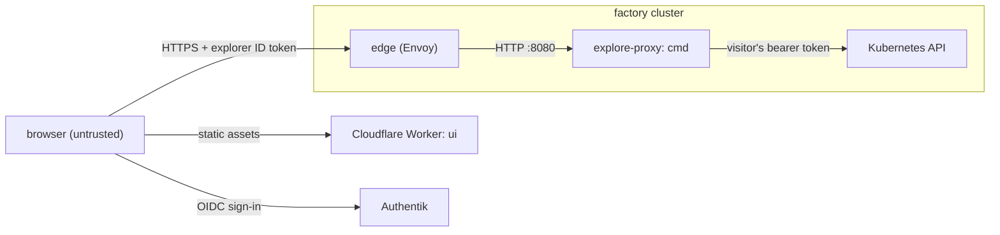

# Factory explorer architecture

The factory explorer lets invited people read the factory cluster from a
browser, for 10 minutes in each hour. The UI is a read-only Sparkles fork
served from Cloudflare. Its API is `explore-proxy` in namespace
`factory-explore`, which forwards each visitor's own token to the Kubernetes
API, so RBAC decides what they see.

| Component | Role | Code | Pin | Untrusted input | Credentials held |
| --- | --- | --- | --- | --- | --- |
| ui | Read-only Sparkles UI: signs in with Authentik and lists cluster resources | `ui/` | Sparkles `fe113cfbe1f5db41a8e25940adb6d28195a23686` | Cluster objects shown in the page | The visitor's OIDC user, in sessionStorage only |
| cmd | `explore-proxy`: checks the explorer token and holds each visitor to the hourly window | `cmd/` | Factory explorer chart | Any request that reaches the edge route | None: it forwards the visitor's token |
| kubectl-wasm | kubectl built for the browser, for the explorer terminal | `kubectl-wasm/` | kubectl `v1.37.2` | Commands the visitor types | None |

## ui

The UI uses the Authentik public client `factory-explore` and calls
`https://factory-explore-api.jomcgi.dev` with the visitor's ID token. The Helm
page, the kubectl shell page, the ServiceAccount token page, impersonation and
the custom User-Agent are removed. No namespaced request starts until the
visitor names a namespace, because explorers may read only the namespaces
bound to them. The publisher in `projects/factory-explore-site/` uploads the
build as Worker static assets; publishing is staged off (`publishEnabled`).

**Why.** Joe chose a Sparkles fork over a custom UI
([record](https://factory-plan.jomcgi.dev/factory/issue/HOME-352#comment-3461)).

## cmd

`explore-proxy` verifies the token's issuer, audience and signature against
the `factory-explore` provider's JWKS. The first request opens a 10-minute
window for that subject. During the window each response carries
`X-Explore-Window-End`; watches close at the deadline. After it, the proxy
answers 403 with `X-Explore-Next-Window` until an hour after the window
opened. It allows only read methods, rejects upgrades, rate-limits each
visitor (10 requests a second, burst 40) and caps watches (8 per visitor,
200 in total) and concurrent reads (32). Its NetworkPolicy admits only the
edge gateway. DNS comes from the cluster baseline policy
([decision](https://factory-plan.jomcgi.dev/factory/issue/HOME-356#comment-3946)).

## kubectl-wasm

A kubectl build for WebAssembly, patched for the browser terminal (HOME-362).
It holds no credential of its own.

## Direction

| Direction | Tracks | State |
| --- | --- | --- |
| Route factory-explore-api.jomcgi.dev through the edge to the proxy | HOME-358 | designed |
| Publish the UI at factory-explore.jomcgi.dev | HOME-388 | staged off behind `publishEnabled` |
| End sessions in the UI when the window closes | HOME-361 | designed |

## Decision history

| Decision | Date | Record |
| --- | --- | --- |
| Explorers get 10 minutes an hour through a Sparkles fork | 2026-11-18 | [HOME-352](https://factory-plan.jomcgi.dev/factory/issue/HOME-352#comment-3461) |
| Publishing the UI waits for the API route | 2026-11-18 | [HOME-360](https://factory-plan.jomcgi.dev/factory/issue/HOME-360#comment-3945) |
