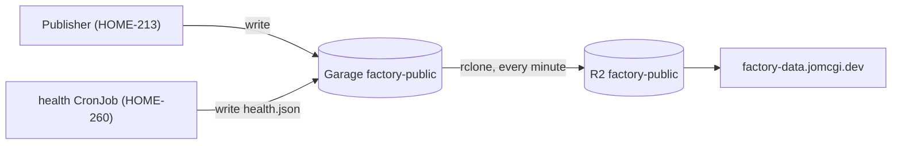

# Factory public mirror

This chart owns the Garage bucket `factory-public` and its mirror to the
Cloudflare R2 bucket `factory-public`, which is public at
`https://factory-data.jomcgi.dev` (HOME-243). It is the first consumer of the
factory Helm library's `buckets:` field
([library README](../shared/helm/factory-library/README.md), HOME-137).
Argo CD deploys it in namespace `factory-public` through
`projects/platform-factory/kustomization.yaml`.



## Values

The chart has one `buckets:` entry in `chart/values.yaml`. It renders:

- the Garage bucket claim and the key Secret, which garage-init fills;
- the mirror CronJob (stock `rclone/rclone`, pinned by digest), under its own
  ServiceAccount with no token mounted;
- the `OnePasswordItem` for `vaults/k8s-homelab/items/factory-r2-public-mirror`
  (fields `access-key-id`, `secret-access-key` and `s3-api-endpoint`);
- a network policy that allows egress only to Garage on 3900, the R2 S3
  endpoint on 443, and DNS;
- an admission rule that lets only the mirror's ServiceAccount mount the R2
  Secret.

Each run syncs every object except `manifest.json` with
`Cache-Control: public, max-age=31536000, immutable`, then copies
`manifest.json` with `Cache-Control: public, max-age=60`.

The publisher gets write access through its own `buckets:` entry without
`public:`. Only this chart owns `public:` for this destination.

## Factory health

The `health` CronJob publishes factory health as static data, so public
readers never call the cluster ([Joe's decision](https://factory-plan.jomcgi.dev/factory/issue/HOME-260#comment-3909)).
Every 2 minutes it reads the nodes and two Argo CD Applications
(`argocd`, `jomcgi-site-prod`) with a read-only ServiceAccount. It then writes
`health.json` to Garage with its own signed PUT:

```json
{"status": "healthy", "generatedAt": "2026-11-18T22:00:00Z",
 "components": {"factory-cluster": "healthy", "jomcgi-site": "healthy"}}
```

A read failure makes that component `unhealthy`. The mirror lists the key
in `public.mutableKeys`, so `https://factory-data.jomcgi.dev/health.json`
has `Cache-Control: public, max-age=60` and is at most about 4 minutes old.
This chart's own claim has `write` access only for this key; every other key
keeps one writer from another chart. Alerting on the status and age in the
file is [HOME-415](https://factory-plan.jomcgi.dev/factory/issue/HOME-415).

## Before the mirror runs

The mirror runs (`public.suspend: false`) since these checks passed on
2026-11-18 (HOME-243). `rclone sync` deletes from R2 every object that Garage
does not have, so check them again before the mirror runs after a stop or a
change of bucket or token. Record the result without credential values:

1. The 1Password operator syncs the item into the Secret with the three fields.
2. The endpoint is
   `https://7c56b458cd657d96b095c63d181c051f.r2.cloudflarestorage.com`, and
   the token can read and write objects only in R2 bucket `factory-public`.
   The token accepts only IPv4 clients from the home network: a request over
   IPv6 gets `AccessDenied`, even on `factory-public`.
3. An authenticated listing shows that R2 bucket `factory-public` holds
   nothing that must be kept.
4. The mirror is the only writer to R2 bucket `factory-public`. Every key
   has one writer, and here that writer is the mirror. Another job that
   writes to the R2 bucket directly loses its objects at the next sync. The
   trips export (`projects/monolith/trips/export`) writes `trips/photos/`
   to R2 `factory-public` directly when `TRIPS_EXPORT_PUBLIC_ENABLED` is
   `true`. Check that `projects/monolith/chart/values.yaml` sets it to
   `false`, and keep it `false` while the mirror runs.

Then set `public.suspend: false` in a PR. To stop the mirror, set it to
`true`: R2 keeps what it has.

**End state.** Every public object reaches R2 through Garage: a job writes
to the Garage bucket `factory-public` through its own `buckets:` entry, and
this mirror copies it to R2. The trips export moves its public photos to
Garage that way (HOME-242, HOME-258). Then no job writes to the R2 bucket
directly.

## Activation record

On 2026-11-18, before the mirror was turned on, the checks above ran
read-only with the credentials in the synced Secret
`factory-public-factory-public-mirror-r2`, over IPv4. No credential was
printed, and no object was created or deleted.

| Check | Result |
| --- | --- |
| 1. Secret fields | `OnePasswordItem` Ready; the Secret has the three fields. |
| 2. Endpoint | `s3-api-endpoint` equals the account endpoint above. |
| 2. Token identity | Cloudflare `GET /accounts/<account>/tokens/verify` with the Secret's `token`: active, no expiry, and its id equals `access-key-id`. |
| 2. Bucket admin | ListBuckets: `AccessDenied`. R2 needs an admin token to list or create buckets. |
| 2. Write and delete in `factory-public` | A multipart upload started and was aborted (a write that stores no object): allowed. DeleteObject on a key that does not exist: 204 (allowed). |
| 2. Other buckets (`stars`, `monolith-trips`, `monolith-public`) | ListObjects, the multipart write and DeleteObject: all `AccessDenied`. |
| 3. Destination listing | ListObjects on `factory-public`: allowed, 0 objects. |
| 4. One writer | `projects/monolith/chart/values.yaml` sets `TRIPS_EXPORT_PUBLIC_ENABLED: "false"`; R2 has no `trips/` objects. |

No credential the factory may use can read the token's permission policy.
Joe accepted the checks above as enough evidence of the write scope and
approved activation with this token
([decision](https://github.com/jomcgi-org/homelab/pull/8240#issuecomment-6981467603)).

## Live check

After the mirror runs:

1. Argo CD shows the Application Synced and Healthy, and the key and R2
   Secrets have data.
2. A test object put into Garage `factory-public` appears at
   `https://factory-data.jomcgi.dev/<key>` within 2 minutes, with the
   immutable `Cache-Control`.
3. A `manifest.json` written after it appears with `max-age=60`.
4. After you delete both from Garage, the next run removes them from R2.
   Check with an authenticated listing, because the CDN can keep a cached
   copy.

## Validation

```bash
bb remote test --config=ci //projects/factory-public/...
```

`chart:public_test` renders the chart and checks the single `buckets:` entry,
the rendered resources and the Application. The admission rules are tested
in `//projects/shared/helm/factory-library/admission:admission_test`.
