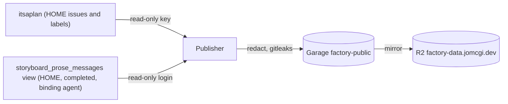

# Factory storyboard

The storyboard reads versioned, sanitized snapshots without connecting to
private factory APIs. This first part of
[HOME-68](https://factory-plan.jomcgi.dev/factory/issue/HOME-68) defines the
wire contract and invented fixtures. The Astryx reader is part of the
[`jomcgi.dev` site](../jomcgi-site/README.md#factory-preview-home-224), under `/factory` (HOME-224).

**Why.** The contract replaces the monolith's publication payloads. A mutable
manifest points to immutable objects so a publication identifies its current
records, readers can reuse unchanged objects, and an unavailable transcript
does not make a goal unreadable. Hashes establish byte identity, not publisher
authenticity. The publisher and the site's snapshot deploy own the publication
and origin boundaries (HOME-213).

The JSON Schema is the wire contract. The TypeScript types describe the same
records. Readers must validate objects, verify hashes and construct links
only from typed IDs. A withheld turn's schema excludes every content field.
Narrative numbers come from the current story stats. Snapshot text must never
become HTML, Markdown, CSS or a URL.

The independent schema test validates the fixtures with draft-07 JSON Schema,
checks their hashes and cross-links, and exercises rejected inputs. The
[README](README.md) describes fixture updates and the future Worker contract.

| Component | Role | Untrusted input | Credentials held |
| --- | --- | --- | --- |
| schema | Defines the versioned public documents shared with the site. | Public snapshot documents | None |

The publisher joins the configured itsaplan project to connector delivery
records and publishes session text by default. Joe chose this on 2026-11-19
in place of per-message owner approval
([decision](https://factory-plan.jomcgi.dev/factory/issue/HOME-414#comment-5459)).

A connector store view returns the text of assistant messages in completed
kagent tasks from the connector's task journal. The view fixes project HOME
and admits only tasks that the HOME binding's own agent ran, so another
project's transcripts and the security agent's sessions never cross this
boundary. The store holds no labels, so the publisher skips issues labelled
private or security in itsaplan. It withholds each turn that the secret scan
matches. The publisher has no network path to the kagent controller, whose
trusted-proxy listener accepts unverified bearer tokens.
Every five minutes it commits immutable objects and then the manifest to
Garage. The existing mirror copies them to R2. The site checks each hash
before it copies the object into its deployment.
