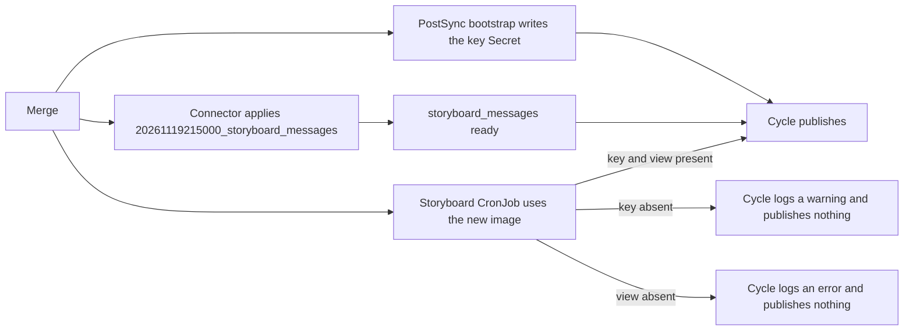

# Factory storyboard snapshots

The public, read-only storyboard will tell the factory's story from goals
through individual agent sessions. This package defines its snapshot contract
and invented fixtures. No real sessions were used for the fixtures.

HOME-68 added this contract and its fixtures. The reader lives at `/factory`
in `projects/jomcgi-site/web` (HOME-224). This package has no separate site.

## Snapshot contract

`schema/v1/snapshot.schema.json` is a draft-07 JSON Schema. Its definitions
describe the manifest and the story, goal, issue and session objects.
`schema/types.ts` carries the corresponding TypeScript types. Every document
has `version: 1`; object documents also have a `kind`. A new incompatible
contract gets a new schema directory and version. Readers must reject
unsupported versions rather than treating them as the current format.

`manifest.json` is the only mutable document. It holds `generatedAt`, the
story path, and maps of every current goal ID, issue key and session ID to
an object path. Object paths have the form `objects/<sha256>.json`, where
the digest covers the exact UTF-8 bytes, including whitespace and a trailing
newline. Reformatting an object changes its address. Objects are immutable;
publish all new objects before replacing the manifest. References use typed
IDs, so a goal or issue can refer to another record without embedding its
current content hash.

The story carries its headline, narrative, goal chapters and progress,
named stats, chart series, work in progress and recently shipped issues.
Goals carry their chapter, issue keys and burn-up measurements. Issues carry
one ordered timeline with issue creation, session turns, PRs, review rounds,
checks, merge queue changes and merge. Sessions carry individual turns, tool
calls and diffs. The allowed states are Working, In review, In merge queue,
Shipped and Stopped.

Narrative fields allow numeric claims only through `{{stat:key}}` placeholders.
The reader must fill them from the story's stats and display an en dash for an
unknown key. All text, including tool input, tool output and diffs, is plain
text. Readers must never interpret it as HTML or Markdown. Only typed IDs
and PR numbers become links; PR links use
`https://github.com/jomcgi-org/homelab/pull/<number>`.

A withheld turn contains only its number, timestamp, role and `withheld: true`.
It cannot contain text, tool calls or a diff. Readers must display:
"This turn was withheld because it matched the secret scan."
The publisher owns scanning and withholding; the site performs no secret scan.

## Fixtures and validation

The fixtures describe a fictional reading-list project. They include every
object kind and state, an empty goal, an unknown stat placeholder, a withheld
turn and a long transcript with tool calls, diffs and script-looking plain text.
`schema_test.py` uses the repository's existing `jsonschema` dependency to
check the schema, every fixture, exact byte hashes, typed cross-links and
invalid inputs. It runs independently of the later web package:

```sh
python3 -m pytest projects/factory-storyboard/schema_test.py
```

The Bazel targets are `//projects/factory-storyboard:schema_test` and
`//projects/factory-storyboard:rehash_test`. The rehash regression tests also
run with `node --test projects/factory-storyboard/fixtures/rehash.test.mjs`
from the repository root. Run `ci lint`,
`ci regen` and `ci ratchet` before pushing. BUILD generation and remote tests
run in PR CI for factory source guests.

After editing fixture objects, run this from the package root:

```sh
node fixtures/rehash.mjs
```

It reads all objects before changing files, rejects occupied or duplicate
destinations, then creates the new objects and updates the manifest paths
before removing the old files. A conflict found before writing leaves every
file unchanged; resolve it before rerunning. New objects use exclusive creation
so existing files cannot be overwritten.
The repository formatter excludes immutable fixture objects to preserve
their addresses.

## Reader and publication

The reader fetches `/data/factory/manifest.json`, then
`/data/factory/<object path>`, and polls the manifest every 60 seconds.
`schema/validate.ts` interprets the JSON Schema subset used by this contract
without generating code. The reader verifies hashes before displaying objects.
Missing or invalid objects leave the rest of the page readable. Vite serves
fixtures at those paths in development and tests; production builds contain none.

The factory-storyboard CronJob runs in the factory namespace every five
minutes. Its ServiceAccount uses the read-only connector database login and
a Garage read-write claim for `factory-public`. The publisher lists objects
to enforce retention. Its root filesystem is read-only, and the secret scan
writes its input files to a 256 MiB `/tmp` emptyDir.
Its egress allows only factory-db, the itsaplan API and Garage. No
storyboard pod can reach the kagent controller, because its trusted-proxy
listener accepts unverified bearer tokens
(`projects/factory/ARCHITECTURE.md` finding 5).

The publisher reads kagent session text through the connector store and
publishes it by default
([decision](https://factory-plan.jomcgi.dev/factory/issue/HOME-414#comment-5459)).
The connector journals each task's history in `task_transcript`. The
read-only `storyboard_messages` view returns the text of each assistant
message in a completed task, as the itsaplan run trace shows it. Artifact
text is excluded. A review round has no journal, so it publishes no turn.

| Rule | Enforced by |
| --- | --- |
| Project HOME only | `storyboard_messages` view |
| Completed tasks only | `storyboard_messages` view |
| Only tasks that the HOME binding's own kagent Agent ran; never the security agent in namespace `factory-intsec` | `storyboard_messages` view |
| No issue labelled `private`, `security`, `security-finding` or `INTSEC`, in any letter case | Publisher, from the itsaplan labels |
| No turn, title or description that the secret scan matches | Publisher, with gitleaks |

The view fixes the project in the database, so the publisher login cannot
read the transcripts of another project. The view matches the session of
the task's attempt, not the current session of the work item. When the
connector releases the session of a done or stopped work item, it keeps the
attempt and its journal, so the text stays published.

The connector store holds no issue labels. On each cycle the publisher reads
the labels from itsaplan and skips a private or security issue before any
connector read. An issue that gets one of these labels stops publishing on
the next cycle.

The publisher redacts e-mail addresses and the project's assignee IDs. One
gitleaks run then scans every turn, title and description, each as its own
file. A matching turn keeps only its number, time and role. A matching title
becomes the issue key, and a matching description becomes empty. Each
withheld record gets one log line with its issue key and no text. A last
gitleaks run scans every object and the manifest before the first write. A
match stops the cycle.

The factory chart's itsaplan bootstrap creates the publisher's key. The
bootstrap Job creates the external agent `factory-storyboard` with no
projects, no triggers and chat off. It gives the agent the read-only team
role `Factory reviewer` in HOME, which grants only `work_items` read. It
checks that access with the agent's own key, then writes the key to Secret
`factory/factory-itsaplan-agent-factory-storyboard`, key `apiKey`. The Job
runs after each sync of Argo CD app `factory` and rotates a key that stops
working. This chart reads that Secret as `ITSAPLAN_KEY` and owns no
1Password item. The publisher refuses a key with any `work_items` right
other than read.

### Rollout order

The factory chart deploys the connector, and the connector applies its
migrations when it starts. A PostSync Job of the same chart writes the
publisher's key. The storyboard chart has its own Argo CD Application. After
a merge, CI advances both pins, and the two Applications sync
independently:



1. The migration only adds. The chart 0.1.10 publisher keeps reading
   `storyboard_tasks` and `storyboard_task_messages`.
2. A new publisher cycle that starts before the migration applies logs
   `connector view storyboard_messages is absent` and writes nothing. The
   last manifest stays. The next cycle after the migration publishes.
3. A cycle that starts before the bootstrap writes the key logs
   `itsaplan key not bootstrapped yet; skipping this cycle` and exits 0.
   The chart marks the key reference `optional`, so the pod starts without
   it. The last manifest stays. The next cycle after the bootstrap
   publishes.

To roll back the publisher, lower `targetRevision` in
`deploy/application.yaml` to the last chart published before HOME-543. CI
advances that pin after each publish, so read it from the file at the parent
of the HOME-543 merge commit (`git show <merge>^:projects/factory-storyboard/deploy/application.yaml`),
not from this README. Those charts read `ITSAPLAN_KEY` from Secret
`factory-storyboard-readers`. Its
OnePasswordItem syncs that Secret from 1Password item
`k8s-homelab/factory-storyboard-readers`. If that item does not exist, the
Job's pod cannot start and nothing publishes. The last manifest stays.

To publish on a chart from before HOME-543, create that item with field `ITSAPLAN_KEY`.
Copy the value from key `apiKey` of Secret
`factory/factory-itsaplan-agent-factory-storyboard`, which the factory chart
keeps. If the bootstrap rotates that key, copy it again. Chart 0.2.40 and
earlier also need field `APPROVED_HISTORY` with the value `{}`. The old
views and the `storyboard_approved_message` table stay for those charts
until HOME-527 drops them.

After publisher rollout, run
`node projects/factory-storyboard/verify-rollout.mjs --mirror-only`
to check the source manifest age and every referenced object. Once the first complete mirror is available, set
`httpsManifests.factory.enabled` in the site's sources.json to true and deploy
the preview site. This also activates its browser requirement. Run
`node projects/factory-storyboard/verify-rollout.mjs` with Node 22.18 or later
to check the seven-minute limit and every object on the preview site.

### Withdraw a published issue

The publisher withdraws whole issues, with all their sessions.

1. Record the affected issue key, its session IDs in the public manifest,
   and the old object paths from both the mirror and preview manifests.
   Include previous versions that carry the withdrawn text. Keep this
   inventory private.
2. Add the label `private` to the issue in itsaplan. For a security issue,
   add `security` instead. Wait for the next successful publisher Job.
3. Fetch `https://factory-data.jomcgi.dev/manifest.json`. Record its
   `generatedAt`. Check that the issue key and its session IDs have
   disappeared from the indexes and from the story. Check all current
   references against the inventory and run
   `node projects/factory-storyboard/verify-rollout.mjs --mirror-only`.
4. If preview has served the affected snapshot, sync the Argo CD Application
   `jomcgi-site-dev` after the mirror check. Its Sync-hook Job builds a fresh
   Worker deployment from the mirrored manifest. Wait for the deploy and site
   checks to succeed. Fetch `https://next.jomcgi.dev/data/factory/manifest.json`
   and repeat the content and reference checks. Its `generatedAt` must be at
   least the mirror timestamp recorded in step 3. Run
   `node projects/factory-storyboard/verify-rollout.mjs` to check the digests.
5. Check the old keys separately. The publisher normally expires unreachable
   Garage objects in two passes. After committing the manifest, it marks each
   unreferenced payload whose last write was at least 24 hours ago. It keeps
   the marked payload for another 24 hours, covering the [library writer
   retention of 990 seconds](../shared/helm/factory-library/README.md#buckets-and-public-mirrors)
   after the first manifest that drops it, even after an outage. The next
   mirror sync removes them from R2. For an urgent takedown, have the bucket
   operator remove the affected, unreferenced Garage keys immediately and
   confirm the deletions reach R2. Use authenticated listings of both buckets.
   Preserve objects still referenced by a current snapshot and resolve any
   remaining reference before deletion.
6. After origin removal and preview redeployment, have the Cloudflare zone
   operator purge the exact old object URLs and manifest URLs on both hosts.
   The mirror gives immutable objects a one-year cache lifetime. Check each
   original URL with an ordinary GET from outside the cluster. Expect HTTP
   404 or 410 for withdrawn objects at both `/objects/…` on the mirror and
   `/data/factory/objects/…` on preview. Repeat the manifest checks after the
   purge. If a deployment-specific Worker URL still serves an old copy,
   disable access to that deployment and verify its URL too. Keep that
   revision out of rollback while it contains withdrawn data. Copies already downloaded by readers can persist.

### Rollback of the database read access

To stop the storyboard reading the connector database, set `login: false`
for `factory_storyboard` in
`projects/platform-factory/factory-db/resources/cluster.yaml`. CloudNativePG
applies managed-role changes. Then end any open sessions, which keep
their access, and check that none remain:

```sh
KUBECONFIG=~/.kube/factory.yaml kubectl -n factory-db exec factory-db-1 -c postgres -- \
  psql -At -c "SELECT pg_terminate_backend(pid) FROM pg_stat_activity WHERE usename = 'factory_storyboard'"
KUBECONFIG=~/.kube/factory.yaml kubectl -n factory-db exec factory-db-1 -c postgres -- \
  psql -At -c "SELECT count(*) FROM pg_stat_activity WHERE usename = 'factory_storyboard'"
```

The second command must print 0. Use the primary's pod name if
`factory-db-1` is not the primary. The `storyboard_delivery` and
`storyboard_messages` views and their grants stay, so a later redeploy works
without a new migration. Until the HOME-518 follow-up, the chart 0.1.10
views and their grants also stay. To remove the grants as well, add a forward
migration that revokes them.
