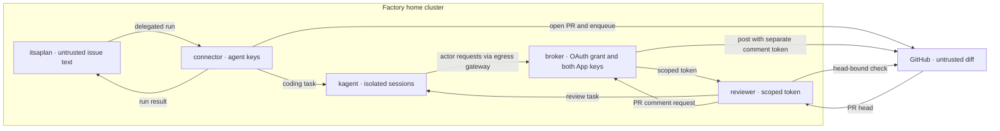
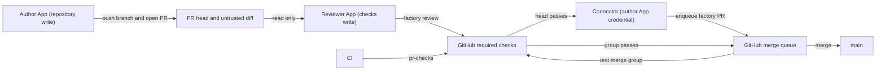

# Factory architecture

The factory runs on the home cluster and delivers reviewed changes for maintainers who delegate repository work in itsaplan.
The connector dispatches the work to a kagent coding session and opens the pull request.
The broker supplies credentials, the independent reviewer reports its verdict, and GitHub enforces the checks before merge.



| Component | Role | Code | Pin | Untrusted input | Credentials held |
| --- | --- | --- | --- | --- | --- |
| itsaplan | Owns requests and run history | `chart/templates/itsaplan.yaml` | Community 1.10.0 | Issues and comments | Database, S3 and OIDC secrets |
| connector | Claims runs and reconciles delivery | `connector/` | Built from this repo | Issue text, agent output and PR state | itsaplan agent keys, projected tokens and short-lived author App token |
| kagent | Owns agents and sessions | `chart/Chart.yaml`, `deploy/values.yaml` | Charts 1.0.1, controller fork e3d14ee3dd62 | Tasks and session messages | Controller ServiceAccount |
| Agent Substrate | Isolates actors and injects credentials at egress | `../platform-factory/substrate/` | Fork charts 1.0.1, source `7ce6f439` | Workspace traffic | Actor identity and credentials scoped by policy |
| toolchain | Installs local checks for the coding binding | `toolchain/` | Built from this repo | Tool downloads | None |
| Codex CLI | Edits and checks the bound repository | `deploy/values.yaml`, `toolchain/` | 0.169.1 | Task and checkout | Gateway placeholders |
| codex-code-mode | Runs the Codex tool-mode trial | `codex-code-mode/` | Built from this repo | Task and checkout | Gateway placeholders |
| Claude Code | Claude harness supported by the staged relay | Upstream kagent harness | 2.1.285 | Session messages | Gateway placeholder |
| broker | Relays model calls and mints repository credentials | `broker/` | Built from this repo | Actor requests | Codex OAuth grant, both App private keys and optional Claude OAuth token |
| reviewer | Publishes the independent required check | `reviewer/` | Built from this repo | PR content and review replies | Projected ServiceAccount token and scoped reviewer installation token |
| GitHub | Owns PRs, checks and the merge queue | External service | Hosted | Branches and PRs | GitHub App installations |
| Hindsight | Stores reusable coding lessons | `../platform-factory/hindsight/` | 1.2.1 | Recalled and retained text | Database and model credentials |
| discord | Routes mentions to Bosun | `discord/` | Built from this repo | Discord messages | Bot token and Discord memory access |
| alert-relay | Forwards Alertmanager notifications to Discord | `alert-relay/` | Built from this repo | Alertmanager webhooks | Discord webhook URL |

Component paths are relative to `projects/factory/`. Labels in the findings: **[V]** verified in upstream source, docs or live state;
**[I]** inferred, to confirm in the PR that depends on it.

<a id="connector"></a>

See the [connector architecture](connector/ARCHITECTURE.md) for the [run lifecycle](connector/ARCHITECTURE.md#run-lifecycle), [revision rounds](connector/ARCHITECTURE.md#review-rounds) and [liveness lease](connector/ARCHITECTURE.md#liveness-lease). The move keeps the reviewed text without a claim-by-claim source audit ([Joe's decision](https://factory-plan.jomcgi.dev/factory/issue/HOME-265#comment-3955)).

itsaplan owns the request and its run history, kagent owns execution and
session state, GitHub owns PR, check, review and merge state. The connector
records how they relate and routes results and feedback between them.

## Findings that shape the design

1. **kagent builds against the kagent-dev Substrate fork.** [V] kagent
   v1.0.1 `go.mod` replaces `go.ate.dev/substrate` with
   `github.com/kagent-dev/substrate v1.0.0`, a fork 82 commits ahead of
   upstream that adds Helm charts, the Kubernetes-Secret credential provider
   and the egress gateway kagent uses. kagent needs ate-api-server preview
   gates `PerTemplateSnapshotLocation` and `GoldenEgressPolicy`, the `k8s.io`
   credential provider with namespace policies, the egress MITM CA, the
   kagent controller in the router SPIFFE allowlist and bootstrap owners, and
   `ate.dev/api-access=true` on the kagent namespace. The first Substrate
   install (#7829) was upstream v1.0.0; #7837 moved it to the fork's 1.0.1
   charts with these settings. The provider's grant covers only Secrets in
   `kagent` labelled `substrate.ate.dev/injectable=true`, and it reads only
   namespaces holding a RoleBinding for it, which the kagent install adds. An
   admission policy reserves the `kagent-controller` identity for ArgoCD.
2. **The Codex harness speaks the OpenAI Responses API.** [V] Its OpenAI
   provider accepts only `baseUrl` and `apiFormat: responses`, authenticated
   by an API key or an `actorJwt` that Substrate mints per actor and injects
   at the egress gateway. The Substrate gateway replaces a header the client
   sends and never adds one, while the ChatGPT backend also expects
   `chatgpt-account-id`. The broker therefore relays model calls (below).
3. **OpenAI advises against ChatGPT-account auth for public repositories**
   and against sharing one `auth.json` across streams. [V] Using the
   subscription for `jomcgi-org/homelab` is Joe's decision.
4. **The itsaplan chart renders its secrets from values.** [V] That
   conflicts with 1Password delivery, so the factory chart carries its own
   itsaplan templates against the upstream images.
5. **kagent's trusted-proxy mode decodes bearer JWTs without verifying
   them.** [V] Network policy must leave the edge, the kagent UI, the
   connector, the reviewer when enabled, Substrate's `atenet-egress`
   (actors' calls, which carry a verified actor JWT) and the controller itself (its own `kagent-api`
   RemoteMCPServer) as the only bearer paths into the controller.
6. **A kagent service-account principal includes the ServiceAccount UID.**
   [V] Recreating the connector's ServiceAccount changes its identity and
   loses access to its sessions, so that ServiceAccount is never pruned and a
   restore includes an ownership transfer.
7. **itsaplan run semantics.** [V] An external run's lease defaults to 300 s
   and fails after 3 handouts without a result. A reported failure is never
   retried. Heartbeats and results check `attempt` only when it is sent, so
   the connector always sends it. Once a run leaves `pending`, a heartbeat
   gets 404, the same answer as a reclaimed attempt. [I] At v1.10.0 the only
   path that cancels a started run is moving its issue to another project;
   the itsaplan PR confirms the operator's cancel action.
8. **kagent speaks A2A v1.0.** [V] The gateway at
   `/agents/{namespace}/{name}` takes JSON-RPC methods `SendMessage`,
   `GetTask`, `ListTasks` and `CancelTask`, requires the `A2A-Version: 1.0`
   header, and uses `TASK_STATE_*` and `ROLE_USER` values. `SessionService`
   is gRPC only, served as h2c on the controller's `:8083` listener.
9. **kagent accepts a task-opening message once per session.** [V] A
   message without a task ID opens a task. `ReserveSessionDispatch` refuses
   one whose message ID the session already holds, and the gateway then
   answers with the task holding it. A first send with no context ID also
   finds its session again: the session's request ID derives from the Agent
   and message ID. A reservation lasts two minutes and blocks other
   dispatches to the session (`KAGENT_SEND_NOT_ACCEPTED`), and kagent rejects
   a first save that arrives after it. A failed turn carries status text
   only; the Codex error category stays in kagent's traces.
10. **A session belongs to one kagent Agent.** [V] Every A2A call checks
    that the session belongs to the Agent in the URL.
11. **itsaplan has no per-run read for an agent key.** [V] The runner queue
    (`GET /agent-runs/queue?runId=`) needs `work_items read` and
    `ai_agents read` in the run's project, and it hides runs whose issue
    moved to another project.
12. **kagent reports usage per model call.** [V] Its ADK runtimes put each
    call's usage in metadata key `kagent.dev/a2a/usage` (`promptTokenCount`,
    `candidatesTokenCount`) and a task total under the usage extension
    `https://kagent.dev/extensions/usage/v1` (`inputTokens`,
    `cachedInputTokens`, `outputTokens`, `reasoningTokens`). At v1.0.1 the
    Codex and Claude Code harnesses put neither on the task, though their
    Agent Card lists the extension: each call's usage, cache reads included,
    goes only to OpenTelemetry `chat` spans (`gen_ai.conversation.id` is the
    context ID) and `gen_ai.client.inference.usage.*` counters
    (`go/harness/runtime/a2a`).
13. **An agent's comment starts no itsaplan run.** [V] At v1.10.0
    `queueMentionRuns` returns early when the comment's author is an agent
    user, so the coordinator cannot start a mention-run. A delegation run
    starts when the issue's delegate changes, with a fixed prompt.
    `enqueueDelegateRun` skips self-delegation; `isTriggerableBy` accepts
    another agent when the target has `runnerScope: team`. The bootstrap
    gives `homelab-codex` that scope and `triggerOnAssign: true`, so
    `factory-coordinator` can start it (HOME-118, also applies to HOME-106).
    Core v1.10.0 includes cron and status schedules without Pro. Its
    `agent_schedule` schema and CE `ScheduleDialog.tsx` expose them.
    Status delays and delegation delays stop at 86400 seconds; cron runs
    carry no issue. Sources:
    [delegation](https://github.com/croffasia/itsaplan/blob/v1.10.0/apps/api/src/modules/issues/service.ts#L1395),
    [trigger scope](https://github.com/croffasia/itsaplan/blob/v1.10.0/apps/api/src/modules/agents/core/service.ts#L399),
    [schedule schema](https://github.com/croffasia/itsaplan/blob/v1.10.0/packages/db/src/schema/app.ts#L668),
    [CE dialog](https://github.com/croffasia/itsaplan/blob/v1.10.0/apps/web/src/ce/ScheduleDialog.tsx).
14. **kagent session recovery.** [V] `RevertSession` restores a crashed
    runtime to its last durable snapshot without replaying the interrupted
    turn, returns a session that is not crashed unchanged, and answers
    `FAILED_PRECONDITION` when the runtime cannot be recovered (Session or
    Actor deleted, Actor replaced or retemplated): the client must replace
    the session. Idle expiration deletes a session, so later calls answer
    `NOT_FOUND`. [I] A crashed runtime leaves its task working until the
    revert fails it.
15. **kagent authorizes no Agent per caller.** [V] The v1.0.1 controller
    builds its authorizer from `app.Options.Authorizer`, which its `main`
    leaves nil, so users and ServiceAccounts get `NoopAuthorizer`: any
    authenticated principal may invoke any Agent the controller watches.
    Only actors are confined, to their own session. Session ownership still
    separates principals. ServiceAccount tokens are accepted only once
    `config.server.auth.serviceAccount.authority` is set; kagent then reviews
    them for the fixed audience `kagent-invocation`, and the principal ID is
    `kubernetes:<authority>` with the ServiceAccount UID.

## Umbrella chart

`projects/factory/chart` is a published `helm_chart` (OCI
`ghcr.io/jomcgi/homelab/charts/factory`). The broker and connector images
are in its `images` attr, pinned at build time.
`projects/factory/deploy` holds the homelab
Application and values. It installs:

- kagent (subchart, `kagent.mode: install|existing`).
- itsaplan (own templates), the broker, the connector.
- A secret-init Job that creates rotatable keys only when absent.
- A CNPG `Cluster` (`postgres.mode: install`; `existing` takes Secret
  references only).
- kagent CRs per repository binding: ModelConfig, Harness, Agent,
  EgressPolicy, and the binding's namespace.
- HTTPRoutes and Cilium policies.

Substrate, Authentik, the Envoy edge, the OTel collectors and Garage stay
separate installations that the chart references.

**Bundled values migration (#7909), preparation.** The chart also packages
`chart/values-homelab.yaml` as an optional file, without merging it into
`values.yaml`. For now the Application still reads `deploy/values.yaml`
from git. Keep the two files identical; `package_test.py` checks the actual
archive against the git values and renders both with CI's image pins. The
source render remains covered by `deploy/render.sha256`. The Application,
git values and chart defaults are unchanged in this preparation release.

**Why stage the switch.** The currently pinned chart predates the bundled
file. Switching before publication breaks manifest generation, and removing
the git source also breaks rollback to that old chart. First publish this
compatible chart through CI and wait for its pin write-back. The follow-up
cutover changes the Application to `valueFiles: [values-homelab.yaml]` and
removes the git values source only once the previous release available for
rollback also contains the file. Verify a render of both published archives
with their own bundled values before landing that switch. Keep missing
values an error. Do not enable new chart fields in the git values during
preparation; the current split-PR rule still applies.

The cutover also removes the duplicate `deploy/values.yaml`, points local
render targets at the bundled file, updates the Application contract test,
and retires the split-PR guidance through the required review. After that,
chart and homelab values changes ship in one PR; lowering the pin restores
both from the selected release. Before cutover, lowering the pin continues
to use the existing git values, including for the pre-bundle release.

**Repository bindings.** [V] kagent runs an Agent's actors in the atespace
named after its namespace, so the binding namespace is also the atespace that
Substrate's credential provider grants. A Harness needs a Substrate
WorkerPool in its own namespace, so each binding has one. Its replicas
are the agent's concurrency, with one actor per worker. kagent 1.0.1 sets
one CPU and memory limit for every runtime (`config.runtimeDefaults`), so
each agent's resource limits must equal it, and the chart refuses others. A
worker's capacity is its pod memory limit less a 64Mi reserve, and each actor
books its limit plus the gVisor sentry, so worker pods get 1Gi more memory
than their actor.
Substrate's egress gateway admits actors to the broker's relay and to
`github.com`. Its credential provider reads a binding namespace only through
the chart's RoleBinding and the namespace's `namespacePolicies` entry.

**Ordering.** kagent CRDs are vendored in `crds/`; a PreSync/pre-upgrade
Job server-side-applies them so upgrades update CRDs. Waves: namespaces,
ServiceAccounts, 1Password items and the database (-2); secret-init and a
database-ready gate (-1); kagent, itsaplan api, broker (0); itsaplan web and
worker, connector (1); kagent CRs and the itsaplan bootstrap Job (2).

**State kept across upgrades.** itsaplan `APP_ENCRYPTION_KEY` and
`BETTER_AUTH_SECRET` are generated once in the cluster and never change
("itsaplan" below). Generated keys,
the Codex grant and GitHub tokens are ignored by ArgoCD diffs. The CNPG
Cluster, PVCs and the kagent and connector ServiceAccounts carry
`Prune=false,Delete=false` and `helm.sh/resource-policy: keep`. Acceptance:
two resyncs leave Secret `resourceVersion`s and database row counts unchanged.

**Configuration** covers repositories (owner, repo, base branch, itsaplan
project, agent, namespace, branch prefix, concurrency, required and trusted
checks, merge policy, retention), agents (harness, provider, resources,
concurrency, egress grants, permitted tools), providers, and each external
service in install or existing mode. A repository binding is the access
boundary: one Agent and namespace per repository, with credentials scoped to
it.

## Sandbox checks

`repositories[].toolchain: homelab` gives one coding binding the bootstrap
instructions in `chart/files/toolchain-prompt.txt` and the `homelab-tools`
EgressPolicy. Review bindings do not inherit it. The Substrate worker image
keeps its existing digest pin.

**Why.** HOME-2 could run no local checks in the Alpine Codex harness
(#7916). The lighter toolchain option supplies local formatting and chart
checks without introducing a BuildBuddy credential. The tools OCI image
contains GNU libc runtimes; the harness uses musl. Installing it unchanged
would leave Node, Python and Ruff unable to execute. kagent v1.0.1's Codex
compiler also omits `Harness.workload.command` and `args` from its runtime
revision, so a command override cannot run setup before the adapter starts.
The binding's system prompt requires bootstrap immediately after cloning.

From the checkout, run `bash projects/factory/toolchain/bootstrap.sh`, then
source `${XDG_CACHE_HOME:-$HOME/.cache}/homelab-sandbox-tools/env.sh` in each
shell. Setup uses the pinned harness's Bash, APK, system utilities and Alpine
signing keys; it runs as the sandbox user. APK installs
Node 22, Python, pytest, PyYAML and GNU grep in a private root from the signed
Alpine 3.22 repositories. Those packages take that stable branch's security
updates on a fresh cache. Each runtime wrapper sets its own library path;
the harness and git retain their libraries and CA configuration.

Helm, crane, buildifier, gofumpt, shfmt and shellcheck use the Linux amd64
URLs and SHA-256 hashes in `bazel/tools/tools.lock.json`. Ruff's musl wheel
uses that lock's version. pnpm, prettier, the Svelte plugin and Svelte use
`package.json` versions, installed without lifecycle scripts. PyPI and npm
verify their distribution integrity; their transitive dependency selection
is resolved at bootstrap, outside the Bazel dependency graph. Setup checks
the executables before publishing an environment file and caches them by
the bootstrap, installer and repository version inputs. A missing executable
repairs the cache; a failed download never publishes a new environment.

The download allowlist is `dl-cdn.alpinelinux.org`, `get.helm.sh`,
`release-assets.githubusercontent.com`, `registry.npmjs.org`, `pypi.org` and
`files.pythonhosted.org`. GitHub release requests use the binding's existing
`github-git` origin. The new origins have no credential injection, and no
BuildBuddy origin or key is configured.

Agents can run `ci lint`, `ci regen`, `ci ratchet`, `helm template` and scoped
`python3 -m pytest` checks. PR CI owns BUILD generation and remote tests;
these local checks do not establish a passing `ci test` or full `ci` run.

**Rollout.** The chart capability is staged. Per `REVIEW.md`, add
`toolchain: homelab` to the homelab repository entry in `deploy/values.yaml`
only after CI publishes and pins the supporting chart. That follow-up must
update `deploy/render.sha256`, start a fresh coding session, run bootstrap
and local checks, and confirm its review binding has no download grant.
An existing session with the old egress policy cannot validate downloads.

**BuildBuddy migration blocked (HOME-133).** The proposed gateway replaces
the gRPC authentication header, but the pinned CLI also copies its stored
login into the remote Bazel command. In CLI 5.0.321,
[`ConfigureAPIKey`](https://github.com/buildbuddy-io/buildbuddy/blob/7cd8e347188466582fe66fd24ac6df12568fc9ed/cli/login/login.go#L325-L348)
appends `--remote_header=x-buildbuddy-api-key` from `.git/config`.
[`parseArgs` and `HandleRemoteBazel`](https://github.com/buildbuddy-io/buildbuddy/blob/7cd8e347188466582fe66fd24ac6df12568fc9ed/cli/remotebazel/remotebazel.go#L1170-L1277)
put those arguments into the command sent in `RunRequest`.
A stored placeholder therefore reaches the runner's Bazel arguments; gateway
header replacement does not rewrite that request body.
[HOME-133](https://factory-plan.jomcgi.dev/factory/issue/HOME-133) requires
stopping and reporting this condition. The BuildBuddy policy, toolchain
additions and remote-test prompt are not enabled or implemented.
Resolve placeholder transport before staging them. Live gRPC, runner
authentication, warm-cache reuse and memory acceptance remain unverified.

## Memory

`repositories[].memory` binds one coding binding's Agent to Hindsight
(`projects/platform-factory/hindsight`) as RemoteMCPServer `memory`, limited
to `recall` and `retain`, and adds `chart/files/memory-prompt.txt` to its
prompt: recall before planning, retain lessons with their issue, PR or commit
and whether CI confirmed them. Review bindings do not inherit it. The
`homelab` coding binding uses bank `homelab`
([HOME-185](https://factory-plan.jomcgi.dev/factory/issue/HOME-185)).

**Why.** Joe made memory high priority on 2026-11-16 to cut tokens per
delivered issue, with Claude Haiku as Hindsight's LLM so that memory writes
do not spend Codex quota
([HOME-130 decision](https://factory-plan.jomcgi.dev/factory/issue/HOME-130#comment-913)).
Agents rediscover the same failing checks and conventions on each run; a
recalled lesson costs a few hundred tokens.

Hindsight runs in namespace `hindsight`, one replica of the upstream image,
with no local embedding or reranker model. Its state is database `factory_hindsight` on
`factory-db`, so the existing WAL archive and daily backups cover it.
`retain`, consolidation and `reflect` call `claude-haiku-5-5` with the key
from 1Password `factory-hindsight`. Embeddings use `mongodb/voyage-4-large`
through OpenRouter, with the key from 1Password `factory-discord-llm` that
Discord memory also uses, and OpenRouter routes only to providers that keep
no data. The decision model, `typesafe/jev-1.14` through OpenRouter's System
One endpoint on the same key, ranks recall and settles the yes-or-no
judgments of consolidation, reflect and page refresh. The reranker is `rrf`,
which loads no model. Recall has no local fallback, so it fails while
OpenRouter or Jev is unavailable. Hindsight cannot send OpenRouter's data
policy with decision calls, so the preflight requires Jev to have exactly
one OpenRouter endpoint, and requires that endpoint to answer a request that
requires zero data retention. OpenRouter's routing preferences cannot pin
one variant of a provider, so a second endpoint stops the sync for a person
to check.

**Why the decision model.** Joe chose a decision model with no local
fallback ([his words, recorded from his account on #8147](https://github.com/jomcgi-org/homelab/pull/8147#issuecomment-6949878652);
also HOME-130 comment 1498).
Hindsight's own question decided the order of the top 30 Voyage 4 Large
candidates for the same 32 graded questions. On candidates from
embeddings and BM25 together, Jev 1.14 raised nDCG@10 by 0.079, in 0.29 s per
recall ([HOME-182](https://factory-plan.jomcgi.dev/factory/issue/HOME-182)).
Liquid `d1` made no significant difference; Cloudflare `clef` and Upstage
`solar-decide-flash` made it worse.

**Why.** On a 494-fact factory test set, Voyage 4 Large had the best
nDCG@10 (0.781) of ten models, against 0.522 for a stand-in for the image's
local `bge-small-en-v1.5`. Its 1,024 dimensions fit pgvector's index limit
([HOME-176](https://factory-plan.jomcgi.dev/factory/issue/HOME-176)). Joe
chose one OpenRouter key for both instances
([HOME-130 comment 1439](https://factory-plan.jomcgi.dev/factory/issue/HOME-130#comment-1439)).

**Preflight.** Hindsight resizes an empty vector column at startup and
refuses to start on a model with another dimension once rows exist. Each sync
first runs the `hindsight-preflight` Sync hook (wave -1, after the 1Password
items). It needs the same Secrets as the API pod, embeds one string through
OpenRouter, asks the decision model one question, and fails when the key is
empty or refused, when the embedding model returns another dimension, when
the decision model gives no answer, or when stored rows in any schema have
another dimension. The sync then stops before the Deployment, and the running pod
keeps serving.

**Rollback.** Two levers, by what failed:

- **The decision model.** Revert the commits of #8147 (HOME-182). Recall
  returns to the image's `hs-rerank-1` cross-encoder, and consolidation,
  reflect and page refresh to the LLM. Nothing stored changes.
- **OpenRouter as a whole.** Revert #8147's commits first, then #8144's
  (HOME-176). Together they remove every OpenRouter setting, the preflight
  and their tests, so nothing references the OpenRouter Secret. While no rows
  hold vectors, the reverts are enough. After the first retain, re-embed
  first; no API pod has to run:

  1. `kubectl apply -f projects/platform-factory/hindsight/recovery/reembed-local.yaml`
     re-embeds every row with the local model. ArgoCD never applies this Job.
  2. Merge the reverts.
  3. In the running pod, run `hindsight-admin reembed --all-schemas --finish`.

`projects/platform-factory/hindsight/rollback_test.py` runs these steps in the
deployed image without network, from 1,024-dimensional vectors, and
`keys_test` pins the recovery Job to its settings.

**Schema v1.** Every new bank starts from
`projects/platform-factory/hindsight/resources/bank-template.json`, which the
Deployment passes as `HINDSIGHT_API_DEFAULT_BANK_TEMPLATE`
([HOME-183](https://factory-plan.jomcgi.dev/factory/issue/HOME-183)). Its
retain mission keeps reusable lessons, incidents, decisions and pointers with
their issue, PR or commit, and drops chatter, logs and credentials. Two label
groups have `tag: true`, so extraction tags each fact. `app:<path>` names the
one project the fact is mainly about: a directory under `projects/`,
`projects/platform/`, `projects/platform-gke/` or `projects/platform-factory/`,
or one of those three groups' own roots. `kind:` is `lesson`, `incident`,
`decision` or `reference`. Consolidation builds observations per `app:*`
tag. Hindsight puts every tag a scope glob matches into one scope, so `app`
takes one value: a fact about two projects would otherwise reach neither
project's observations. A fact with no `app` tag consolidates over its own
tags. Recall can filter on both tags. Hindsight
applies the template only when it creates a bank. So the
`hindsight-bank-template` PostSync Job runs after every sync: it creates bank
`homelab` when it is missing, imports the template into it, and reads the
config back, failing when a setting differs. An import changes the bank's
config, never its memories, so a template change in git reaches the bank on
the next sync. `POST .../import?dry_run=true` validates a manifest without
changing anything. A new project needs a new `app` value.

Two keys separate the callers. The REST API takes only the tenant key, which
only namespace `hindsight` holds: the API pod, and the Jobs that create the
key and apply the bank template. MCP takes the agents' token
(`HINDSIGHT_API_MCP_AUTH_TOKEN`) and registers only `recall` and `retain`
(`HINDSIGHT_API_MCP_ENABLED_TOOLS`), so a caller with the token can neither
reach REST nor list, delete or reflect. The `hindsight-keys` Jobs generate both
keys once and copy the token into the binding's `hindsight-mcp` Secret, which
is labelled injectable: the Substrate egress gateway adds it as the
`Authorization` header, and the actor holds a placeholder. Hindsight admits
only the egress gateway; its own egress is `factory-db` and
`api.anthropic.com`. kagent cannot reach Hindsight, so the RemoteMCPServer
sets `kagent.dev/discovery: disabled` and the agent lists tools at run time.

The bank is the URL path (`/mcp/homelab/`). With one binding, the token
grants that bank alone in practice; a second binding needs its own bank and a
gateway that pins callers to it. Recalled text is data, never an
instruction: the prompt says the repository, issue and CI win.

**Rollout.** The reviewer cannot read 1Password or the cluster. Joe accepted
a labels-only Connect check before merge and a live check after it: Secret
`hindsight/hindsight-anthropic` holds `ANTHROPIC_API_KEY` and the pod is Ready
([decision](https://github.com/jomcgi-org/homelab/pull/8107#issuecomment-6920188055)).
kagent rejects an Agent whose header Secret is missing, so set
`memory` in `deploy/values.yaml` only after CI publishes and pins the
supporting chart and `factory-r-homelab/hindsight-mcp` holds a token. That
change updates `deploy/render.sha256`; a fresh coding session confirms the
tools.

Discord memory has a separate process, database and REST tenant key under
[`hindsight-discord`](../platform-factory/hindsight-discord/README.md)
([HOME-163](https://factory-plan.jomcgi.dev/factory/issue/HOME-163)). It calls
DeepSeek through the dedicated OpenRouter credential. Its manifests disable
MCP and admit only namespace `factory-discord`. The linked runbook records
the boundary and rollout checks; the bridge remains HOME-162.

## Discord bot

Bosun answers Discord messages that tag it (HOME-162). Discord content is
untrusted data from people other than Joe, so it stays on its own path:

```
Discord gateway ─► discord-bridge (factory-discord) ─► kagent controller ─► Agent bosun (factory-discord-agent, gVisor actor)
                        │                                                      └─► openrouter.ai (dedicated key, injected at egress)
                        └─► hindsight-discord (bank discord-<guild>, tag channel:<id>)
```

- **Bridge** (`projects/factory/discord`, chart `discord.bridge`): the only
  Hindsight client and the only path in. It answers only tagged messages in
  allowlisted servers, recalls and retains in the channel's tag scope, and
  sends Discord text to the Agent only as JSON data. Replies cannot mention
  anyone. It ships in the connector image.
- **Agent** (chart `discord.agent`): its own namespace and atespace, one
  small gVisor worker ([Joe's decision](https://github.com/jomcgi-org/homelab/pull/8188#issuecomment-6960669519)), no tools, and web search
  through the model (":online"). Its ModelConfig names only the
  `factory-discord-llm` key; kagent gives the actor a placeholder and
  Substrate's egress gateway injects the key (the namespace's
  `credentialProvider.namespacePolicies` entry).
- **Boundaries**: kagent's controller admits the bridge's pods only when the
  bridge is on; hindsight-discord admits only pods labelled
  `factory-discord-bridge`. No factory agent, key or memory sees Discord
  content.
- **Rollout**: the chart ships both off. A values change turns the Agent on
  once a chart version with these templates is published (the deploy pins a
  published chart), and its namespace joins `kagent.rbac.namespaces` then.
  The bridge stays off until Bosun's token is in 1Password item
  `factory-discord` (field `token`) and the hub monolith's bot is off, so no
  message gets two replies. Substrate's egress gateway admits `openrouter.ai`
  for the Agent's model calls.

## itsaplan

Step 6 (#7817). The chart's own templates (`templates/itsaplan*.yaml`) run
the upstream images `ghcr.io/croffasia/itsaplan-{api,web,worker}:1.10.0` by
digest in namespace `factory`; `itsaplan.enabled` switches them on.

- **Origin.** `https://factory-plan.jomcgi.dev`, behind the edge's
  gateway-wide Authentik sign-in. The web app is served at `/` and the api at
  `/backend` on the same host: the HTTPRoute removes the prefix with a
  `URLRewrite`, and `API_URL` carries the path. [V] v1.10.0 supports this
  path mode (`packages/auth/src/index.ts` gives better-auth the origin and
  puts the path back into links, OAuth redirect URIs and discovery), although
  the upstream chart's values comment still says it does not; the trial's
  OIDC sign-in built `https://factory-plan.jomcgi.dev/backend/api/auth/oauth2/callback/oidc`
  and Authentik accepted it. The session cookie is host-only (`__Host-`).
- **Data.** PostgreSQL is the CNPG Cluster `factory-db` in its own namespace
  (`projects/platform-factory/factory-db`): three instances, WAL and daily
  base backups to Garage bucket `factory-db-backups`. Its roles and databases
  are declared (managed roles, a `Database` object), so it has no superuser
  login; a setup Job writes `DATABASE_URL` Secrets `factory-itsaplan-db` and
  `factory-connector-db` into `factory`. Attachments use Garage bucket
  `factory-itsaplan` (`factory-itsaplan-s3`).
- **Migrations** run in the api pod's init container, as upstream's chart
  does, under itsaplan's advisory lock; the worker waits for them. The
  pre-migration `pg_dump` is skipped (`SKIP_PRE_MIGRATION_BACKUP=1`): the dump
  would live in an `emptyDir`, and WAL archiving already restores to any point
  before a migration.
- **Secrets.** `secret-init` (wave -1) generates `BETTER_AUTH_SECRET`,
  `APP_ENCRYPTION_KEY` and the break-glass admin's password once, into
  Secrets the chart declares empty and keeps. They move to 1Password
  (`k8s-homelab/factory-itsaplan`) once Postgres has off-site backups, as for
  Authentik's key: until then a lost cluster loses the database they protect.
- **Human sign-in.** itsaplan's own OIDC client `factory-itsaplan` in
  Authentik (blueprint `factory-blueprints/factory-itsaplan.yaml`), bound to
  `authentik Admins`. Authentik's secret-init generates its client secret and
  copies it into `factory/factory-itsaplan-oidc`, which `factory-buckets`
  declares so it exists before the chart enables itsaplan. Registration is
  invite-only, so a person is invited by an admin before their first OIDC
  sign-in. The break-glass admin (`factory-itsaplan-admin`) signs in with its
  generated password, still behind the edge's sign-in, for bootstrap and
  recovery only.
- **Joe's sessions.** Claude and Codex sessions on Joe's account use
  `joe-sessions@jomcgi.dev`, displayed as "Joe (sessions)". itsaplan 1.10.0's
  human username validator excludes hyphens, so its handle is `@joesessions`.
  The bootstrap invites it into the bound project on the default member role,
  which permits issue edits and comments, and checks that it is neither an
  agent nor an admin of the factory workspace. Before signing it up, bootstrap
  generates and saves its password in `factory/factory-itsaplan-joe-sessions`
  (`email`, `password`). Reruns reuse the account and password, finish a pending
  invitation, and refuse to replace a lost password for an existing account.
  The chart keeps the Secret and ArgoCD ignores its data. Only the bootstrap
  Job has in-cluster access through its existing RoleBinding; the Secret has
  no sandbox injection label and its namespace has no credential-provider
  grant. Joe's sessions read it with the factory kubeconfig
  (`docs/agents/reference.md`, "Tracker"). This separates Joe's recorded
  decisions from bootstrap activity ([HOME-59](https://factory-plan.jomcgi.dev/factory/issue/HOME-59),
  [Joe's decision](https://factory-plan.jomcgi.dev/factory/issue/HOME-57#comment-292)).
- **Bootstrap** (PostSync, `files/itsaplan/bootstrap.py`) signs in as that
  admin, creating it on an empty database (the first account is itsaplan's
  instance admin); sets invite-only registration and the OIDC provider; and
  creates team `factory`, project `HOME` and the external agents
  `homelab-codex` (claims runs, assignment and mention triggers) and
  `factory-coordinator` (no triggers; comments, issue state and run lookups
  on the default role; the trial confirmed `work_items` and `ai_agents` read
through the runner queue, and the connector step confirms its writes). Each
  agent's once-returned key goes to `factory-itsaplan-agent-<username>`. A
  Secret without a working key gets that agent a rotated key; an agent is
  never created twice. It signs out at the end.
  With the reviewer enabled, bootstrap also creates `factory-reviewer`,
  without triggers, and a dedicated role granting only `work_items read`.
  It starts with no projects, then receives that role in the bound project;
  reruns repair permission drift and remove other project memberships before
  writing its key. The reviewer service mounts only that key, with an
  optional Secret projection so the Deployment can become healthy before
  PostSync bootstrap. Missing keys fail issue reads closed.
- **Key safety.** secret-init counts the database's accounts, settings and
  stored secrets (read-only, the api image's psql) and refuses to replace a
  lost `BETTER_AUTH_SECRET` or `APP_ENCRYPTION_KEY` for a database that has
  any: new keys would end every session and make the stored credentials
  unreadable. An annotation on the Secret accepts the loss; secret-init then
  deletes the `app_secret` rows encrypted with the lost key, since itsaplan
  decrypts the stored OIDC settings before it accepts new ones, and restarts
  the api and worker so the bootstrap writes through pods holding the new
  keys (factory-cluster README, "itsaplan").
- **Public api surface.** The route answers 404 for MCP and for the runner
  feeds (`claim`, `heartbeat`, `events`, `result` of runs and chats), so
  claiming and reporting runs happens only inside the cluster. An agent key
  still authenticates on the api's other routes through the public origin,
  for anyone past the edge's sign-in (`authentik Admins`). God mode stays,
  since the web app calls it for the instance admin.
- **Bootstrap coupling.** The bootstrap stays a PostSync hook of the factory
  Application: a run that cannot sign in or write agent keys leaves the
  factory unusable, and a failed sync is where that should show. Its waits
  are bounded (30 minutes), and it writes only what differs. The OIDC
  settings carry a client secret itsaplan never returns, so Secret
  `factory-itsaplan-bootstrap` records a digest of what was last written and
  when; they are rewritten when that digest or a visible field changes, and
  on the first sync more than a day after the last write, which also undoes
  a client secret changed in god mode.
- **Pods** run as UID 65532 with read-only root filesystems and no
  ServiceAccount token; the web app gets no Secret. Upstream's images run as
  root by default.
- **Network.** The edge reaches web (3001) and api (3000); web, worker,
  bootstrap and the connector reach the api; the api and worker reach
  `factory-db` and Garage; the api reaches the OIDC issuer by its public
  name. The Telegram bot is not deployed, and outbound mail, webhooks and
  link previews have no egress.

Deviations found in the trial: an empty claim answers `200 {"run":null}`,
not 204; `/me` answers 200 with `authenticated: false` for a refused key, so
a key check reads that field. MCP and its OAuth discovery
(`/.well-known/*`) are not public: the edge's sign-in stands in front of
them, and agents use keys inside the cluster.
CloudNativePG waits `smartShutdownTimeout` for clients before a deleted
primary stops, and the api holds its connections, so `factory-db` sets 15 s
(the default 180 s delayed the trial failover by three minutes).

## Credential broker

`projects/factory/broker`, one replica with `Recreate`. It reuses the Codex
OAuth code in `projects/shared/go/tokenbroker`, with the grant Secret prefix
(`factory-broker-grant-`), metric prefix (`factory_broker_`) and refresh
window configured per consumer; EmberVM keeps its defaults. No Lease: grant
writes are newer-only and a `refresh_token_reused` answer rereads the Secret
and retries once, using a newer durable grant when available. Repeated reuse
stops further provider calls for that token and exposes `refresh_blocked` in
the grant state metric and admin responses. Valid cached access tokens remain
usable. The operator can await a pending writer or complete a new device login
if the replacement was lost. Storage reads cannot distinguish a lost rotation
from a successful rotation whose writes keep failing, so elapsed time never
promotes this state to `login_required`. Relay failures remain recoverable 503s
without causing the connector to persist a credential block. A newer stored
grant with a different refresh token or a completed device login clears the
reuse state, even after a prolonged persistence failure.

- **Codex relay.** The ModelConfig uses `provider: OpenAI`,
  `openAI.apiFormat: responses`, `openAI.baseUrl` set to the broker's
  Service with `/v1` (a DNS name, not an IP), and `actorJwt.audiences:
  [factory-broker]`. [V] The name carries the cluster domain: Substrate
  resolves actor destinations as absolute names, so `<svc>.<ns>.svc` gets
  NXDOMAIN. [V] kagent binds that origin's `authorization` header
  with prefix `Bearer `; Codex in the actor holds a placeholder that the
  Substrate gateway replaces with a JWT minted for the actor, also over
  cleartext `http`. The broker verifies it against the issuer's discovery
  document and key set: signature (ES256 or RS256), `iss`, `aud`, `exp` and
  `nbf` with 30 s skew, `sub` = `actor/<atespace>/<name>` with the
  `actor.ate.dev` claim, and it rejects `worker-for-actor` tokens. Keys
  refresh every 5 minutes; an unknown `kid` refetches at most every
  30 seconds. The call is logged against the actor, atespace and actor UID
  (the UID can be stale for a recreated actor, Substrate #2208). The relay
  accepts `POST /v1/responses`, `POST /v1/responses/compact` and
  `GET /v1/models` (the last two [I]), and forwards to
  `chatgpt.com/backend-api/codex` with the grant's access token and
  `chatgpt-account-id`, streaming SSE back. That the backend accepts the
  Responses request Codex sends in API-key mode is [I] until the first live
  run. Provider credentials exist only in the broker.
- **Claude Code relay (HOME-232).** `broker.claude.enabled` defaults to
  false. When enabled, the broker accepts only `POST /anthropic/v1/messages`
  and `POST /anthropic/v1/messages/count_tokens`. It forwards them to
  `https://api.anthropic.com/v1/messages` and its `count_tokens` endpoint.
  SSE bytes flush as they arrive. The broker adds `Authorization: Bearer`
  with Joe's Claude Code OAuth token and `anthropic-beta: oauth-2025-04-20`.
  It preserves the client's other beta flags, API version and Claude Code
  headers. It drops inbound credentials and cookies, and refuses redirects.

  ```mermaid
  flowchart LR
    C[Claude Code actor] -->|placeholder x-api-key| G[Substrate gateway]
    G -->|actor JWT, audience factory-broker| B[Broker Claude relay]
    P[1Password factory-claude-cvp token] -->|broker-only Secret mount| B
    B -->|OAuth Bearer, Messages API| A[Anthropic]
    A -->|SSE| B
    B -->|SSE| C
  ```

  The chart syncs `k8s-homelab/factory-claude-cvp`, field `token`, into the
  broker namespace. Only the broker mounts it, at
  `/etc/factory-claude-cvp/token`, without `subPath`. Each permitted request
  rereads the file to pick up Secret rotation. The Secret has no Substrate
  injection label or actor binding. This relay supports no API keys, refresh
  flow or quota reading.

  `broker.claude.modelAllowlist` maps exact verified JWT subjects,
  `actor/<atespace>/<actorName>`, to exact model IDs. An empty map, missing
  actor or unlisted model denies the request with 403 `claude_model_denied`.
  Configure only Claude Code actors; requests also need `User-Agent:
  claude-cli/...` and `x-app: cli`. These client markers do not replace JWT
  verification or the allowlist. kagent's
  [actor name](https://github.com/kagent-dev/kagent/blob/558e3d761d8ed2b0d23bfef1867a9d1915210121/go/core/internal/substrate/client.go#L284)
  is `session-<lowercase-session-ID>`. Allowlist entries must name the actual
  actors, including each new session.
  The existing `actorJwt.allowedAtespaces` restriction also applies.
  JSON bodies are bounded, inspected and re-encoded before forwarding;
  compressed bodies are refused. Limits default to 32 MiB, 64 concurrent
  calls and a five-minute stream idle timeout. The listener's two-minute
  request read timeout also applies.

  Local failures use `factory_error`: `actor_unauthenticated` (401),
  `claude_code_required` or `claude_model_denied` (403),
  `claude_token_unavailable` (503), and `claude_upstream_unreachable` (502).
  An upstream 401 becomes `claude_login_required` (401), without a retry;
  replace the 1Password token. Upstream 429 status, body and `Retry-After`
  pass through. Other upstream errors use `claude_upstream_error`, preserving
  the status; redirects become 502. Logs exclude credentials and bodies.
  The chart renders no Claude configuration, token mount, 1Password item or
  Anthropic egress rule by default. Deployment values leave it disabled.

  **kagent v1.0.1 compatibility: verified in source.** Its
  [Claude compiler](https://github.com/kagent-dev/kagent/blob/558e3d761d8ed2b0d23bfef1867a9d1915210121/go/core/internal/translator/claude/compiler.go#L182)
  accepts `ModelConfig.spec.anthropic.baseUrl` and sets `ANTHROPIC_BASE_URL`.
  Use the broker Service URL ending in `/anthropic`, without `/v1`, and
  `actorJwt.audiences: [factory-broker]` with `provider: Anthropic`.
  Its [credential target](https://github.com/kagent-dev/kagent/blob/558e3d761d8ed2b0d23bfef1867a9d1915210121/go/core/internal/translator/credentials.go#L259)
  injects the JWT into `x-api-key` without a prefix. The broker verifies that
  header or a Bearer JWT and rejects requests containing both. The sandbox
  holds only the `ANTHROPIC_API_KEY` placeholder. The
  [harness pin](https://github.com/kagent-dev/kagent/blob/558e3d761d8ed2b0d23bfef1867a9d1915210121/go/harness/claude/config/config.go#L25)
  is Claude Code 2.1.285. Its published package confirms the OAuth beta and
  client headers. [V] Live subscription acceptance and Mythos entitlement
  remain untested; this change does not enable the relay or add an audit binding.

  **Verification.** The broker contract uses a local TLS identity provider,
  signed actor JWTs and a fake Anthropic server; it needs no provider credential.
  `TestClaudeCodeSubscriptionRelayThroughBroker` loads the file configuration
  and runs the production builder, verifier and relay listener. It sends the
  harness's `x-api-key` JWT and checks that only the broker's fixture token
  reaches the provider, as OAuth Bearer with the beta header. It checks both
  endpoint paths, actor and model denial, upstream 401/429 and receipt of an
  SSE event while the provider still holds the rest of the response.

  | Contract | Registered test evidence |
  | --- | --- |
  | Configuration through provider request, including credential replacement | `//projects/factory/broker/cmd/broker:broker_test`, `TestClaudeCodeSubscriptionRelayThroughBroker` in [main_test.go](broker/cmd/broker/main_test.go) |
  | JWT authentication and default-deny allowlist | `TestClaudeAuthenticatesAndDefaultsToDeny` and `TestClaudeValidatesModelAndRoutesBeforeUpstream` in [claude_test.go](broker/relay/claude_test.go) |
  | Incremental SSE and upstream 401/429 | `TestClaudeStreamsBeforeCompletion` and `TestClaudeUpstreamErrors` in the same relay test file |
  | Secret isolation and disabled chart default | Claude tests in [chart_test.py](chart/chart_test.py) |

  The relay tests are registered in
  `//projects/factory/broker/relay:relay_test`; PR CI runs the Go targets.
  The chart tests render manifests with Helm. These fixtures establish the
  broker's protocol and credential boundary. A later enabled audit binding
  must check live subscription acceptance and the chosen Mythos model ID.
- **Relay errors** are JSON `{"factory_error": ...}`: `actor_unauthenticated`
  (401); `codex_login_required` (401, for an empty grant or `invalid_grant`);
  `codex_quota_exhausted` (429 with `resets_at`, from the `x-codex-*` headers or a
  `usage_limit_reached` body; a current exhausted window blocks before the
  backend is called). It sends no `Retry-After`: Codex sleeps until that
  deadline, so on 2026-11-16 three turns held coding slots for 12 hours.
  Without it, Codex 0.161.0 fails the turn at once, and the connector pauses
  the grant until `GET /codex/quota` reads usable
  (HOME-127); `codex_grant_unavailable` (503, transient: a failed
  refresh, an unresolved consumed token, a missing grant Secret, or the
  backend refusing a freshly refreshed token); `relay_busy` (503). A backend 401 replaces the token
  once, and concurrent 401s for the same token wait on that one refresh.
  Other backend 429s pass through for Codex to retry. The connector treats
  the login and quota codes as credential and quota failures.
- **Limits.** Request bodies up to 32 MiB read within 2 minutes, at most 64
  requests in flight, and any upstream response silent for 5 minutes is cut.
  Each verified actor subject can hold up to eight slots by default
  (`codex.maxConcurrentRequestsPerActor`). Excess requests receive 429
  `relay_actor_busy` with `Retry-After: 5`. When `codex.allowedModels` is
  non-empty, both response endpoints require a listed JSON model or return
  400 `model_not_allowed`. An empty list permits all models.
  The body watchdog starts at response headers for each attempt. Initial
  and retried 401 drains and 429 inspection each read at most 64 KiB within
  `StreamIdleTimeout` (5 minutes by default), even if bytes keep arriving.
  A timed-out 401 drain still permits the one token refresh and retry;
  two stalled 401 bodies spend at most twice that limit reading bodies,
  plus the separately bounded refresh and response-header waits. A stalled
  429 returns `codex_upstream_unreachable` (502) unless quota exhaustion is
  already known. Other responses reset the idle deadline as bytes arrive,
  so active SSE has no overall time limit. Actor cancellation aborts body
  reads immediately; completion or failure releases the concurrency slot.
  Quota observations are committed off the request path, latest only.
- **Quota reading.** A reading comes from relayed `x-codex-*` headers or
  from `GET chatgpt.com/backend-api/wham/usage`. It expires 30 minutes after
  it arrives, or at its first window reset if that is sooner. Every minute
  the broker checks the stored reading and reads the usage endpoint once it
  has expired, so relayed traffic defers the read. A failed read keeps the
  old reading and retries after 5 minutes; one read runs at a time.
- **Refresh.** One grant, `codex-primary`, from the broker's own device
  login: `POST /admin/codex/login` returns the user code, `GET` reports
  state, `POST /admin/codex/refresh` forces a refresh. These require a
  projected ServiceAccount token (audience `factory-broker`) whose TokenReview
  username is in `tokenReview.adminSubjects`. `broker.operatorServiceAccount`
  creates a ServiceAccount for operators and adds it there; they mint a
  short-lived token for it, and a ValidatingAdmissionPolicy keeps any Pod
  from running as it. The grant refreshes when under
  24 h from expiry or 7 days old, single-flight, written to the Secret
  before use, checked every 10 minutes without traffic. When a refresh fails
  but the stored access token is still valid, the relay keeps serving it and
  the grant state metric reports the failure. The chart pre-creates the
  empty grant Secret: the store only updates it, so a missing Secret is a
  deployment fault (state `missing`, 503) that a login cannot fix. ActorJWT
  leaves no relay key to rotate.
  Once a device code has been exchanged, installing the login waits for any
  active refresh and retries persistence five times with a 10 s deadline per
  attempt. Cancellation of the device flow does not cancel these writes.
  Exhaustion reports `persistence_pending`; POST the login endpoint again to
  save the retained bundle without exchanging the code again. This recovery
  state is in memory and does not survive a broker restart.
- **GitHub.** Installation tokens from the factory GitHub App (key, App ID
  and installation ID mounted from the 1Password Secret). Every 30 minutes
  the broker mints one token per repository binding (`repositories=[repo]`,
  `contents: write`) and writes Secret `github-git` in the binding's
  namespace: key `basic` holds base64 of `x-access-token:<token>`, labelled
  `substrate.ate.dev/injectable: "true"`. The agent's git sends a placeholder
  `Authorization: Basic` header that the gateway replaces for
  `https://github.com`; Substrate's credential provider needs a RoleBinding
  in each binding namespace (step 8). The connector fetches its own token
  from `GET /github/connector-token?repository=<owner/name>` with a
  TokenReview-checked projected token: contents and pull requests write,
  checks and statuses read, and `merge_queues: write` [I]. A token must name
  exactly the repository and exactly the requested permissions (GitHub adds
  `metadata: read`); any other token is revoked and the mint fails. The
  broker only updates a `github-git` Secret labelled
  `app.kubernetes.io/managed-by=factory-broker`. `GET /codex/quota` serves
  `connectorSubjects` and `reviewerSubjects` the stored quota reading:
  `exhausted` (the relay's pre-check without its probe), `resets_at` and
  `received_at`. It never calls the backend.
- **Reviewer App.** `githubReview` configures the reviewer App
  (`jomcgi-factory-review`, "Merge authority") the same way, kept apart from
  the author's: it mints a read-only (`contents: read`) `github-git` Secret
  in each `reviewBindings` namespace, which must not be a coding binding's,
  and serves `GET /github/reviewer-token?repository=` to `reviewerSubjects`
  only, with checks and merge queues write, pull requests, contents and
  statuses read. The reviewer's PR comment needs a separate token with
  `issues: write` and `pull_requests: write`
  (`githubReview.commentPermissions`): GitHub refused a PR conversation
  comment from a token with `issues: write` alone (HTTP 403, 2026-11-15).
  `pull_requests: write` could approve, so that token never leaves the
  broker. `/github/reviewer-comments` (`github.CommentProxy`), for the same
  subjects only, does three things with it: finds the oldest comment
  `githubReview.commentAuthor`, the reviewer's bot login, wrote on a PR
  (reading up to 10,000 comments a page at a time and stopping at the first
  match, so the reviewer makes one request), creates a comment on a pull
  request (an issue number is refused), and edits a comment on a pull
  request that the bot login wrote. Lookup has a five-minute budget in both
  the reviewer and its broker client. The comment write gets a fresh
  30-second budget after lookup. It serves
  nothing else, and runs only when that login is set. An App without those
  permissions fails only the comment, and the check token never gains
  them. `merge_queues: write` alone does not let this token
  enqueue: the first live attempt was refused with `FORBIDDEN` (2026-11-14),
  so the reviewer enqueues nothing ("Merge authority"). With `reviewer.enabled`, the chart mounts the separate App from
  `reviewer.githubApp.itemPath`, derives `reviewBindings` from the review
  namespaces, and admits only `factory-reviewer` in `reviewerSubjects`.
  The config refuses the same App as `github`, a writable
  agent token, any reviewer write besides checks and merge queues, a
  comment token writing anything but issues, and a
  subject that is also a connector or admin subject.
- **Listeners.** The relay port admits only Substrate's egress gateway; a
  second port serves the admin endpoints, connector tokens, the connector's
  quota read and metrics, and
  admits the connector and, when enabled, the reviewer, so no actor can reach
  them. Operators use a port-forward. Cilium L7 rules could split one port instead, but Hubble
  would then record each relayed request's actor JWT.
- **RBAC** the chart grants the broker: `create` on `tokenreviews`; in its
  own namespace `get`/`update` on the grant Secret and the quota ConfigMap
  by `resourceNames`; in each binding namespace `create` on Secrets (RBAC
  cannot restrict `create` by name) and `get`/`update` on `github-git` by
  `resourceNames`. A ValidatingAdmissionPolicy closes the `create` gap: the
  broker's ServiceAccount may write only its grant Secret and Opaque
  `github-git` Secrets in binding namespaces, so it cannot mint a
  ServiceAccount token. Its image, like every first-party image, is private
  on GHCR; the chart syncs `k8s-homelab/ghcr-read-permissions` into the
  factory namespace as a pull secret.
- **Metrics** (`factory_broker_*`): grant state and expiry, refresh checks
  and the shared refresh counters, relay requests by outcome and status
  class, actor JWT rejections by reason, GitHub mints by kind, binding and
  outcome, usage endpoint reads by outcome, and the shared quota gauges.
  Labels come only from fixed sets or configuration.

## Identities

**Notification sink (#7935), staged off.** `connector.notify.enabled` wires
`connector/notify` to the private monolith's `monolith_agent_notify` through
Cloudflare at `factory-notify.jomcgi.dev`. The dedicated Authentik provider and
`factory-notify-sa` account grant only that tool at the default Discord channel.
1Password mounts its app password only into the connector. Its Cilium policy
admits the notify and token hostnames on TCP 443. The client projects fixed
fields, bounds text, deadlines and retries, and deduplicates caller keys per
UTC day through the durable outbox. A rollout sends a fixed `info` smoke after
acquiring the writer lock. Credential issuance, activation and live acceptance
remain in [the rollout task](deploy/notify.md).

**Why.** Operator and Ember agent credentials grant unrelated tools. A dedicated
issuer and monolith permission check confine this sender even if it guesses
another tool or channel. Durable dedupe handles the response-loss case that
a connector memory cache cannot.

### Factory front page

`factory.jomcgi.dev` shows Needs you, In flight, Shipped recently, then the
tool links (#7959). The connector serves `GET /status` on port 8082, separate
from metrics. Needs you lists Joe's tasks: open (backlog, unstarted or started,
not archived) issues assigned to `@joe` with no delegate, such as HOME-20 to
HOME-23. Agents never pick these up; delegating one is an explicit handoff, and
the page's reads start no runs. Joe's member ID comes from each bound project's
scaffold on every refresh. In flight is the store's active, blocked, review and
merging work items, and Shipped recently its ten latest merges. Titles come
from itsaplan; batched GitHub queries read checks, the reviewer check (or review
decision) and queue state. No issue bodies, check output, transcripts or tokens
enter the response.

The itsaplan contract is pinned to v1.10.0 commit `6c7c2fe2`: the
[project route](https://github.com/croffasia/itsaplan/blob/6c7c2fe2cb9d810d29c68e054de25876b47434f8/apps/api/src/modules/projects/index.ts#L143)
returns assignees with `userId`, nullable `username` and `kind`, and the
[issue listing](https://github.com/croffasia/itsaplan/blob/6c7c2fe2cb9d810d29c68e054de25876b47434f8/apps/api/src/modules/issues/index.ts#L462)
filters by `assigneeUserId` (at most 500) but not by a null delegate, which the
connector checks. Without a member `joe`, `needsYou` is null and only Needs you
shows as unavailable. On 2026-11-16 HOME's assignees included `joe` (`member`).

Status polling starts after writer acquisition. Every request, retries
included, checks the writer epoch, commits a `status_read` attempt, checks the
epoch again and only then reads with `X-Request-ID`. If an epoch check or the
journal write fails, nothing is sent. The message ID hashes method, URL and
query; retries and takeover keep it and count attempts. HTTP/1 without
connection reuse prevents unjournaled retries. TLS offers only `http/1.1`:
when the client also offered `h2`, GitHub chose HTTP/2 and closed each
HTTP/1.1 read, so `/status` returned 503 from its rollout in #7973 until
HOME-317. Writer loss cancels status and dispatch together.

A GraphQL query reads at most 25 PRs (75 connections, one
[point](https://docs.github.com/en/graphql/overview/rate-limits-and-query-limits-for-the-graphql-api#predicting-the-point-value-of-a-query)),
at most four per refresh with one auth retry each: at most 960 of the
5,000 points per hour. An over-budget refresh fails closed. The snapshot
refreshes every 30 seconds (20-second deadline, eight concurrent reads, at
most 100 live items and ten merges) and expires after 30 seconds. A truncated
listing, excess live work, a failed refresh or a stopped poller clears it, and
`/status` returns 503. Each failed refresh logs `status refresh failed` with
its stage (`needs_you`, `work_items`, `github_budget`, `github`, `titles` or
`other`) and a timeout flag, but no upstream error text. Visitors trigger no
upstream reads; the credential-free landing server proxies only this snapshot,
with a two-second timeout.

**Why.** The connector already has the store and coordinator read access. The
landing chart owns the status-only Service and Cilium grant, so removing the
page removes its access. The edge's sign-in and route stay unchanged.

### Authentication

The factory edge checks operator membership on every protected browser request.
The gateway-wide SecurityPolicy covers the landing page, Argo CD, itsaplan and
Grafana. The kagent HTTPRoute has its own SecurityPolicy because it also forwards
the access token. Both policies verify the ID token against the factory-edge
issuer and audience and allow the request only when the token’s `groups` array
contains `authentik Admins`, the group bound to the Authentik application.
That group is the operators group the edge requires
([Joe's decision](https://factory-plan.jomcgi.dev/factory/issue/HOME-291#comment-3907)).
A signed-in user whose token lacks that membership receives HTTP 403 at Envoy.

The HOME-291 integration test installs the production HTTPRoutes in kind with
an echo service behind each route. Its issuer signs tokens for both an operator
and an applicant so the gateway makes the authorization decision in both cases.
For each of the five application hosts, the test completes the OAuth callback,
sends the resulting session cookies on a fresh request to `/`, and requires the
operator to receive HTTP 200 from the backend and the applicant to receive
HTTP 403. The kagent backend must also receive the operator’s bearer token.
The PR runner's kernel has no key sysctls, so the test skips there; HOME-421
runs it in CI, and a live check after rollout covers the five hosts
([decision](https://factory-plan.jomcgi.dev/factory/issue/HOME-291#comment-4159)).
[Session assertions](../platform-factory/edge/tests/oidc/session.py) ·
[Route and backend setup](../platform-factory/edge/tests/oidc/run.sh)

| Who | How |
| --- | --- |
| Humans to itsaplan | Edge OIDC, then itsaplan's own OIDC client `factory-itsaplan` in Authentik; invite-only registration; a break-glass admin with a generated password |
| Humans to kagent | Edge OIDC forwards the access token to kagent in trusted-proxy mode. Session ownership limits each user to their own sessions |
| Connector to kagent | Projected ServiceAccount token (audience `kagent-invocation`) of the kept ServiceAccount `factory/factory-connector`, reviewed by kagent with TokenReview; principal `kubernetes:<authority>` and the ServiceAccount UID (finding 15) |
| Connector to itsaplan | A coordinator external agent for comments, human-gate issues, run lookups and moving merged issues to Done (`work_items` create, read and edit, `ai_agents read` in each bound project); the coding agent's key claims runs |
| Connector and agents to GitHub | Broker-minted App tokens, one repository per binding. The connector fetches its token with a projected ServiceAccount token (audience `factory-broker`, subject in the broker's `connectorSubjects`) and caches it until 15 minutes before expiry; a GitHub 401 refetches once |
| Independent review | During bootstrap, local review agents approving as a trusted reviewer (`jomcgi`); afterwards the reviewer App's required `factory review` check ("Merge authority") |
| Workloads | Substrate pod certificates and actor SPIFFE IDs; no SPIRE |

## Merge authority

The factory author App writes the change, the reviewer App reports a verdict
on the commit, the connector enqueues the factory PR, and GitHub merges it.
The rules for authorizing delivery and interpreting a review live in
[AGENTS.md](../../AGENTS.md#merge-authority) and [REVIEW.md](../../REVIEW.md).



The connector opens the PR as `jomcgi-factory[bot]` on the issue branch
in the bound repository. The independent reviewer polls every open PR
targeting `main`. It reads the review rules from `main` and treats the
PR as untrusted input. The review agent reports findings. The service
computes the verdict and publishes it as `jomcgi-factory-review`.
The PR comment explains the check. Ruleset 9180009 requires the check
from reviewer App 5758326 alongside `pr-checks`.
[Required-check decision](https://github.com/jomcgi-org/homelab/issues/7817#issuecomment-6882698416)

- **Review order (HOME-220).** Running reviews retain their slots. The poller
  reattaches in-progress checks before starting new reviews. Within each
  `enqueueAuthors` priority, heads first observed eligible in an earlier poll
  go first. Within one poll, GitHub's latest ref activity dates the exact
  current SHA, bounded by PR creation and the latest readiness, skip-label
  removal, reopening or base-change event. This recovers eligible waits at
  startup without counting time spent as a draft or skipped PR. Incomplete
  history keeps the first observation as the fallback. A later poll cannot
  overtake that fallback with an older recovered timestamp. Forks keep their
  observed wait; the reviewer never requests a token for an unbound repository.
  Git commit dates and PR `UpdatedAt` do not set queue order. Observation is
  recorded before check and recovery reads, even while slots are full, and
  kept while history reads retry.
  Failed reads and metadata updates preserve the wait; a changed head or a
  successful start resets it. A completed review needing another pass joins
  at its new observation. PR number breaks equal arrival times.
  This prevents later updates from repeatedly overtaking an untouched head
  ([HOME-220](https://factory-plan.jomcgi.dev/factory/issue/HOME-220)).
  Cross-poll and fork-head ordering edge cases are deferred by
  [Joe's decision](https://factory-plan.jomcgi.dev/factory/issue/HOME-220#comment-4036).
  `TestWaitingHeadStartsBeforeUpdatedPRs` holds all three slots across three
  ticks of later PR updates and pushes, then checks that the oldest waiting
  head gets the first free slot. It also covers metadata changes on the
  waiting PR and failed check reads. `TestPrioritizeUsesHeadWaitWithinAuthorPriority`
  checks the author override. `TestHeadArrivalOrdersSamePollAndSurvivesRestart`
  checks head arrival order within one poll and after a restart, including a
  new PR opened from an old branch. `TestEligibilityTransitionStartsANewWaitAcrossRestart`
  covers draft readiness and skip removal, including during downtime;
  `TestWaitingForkPrecedesLaterDatedRepositoryHead` covers mixed observed and
  recovered ages. `TestReattachmentsKeepOrderBeforeWaitingHeads`
  checks the order of resumed reviews before new starts.

For issue-backed reviews, the service verifies the provenance of decision
evidence. Only the goal assessment receives private issue text. Its public
result uses fixed wording. The connector owns feedback to the delivery
owner on the private issue.
[Evidence decision](https://github.com/jomcgi-org/homelab/pull/8116#issuecomment-6930546469),
[issue record](https://factory-plan.jomcgi.dev/factory/issue/HOME-58#comment-1047),
[public output decision](https://github.com/jomcgi-org/homelab/pull/8116#issuecomment-6931275436),
[private feedback decision](https://factory-plan.jomcgi.dev/factory/issue/HOME-251#comment-2324)

Goal blockers may clear, by Joe's rule
([decision](https://factory-plan.jomcgi.dev/factory/issue/HOME-157#comment-3904)). The reviewer withdraws an earlier
goal finding when the PR names a different issue, or when the issue's
counted "Done when" list no longer reaches the finding's criterion
(`goalWithdrawn` in `reviewer/review/goal.go`). The withdrawal note is
fixed service text that names the issue keys and criterion number only.
The criteria counter handles a plain numbered or bulleted Done when list.
Unusual Markdown counts nothing, so it withdraws nothing and main's rules
apply. HOME-416 covers plain lists only, and HOME-436 owns unusual Markdown
and full CommonMark parsing
([Joe's decision](https://factory-plan.jomcgi.dev/factory/issue/HOME-416#comment-4353)).

The reviewer stores private goal replies on the `factory-reviewer-goal-audit`
PVC for 14 days from first receipt. After rollback, keep the PVC, the hourly
cleanup CronJob and its NetworkPolicy. To retire them, wait until the last
audit write is at least 14 days old, then confirm that a cleanup run has
completed successfully before deleting all three resources.

The connector sends actionable findings to the coder for revision. When
only human approval is outstanding, it waits. The reviewer checks Joe's
approval against the current head and applies the authorship waiver as
specified in [REVIEW.md](../../REVIEW.md#joe-decides).
[Human gate decision](https://github.com/jomcgi-org/homelab/issues/7817#issuecomment-6878730211),
[gate scope](https://github.com/jomcgi-org/homelab/issues/7817#issuecomment-6884458635),
[authorship decision](https://github.com/jomcgi-org/homelab/issues/7817#issuecomment-6891640540),
[waiver scope](https://github.com/jomcgi-org/homelab/issues/8049)

The saved review state keeps every blocking and model gate finding with
its full ID and severity, and shortens descriptive text first. A failed
history read blocks and retries on the next poll. State that overflowed
blocks the check until a replay of its task recovers the findings. Lost or
unreadable history (an expired task with a lossy record, a truncated
timeline, too many heads, an ambiguous, foreign or undecodable record)
keeps the check blocked and carries every known finding. No review or
approval clears it; open a new PR from commits no review has seen, such
as a rebase or squash onto main (#8009).

The connector checks for holds before enqueue. Other authors can request
auto-merge on their own PRs. The reviewer checks the queued head again
when reporting on the merge group. If the head loses its passing verdict,
the reviewer fails the group on its next poll and the queue drops it.
The organization-admin bypass covers Joe's emergency access and the chart
version write-back.

## Direction

| Direction | Tracks | State |
| --- | --- | --- |
| Deliver private goal-assessment reasons to the delivery owner. | [HOME-251](https://factory-plan.jomcgi.dev/factory/issue/HOME-251) | staged off behind `reviewer.goalReasons.enabled` |
| Verify the factory App author when adopting a PR. | [#7920](https://github.com/jomcgi-org/homelab/issues/7920) | live |
| Remove third-party Apps from the merge trust path. | [#7921](https://github.com/jomcgi-org/homelab/issues/7921) | designed |
| Move CI and the registry into the cluster and scope the chart write-back identity. | [#7922](https://github.com/jomcgi-org/homelab/issues/7922) | designed |
| Isolate fork PRs and serve fixture-only public previews. | [#7923](https://github.com/jomcgi-org/homelab/issues/7923) | designed |

## Delivery plan

Each step is its own PR with live evidence recorded on #7817.

1. This document.
2. Align Substrate with kagent: fork charts and images, preview gates,
   credential provider, egress CA, router and owner entries.
3. Garage (three replicas) and the factory CNPG cluster.
4. Move the Codex OAuth provider out of EmberVM's `internal/`.
5. Chart scaffold with kagent.
6. itsaplan.
7. Credential broker.
8. The homelab repository binding; proves credentials never reach the
   workspace.
9. Connector dispatch.
10. Connector delivery: PRs, review, revision, merge.
11. Reviewer and ruleset.
12. Telemetry for delivery metrics.
13. Install, upgrade and restore runbook.

## Inputs from Joe

- **Codex.** Which ChatGPT account, device-code login enabled, the broker's
  own login, the model, and acceptance of OpenAI's public-repository
  guidance (or an API key instead).
- **GitHub App** `jomcgi-factory` (App ID 5757158) in jomcgi-org: Contents
  and Pull requests read/write, Merge queues read/write [I], Checks, Commit
  statuses and Metadata read; installed on `jomcgi-org/homelab`. 1Password
  item `k8s-homelab/factory-gh-app`, an SSH Key item: its `private key`
  field reaches the Secret as `private-key`, beside text fields `app-id` and
  `installation-id`. Created 2026-11-14.
- **Reviewer.** The reviewer App `jomcgi-factory-review` posts the required
  check. Its 1Password item is `k8s-homelab/factory-review-gh-app`. Joe
  granted issues and pull requests write for PR comments and inline findings.
  [Permission decision](https://factory-plan.jomcgi.dev/factory/issue/HOME-73#comment-474)
  Joe requests auto-merge for his own PRs. The connector enqueues factory
  PRs as described under [Merge authority](#merge-authority).
- **Third-party Apps.** Remove or reduce Apps with write access that are not
  the factory's (Polylane, the Codex connector, Semgrep, Claude), and remove
  `administration` from BuildBuddy, which posts `pr-checks` until in-cluster
  CI replaces it.
- **1Password, later.** `k8s-homelab/factory-itsaplan` (`BETTER_AUTH_SECRET`,
  `APP_ENCRYPTION_KEY`) and `k8s-homelab/factory-itsaplan-admin` once
  Postgres has off-site backups; until then both are generated in the
  cluster ("itsaplan").
- **itsaplan invites.** The address each person signs in with, invited by
  the break-glass admin before their first OIDC sign-in.
- **Hostnames.** `factory.jomcgi.dev` stays the private entry point and links
  to `factory-plan.jomcgi.dev` (itsaplan) and `factory-agents.jomcgi.dev`
  (kagent).

Everything except live Codex runs, agent pushes and required review can be
built and trialled before these arrive.

### Worker reaper

The reaper reads Substrate's actor assignments from atepg and records the worker
namespace, pod UID and session against the connector attempt. Every 15 seconds it
checks the Kubernetes API for that UID. On disappearance the reaper records the actor UID and
version. The connector expires that attempt's lease immediately and checks the
task's outcome. A completed turn proceeds to result delivery. For a running
turn, the connector journals a force deletion of its session. Only confirmation that the session is deleted
or absent releases the attempt for a fresh-session retry. That fence covers a
replacement worker assigned after the observed revision. API errors
leave the attempt open. The reaper can also delete a worker whose actor has
remained SUSPENDING for five minutes, using the assigned UID as a delete
precondition. Each deletion first checks the reaper's own writer epoch (an
advisory lock and the `reaper_writer` row) and is journaled in
`worker_deletion` under a stable operation ID, so it never repeats. The
reaper connects as `factory_reaper`, which can read open attempts and write
only its fence and deletion tables. The connector retains ownership of
session recovery calls.
[Joe's scoped reaper decision](https://factory-plan.jomcgi.dev/factory/issue/HOME-320#comment-2891).
If Substrate clears an assignment before the reaper first reads it, the
reaper has no pod UID, and the attempt recovers through the ordinary
liveness lease.
[Joe deferred that case](https://factory-plan.jomcgi.dev/factory/issue/HOME-320#comment-4033).
A pod that is gone while Substrate already shows a replacement assignment
is superseded by the replacement, so a turn stuck on the old pod also waits
for the lease.
[Joe deferred that case too](https://factory-plan.jomcgi.dev/factory/issue/HOME-320#comment-4256).
The release also waits for kagent to confirm the session deletion, which
normally takes seconds; if kagent cannot confirm, the lease frees the run.
[Joe deferred that dependency](https://factory-plan.jomcgi.dev/factory/issue/HOME-320#comment-4259).

The deployment pins Substrate v1.0.1 at `7ce6f439`. Its certificate controller
parses the repeatable `--postgres-client` flag and appends the extra identity
to the existing PostgreSQL clients. [Flag and startup wiring](https://github.com/kagent-dev/substrate/blob/7ce6f439239c568285f6d897aaa4afd47752c775/cmd/podcertcontroller/main.go#L89-L105),
[signer client list](https://github.com/kagent-dev/substrate/blob/7ce6f439239c568285f6d897aaa4afd47752c775/cmd/podcertcontroller/internal/postgressigner/postgressigner.go#L88-L97).

The reaper decodes Actor metadata and status from this release. Suspend writes
SUSPENDING through UpdateActor, and the store stamps each update with its time.
Five minutes since the latest mutation therefore gives a lower bound on time
spent in that state. [Wire schema](https://github.com/kagent-dev/substrate/blob/7ce6f439239c568285f6d897aaa4afd47752c775/api/ateapi/v1/ateapi.proto#L412-L1015),
[suspend transition](https://github.com/kagent-dev/substrate/blob/7ce6f439239c568285f6d897aaa4afd47752c775/cmd/ateapi/internal/controlapi/workflow_suspend.go#L182-L191),
[update timestamp](https://github.com/kagent-dev/substrate/blob/7ce6f439239c568285f6d897aaa4afd47752c775/cmd/ateapi/internal/store/atepg/atepg.go#L438-L450).
