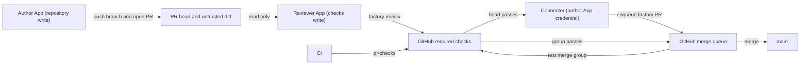

# Factory architecture

The factory turns delegated itsaplan issues into reviewed GitHub pull requests for repositories bound to the factory home cluster. The connector claims the work and starts a kagent coding session in an isolated workspace. The reviewer checks the proposed change independently, and GitHub enforces the required checks before merge.

```mermaid
flowchart LR
  plan["itsaplan (issue text)"] -->|delegated run| connector["Connector (agent keys)"]
  connector -->|dispatch| kagent["kagent coding session"]
  kagent -->|model and Git requests via egress gateway| broker["Broker (OAuth grant and author App key)"]
  broker -->|repository access| github["GitHub (untrusted PR content)"]
  connector -->|open PR and enqueue| github
  github -->|diff and head SHA| reviewer["Reviewer (separate App key)"]
  reviewer -->|review task| reviewAgent["kagent review session"]
  reviewer -->|head-bound check| github
  connector -->|report outcome| plan
```

## Components and ownership

Paths are relative to `projects/factory/`.

| Component | Role | Code | Pin | Untrusted input | Credentials held |
| --- | --- | --- | --- | --- | --- |
| itsaplan | Owns requests and run history | `chart/templates/itsaplan.yaml` | Community 1.10.0 | Issues and comments | Database, S3 and OIDC secrets |
| Connector | Claims runs and reconciles delivery | `connector/` | Built from this repo | Issue text, agent output and PR state | itsaplan agent keys, projected tokens and short-lived author App token |
| kagent | Owns agents and sessions | `chart/Chart.yaml`, `deploy/values.yaml` | Charts 1.0.1, controller fork e3d14ee3dd62 | Tasks and session messages | Controller ServiceAccount |
| Agent Substrate | Isolates actors and injects credentials at egress | `../platform-factory/substrate/` | Fork charts 1.0.1 | Workspace traffic | Actor identity and credentials scoped by policy |
| Codex CLI | Edits and checks the bound repository | `deploy/values.yaml`, `toolchain/` | 0.169.1 | Task and checkout | Gateway placeholders |
| Broker | Relays model calls and mints repository credentials | `broker/` | Built from this repo | Actor requests | Codex OAuth grant and author App key |
| Reviewer | Publishes the independent required check | `reviewer/` | Built from this repo | PR content and review replies | Reviewer App key |
| GitHub | Owns PRs, checks and the merge queue | External service | Hosted | Branches and PRs | GitHub App installations |
| Hindsight | Stores reusable coding lessons | `../platform-factory/hindsight/` | 1.2.1 | Recalled and retained text | Database and model credentials |
| Discord bridge | Routes mentions to Bosun | `discord/` | Built from this repo | Discord messages | Bot token and Discord memory access |
| Alert relay | Forwards Alertmanager notifications to Discord | `alert-relay/` | Built from this repo | Alertmanager webhooks | Discord webhook URL |

See the [connector architecture](connector/ARCHITECTURE.md) for the [run lifecycle](connector/ARCHITECTURE.md#run-lifecycle), [revision rounds](connector/ARCHITECTURE.md#review-rounds) and [liveness lease](connector/ARCHITECTURE.md#liveness-lease). The move keeps the reviewed text without a claim-by-claim source audit ([Joe's decision](https://factory-plan.jomcgi.dev/factory/issue/HOME-265#comment-3955)).

## Umbrella chart

Argo CD installs the factory chart with the homelab binding in `deploy/values.yaml`. The chart renders itsaplan, the broker, connector and reviewer, plus kagent resources for each repository binding. Substrate, Authentik, the edge gateway, Postgres and Garage run as separate installations.

## Sandbox checks

The homelab coding binding supplies the local check tools and their download policy. Its prompt directs the coder to run `toolchain/bootstrap.sh` after cloning and source the generated environment in each shell. Remote tests run in PR CI.

**Why.** The Alpine harness needs musl-compatible tools for local checks. The binding installs them without giving the workspace a BuildBuddy credential. [Sandbox toolchain decision](https://github.com/jomcgi-org/homelab/issues/7916)

## Memory

The coding agent recalls lessons before planning and retains reusable lessons in Hindsight's homelab bank. The egress gateway supplies the MCP credential. The review binding has no access to that bank.

**Why.** Joe made memory high priority on 2026-11-16 to cut tokens per
delivered issue, with Claude Haiku as Hindsight's LLM so that memory writes
do not spend Codex quota
([HOME-130 decision](https://factory-plan.jomcgi.dev/factory/issue/HOME-130#comment-913)).
Agents rediscover the same failing checks and conventions on each run; a
recalled lesson costs a few hundred tokens.

**Why.** On a 494-fact factory test set, Voyage 4 Large had the best
nDCG@10 (0.781) of ten models, against 0.522 for a stand-in for the image's
local `bge-small-en-v1.5`. Its 1,024 dimensions fit pgvector's index limit
([HOME-176](https://factory-plan.jomcgi.dev/factory/issue/HOME-176)). Joe
chose one OpenRouter key for both instances
([HOME-130 comment 1439](https://factory-plan.jomcgi.dev/factory/issue/HOME-130#comment-1439)).

## Discord bot

Bosun answers mentions in the configured Discord servers. The bridge scopes memory to the guild and channel and passes messages to a separate kagent agent. The agent uses a dedicated model credential and has no coding tools. [Isolation decision](https://github.com/jomcgi-org/homelab/pull/8188#issuecomment-6960669519)

## itsaplan

The API and worker share the factory database. Attachments go to Garage. Humans sign in through the edge and itsaplan's invite-only OIDC application. The connector uses separate identities to claim coding work and coordinate issue updates.

## Credential broker

The broker holds the Codex grant and GitHub author App key. It authenticates actor requests and scopes GitHub installation tokens to the bound repository. The connector authenticates to the broker with a projected ServiceAccount token. The separate reviewer App signs the required check.

## Identities

The optional notification client uses a dedicated Authentik account scoped to the monolith notification tool and its configured channel. See the [activation procedure](deploy/notify.md).

**Why.** Operator and Ember agent credentials grant unrelated tools. A dedicated
issuer and monolith permission check confine this sender even if it guesses
another tool or channel. Durable dedupe handles the response-loss case that
a connector memory cache cannot.

### Factory front page

The landing page reads the connector’s cached status snapshot. It shows work that needs Joe, active work and recent merges. A failed refresh makes the snapshot unavailable.

**Why.** The connector already has the store and coordinator read access. The
landing chart owns the status-only Service and Cilium grant, so removing the
page removes its access. The edge's sign-in and route stay unchanged.

## Merge authority

The factory author App writes the change, the reviewer App reports a verdict
on the commit, the connector enqueues the factory PR, and GitHub merges it.
The rules for authorizing delivery and interpreting a review live in
[AGENTS.md](../../AGENTS.md#merge-authority) and [REVIEW.md](../../REVIEW.md).

The connector opens the PR as `jomcgi-factory[bot]` on the issue branch
in the bound repository. The independent reviewer polls every open PR
targeting `main`. It reads the review rules from `main` and treats the
PR as untrusted input. The review agent reports findings. The service
computes the verdict and publishes it as `jomcgi-factory-review`.
The PR comment explains the check. Ruleset 9180009 requires the check
from reviewer App 5758326 alongside `pr-checks`.
[Required-check decision](https://github.com/jomcgi-org/homelab/issues/7817#issuecomment-6882698416)

- **Review order (HOME-220).** Running reviews retain their slots. The poller
  reattaches in-progress checks before starting new reviews. Within each
  `enqueueAuthors` priority, heads first observed eligible in an earlier poll
  go first. Within one poll, GitHub's latest ref activity dates the exact
  current SHA, bounded by PR creation and the latest readiness, skip-label
  removal, reopening or base-change event. This recovers eligible waits at
  startup without counting time spent as a draft or skipped PR. Incomplete
  history keeps the first observation as the fallback. A later poll cannot
  overtake that fallback with an older recovered timestamp. Forks keep their
  observed wait; the reviewer never requests a token for an unbound repository.
  Git commit dates and PR `UpdatedAt` do not set queue order. Observation is
  recorded before check and recovery reads, even while slots are full, and
  kept while history reads retry.
  Failed reads and metadata updates preserve the wait; a changed head or a
  successful start resets it. A completed review needing another pass joins
  at its new observation. PR number breaks equal arrival times.
  This prevents later updates from repeatedly overtaking an untouched head
  ([HOME-220](https://factory-plan.jomcgi.dev/factory/issue/HOME-220)).
  Cross-poll and fork-head ordering edge cases are deferred by
  [Joe's decision](https://factory-plan.jomcgi.dev/factory/issue/HOME-220#comment-4036).
  `TestWaitingHeadStartsBeforeUpdatedPRs` holds all three slots across three
  ticks of later PR updates and pushes, then checks that the oldest waiting
  head gets the first free slot. It also covers metadata changes on the
  waiting PR and failed check reads. `TestPrioritizeUsesHeadWaitWithinAuthorPriority`
  checks the author override. `TestHeadArrivalOrdersSamePollAndSurvivesRestart`
  checks head arrival order within one poll and after a restart, including a
  new PR opened from an old branch. `TestEligibilityTransitionStartsANewWaitAcrossRestart`
  covers draft readiness and skip removal, including during downtime;
  `TestWaitingForkPrecedesLaterDatedRepositoryHead` covers mixed observed and
  recovered ages. `TestReattachmentsKeepOrderBeforeWaitingHeads`
  checks the order of resumed reviews before new starts.

For issue-backed reviews, the service verifies the provenance of decision
evidence. Only the goal assessment receives private issue text. Its public
result uses fixed wording. The connector owns feedback to the delivery
owner on the private issue.
[Evidence decision](https://github.com/jomcgi-org/homelab/pull/8116#issuecomment-6930546469),
[issue record](https://factory-plan.jomcgi.dev/factory/issue/HOME-58#comment-1047),
[public output decision](https://github.com/jomcgi-org/homelab/pull/8116#issuecomment-6931275436),
[private feedback decision](https://factory-plan.jomcgi.dev/factory/issue/HOME-251#comment-2324)

Goal blockers may clear, by Joe's rule
([decision](https://factory-plan.jomcgi.dev/factory/issue/HOME-157#comment-3904)). The reviewer withdraws an earlier
goal finding when the PR names a different issue, or when the issue's
counted "Done when" list no longer reaches the finding's criterion
(`goalWithdrawn` in `reviewer/review/goal.go`). The withdrawal note is
fixed service text that names the issue keys and criterion number only.
The criteria counter handles a plain numbered or bulleted Done when list.
Unusual Markdown counts nothing, so it withdraws nothing and main's rules
apply. HOME-416 covers plain lists only, and HOME-436 owns unusual Markdown
and full CommonMark parsing
([Joe's decision](https://factory-plan.jomcgi.dev/factory/issue/HOME-416#comment-4353)).

The reviewer stores private goal replies on the `factory-reviewer-goal-audit`
PVC for 14 days from first receipt. After rollback, keep the PVC, the hourly
cleanup CronJob and its NetworkPolicy. To retire them, wait until the last
audit write is at least 14 days old, then confirm that a cleanup run has
completed successfully before deleting all three resources.

The connector sends actionable findings to the coder for revision. When
only human approval is outstanding, it waits. The reviewer checks Joe's
approval against the current head and applies the authorship waiver as
specified in [REVIEW.md](../../REVIEW.md#joe-decides).
[Human gate decision](https://github.com/jomcgi-org/homelab/issues/7817#issuecomment-6878730211),
[gate scope](https://github.com/jomcgi-org/homelab/issues/7817#issuecomment-6884458635),
[authorship decision](https://github.com/jomcgi-org/homelab/issues/7817#issuecomment-6891640540),
[waiver scope](https://github.com/jomcgi-org/homelab/issues/8049)

The saved review state keeps every blocking and model gate finding with
its full ID and severity, and shortens descriptive text first. A failed
history read blocks and retries on the next poll. State that overflowed
blocks the check until a replay of its task recovers the findings. Lost or
unreadable history (an expired task with a lossy record, a truncated
timeline, too many heads, an ambiguous, foreign or undecodable record)
keeps the check blocked and carries every known finding. No review or
approval clears it; open a new PR from commits no review has seen, such
as a rebase or squash onto main (#8009).

The connector checks for holds before enqueue. Other authors can request
auto-merge on their own PRs. The reviewer checks the queued head again
when reporting on the merge group. If the head loses its passing verdict,
the reviewer fails the group on its next poll and the queue drops it.
The organization-admin bypass covers Joe's emergency access and the chart
version write-back.

## Findings that shape the design

- The Substrate gateway replaces credentials in outgoing headers. The broker supplies the account header and authorization that Codex model calls require.
- Each kagent session belongs to one Agent. The connector records the session with the run so it can route revisions to the coder.
- An agent comment does not start another itsaplan run. The connector can report progress on the issue without dispatching new work.
- kagent trusted-proxy authentication relies on the edge to validate human access tokens. The connector authenticates separately through Kubernetes TokenReview.
- The chart renders itsaplan Secrets separately from the application workloads so that secret-init can generate missing values and preserve existing ones.
- A Kubernetes ServiceAccount principal includes its UID. Replacing the connector account changes its kagent identity even if its name stays the same.
- The connector renews itsaplan's run lease during execution. It correlates the run with a kagent A2A task and session in its own store.
- A task-opening message belongs to one session. Recovery must distinguish a lost response from a task that never started. The [connector lifecycle](connector/ARCHITECTURE.md#run-lifecycle) describes the recovery checks.
- Model usage comes from individual calls. The factory aggregates usage for a delivery in its [accounting model](token-usage.md).

## Direction

| Direction | Tracks | State |
| --- | --- | --- |
| Deliver private goal-assessment reasons to the delivery owner. | [HOME-251](https://factory-plan.jomcgi.dev/factory/issue/HOME-251) | staged off behind `reviewer.goalReasons.enabled` |
| Verify the factory App author when adopting a PR. | [#7920](https://github.com/jomcgi-org/homelab/issues/7920) | designed |
| Remove third-party Apps from the merge trust path. | [#7921](https://github.com/jomcgi-org/homelab/issues/7921) | designed |
| Move CI and the registry into the cluster and scope the chart write-back identity. | [#7922](https://github.com/jomcgi-org/homelab/issues/7922) | designed |
| Isolate fork PRs and serve fixture-only public previews. | [#7923](https://github.com/jomcgi-org/homelab/issues/7923) | designed |
| Activate the scoped Discord notification sink. | [#7935](https://github.com/jomcgi-org/homelab/issues/7935), consumers HOME-4, HOME-6 and HOME-10 | staged off behind `connector.notify.enabled` |
| Switch the Application to values bundled with the published chart. | [#7909](https://github.com/jomcgi-org/homelab/issues/7909) | designed |
| Store itsaplan application and recovery secrets in 1Password. | [Factory foundation](https://github.com/jomcgi-org/homelab/issues/7817) | designed, after off-site database backups |

## Decision history

| Decision | Record |
| --- | --- |
| Use a decision model for memory without a local fallback. | [Model choice](https://github.com/jomcgi-org/homelab/pull/8147#issuecomment-6949878652), [evaluation](https://factory-plan.jomcgi.dev/factory/issue/HOME-182) |
| Separate Joe's tracker identity from the account that provisions the project. | [Identity decision](https://factory-plan.jomcgi.dev/factory/issue/HOME-57#comment-292), [HOME-59](https://factory-plan.jomcgi.dev/factory/issue/HOME-59) |
| Grant the reviewer App permission to post PR comments and inline findings. | [Permission decision](https://factory-plan.jomcgi.dev/factory/issue/HOME-73#comment-474) |
