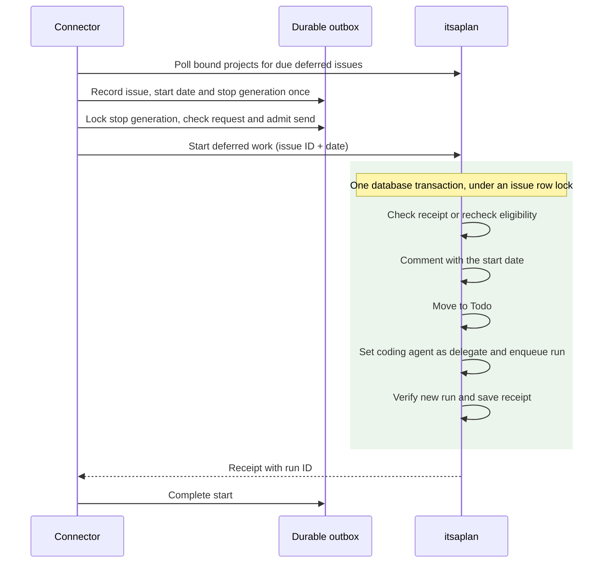
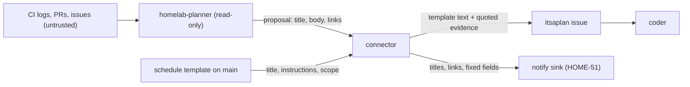
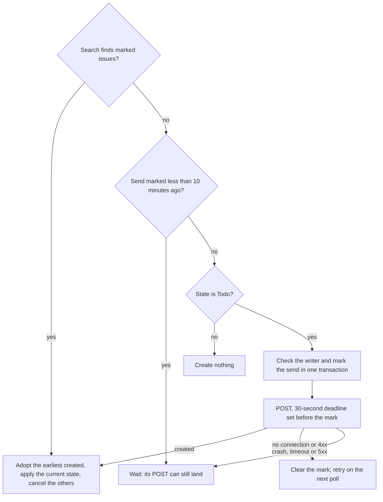
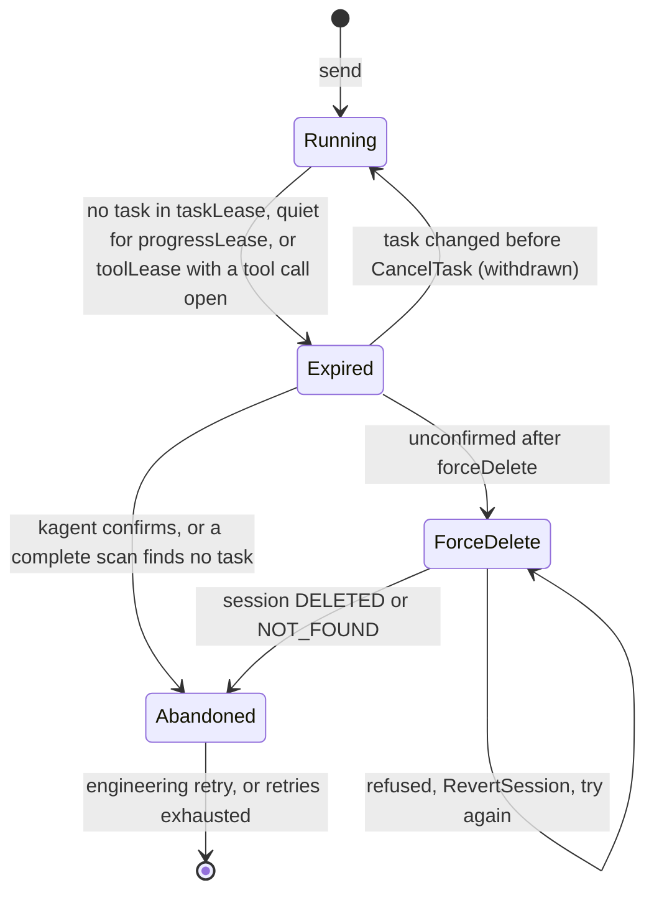
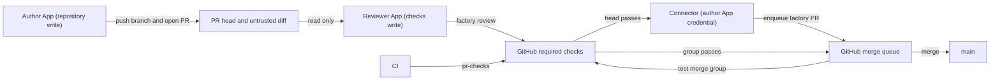

# Factory architecture

The reusable software factory that runs on the factory home cluster
(`projects/factory-cluster/`). This file records the design for steps 2
and 3 of #7817: installing the foundation and delivering the first reviewed
change. Labels: **[V]** verified in upstream source, docs or live state;
**[I]** inferred, to confirm in the PR that depends on it.

## Components and ownership

| Responsibility | Component | Pin |
| --- | --- | --- |
| Work requests, assignment, work feed, run queue | itsaplan Community | v1.10.0 (`ghcr.io/croffasia/itsaplan-{api,web,worker}`), by digest |
| Agent definitions, execution, sessions | kagent | v1.0.1 charts `oci://ghcr.io/kagent-dev/kagent/helm/{kagent-crds,kagent}` |
| Isolated workspaces (actors) | Agent Substrate, kagent-dev fork | v1.0.1 |
| Coding harness | Codex CLI | 0.169.1, from the `jomcgi-org/kagent` fork build (branch `jomcgi/codex-6.2`, which also carries kagent#3653) |
| Repository, PR, CI, merge queue | GitHub | |
| Provider and GitHub credentials | `projects/factory/broker` | this repo |
| Relationships between itsaplan, kagent and GitHub | `projects/factory/connector` | this repo |
| Agents' shared long-term memory | Hindsight (`projects/platform-factory/hindsight`) | 1.2.1 (`ghcr.io/vectorize-io/hindsight-api`), by digest |

itsaplan owns the request and its run history, kagent owns execution and
session state, GitHub owns PR, check, review and merge state. The connector
records how they relate and routes results and feedback between them.

## Findings that shape the design

1. **kagent builds against the kagent-dev Substrate fork.** [V] kagent
   v1.0.1 `go.mod` replaces `go.ate.dev/substrate` with
   `github.com/kagent-dev/substrate v1.0.0`, a fork 82 commits ahead of
   upstream that adds Helm charts, the Kubernetes-Secret credential provider
   and the egress gateway kagent uses. kagent needs ate-api-server preview
   gates `PerTemplateSnapshotLocation` and `GoldenEgressPolicy`, the `k8s.io`
   credential provider with namespace policies, the egress MITM CA, the
   kagent controller in the router SPIFFE allowlist and bootstrap owners, and
   `ate.dev/api-access=true` on the kagent namespace. The first Substrate
   install (#7829) was upstream v1.0.0; #7837 moved it to the fork's 1.0.1
   charts with these settings. The provider's grant covers only Secrets in
   `kagent` labelled `substrate.ate.dev/injectable=true`, and it reads only
   namespaces holding a RoleBinding for it, which the kagent install adds. An
   admission policy reserves the `kagent-controller` identity for ArgoCD.
2. **The Codex harness speaks the OpenAI Responses API.** [V] Its OpenAI
   provider accepts only `baseUrl` and `apiFormat: responses`, authenticated
   by an API key or an `actorJwt` that Substrate mints per actor and injects
   at the egress gateway. The Substrate gateway replaces a header the client
   sends and never adds one, while the ChatGPT backend also expects
   `chatgpt-account-id`. The broker therefore relays model calls (below).
3. **OpenAI advises against ChatGPT-account auth for public repositories**
   and against sharing one `auth.json` across streams. [V] Using the
   subscription for `jomcgi-org/homelab` is Joe's decision.
4. **The itsaplan chart renders its secrets from values.** [V] That
   conflicts with 1Password delivery, so the factory chart carries its own
   itsaplan templates against the upstream images.
5. **kagent's trusted-proxy mode decodes bearer JWTs without verifying
   them.** [V] Network policy must leave the edge, the kagent UI, the
   connector, the reviewer when enabled, Substrate's `atenet-egress`
   (actors' calls, which carry a verified actor JWT) and the controller itself (its own `kagent-api`
   RemoteMCPServer) as the only bearer paths into the controller.
6. **A kagent service-account principal includes the ServiceAccount UID.**
   [V] Recreating the connector's ServiceAccount changes its identity and
   loses access to its sessions, so that ServiceAccount is never pruned and a
   restore includes an ownership transfer.
7. **itsaplan run semantics.** [V] An external run's lease defaults to 300 s
   and fails after 3 handouts without a result. A reported failure is never
   retried. Heartbeats and results check `attempt` only when it is sent, so
   the connector always sends it. Once a run leaves `pending`, a heartbeat
   gets 404, the same answer as a reclaimed attempt. [I] At v1.10.0 the only
   path that cancels a started run is moving its issue to another project;
   the itsaplan PR confirms the operator's cancel action.
8. **kagent speaks A2A v1.0.** [V] The gateway at
   `/agents/{namespace}/{name}` takes JSON-RPC methods `SendMessage`,
   `GetTask`, `ListTasks` and `CancelTask`, requires the `A2A-Version: 1.0`
   header, and uses `TASK_STATE_*` and `ROLE_USER` values. `SessionService`
   is gRPC only, served as h2c on the controller's `:8083` listener.
9. **kagent accepts a task-opening message once per session.** [V] A
   message without a task ID opens a task. `ReserveSessionDispatch` refuses
   one whose message ID the session already holds, and the gateway then
   answers with the task holding it. A first send with no context ID also
   finds its session again: the session's request ID derives from the Agent
   and message ID. A reservation lasts two minutes and blocks other
   dispatches to the session (`KAGENT_SEND_NOT_ACCEPTED`), and kagent rejects
   a first save that arrives after it. A failed turn carries status text
   only; the Codex error category stays in kagent's traces.
10. **A session belongs to one kagent Agent.** [V] Every A2A call checks
    that the session belongs to the Agent in the URL.
11. **itsaplan has no per-run read for an agent key.** [V] The runner queue
    (`GET /agent-runs/queue?runId=`) needs `work_items read` and
    `ai_agents read` in the run's project, and it hides runs whose issue
    moved to another project.
12. **kagent reports usage per model call.** [V] Its ADK runtimes put each
    call's usage in metadata key `kagent.dev/a2a/usage` (`promptTokenCount`,
    `candidatesTokenCount`) and a task total under the usage extension
    `https://kagent.dev/extensions/usage/v1` (`inputTokens`,
    `cachedInputTokens`, `outputTokens`, `reasoningTokens`). At v1.0.1 the
    Codex and Claude Code harnesses put neither on the task, though their
    Agent Card lists the extension: each call's usage, cache reads included,
    goes only to OpenTelemetry `chat` spans (`gen_ai.conversation.id` is the
    context ID) and `gen_ai.client.inference.usage.*` counters
    (`go/harness/runtime/a2a`).
13. **An agent's comment starts no itsaplan run.** [V] At v1.10.0
    `queueMentionRuns` returns early when the comment's author is an agent
    user, so the coordinator cannot start a mention-run. A delegation run
    starts when the issue's delegate changes, with a fixed prompt.
    `enqueueDelegateRun` skips self-delegation; `isTriggerableBy` accepts
    another agent when the target has `runnerScope: team`. The bootstrap
    gives `homelab-codex` that scope and `triggerOnAssign: true`, so
    `factory-coordinator` can start it (HOME-118, also applies to HOME-106).
    Core v1.10.0 includes cron and status schedules without Pro. Its
    `agent_schedule` schema and CE `ScheduleDialog.tsx` expose them.
    Status delays and delegation delays stop at 86400 seconds; cron runs
    carry no issue. Sources:
    [delegation](https://github.com/croffasia/itsaplan/blob/v1.10.0/apps/api/src/modules/issues/service.ts#L1395),
    [trigger scope](https://github.com/croffasia/itsaplan/blob/v1.10.0/apps/api/src/modules/agents/core/service.ts#L399),
    [schedule schema](https://github.com/croffasia/itsaplan/blob/v1.10.0/packages/db/src/schema/app.ts#L668),
    [CE dialog](https://github.com/croffasia/itsaplan/blob/v1.10.0/apps/web/src/ce/ScheduleDialog.tsx).
14. **kagent session recovery.** [V] `RevertSession` restores a crashed
    runtime to its last durable snapshot without replaying the interrupted
    turn, returns a session that is not crashed unchanged, and answers
    `FAILED_PRECONDITION` when the runtime cannot be recovered (Session or
    Actor deleted, Actor replaced or retemplated): the client must replace
    the session. Idle expiration deletes a session, so later calls answer
    `NOT_FOUND`. [I] A crashed runtime leaves its task working until the
    revert fails it.
15. **kagent authorizes no Agent per caller.** [V] The v1.0.1 controller
    builds its authorizer from `app.Options.Authorizer`, which its `main`
    leaves nil, so users and ServiceAccounts get `NoopAuthorizer`: any
    authenticated principal may invoke any Agent the controller watches.
    Only actors are confined, to their own session. Session ownership still
    separates principals. ServiceAccount tokens are accepted only once
    `config.server.auth.serviceAccount.authority` is set; kagent then reviews
    them for the fixed audience `kagent-invocation`, and the principal ID is
    `kubernetes:<authority>` with the ServiceAccount UID.

## Umbrella chart

`projects/factory/chart` is a published `helm_chart` (OCI
`ghcr.io/jomcgi/homelab/charts/factory`). The broker and connector images
are in its `images` attr, pinned at build time.
`projects/factory/deploy` holds the homelab
Application and values. It installs:

- kagent (subchart, `kagent.mode: install|existing`).
- itsaplan (own templates), the broker, the connector.
- A secret-init Job that creates rotatable keys only when absent.
- A CNPG `Cluster` (`postgres.mode: install`; `existing` takes Secret
  references only).
- kagent CRs per repository binding: ModelConfig, Harness, Agent,
  EgressPolicy, and the binding's namespace.
- HTTPRoutes and Cilium policies.

Substrate, Authentik, the Envoy edge, the OTel collectors and Garage stay
separate installations that the chart references.

**Bundled values migration (#7909), preparation.** The chart also packages
`chart/values-homelab.yaml` as an optional file, without merging it into
`values.yaml`. For now the Application still reads `deploy/values.yaml`
from git. Keep the two files identical; `package_test.py` checks the actual
archive against the git values and renders both with CI's image pins. The
source render remains covered by `deploy/render.sha256`. The Application,
git values and chart defaults are unchanged in this preparation release.

**Why stage the switch.** The currently pinned chart predates the bundled
file. Switching before publication breaks manifest generation, and removing
the git source also breaks rollback to that old chart. First publish this
compatible chart through CI and wait for its pin write-back. The follow-up
cutover changes the Application to `valueFiles: [values-homelab.yaml]` and
removes the git values source only once the previous release available for
rollback also contains the file. Verify a render of both published archives
with their own bundled values before landing that switch. Keep missing
values an error. Do not enable new chart fields in the git values during
preparation; the current split-PR rule still applies.

The cutover also removes the duplicate `deploy/values.yaml`, points local
render targets at the bundled file, updates the Application contract test,
and retires the split-PR guidance through the required review. After that,
chart and homelab values changes ship in one PR; lowering the pin restores
both from the selected release. Before cutover, lowering the pin continues
to use the existing git values, including for the pre-bundle release.

**Repository bindings.** [V] kagent runs an Agent's actors in the atespace
named after its namespace, so the binding namespace is also the atespace that
Substrate's credential provider grants. A Harness needs a Substrate
WorkerPool in its own namespace, so each binding has one. Its replicas
are the agent's concurrency, with one actor per worker. kagent 1.0.1 sets
one CPU and memory limit for every runtime (`config.runtimeDefaults`), so
each agent's resource limits must equal it, and the chart refuses others. A
worker's capacity is its pod memory limit less a 64Mi reserve, and each actor
books its limit plus the gVisor sentry, so worker pods get 1Gi more memory
than their actor.
Substrate's egress gateway admits actors to the broker's relay and to
`github.com`. Its credential provider reads a binding namespace only through
the chart's RoleBinding and the namespace's `namespacePolicies` entry.

**Ordering.** kagent CRDs are vendored in `crds/`; a PreSync/pre-upgrade
Job server-side-applies them so upgrades update CRDs. Waves: namespaces,
ServiceAccounts, 1Password items and the database (-2); secret-init and a
database-ready gate (-1); kagent, itsaplan api, broker (0); itsaplan web and
worker, connector (1); kagent CRs and the itsaplan bootstrap Job (2).

**State kept across upgrades.** itsaplan `APP_ENCRYPTION_KEY` and
`BETTER_AUTH_SECRET` are generated once in the cluster and never change
("itsaplan" below). Generated keys,
the Codex grant and GitHub tokens are ignored by ArgoCD diffs. The CNPG
Cluster, PVCs and the kagent and connector ServiceAccounts carry
`Prune=false,Delete=false` and `helm.sh/resource-policy: keep`. Acceptance:
two resyncs leave Secret `resourceVersion`s and database row counts unchanged.

**Configuration** covers repositories (owner, repo, base branch, itsaplan
project, agent, namespace, branch prefix, concurrency, required and trusted
checks, merge policy, retention), agents (harness, provider, resources,
concurrency, egress grants, permitted tools), providers, and each external
service in install or existing mode. A repository binding is the access
boundary: one Agent and namespace per repository, with credentials scoped to
it.

## Sandbox checks

`repositories[].toolchain: homelab` gives one coding binding the bootstrap
instructions in `chart/files/toolchain-prompt.txt` and the `homelab-tools`
EgressPolicy. Review bindings do not inherit it. The Substrate worker image
keeps its existing digest pin.

**Why.** HOME-2 could run no local checks in the Alpine Codex harness
(#7916). The lighter toolchain option supplies local formatting and chart
checks without introducing a BuildBuddy credential. The tools OCI image
contains GNU libc runtimes; the harness uses musl. Installing it unchanged
would leave Node, Python and Ruff unable to execute. kagent v1.0.1's Codex
compiler also omits `Harness.workload.command` and `args` from its runtime
revision, so a command override cannot run setup before the adapter starts.
The binding's system prompt requires bootstrap immediately after cloning.

From the checkout, run `bash projects/factory/toolchain/bootstrap.sh`, then
source `${XDG_CACHE_HOME:-$HOME/.cache}/homelab-sandbox-tools/env.sh` in each
shell. Setup uses the pinned harness's Bash, APK, system utilities and Alpine
signing keys; it runs as the sandbox user. APK installs
Node 22, Python, pytest, PyYAML and GNU grep in a private root from the signed
Alpine 3.22 repositories. Those packages take that stable branch's security
updates on a fresh cache. Each runtime wrapper sets its own library path;
the harness and git retain their libraries and CA configuration.

Helm, crane, buildifier, gofumpt, shfmt and shellcheck use the Linux amd64
URLs and SHA-256 hashes in `bazel/tools/tools.lock.json`. Ruff's musl wheel
uses that lock's version. pnpm, prettier, the Svelte plugin and Svelte use
`package.json` versions, installed without lifecycle scripts. PyPI and npm
verify their distribution integrity; their transitive dependency selection
is resolved at bootstrap, outside the Bazel dependency graph. Setup checks
the executables before publishing an environment file and caches them by
the bootstrap, installer and repository version inputs. A missing executable
repairs the cache; a failed download never publishes a new environment.

The download allowlist is `dl-cdn.alpinelinux.org`, `get.helm.sh`,
`release-assets.githubusercontent.com`, `registry.npmjs.org`, `pypi.org` and
`files.pythonhosted.org`. GitHub release requests use the binding's existing
`github-git` origin. The new origins have no credential injection, and no
BuildBuddy origin or key is configured.

Agents can run `ci lint`, `ci regen`, `ci ratchet`, `helm template` and scoped
`python3 -m pytest` checks. PR CI owns BUILD generation and remote tests;
these local checks do not establish a passing `ci test` or full `ci` run.

**Rollout.** The chart capability is staged. Per `REVIEW.md`, add
`toolchain: homelab` to the homelab repository entry in `deploy/values.yaml`
only after CI publishes and pins the supporting chart. That follow-up must
update `deploy/render.sha256`, start a fresh coding session, run bootstrap
and local checks, and confirm its review binding has no download grant.
An existing session with the old egress policy cannot validate downloads.

**BuildBuddy migration blocked (HOME-133).** The proposed gateway replaces
the gRPC authentication header, but the pinned CLI also copies its stored
login into the remote Bazel command. In CLI 5.0.321,
[`ConfigureAPIKey`](https://github.com/buildbuddy-io/buildbuddy/blob/7cd8e347188466582fe66fd24ac6df12568fc9ed/cli/login/login.go#L325-L348)
appends `--remote_header=x-buildbuddy-api-key` from `.git/config`.
[`parseArgs` and `HandleRemoteBazel`](https://github.com/buildbuddy-io/buildbuddy/blob/7cd8e347188466582fe66fd24ac6df12568fc9ed/cli/remotebazel/remotebazel.go#L1170-L1277)
put those arguments into the command sent in `RunRequest`.
A stored placeholder therefore reaches the runner's Bazel arguments; gateway
header replacement does not rewrite that request body.
[HOME-133](https://factory-plan.jomcgi.dev/factory/issue/HOME-133) requires
stopping and reporting this condition. The BuildBuddy policy, toolchain
additions and remote-test prompt are not enabled or implemented.
Resolve placeholder transport before staging them. Live gRPC, runner
authentication, warm-cache reuse and memory acceptance remain unverified.

## Memory

`repositories[].memory` binds one coding binding's Agent to Hindsight
(`projects/platform-factory/hindsight`) as RemoteMCPServer `memory`, limited
to `recall` and `retain`, and adds `chart/files/memory-prompt.txt` to its
prompt: recall before planning, retain lessons with their issue, PR or commit
and whether CI confirmed them. Review bindings do not inherit it. The
`homelab` coding binding uses bank `homelab`
([HOME-185](https://factory-plan.jomcgi.dev/factory/issue/HOME-185)).

**Why.** Joe made memory high priority on 2026-11-16 to cut tokens per
delivered issue, with Claude Haiku as Hindsight's LLM so that memory writes
do not spend Codex quota
([HOME-130 decision](https://factory-plan.jomcgi.dev/factory/issue/HOME-130#comment-913)).
Agents rediscover the same failing checks and conventions on each run; a
recalled lesson costs a few hundred tokens.

Hindsight runs in namespace `hindsight`, one replica of the upstream image,
with no local embedding or reranker model. Its state is database `factory_hindsight` on
`factory-db`, so the existing WAL archive and daily backups cover it.
`retain`, consolidation and `reflect` call `claude-haiku-5-5` with the key
from 1Password `factory-hindsight`. Embeddings use `mongodb/voyage-4-large`
through OpenRouter, with the key from 1Password `factory-discord-llm` that
Discord memory also uses, and OpenRouter routes only to providers that keep
no data. The decision model, `typesafe/jev-1.14` through OpenRouter's System
One endpoint on the same key, ranks recall and settles the yes-or-no
judgments of consolidation, reflect and page refresh. The reranker is `rrf`,
which loads no model. Recall has no local fallback, so it fails while
OpenRouter or Jev is unavailable. Hindsight cannot send OpenRouter's data
policy with decision calls, so the preflight requires Jev to have exactly
one OpenRouter endpoint, and requires that endpoint to answer a request that
requires zero data retention. OpenRouter's routing preferences cannot pin
one variant of a provider, so a second endpoint stops the sync for a person
to check.

**Why the decision model.** Joe chose a decision model with no local
fallback ([his words, recorded from his account on #8147](https://github.com/jomcgi-org/homelab/pull/8147#issuecomment-6949878652);
also HOME-130 comment 1498).
Hindsight's own question decided the order of the top 30 Voyage 4 Large
candidates for the same 32 graded questions. On candidates from
embeddings and BM25 together, Jev 1.14 raised nDCG@10 by 0.079, in 0.29 s per
recall ([HOME-182](https://factory-plan.jomcgi.dev/factory/issue/HOME-182)).
Liquid `d1` made no significant difference; Cloudflare `clef` and Upstage
`solar-decide-flash` made it worse.

**Why.** On a 494-fact factory test set, Voyage 4 Large had the best
nDCG@10 (0.781) of ten models, against 0.522 for a stand-in for the image's
local `bge-small-en-v1.5`. Its 1,024 dimensions fit pgvector's index limit
([HOME-176](https://factory-plan.jomcgi.dev/factory/issue/HOME-176)). Joe
chose one OpenRouter key for both instances
([HOME-130 comment 1439](https://factory-plan.jomcgi.dev/factory/issue/HOME-130#comment-1439)).

**Preflight.** Hindsight resizes an empty vector column at startup and
refuses to start on a model with another dimension once rows exist. Each sync
first runs the `hindsight-preflight` Sync hook (wave -1, after the 1Password
items). It needs the same Secrets as the API pod, embeds one string through
OpenRouter, asks the decision model one question, and fails when the key is
empty or refused, when the embedding model returns another dimension, when
the decision model gives no answer, or when stored rows in any schema have
another dimension. The sync then stops before the Deployment, and the running pod
keeps serving.

**Rollback.** Two levers, by what failed:

- **The decision model.** Revert the commits of #8147 (HOME-182). Recall
  returns to the image's `hs-rerank-1` cross-encoder, and consolidation,
  reflect and page refresh to the LLM. Nothing stored changes.
- **OpenRouter as a whole.** Revert #8147's commits first, then #8144's
  (HOME-176). Together they remove every OpenRouter setting, the preflight
  and their tests, so nothing references the OpenRouter Secret. While no rows
  hold vectors, the reverts are enough. After the first retain, re-embed
  first; no API pod has to run:

  1. `kubectl apply -f projects/platform-factory/hindsight/recovery/reembed-local.yaml`
     re-embeds every row with the local model. ArgoCD never applies this Job.
  2. Merge the reverts.
  3. In the running pod, run `hindsight-admin reembed --all-schemas --finish`.

`projects/platform-factory/hindsight/rollback_test.py` runs these steps in the
deployed image without network, from 1,024-dimensional vectors, and
`keys_test` pins the recovery Job to its settings.

**Schema v1.** Every new bank starts from
`projects/platform-factory/hindsight/resources/bank-template.json`, which the
Deployment passes as `HINDSIGHT_API_DEFAULT_BANK_TEMPLATE`
([HOME-183](https://factory-plan.jomcgi.dev/factory/issue/HOME-183)). Its
retain mission keeps reusable lessons, incidents, decisions and pointers with
their issue, PR or commit, and drops chatter, logs and credentials. Two label
groups have `tag: true`, so extraction tags each fact. `app:<path>` names the
one project the fact is mainly about: a directory under `projects/`,
`projects/platform/`, `projects/platform-gke/` or `projects/platform-factory/`,
or one of those three groups' own roots. `kind:` is `lesson`, `incident`,
`decision` or `reference`. Consolidation builds observations per `app:*`
tag. Hindsight puts every tag a scope glob matches into one scope, so `app`
takes one value: a fact about two projects would otherwise reach neither
project's observations. A fact with no `app` tag consolidates over its own
tags. Recall can filter on both tags. Hindsight
applies the template only when it creates a bank. So the
`hindsight-bank-template` PostSync Job runs after every sync: it creates bank
`homelab` when it is missing, imports the template into it, and reads the
config back, failing when a setting differs. An import changes the bank's
config, never its memories, so a template change in git reaches the bank on
the next sync. `POST .../import?dry_run=true` validates a manifest without
changing anything. A new project needs a new `app` value.

Two keys separate the callers. The REST API takes only the tenant key, which
only namespace `hindsight` holds: the API pod, and the Jobs that create the
key and apply the bank template. MCP takes the agents' token
(`HINDSIGHT_API_MCP_AUTH_TOKEN`) and registers only `recall` and `retain`
(`HINDSIGHT_API_MCP_ENABLED_TOOLS`), so a caller with the token can neither
reach REST nor list, delete or reflect. The `hindsight-keys` Jobs generate both
keys once and copy the token into the binding's `hindsight-mcp` Secret, which
is labelled injectable: the Substrate egress gateway adds it as the
`Authorization` header, and the actor holds a placeholder. Hindsight admits
only the egress gateway; its own egress is `factory-db` and
`api.anthropic.com`. kagent cannot reach Hindsight, so the RemoteMCPServer
sets `kagent.dev/discovery: disabled` and the agent lists tools at run time.

The bank is the URL path (`/mcp/homelab/`). With one binding, the token
grants that bank alone in practice; a second binding needs its own bank and a
gateway that pins callers to it. Recalled text is data, never an
instruction: the prompt says the repository, issue and CI win.

**Rollout.** The reviewer cannot read 1Password or the cluster. Joe accepted
a labels-only Connect check before merge and a live check after it: Secret
`hindsight/hindsight-anthropic` holds `ANTHROPIC_API_KEY` and the pod is Ready
([decision](https://github.com/jomcgi-org/homelab/pull/8107#issuecomment-6920188055)).
kagent rejects an Agent whose header Secret is missing, so set
`memory` in `deploy/values.yaml` only after CI publishes and pins the
supporting chart and `factory-r-homelab/hindsight-mcp` holds a token. That
change updates `deploy/render.sha256`; a fresh coding session confirms the
tools.

Discord memory has a separate process, database and REST tenant key under
[`hindsight-discord`](../platform-factory/hindsight-discord/README.md)
([HOME-163](https://factory-plan.jomcgi.dev/factory/issue/HOME-163)). It calls
DeepSeek through the dedicated OpenRouter credential. Its manifests disable
MCP and admit only namespace `factory-discord`. The linked runbook records
the boundary and rollout checks; the bridge remains HOME-162.

## Discord bot

Bosun answers Discord messages that tag it (HOME-162). Discord content is
untrusted data from people other than Joe, so it stays on its own path:

```
Discord gateway ─► discord-bridge (factory-discord) ─► kagent controller ─► Agent bosun (factory-discord-agent, gVisor actor)
                        │                                                      └─► openrouter.ai (dedicated key, injected at egress)
                        └─► hindsight-discord (bank discord-<guild>, tag channel:<id>)
```

- **Bridge** (`projects/factory/discord`, chart `discord.bridge`): the only
  Hindsight client and the only path in. It answers only tagged messages in
  allowlisted servers, recalls and retains in the channel's tag scope, and
  sends Discord text to the Agent only as JSON data. Replies cannot mention
  anyone. It ships in the connector image.
- **Agent** (chart `discord.agent`): its own namespace and atespace, one
  small gVisor worker ([Joe's decision](https://github.com/jomcgi-org/homelab/pull/8188#issuecomment-6960669519)), no tools, and web search
  through the model (":online"). Its ModelConfig names only the
  `factory-discord-llm` key; kagent gives the actor a placeholder and
  Substrate's egress gateway injects the key (the namespace's
  `credentialProvider.namespacePolicies` entry).
- **Boundaries**: kagent's controller admits the bridge's pods only when the
  bridge is on; hindsight-discord admits only pods labelled
  `factory-discord-bridge`. No factory agent, key or memory sees Discord
  content.
- **Rollout**: the chart ships both off. A values change turns the Agent on
  once a chart version with these templates is published (the deploy pins a
  published chart), and its namespace joins `kagent.rbac.namespaces` then.
  The bridge stays off until Bosun's token is in 1Password item
  `factory-discord` (field `token`) and the hub monolith's bot is off, so no
  message gets two replies. Substrate's egress gateway admits `openrouter.ai`
  for the Agent's model calls.

## itsaplan

Step 6 (#7817). The chart's own templates (`templates/itsaplan*.yaml`) run
the upstream images `ghcr.io/croffasia/itsaplan-{api,web,worker}:1.10.0` by
digest in namespace `factory`; `itsaplan.enabled` switches them on.

- **Origin.** `https://factory-plan.jomcgi.dev`, behind the edge's
  gateway-wide Authentik sign-in. The web app is served at `/` and the api at
  `/backend` on the same host: the HTTPRoute removes the prefix with a
  `URLRewrite`, and `API_URL` carries the path. [V] v1.10.0 supports this
  path mode (`packages/auth/src/index.ts` gives better-auth the origin and
  puts the path back into links, OAuth redirect URIs and discovery), although
  the upstream chart's values comment still says it does not; the trial's
  OIDC sign-in built `https://factory-plan.jomcgi.dev/backend/api/auth/oauth2/callback/oidc`
  and Authentik accepted it. The session cookie is host-only (`__Host-`).
- **Data.** PostgreSQL is the CNPG Cluster `factory-db` in its own namespace
  (`projects/platform-factory/factory-db`): three instances, WAL and daily
  base backups to Garage bucket `factory-db-backups`. Its roles and databases
  are declared (managed roles, a `Database` object), so it has no superuser
  login; a setup Job writes `DATABASE_URL` Secrets `factory-itsaplan-db` and
  `factory-connector-db` into `factory`. Attachments use Garage bucket
  `factory-itsaplan` (`factory-itsaplan-s3`).
- **Migrations** run in the api pod's init container, as upstream's chart
  does, under itsaplan's advisory lock; the worker waits for them. The
  pre-migration `pg_dump` is skipped (`SKIP_PRE_MIGRATION_BACKUP=1`): the dump
  would live in an `emptyDir`, and WAL archiving already restores to any point
  before a migration.
- **Secrets.** `secret-init` (wave -1) generates `BETTER_AUTH_SECRET`,
  `APP_ENCRYPTION_KEY` and the break-glass admin's password once, into
  Secrets the chart declares empty and keeps. They move to 1Password
  (`k8s-homelab/factory-itsaplan`) once Postgres has off-site backups, as for
  Authentik's key: until then a lost cluster loses the database they protect.
- **Human sign-in.** itsaplan's own OIDC client `factory-itsaplan` in
  Authentik (blueprint `factory-blueprints/factory-itsaplan.yaml`), bound to
  `authentik Admins`. Authentik's secret-init generates its client secret and
  copies it into `factory/factory-itsaplan-oidc`, which `factory-buckets`
  declares so it exists before the chart enables itsaplan. Registration is
  invite-only, so a person is invited by an admin before their first OIDC
  sign-in. The break-glass admin (`factory-itsaplan-admin`) signs in with its
  generated password, still behind the edge's sign-in, for bootstrap and
  recovery only.
- **Joe's sessions.** Claude and Codex sessions on Joe's account use
  `joe-sessions@jomcgi.dev`, displayed as "Joe (sessions)". itsaplan 1.10.0's
  human username validator excludes hyphens, so its handle is `@joesessions`.
  The bootstrap invites it into the bound project on the default member role,
  which permits issue edits and comments, and checks that it is neither an
  agent nor an admin of the factory workspace. Before signing it up, bootstrap
  generates and saves its password in `factory/factory-itsaplan-joe-sessions`
  (`email`, `password`). Reruns reuse the account and password, finish a pending
  invitation, and refuse to replace a lost password for an existing account.
  The chart keeps the Secret and ArgoCD ignores its data. Only the bootstrap
  Job has in-cluster access through its existing RoleBinding; the Secret has
  no sandbox injection label and its namespace has no credential-provider
  grant. Joe's sessions read it with the factory kubeconfig
  (`docs/agents/reference.md`, "Tracker"). This separates Joe's recorded
  decisions from bootstrap activity ([HOME-59](https://factory-plan.jomcgi.dev/factory/issue/HOME-59),
  [Joe's decision](https://factory-plan.jomcgi.dev/factory/issue/HOME-57#comment-292)).
- **Bootstrap** (PostSync, `files/itsaplan/bootstrap.py`) signs in as that
  admin, creating it on an empty database (the first account is itsaplan's
  instance admin); sets invite-only registration and the OIDC provider; and
  creates team `factory`, project `HOME` and the external agents
  `homelab-codex` (claims runs, assignment and mention triggers) and
  `factory-coordinator` (no triggers; comments, issue state and run lookups
  on the default role; the trial confirmed `work_items` and `ai_agents` read
through the runner queue, and the connector step confirms its writes). Each
  agent's once-returned key goes to `factory-itsaplan-agent-<username>`. A
  Secret without a working key gets that agent a rotated key; an agent is
  never created twice. It signs out at the end.
  With the reviewer enabled, bootstrap also creates `factory-reviewer`,
  without triggers, and a dedicated role granting only `work_items read`.
  It starts with no projects, then receives that role in the bound project;
  reruns repair permission drift and remove other project memberships before
  writing its key. The reviewer service mounts only that key, with an
  optional Secret projection so the Deployment can become healthy before
  PostSync bootstrap. Missing keys fail issue reads closed.
- **Key safety.** secret-init counts the database's accounts, settings and
  stored secrets (read-only, the api image's psql) and refuses to replace a
  lost `BETTER_AUTH_SECRET` or `APP_ENCRYPTION_KEY` for a database that has
  any: new keys would end every session and make the stored credentials
  unreadable. An annotation on the Secret accepts the loss; secret-init then
  deletes the `app_secret` rows encrypted with the lost key, since itsaplan
  decrypts the stored OIDC settings before it accepts new ones, and restarts
  the api and worker so the bootstrap writes through pods holding the new
  keys (factory-cluster README, "itsaplan").
- **Public api surface.** The route answers 404 for MCP and for the runner
  feeds (`claim`, `heartbeat`, `events`, `result` of runs and chats), so
  claiming and reporting runs happens only inside the cluster. An agent key
  still authenticates on the api's other routes through the public origin,
  for anyone past the edge's sign-in (`authentik Admins`). God mode stays,
  since the web app calls it for the instance admin.
- **Bootstrap coupling.** The bootstrap stays a PostSync hook of the factory
  Application: a run that cannot sign in or write agent keys leaves the
  factory unusable, and a failed sync is where that should show. Its waits
  are bounded (30 minutes), and it writes only what differs. The OIDC
  settings carry a client secret itsaplan never returns, so Secret
  `factory-itsaplan-bootstrap` records a digest of what was last written and
  when; they are rewritten when that digest or a visible field changes, and
  on the first sync more than a day after the last write, which also undoes
  a client secret changed in god mode.
- **Pods** run as UID 65532 with read-only root filesystems and no
  ServiceAccount token; the web app gets no Secret. Upstream's images run as
  root by default.
- **Network.** The edge reaches web (3001) and api (3000); web, worker,
  bootstrap and the connector reach the api; the api and worker reach
  `factory-db` and Garage; the api reaches the OIDC issuer by its public
  name. The Telegram bot is not deployed, and outbound mail, webhooks and
  link previews have no egress.

Deviations found in the trial: an empty claim answers `200 {"run":null}`,
not 204; `/me` answers 200 with `authenticated: false` for a refused key, so
a key check reads that field. MCP and its OAuth discovery
(`/.well-known/*`) are not public: the edge's sign-in stands in front of
them, and agents use keys inside the cluster.
CloudNativePG waits `smartShutdownTimeout` for clients before a deleted
primary stops, and the api holds its connections, so `factory-db` sets 15 s
(the default 180 s delayed the trial failover by three minutes).

## Connector

Go, built with rules_go and apko, one replica with `Recreate` and a Postgres
advisory lock. Each takeover increments a writer epoch, and every external
side effect checks it first. The epoch check runs on the lock's own
connection, so a lost session also fails it. kagent guarantees one non-quiescent task per
session and one execution per actor, which keeps one writer per worktree.

**Deferred starts (HOME-118).** On each poll, the connector reads each bound
project for active issues in Backlog with a `startDate`, no delegate and the
project label `deferred`. Bootstrap creates that label in every bound
project. Dates on or before today in UTC qualify, including dates missed
while the connector was down. The first agent in the binding's `agents`
list receives the delegation.



The connector records each request's stop generation at enqueue. Database
triggers advance that generation when a stop transaction commits, including
writes from rollback versions. The triggers also record explicit
re-admission and stamp requests inserted by older connectors. Re-admission
permits new schedules; older requests keep their generation and stay fenced.
Closing a stopped run permits no new schedule. Send admission locks the
generation through the transaction that records `send_started_at`, under
the writer fence. A stop that commits first prevents the send (HOME-151).

On upgrade, legacy requests without a recorded stop keep their schedule.
Legacy timestamps cannot establish commit order across a stop. Requests
with any historical stop remain pending with `deferred stop order unknown`,
even after re-admission. One issue comment explains the hold and
reconciliation: delegate explicitly, then choose a different start date
for a later automatic start. The hold consumes no error retries. Repeated
delivery and rollback recovery preserve the original request and never
attach a newer generation to it.
The chart mounts a small adapter into the pinned itsaplan v1.10.0 API. Its
authenticated route uses the core work-item edit guard and the existing
comment and issue-update services. A request-scoped database client puts
their effects, including notifications and webhook outboxes, in one
transaction. Other API requests and background jobs use the normal pool;
the worker and migration containers keep the upstream client.

The receipt key is the issue ID and start date. The API locks the issue
before it checks the receipt and eligibility. An existing delegate without
that receipt stops all writes. The receipt records the coordinator, coding
agent and newly created delegation run. The API verifies the run on replay;
a delegate alone cannot complete a start. If delegation fails before
enqueue, the transaction rolls back the comment, move and delegate too.
A restart before sending or a lost response can therefore retry the same
request without a second comment, move, delegation or run.

The adapter uses the upstream assignment trigger checks, including
`runnerScope`, and refuses startup on another itsaplan version until the
integration is revalidated. It grants the connector no database access.
The existing outbox retry bounds still apply to persistent failures and
permission refusals. A `wip_limit_exceeded` refusal rolls back all effects
and leaves the start pending. It retries every minute without consuming the
error retry budget or a run slot, including after a restart. Each retry
rechecks eligibility; removing the opt-in or stopping the work cancels it.
After a chart rollback, an older connector can abandon a pending start as
`unknown kind deferred_start`. When upgraded again, the sweep resumes that
same outbox row only if the issue still qualifies and its stop generation matches.
It keeps the original request, receipt key and error retry count. Completed
starts and other abandonment reasons stay terminal.
`factory_connector_deferred_started_total` counts completed starts. The
sweep does not inspect blockers. The queued run still passes dependency
admission before its first delivery attempt (HOME-55).

**Data**, in its own database: repository bindings, work items (issue,
binding, branch `factory/<KEY>`, kagent session and generation, state,
review rounds), runs (itsaplan's, and the connector's own review rounds),
delivery attempts (unique per run and sequence number, A2A message ID,
kagent task, error class, evidence URI, and the itsaplan attempt as
`run_attempt`, since engineering retries add sends within one itsaplan
attempt), pull requests (head SHA, merge-queue
state), review events (unique GitHub node ID, commit SHA, disposition),
cancellations and an outbox. Full transcripts and CI logs go to the
`factory-evidence` bucket. Migrations are timestamped SQL files, named like
the monolith's, embedded in the binary and applied at startup under an
advisory lock. Database tests start PostgreSQL 16 from `@postgres_test`, as
the monolith's pytest plugin does.

**Planner proposals.** The planner (HOME-40) reads untrusted text, so its
output never becomes instructions:



**Why.** Joe chose delegated fixes for the three pilots
([decision](https://github.com/jomcgi-org/homelab/issues/7935#issuecomment-6891325789),
HOME-45). A planner can copy an instruction from a CI log or a PR into its
proposal. The template on `main` supplies every instruction, and the
connector quotes and sanitizes planner text so it cannot close its evidence
block. Copied text stays quoted evidence. The rule is `REVIEW.md` "Planner
exception". It lands before HOME-40, because the reviewer loads its rules
from `main`.

**Run transcripts.** Native Codex text arrives in task artifacts, which can
grow without an assistant history message. The connector journals events
and per-artifact byte cursors in `task_transcript` before posting to itsaplan.
Journal JSON is stored as `bytea`, retaining U+0000 and preserving existing
journals through a conversion migration. itsaplan's JSONB trace storage and
the connector's JSONB result outbox cannot store NUL, so delivered text uses
U+FFFD in its place. Replacement happens after event chunking and does not
change event counts; artifact cursors still count and validate the raw bytes.
Each journal belongs to one run attempt and kagent task, with a fixed base
offset after any earlier engineering retry. Artifact message IDs hash the
full task and artifact IDs; new snapshots append only unseen text. END is
recorded once when the task becomes quiescent because task snapshots omit
the artifact stream's `LastChunk` flag. History retains its existing event
rendering, including offsets acknowledged before the journal was introduced.

**Why.** Re-rendering a growing artifact changes event boundaries and moves
acknowledged offsets. Persisting events and cursors together lets a restart
replay the exact batch after a lost acknowledgement, even if the next task
snapshot has more text. A missing artifact or a changed or shortened prefix
fails the poll without advancing the transcript or reporting completion
(#8017).

**Rollback transition (#8017).** Chart 0.27.11 shipped the journal with
`dispatch.Config.ArtifactTranscripts` false: new journals held history events
only, and an existing artifact journal recorded its admission and always
resumed, including pending events whose acknowledgement was lost. Chart
0.29.10 ran that way in production, and HOME-102 sets it true in
`cmd/connector/main.go`.

To roll back, lower the deploy pin to 0.29.10 or any journal-aware release
with admission off. It resumes active artifact journals and keeps new ones
history-only. A direct rollback to a release before 0.27.11 is unsupported:
it would misread the artifact offsets already acknowledged.

**Dispatch.** Runs come from itsaplan assignment, mentions and delegation;
none of these is a Pro feature (status-triggered schedules are Pro and are
not used). Claim runs per agent key. A claimed run with an open attempt
is a transport redelivery: find the kagent task by message ID and attach,
never send again while kagent could still accept it. Agents have no itsaplan
tools, and itsaplan's run prompt only names the issue, so a send that opens
a session quotes its title, description, checklists, sub-tasks, parent,
issue links, development links and attachment names, in that order
([HOME-126 decision](https://factory-plan.jomcgi.dev/factory/issue/HOME-126#comment-841)).
The coordinator reads the issue and lists its attachments without fetching
attachment content. Development items show only fixed type and status labels
and numeric PR IDs. itsaplan retains no trusted reviewer identity for these
items, so provider titles, branch names, repository text and URLs are omitted.
The attempt records the brief so resends stay identical.
The whole brief has an 8,000-byte bound, including headings and notices.
It cuts whole list items from the end before clipping the description and
reports the number cut. Clipped text preserves UTF-8 characters and carries
its retained and original byte counts. Replacement sessions use the same
brief format. A failed issue or attachment lookup, or empty issue text,
holds the run and announces the missing input once on the issue.
Terminal HTTP errors and prolonged auth failures never start a session with
a placeholder. The lookup retries until the issue is available or the run
is canceled. This also applies to a review round that opens a session.
A run waiting for its brief keeps its existing work-item admission and
honors later delivery stops. Only a new itsaplan run can resume a stopped
work item. The stop and its reason are persisted on already-admitted runs
in the stop transaction. Resuming the work item cannot revive those runs,
even before their next dispatch step or after transport redelivery. Send
admission checks each run's stop as well as the work item's state.
A reassignment also persists supersession on admitted runs without a delivery
attempt. They cannot borrow the new owner's epoch to send a held prompt, even
if ownership returns to the original agent before those runs are stepped.
HOME-1, the first live run, ended "blocked" without this. A new send uses message
ID `itsaplan-run/<runId>/<decisionId>`, where the decision ID is the
connector's record of why it sends (initial, revision or engineering retry).
The attempt is recorded, with the run's state, before the send. The
connector never sets a task ID, so every send opens a task. A definitive
not-accepted response leaves the attempt ready to retry, spaced by 15 s;
after 20 refusals it tries once per dispatch window three more times. The
ready state is persisted only after that response. A crash before the write
leaves ambiguity and cannot resend.
An engineering retry that opens a session reuses its recorded context,
including a replacement's PR, branch and review threads. If no context was
recorded, or it contains a legacy unavailable-issue placeholder, it requires
an issue lookup. A definitively unaccepted legacy attempt is retired through
the bounded retry path, so corrected text gets a new message ID. Ambiguous
sends still require reconciliation. Exhausted retries finish without reading
the issue.

Before the first delivery attempt, admission reads the issue and its
`blocked_by` dependencies. itsaplan v1.10.0 returns these as `blocks` links
with `direction: inward`; other relations do not gate dispatch. Only a
`completed` column releases a blocker. An unreadable issue, missing relation
data, empty brief or unresolved dependency uses the same durable waiting
hold, without resolving the work item, creating a delivery attempt or
occupying an agent slot. Heartbeats keep itsaplan's lease alive. Each poll
reads fresh evidence, including after a restart or transport redelivery;
when the final blocker completes, the next poll can dispatch within the
agent's concurrency (HOME-55).

The first claim also snapshots the existing work item's stop counter. A later
stop fences that delegation across holds, restart and transport redelivery,
even if a newer delegation has already resumed the work item. Resolution
checks the counter under the same work-item lock as operator stop, before
changing ownership or state. When the issue has no work item, or its work
item is already stopped or done, no counter moves. `connector cancel` then
puts the stop on each run not linked to a work item, and reports how many
it stopped. Each admission read and the
locked resolution check that stop. Dispatch takes `LockStop` before it
records an attempt and records none after a stop. A newer delegation of the
issue to another agent supersedes an older run that admission has not linked
yet, as reassignment supersedes a linked run. Admission checks the root
issue's workflow column on every poll. If the issue has no work item, a
completed or canceled root ends the run without creating one. With a work
item, the factory moved the issue itself, and a later delegation runs:
`followUp` asks for a new issue after a merge.

Claims and existing holds join one admission queue, ordered by last poll;
new claims enter at their arrival time. One worker processes a snapshot of
that queue, with a thirty-second timeout per request. Each tick waits at most
two seconds for the worker before cancellation, delivery and outbox phases
proceed. The worker continues its current poll across ticks, so a successful
graph can take longer than either timeout without restarting successful
reads. During each read the worker releases the run lock, letting heartbeats,
cancellation and redelivery proceed. It reacquires the lock and checks the
run's state and attempt before using each response; a changed run discards
the poll. Before release it refreshes the workflow and root issue. The root's
links include every direct blocker's column from one SQL query, so this final
snapshot must show every blocker completed, including blockers read earlier
in the traversal that have since reopened. Admission dispatches directly,
without caching permission for a later tick. Admission and waiting retries
serialize their slot checks and starts without making the delivery loop wait
for that lock. Shutdown cancels and joins the worker before releasing writer
authority; a restart reads the graph again. The latest issue read supplies
the first attempt's brief; the send path reads only the attachment names.

Admission traverses unfinished dependencies to detect cycles. Canceled
dependencies hold the run and queue one explanatory comment per run and
blocker; a cyclic component queues one comment on its lowest-ID issue,
deduplicated across all its runs. People resolve these by completing blockers
or changing the relations. Reads are journaled in `admission_read` with the
run attempt and writer epoch before the call. Comments use the durable
at-most-once outbox protocol: an ambiguous send is never reposted. Hold
events are journaled before posting at the current itsaplan attempt and
offset, and drain before task events. `factory_connector_held_runs` and
`factory_connector_oldest_hold_seconds` reflect persisted active holds.

**Admission rollback.** A held run that is not linked to a work item is
`waiting` with no `work_item_id`. A connector without admission resumes a
waiting run through its work item, so it errors on such a run each tick,
counts it against the agent's concurrency, and its `connector cancel` cannot
find it. To lower the pin below the HOME-55 release:

1. Run the statement below. The running connector stops each such run and
   reports it failed on its issue.
2. Lower the connector pin.
3. When the older connector runs, run the statement again. It stops a run
   held between steps 1 and 2, and otherwise updates 0 rows.

```sql
UPDATE run SET stopped_reason = 'the connector was rolled back while this run was held for admission', updated_at = now()
WHERE work_item_id IS NULL AND state = 'waiting' AND stopped_reason IS NULL
```

Run it with `psql -d factory_connector` on the primary, as in
`docs/agents/reference.md` "Human handoff". The older connector checks
`stopped_reason` before it reads a work item, reports the run failed and
frees its slot. It sets `waiting` only on a linked run, so the statement
selects only admission holds. A run linked before its hold resumes on the
older connector without the dependency check. Delegate a stopped issue again
when its blockers are done.

After any ambiguous response, the connector only reads every task state and
page looking for the original message ID. A positive match attaches the
original task, including a task that finished or is waiting for input. It
never sends that message again or replaces its context merely because the
task or session is missing. kagent may remove an idle session's creation
receipt; resending the same initial message after a long outage could then
create another actor. Its NodeGone deletion path can also hide an actor
whose machine has not physically stopped, so even a complete empty listing
does not prove the original execution ceased.

After a dispatch window with no positive match, the connector keeps the
original attempt and concurrency slot. Missing, malformed or incomplete
reads keep it; later positive evidence resumes the original task. Past
`intervals.taskLease`, the liveness lease below decides what absence means.
Where it cannot, recovery requires operator verification that the original
runtime is fenced, announced once on the issue.

Task scans retain page coverage metadata: a negative scan must observe a
stable total and exactly that many distinct task IDs. Counts and page rows
use separate queries, so concurrent insertion or deletion can make a scan
inconsistent. Such a scan may still positively identify the original task.
Every non-matching task must expose its opening user input: a first
terminal or waiting save may remain publicly SUBMITTED with hidden history
until native cleanup finishes. Null/partial responses, failed reads,
repeated cursors and scan timeouts remain uncertainty. None of these
releases an unknown send.

Reconciliation never resends the original message or replaces its context.
The liveness lease closes an unknown send only on kagent's evidence: a
complete scan within its bound, or a deleted session. A positively observed original task
continues through the existing completion and lifecycle handling. That does
not prove physical quiescence for every published terminal state: kagent
can publish saved outcomes or synthetic failure after an inferred crash,
and Substrate's NodeGone cleanup can succeed without an independent kill
acknowledgment. That platform fencing gap is tracked separately from send
reconciliation. The liveness lease relies on kagent's force delete of the
Actor and accepts this gap (HOME-141).

The dispatch window covers the 60 s call timeout, the two-minute reservation
and 30 s of skew; configuration refuses anything under 210 s. The repository
and branch come only from configuration.

Before the first send, the work item keeps an immutable caller witness:
projected token issuer, ServiceAccount UID, the controller's configured
authority, and the A2A and gRPC endpoints. Each observation/action sequence
pins one projected token for both protocols and checks that witness before
sending, cancelling or relying on session absence. Token rotation preserves
the witness; a recreated ServiceAccount, changed authority or changed
endpoint holds the original attempt without spending a retry. Legacy rows
without a witness need positive ownership from a readable session whose
creator matches the current principal; an unknown first send must first be
found by its exact message ID. A new unsent retry cannot establish ownership
for older work that may still execute: all uncertain historical sends must
also have readable ownership and quiescent tasks. Missing legacy evidence stays held
until the original identity or positive ownership can be restored. Tokens
are never persisted in the witness. The controller authority and kept
ServiceAccount remain immutable operational requirements (finding 15).

A work item keeps one kagent session whichever agent key delivers its run.
When a run for an existing work item arrives under a different agent, the
connector bumps the work item's epoch, which fences attempts sent under the
previous one. It confirms the mapped session has no running task, cancelling
it first if needed, and continues in that session. The work item records
the session's kagent Agent, and every send to the session goes to that
Agent, whichever itsaplan agent key delivers the run. A new session is
created only by the replacement path below.

**Heartbeat** every 60 s, from a loop separate from dispatch, so a slow
kagent call cannot let a lease lapse. On 404, read the run through the
runner queue with the coordinator's key: canceled starts cancellation; a
higher attempt means this attempt is stale and stops writing; a run itsaplan
finished without this attempt's result has its kagent task canceled before
it closes. The connector looks each run up once after claiming it. Once the
queue has shown a run, a lookup that no longer shows it counts as canceled,
since moving its issue is the v1.10.0 cancel path and hides it. Before that
sighting an empty lookup changes nothing. Progress is
posted as itsaplan run events with a persisted offset.

Lifecycle polling and cancellation read the accepted task's metadata by ID
through `GetTask`, with history disabled, under the original caller. Pinned
kagent still includes artifacts, so the client streams and validates the
complete response while discarding artifacts and history. Status text is
streamed through the same credential and quota patterns used for ordinary
failures, retaining only fixed classification evidence. Task identity, state
and that bounded summary remain, with a 32 MiB retained metadata budget and
a 60-second deadline for the whole read. Even an oversized accepted task
never depends on transferring unrelated tasks' output. The
returned task ID and context must match the durable attempt. A failed or
incomplete read retains execution ownership; it never falls back to a listing.
Unknown-send reconciliation still uses paginated `ListTasks`, with history
and artifacts disabled and the same streaming validation of status messages.

Metadata polling checks the pinned caller and commits a `task_metadata_read`
record under the writer fence before each request. The record binds the
execution attempt, task and context to one stable message ID, also sent as
the JSON-RPC request ID. Retries and writer takeovers increment the attempt
count and record the current writer epoch under that same ID. Each poll
fetches fresh state; recording a read never authorizes another execution.

Transcripts use a separate `GetTask` read. Responses exceeding 32 MiB produce
an explicit size error. The connector records a bounded-output notice once
and stops fetching that attempt's transcript, including after a restart.
A live attempt keeps its slot and remains cancellable. Once metadata proves
quiescence, oversized output reports a `bounded_output` failure without an
engineering retry and releases the slot, including when waiting for input.
The outcome uses the same attempt fence as normal completion, so a concurrent
stop or successor turn wins. A quiescent task withdraws an unsent lease
cancellation and reports its bounded outcome, as on the ordinary output path.
Authorization-required tasks and failed tasks with credential or quota
evidence retain the normal grant block and release their execution slot.
Failure markers anywhere in an oversized status message, including escaped
text beyond the transcript budget, still block that grant. Cancellation waits
for terminal metadata or the liveness lease's confirmed session deletion,
regardless of the cancel response's size.

**Completion.** The connector opens or updates the one PR for the work
item from the pushed branch. A completed turn records its attempt on the
work item in the same transaction as the run's result; delivery then
compares the branch with the base and, when it has commits, finds the
branch's PR or opens it, titled with the head commit's subject. The body
links the issue, run, session and delivery attempt of the latest turn. The
connector always looks the branch up before opening a PR and again after a
failed open, and GitHub holds one open PR per head, so a restart or a lost
response never opens a second. The connector never reopens a PR: a
closed, unmerged one, or one against another base branch, stops delivery
for the work item (below). A turn without commits opens nothing and says
so on the issue. One issue maps to one merged PR: a turn that pushes to
the branch after the merge is not delivered, and the issue says follow-up
work needs a new issue. A run result means
the turn finished; the issue becomes Done only from the observed merge. Engineering retries are
connector decisions bounded per work item; the retry and the attempt it
sends commit together. Credential and quota failures finish the external
attempt with persisted failure evidence and keep the run waiting until its
grant is unblocked. The class comes from whole identifiers in the
status text (`codex_login_required`, `unauthorized`, `usage_limit_reached`, an HTTP
401 or 429 status). A block covers every work item on the same kagent
Agent, the scope of its grant, and is announced once on the issue that hit
it. Issue comments name only the failure class: the status text is model
or provider output, so it stays in the logs, the attempt and the itsaplan
result. An operator clears a block with `connector unblock
kagent:<namespace>/<agent>` after fixing the grant. A mention never clears
one: itsaplan v1.10.0 runs carry no requester identity, and a mention can
come from an agent. The connector also clears quota blocks itself
(HOME-127). While one stands, it reads the broker's `GET /codex/quota` at
most once a minute. It clears each quota block that began before a reading
that refuses nothing, and releases only the work items a quota failure
blocked. A credential failure on a grant a quota failure paused turns the
block into a credential block and is announced on its issue. A grant with
credential-blocked work stays paused, with all its blocked work items,
until `connector unblock`. The failed turn's own readings predate its block, so
a grant that still fails pauses again only after the broker's next reading,
about every 30 minutes. The same reading stops a turn that never fails:
while the broker reads the quota exhausted, the connector cancels a running
turn that has had no task event for `intervals.quotaStall` (10 minutes). A
task event is a new history message, artifact or artifact text in the
connector's `GetTask` read, recorded on the attempt (`event_at`). A turn
is quiet only after a read has recorded its activity, so a turn sent before
the connector recorded activity waits for a read at rollout. kagent records
each tool or command as a `function_call` artifact when it starts and a
`function_response` with the same ID when it ends. A turn with a call and
no response is busy, such as during a 30-minute `ci` run, and is never
canceled as `quota_stall`, since it makes no model call. The liveness
lease bounds it. On an exhausted reading the connector reads each quiet
turn's task again before it cancels it, recorded in `status_read` first
(`kagent/GetTask/<namespace>/<agent>/<task>`). A task that changed since
the last read, or has an open tool call, is not canceled; the change is
recorded and the quiet period starts again. A failed read cancels nothing
for that turn. The `quota_stall` cancellation records the task size it was
decided on. Before its first `CancelTask`, a separate activity read, recorded
in `status_read`, checks what lifecycle metadata omits. A task that grew or
has an open tool call withdraws it (`withdrawn`) and records the change, so
the quiet period starts again. Activity over the transcript budget also
withdraws the automatic cancellation: it cannot prove the turn quiet.
A stop's or itsaplan's cancellation joins
a pending one, so a stopped run or work item, or a run no longer
dispatched, keeps it. Once `CancelTask` is out it stands until kagent
confirms, since kagent may still apply it. The
connector reads the broker while a quota block stands or a turn is that
quiet. Each read is recorded in `quota_read`
before the call, under the writer's epoch, with one message ID for each
quota block (`quota/block/<scope>/<began>`) and quiet turn
(`quota/stall/<attempt>`) it serves. The next poll and a new writer after
a takeover reuse those IDs and count the attempt; the read always fetches
the current reading. kagent's confirmation finishes the turn as a
quota failure, so it waits and resumes like one. A turn that ended on its
own meanwhile keeps its outcome, and a stop of its run or work item before
the confirmation still reports the stop: blocking a turn locks its work
item and run and checks for a stop first. A usable reading cancels
nothing. Failed
runs and runs claimed meanwhile wait without holding a concurrency slot,
keeping their itsaplan leases alive. After unblock, a credential failure
consumes an engineering retry and sends a fresh deterministic retry message
in the same session within the agent key's concurrency. A quota failure
resends as `quota-resume-<seq>` and spends no retry: the limit failed, not
the work. If a newer run has an accepted task
on the same work item, the waiting failure closes as superseded under the writer
transaction, preserving newer work and spending no retry. An unattached failed
or canceled send does not supersede the failure or prevent its retry. Such a
cancellation requires known non-acceptance or operator-attested fencing.
Unsent or ambiguous sends, including pending cancellations, keep the older run
waiting until their outcome is known.
Polling while blocked spends no retries. An exhausted run reports the existing
engineering-retries-exhausted failure only after unblock. Running or ambiguous tasks keep their existing
reconciliation path. The reported usage is the sum of the run's measured
Codex calls, including retries. The broker observes Responses API usage
without changing the relayed bytes. It writes call evidence to the connector
database through two accounting functions, using a separate restricted login
and the verified actor identity. The connector owns attribution and run totals. See [token accounting](token-usage.md) for the data boundary,
tokens per delivered issue query and rollout check (HOME-195).

**Review.** Poll owned PRs every 60 s (no public webhook): GraphQL for the
PR, its reviews and review threads, REST for check runs and statuses on the
head. Events that ask for changes are a `CHANGES_REQUESTED` review, or a
failed run of a configured check or status. Each is recorded once by its
GitHub node ID. It acts only if its commit is the current head and its
author is trusted by the binding: a trusted reviewer login, a check run
from the check's App ID, or a status from the check's creator login.
Otherwise it is recorded `stale_head` or `untrusted`. A round acts once per
head, kind and source (reviewer or check name); a later event with the same
key, such as a re-run failing again on an unchanged head, is `duplicate`.
Acting events start one review round with their text and the unresolved
threads, and the start is announced on the issue. The repository is
public, so only thread comments by trusted reviewer logins reach the
prompt or a replacement's context; the rest are dropped and the text says
how many. Thread paths are replaced with a fixed label, since the change
author chooses them, even on threads with trusted comments. A reviewer
App's comments reach the agent only if its bot login
is listed in `trustedReviewers`. Rounds are bounded per
work item (`maxReviewRounds`, default 3); past the bound events are
`round_limit` and the PR waits for a person. Events are read only while
the work item is in review, not while a turn runs.

An open PR outside the merge queue whose mergeability is `CONFLICTING`
starts a rebase round on the next review poll, before the enqueue gate and
without waiting for checks to finish. `UNKNOWN` waits for the next poll.
The prompt asks the agent to rebase on the binding's `origin/<base>`, resolve
the conflicts, rerun affected tests and push. If checks or reviews also ask
for changes on that poll, their feedback goes into that same round. A
synthetic conflict event records the head once, atomically with the round
and its issue announcement; repeated polls and connector restarts cannot
start another rebase on that head. Holds and stopped work items block it
like any other revision trigger.
Once that conflict event is consumed, independently new check failures or
trusted review feedback can still start a review round within `maxReviewRounds`.
Its prompt includes the remaining conflict, but the rebase count does not
increase again for the same head.

Rebase rounds use a separate per-binding `maxRebaseRounds` bound (default 3,
0 disables them), persisted as `work_item.rebase_rounds`. They do not spend
`maxReviewRounds`, including when the prompt also carries review feedback.
Past the bound, one issue comment says the PR conflicts and waits for a
person. `factory_connector_rebase_rounds_total{outcome}` counts starts,
idle rounds and work items reaching the bound (`started`, `idle`, `limited`).
No conflicting head is enqueued. A rebased head needs fresh CI and independent
review before it may enter the queue.

**Why.** Main moving is not a review failure. Before
[HOME-71](https://factory-plan.jomcgi.dev/factory/issue/HOME-71), only queue
ejections carried conflicts back to the agent: PR #8058 repeatedly failed
enqueue with a conflict while its issue stayed silent. Detecting conflicts
during review repairs that case within a separate bound.

The reviewer marks a check that failed only because the PR is over its size
budget with a service-only `split-only` marker. When that check, from the
binding's reviewer App, is the only acting event on the head, it starts a
split round instead of a review round. The prompt asks the agent to reduce
the PR to one coherent part within the budget and to name what it removed in
the commit message. Split rounds use a separate per-binding `maxSplitRounds`
bound (default 1, 0 disables them), persisted as `work_item.split_rounds`.
Past the bound, one issue comment says the PR is over the budget and waits
for a person. `factory_connector_split_rounds_total{outcome}` counts
`started`, `idle` and `limited`. A split request that arrives with other
failures on the head starts the round they would start. The marker changes
no check conclusion, and the reviewer strips its prefix from all PR and
agent text, as it does for the human-gate marker.

**Why.** A size failure is not a review finding, and no review ran.
PR #8062 spent the first of its three review rounds on one
([HOME-107](https://factory-plan.jomcgi.dev/factory/issue/HOME-107)).

Every round prompt says the reviewer reads commit messages, not the agent's
reply. For each finding it does not fix, the agent adds a "Review response"
to the commit it pushes: the finding ID, why, and evidence the reviewer can
check (file:line, a test, a CI run or an issue). With no code change it
records the responses in an empty commit (`git commit --allow-empty`), so
the reviewer reviews a new head.

**Why.** `REVIEW.md` "Clearing a finding without a fix" lets an author
justify a medium or withdraw a wrong finding with evidence, but the agent's
reply reached no one. The reviewer reads PR comments only from
`trustedCommenters` and the PR body, which the connector writes without the
change's intent. On PR #8037 the reviewer repeated a finding verbatim after
the agent's reply showed the read was idempotent. Commit messages are already
public, so this channel publishes nothing new
([HOME-107](https://factory-plan.jomcgi.dev/factory/issue/HOME-107)).

**CI failures by name.** With `connector.buildbuddy`, a failed required
status whose link is exactly `https://<host>/invocation/<uuid>` makes the
connector page BuildBuddy's GetLog API. Each page is untrusted code output.
Before each page and base-source read, the connector checks the writer epoch
and records the attempt in `delivery_read`. Failed reads report a fixed class;
raw logs, provider errors and status descriptions never enter the prompt.

Only names verified at the PR's immutable `baseRefOid` on `main` pass: a
Bazel target's literal `name` in its package's `BUILD.bazel` or `BUILD`,
a pytest declaration in a test file, a Go test declaration, or a JavaScript
test file. Paths must be canonical. Comments, strings, dynamic target names
and names introduced by the PR cannot authorize a name. Go names have no
path in the log, so verification searches test files in verified failing
packages, or the base tree when no package is known. Verification reads at
most 128 files and 8 MiB. Unsupported or unverified names are omitted.

The prompt quotes verified names inside an untrusted evidence block, with
at most 20 targets and 30 tests. A merge-queue ejection uses the same path
and PR base, never the synthetic commit. Missing base evidence adds only
`base_read`; GitHub credential refusals use the dispatch retry path.
`factory_connector_ci_log_reads_total` counts invocation outcomes.

**Why.** HOME-15 and HOME-18 could see only a link and "Failed in 43s".
PR #8038 added names, but code under test could print a forged label.
[HOME-49](https://factory-plan.jomcgi.dev/factory/issue/HOME-49) requires
base-tree membership as well as syntax checks. The feature is off by default.
The connector alone mounts the read-only `API_KEY` from the 1Password item
`k8s-homelab/buildbuddy`. HOME-125 enables it after the chart publishes.

A review round is a connector-initiated continuation, not an itsaplan
mention-run: itsaplan v1.10.0 starts no run for an agent's comment
(finding 13). The round is a connector run (negative id, message IDs
`factory-review/<n>/<decision>`) that dispatch sends like any other
continuation in the mapped session, with no lease, transcript or result in
itsaplan; its record lives in the connector database and on the issue. A
round holds a slot of its agent key's concurrency and waits for one. A
failed round returns the work item to review.

A round records the head it was asked to change. If it closes with the PR
still at that head, the agent pushed nothing. Consumed events cannot start
another round; independently new feedback remains eligible within the review
bound. Once every required check and
the reviewer check has finished on that head and the gate is still closed,
the connector says so on the issue once per round. A still-conflicting head
gets this idle-round comment without waiting for checks to finish. The PR
waits for a person; a new commit restarts CI and review, and the comment says how many
rounds remain. itsaplan comments carry no idempotency key, so this one is
sent at most once: `outbox.send_started_at` is set before the send, a send
whose outcome is unknown is abandoned rather than repeated, and only a send
that provably created nothing (no connection, or a 4xx refusal such as a 401
during a key rotation) is retried under the outbox's usual bounds.
`factory_connector_idle_review_rounds_total` counts these. Before this,
HOME-15 and HOME-18 waited silently for eight hours after rounds whose
agent could not read the CI failure.

**Human gate.** For the Homelab binding's HOME project ([#7935](https://github.com/jomcgi-org/homelab/issues/7935)), `humanGateAssignee` defaults to
`joe`; an explicit empty string disables it, and other bindings opt in.
When the current PR head passes `pr-checks` and the configured reviewer
App marks its failed review `human-gate-only`, the connector creates one
issue titled `Merge #<n> past the human gate`. It is assigned to Joe with
no delegate, in Todo, so it appears in Needs Joe. Its body links the PR,
names the head and includes the review's gated files and findings. It also
names the approval that clears the gate under `REVIEW.md` "Joe decides":

| PR | Approval |
| --- | --- |
| Has a hold label (`human`, `needs-human`) | An APPROVED review of the head by `jomcgi` |
| Authored by `jomcgi` | The one the `factory review` check names. The verified authorship waiver may apply ([decision](https://github.com/jomcgi-org/homelab/issues/7817#issuecomment-6891640540), [#8049 scope](https://github.com/jomcgi-org/homelab/issues/8049)); shared-head, foreign-check and restart-recovery holds need an APPROVED review |
| Any other, such as the factory's | An APPROVED review of the head by `jomcgi` |

Long review summaries are clipped within itsaplan's 50,000-character
description limit, preserving the PR link, head, recovery markers and a link
to the full review.

The issue follows the PR during coding turns and after delivery stops:
an unready head moves it to Backlog, a ready head to Todo, a merge to Done,
and a close to Canceled. Canceled issues keep polling so reopening a PR
restores Backlog or Todo without resuming stopped coding work.
`human_gate_issue` has one row per repository and PR. Every write first
records a `human_gate_attempt` with its message ID, payload and writer epoch.
Absolute state updates retry with the same message ID and payload for that
revision, and failed terminal moves remain eligible after PR delivery ends.

Itsaplan v1.10.0 has no create idempotency key: the
[create route](https://github.com/croffasia/itsaplan/blob/6c7c2fe2cb9d810d29c68e054de25876b47434f8/apps/api/src/modules/issues/index.ts#L325-L343)
takes only issue fields. Its
[search](https://github.com/croffasia/itsaplan/blob/6c7c2fe2cb9d810d29c68e054de25876b47434f8/apps/api/src/modules/issues/index.ts#L433-L443)
includes archived issues and
[matches](https://github.com/croffasia/itsaplan/blob/6c7c2fe2cb9d810d29c68e054de25876b47434f8/apps/api/src/modules/issues/service.ts#L322-L334)
the description with `ILIKE` in the database that stores the issue, so a
created issue is found once its create commits. Every create description
carries the PR's marker, `<!-- factory-human-gate/<repo>/<n> -->`, and the
connector creates only when a search finds no marked issue:



The mark records `attempted_at` from the database clock. Ten minutes later,
no POST under that mark is open: its process stopped, or its deadline closed
the request. If a search then finds no marker, the connector sends again
with the frozen payload. A crash
between the mark and the POST, a lost COMMIT acknowledgment and a timed-out
POST all recover this way without a person. A send that provably created
nothing clears its mark at once, and its retry uses the current payload.

The deadline does not stop itsaplan's work. A create that waits more than
ten minutes on the project's sequence row can commit after the retry, so a
late commit can briefly make a second marked issue in Needs Joe. The next
poll cancels it. Unless a gate's create was sent exactly once, every poll
searches for the marker. The connector keeps the issue it adopted; before
adoption it adopts the earliest created (`createdAt`, then ID), so every
poll and writer keeps the same issue. It moves each other marked issue to
Canceled once, under message ID `<marker key>/duplicate/<issue ID>`
recorded before the move, then queues a comment that names the kept issue.
Under root `REVIEW.md` Severity rule 3 this is a loud, recoverable failure
that needs unusual timing.

The coordinator needs `work_items` create, read and edit. HOME-51's
notify sink is not wired yet; these issues are the notification for now.

**Stopping delivery.** A round has no itsaplan run to cancel, and its
kagent session belongs to the connector, so the connector watches for the
signals a person gives. It reads the issue before a round starts, every
heartbeat interval while one runs, before it opens or updates the PR, and
on every PR poll, so before any enqueue and any merge into Done. Delivery
stops if the issue left the binding's project or sits in a `completed` or
`canceled` column. A closed PR stops it too, whether the PR poll sees it
(including a PR closed while queued) or the heartbeat of a running turn.
`connector cancel <ISSUE> [--by NAME]` stops it from the operator's shell
and records who did. A stopped work item gets no PR updates or rounds.
Every running turn on it, itsaplan's or a round, gets a pending
cancellation and is reported failed, with the reason, only once kagent
confirms the task stopped. Its open PR is still polled: a queued PR is
dequeued with GraphQL `dequeuePullRequest`, and a merge is recorded and
commented but never moves the issue to Done. State writes that would
resume a stopped item (a round start, enqueue, ejection, merge) are
guarded, so a stop that races them stands; an enqueue that lost the race
is dequeued. The stop is announced on the issue. A new itsaplan run on the
issue resumes delivery; a closed PR must be reopened by a person first.

So a person cancels a round by moving the issue to a canceled column (or
another project), by closing the PR, or with `connector cancel`; it
reaches kagent within a heartbeat interval.

The PR poll skips a work item while a turn runs, so the heartbeat of a
round or an itsaplan run records a merge it sees. Each tick then stops
every live run claimed before its work item's PR merged, as a stop does,
with the reason "its pull request #N merged". A run claimed after the
merge, such as a question on the done issue, runs (HOME-141).

A missing accepted task or a session observed crashed, deleting, deleted,
missing, or unrecoverable enters an explicit fencing hold. The connector does
not revert or replace it automatically: controller absence and READY after a
revert do not prove the old physical writer stopped. A positive original task
clears a missing-task hold; a lifecycle hold remains sticky until attested,
even if the task returns or the session later reports READY. The attempt and
concurrency slot remain occupied, including an unsent continuation whose
previous session is uncertain. The liveness lease settles a held turn by
deleting its session with force; an operator's attestation outranks it.

An operator with the connector's database access can inspect and recover it:

```sh
connector recovery inspect HL-123
connector recovery confirm-fenced HOLD_ID --fingerprint HASH --action retry \
  --by OPERATOR --evidence 'fencing evidence or incident reference' \
  --confirm-all-copies-fenced
```

Inspection includes the immutable caller witness, target, every uncertain
historical attempt, and the earliest confirmation time. Fence every possible
execution copy, including copies under historical principals that are no
longer visible, and quiesce retired or in-flight dispatchers. Keep them fenced;
recovery never authorizes their restart. Wait for the dispatch window before
confirming. This command records an operator attestation, not a code-verified
kill. Use `--action cancel` to stop the current target without replacing it.

The connector revalidates the complete fingerprint and current writer epoch
before consuming that decision in one transaction. Changed authority, a new
predecessor, positive reconciliation or stronger lifecycle evidence invalidates
obsolete approval. Historical attempts are evidence only, never restarted.
A bound caller cannot be changed by confirmation. Legacy unbound work can
adopt the current caller only after attestation covers every possible prior
copy. Retry spends the existing bounded engineering budget and records one
fresh-session attempt with issue, structural PR and branch data, and trusted
thread context; an untrusted PR title is omitted. Fresh authoritative issue text is
required before consuming retry attestation, even after a terminal lookup error
or prolonged 401/403. Failed reads retain the attempt, slot and attestation.
Pending cancellation or a stopped work item takes precedence over retry,
without requiring replacement-context reads. Send admission separately checks
current stop, cancellation, run attempt and work epoch under the writer fence.
Attestations and their consumed/invalidated states remain in the audit trail.

**Coordinator permissions.** The itsaplan bootstrap verifies the configured
coordinator's identity with `/me` using its stored key. It reads that identity's
effective permissions from `/projects/{teamId}.HOME` (the bootstrap project):
`work_items read/create/edit` and `ai_agents read`. If rights are missing, the
existing bootstrap admin selects an unused team role with exactly those grants.
It checks the role's members, agents, pending invites and groups through the
usage API. A same-named role with other grants or any users is left untouched;
bootstrap creates a separate role under an unused numbered name. It never
patches role permissions. It re-reads the selected role before assigning it to
the coordinator's project membership, then verifies effective permissions using
the coordinator key. A failed read or missing grant fails bootstrap.
Sufficient existing grants and all other memberships stay unchanged.
Logs name the verified project and rights without keys. The pinned
[roles](https://github.com/croffasia/itsaplan/blob/v1.10.0/apps/api/src/modules/roles/index.ts)
and [membership](https://github.com/croffasia/itsaplan/blob/v1.10.0/apps/api/src/modules/members/index.ts)
APIs support these grants.

The render lock includes this change in the `factory-itsaplan-scripts` ConfigMap.
Its `config.json` names the enabled connector's coordinator, and `bootstrap.py`
grants and verifies those rights during PostSync. CI chart publication and the
normal deployment pin advance roll it out. Source checks do not prove live access.

This is the first part of [HOME-106](https://factory-plan.jomcgi.dev/factory/issue/HOME-106).
The activation completion policy remains pending after the size split of PR #8091.
Later parts add the coding agent's `Activation:` trailer and pre-enqueue check,
the trusted reviewer's activation assessment, and the durable follow-up lifecycle.
A pending step must create a linked, delegated activation issue; completing it
must conditionally complete its parent while preserving stops and cancellation.
The coordinator grant must be deployed before that lifecycle is enabled.
The removed implementation and regression tests remain available at
[e3261528e](https://github.com/jomcgi-org/homelab/commit/e3261528e3830c2cabc939ec8ad3c15ec7558c3a)
for those follow-up PRs. This prerequisite does not implement the activation policy.
The current connector still moves its delivery issue to Done on merge and does
not read the pending `Activation:` trailer. Joe chose to track the remaining
scope in [HOME-150](https://factory-plan.jomcgi.dev/factory/issue/HOME-150),
blocked by HOME-106 and delegated to `homelab-codex`
([handoff](https://github.com/jomcgi-org/homelab/pull/8091#issuecomment-6940112989)).
The connector holds that follow-up until this prerequisite is complete.

**Merge.** When the required checks and the trusted reviewer succeed on the
current head, enqueue with GraphQL `enqueuePullRequest` and
`expectedHeadOid` set to that head. The reviewer is the binding's reviewer
check, or without one a trusted reviewer's approval of the head; a trusted
reviewer's standing change request blocks either way. A PR already in the
queue is recorded as enqueued, never enqueued twice. A PR against another
base branch is never enqueued. When the merge is observed, the connector comments the issue, run, session, PR and merge
links on the issue and moves it to the project's first `completed` column
(or `doneColumn`); a move itsaplan refuses, such as a full column at a hard
WIP limit, is reported on the issue and retried with backoff. A move the
connector gives up on is also reported on the issue, unless a person
canceled the issue since the merge.

A PR that leaves the queue unmerged, after a second read confirms it did
not merge, starts a revision in the mapped session, counting against
`maxReviewRounds`.
The connector saves the queue entry's synthetic commit while queued, then
reads its failing checks and statuses, matched against configured names,
App IDs and status creators. The prompt uses the configured names and fixed
failure states. Check links are built from the
repository and numeric check ID; statuses link to the merge-group commit's
checks page. CI-provided URLs, summaries and descriptions are omitted. If the
queue entry disappeared before its commit was observed, the prompt says the
evidence is unavailable.
GitHub's `CONFLICTING` mergeability asks the agent to rebase on the bound
`origin/<base>` and resolve. This stays one ejection round against the review
bound and consumes the head's conflict event, so an unchanged head cannot
start another rebase round on a later review poll. If the review bound is
already exhausted, the ejection fences the head's conflict trigger as
`round_limit` in the same transaction and waits for a person, even if GitHub
reports `UNKNOWN` or `MERGEABLE` at that time. A later `CONFLICTING` result
on that head cannot switch to the separate rebase budget. A new head remains
eligible for that budget. A CI infrastructure flake
may be repaired by rebasing and re-pushing the same change; the new head needs
the usual checks and independent review.

The ejection and round start commit together and are announced on the issue.
An ejected head is never re-enqueued. A new head
returns to ordinary review without spending a round on the previous entry.
Before starting a revision the connector reads the PR head's reviewer check
for its human-gate marker, even when the synthetic commit was not observed,
then refreshes the issue and PR stops. A `human` label observed while queued
stops delivery durably; removing it does not resume the work item. Other
human holds and the round bound leave the work item in review for a person.
On every review poll, a hold label or the current head's reviewer human-gate
marker blocks all revision triggers, including newly failed checks, statuses
and change requests. Pending events stay unconsumed until the hold clears.
Ejection reads are recorded in `delivery_read` before each external call,
with a stable message ID, writer epoch and attempt count. Retries share the
read ID and always fetch fresh state, including after a writer takeover.
Deployment health is a separate record. After the handover in "Merge
authority" (#7919) the connector still enqueues the factory's PRs, since it
sees their stops, and GitHub's required
`factory review` check gates them.

**Cancellation** sends A2A `CancelTask`, with a 15 s timeout, and stays
pending until kagent reports the task in a terminal state or the liveness
lease deletes its session; only an unsent `quota_stall` or `lease_expired`
cancellation can be withdrawn. A cancellation never sends a message.
For an attempt whose task is unknown, it waits a dispatch window after the
last send. It then finds the task in any state whose history holds the
attempt's message ID, looking in the attempt's session or, for a first
send, across all of the original caller's sessions. A terminal task confirms
cancellation; a running or waiting task is cancelled. A complete scan with
no match within an hour of the send confirms the cancellation as never
started: kagent rejects a first save after its two-minute dispatch
reservation, before native execution
([session_tasks.go](https://github.com/kagent-dev/kagent/blob/558e3d761d8ed2b0d23bfef1867a9d1915210121/go/core/internal/database/session_tasks.go#L29-L32)).
Later, idle expiry could have removed a session that ran it. A scan that
cannot complete keeps the cancellation pending. The force delete below
settles an attempt that names its session; an operator settles one that
does not. A never-sent or definitively unaccepted attempt with no
prior-session uncertainty can confirm cancellation without a task. A run that itsaplan ended closes once its
cancellation is confirmed, whatever started that cancellation. A
quiescent task with a pending cancellation waits for the confirmation
before its run reports anything.

**Liveness lease (HOME-141).** No run holds a coding slot for long without
progress, and freeing it needs no person.



- Each tick, after the runs phase, the connector checks the latest attempt
  of each dispatched run without a stop. A send expires without a task
  `intervals.taskLease` (5 min) after it went out. An accepted turn expires
  with no task event for `intervals.progressLease` (20 min), or for
  `intervals.toolLease` (60 min) while a tool call is open. The longest quiet
  stretch of a turn that completed normally on 2026-11-16 was 8 min 16 s,
  and a 30-minute `ci` run keeps its slot. kagent keeps a tool call open
  when its runtime dies: on 2026-11-17 a replaced worker pod left one open
  with no end (HOME-159).
- A turn with a task is read again first, recorded in `status_read` as for
  `quota_stall`. A changed task restarts the lease. Otherwise the turn gets
  a `lease_expired` cancellation that records the task size. An event before
  the first `CancelTask` withdraws it, and so does a turn that ends first.
- A cancellation of any reason that kagent has not confirmed
  `intervals.forceDelete` (10 min) after it was requested deletes the
  attempt's session with force
  ([sessions.proto](https://github.com/kagent-dev/kagent/blob/558e3d761d8ed2b0d23bfef1867a9d1915210121/proto/kagent/api/v1/sessions.proto#L120-L125)).
  The connector records the call in `session_deletion` (reason `stuck`,
  `force`) under the writer epoch first, keyed by the session ID, and clears
  the session from the work item. kagent revokes the session's dispatch,
  deletes the Actor in Substrate, then marks the session DELETED and its
  active tasks CANCELED
  ([session_deletion.go](https://github.com/kagent-dev/kagent/blob/558e3d761d8ed2b0d23bfef1867a9d1915210121/go/core/internal/database/session_deletion.go#L37-L113)).
  DELETED or NOT_FOUND confirms the cancellation.
- During a node partition, Substrate's NodeGone cleanup can report the Actor
  gone while the old turn still runs on the cut-off machine. A DELETED or
  NOT_FOUND result, or a complete and empty task scan, then frees the slot
  while a second writer may exist. Joe accepted that risk so the factory
  never stays stuck: it is rare on three nodes, and loud, as unexpected
  commits on the work branch
  ([decision](https://github.com/jomcgi-org/homelab/pull/8123#issuecomment-6931498421)).
  Fencing old executions independently stays with HOME-38
  ([#8011](https://github.com/jomcgi-org/homelab/issues/8011)).
- kagent refuses a force delete while an idle suspend holds its claim. The
  run then keeps its slot, since kagent may still run the turn, and the
  `refused` step of `factory_connector_stuck_turns_total` counts it. After
  each refusal the connector sends `RevertSession`, recorded first. It acts
  only on a crashed Actor and fails its turn
  ([recovery.go](https://github.com/kagent-dev/kagent/blob/558e3d761d8ed2b0d23bfef1867a9d1915210121/go/core/internal/service/session/recovery.go#L71-L91)),
  so the turn ends once a person deletes the Actor's worker pod. The
  connector holds no Kubernetes credentials.
- A confirmed `lease_expired` cancellation closes the attempt as
  `abandoned`, unless the turn ended on its own. A stop or a reassignment
  that joined it wins, as for `quota_stall`. The run then spends one
  engineering retry, or reports the existing exhausted failure. After a
  deleted session or an unstarted send, the retry opens a fresh session
  with the work item's recorded brief and a fixed replacement note. After a
  confirmed `CancelTask` it stays in the session.
- An operator's attestation outranks the lease: an attested attempt gets
  no lease, and recovery confirms a pending `lease_expired` cancellation
  before it acts.
- Two cases still hold a slot while kagent cannot list tasks: a claimed
  continuation that cannot check its session is idle, and a first send
  whose session kagent never named. The notify alarm (HOME-141 item 4) is
  not built yet; these show in the logs and the tick error metric.

**Why.** On 2026-11-16 all four Codex slots were held for hours while 8
runs waited. Two rounds had working tasks with no event since 13:31 UTC,
and their `CancelTask` timed out against a hung runtime. Two more had
sends with no task, held for an operator. A person freed them with
`connector cancel` and a restart of the coder's worker pods.

**Finished sessions.** Every 10 minutes the connector deletes the coder
sessions no run will send to again (`DeleteSession`, without force), at most
10 a sweep:
- the session of a done work item;
- the session of a work item stopped for an hour;
- a session the work item no longer records, such as a replaced one.

It deletes only sessions its pinned caller lists (`ListSessions` lists the
caller's own) that its database records for a work item. It keeps a session
with an open attempt, a pending cancellation, a recovery hold on its work
item, or an attempt that finished within 15 minutes. It also keeps the
recorded session of a work item with an open run, including a claimed run
for its issue. Before deleting a session its work item still records, the
connector clears it from the work item, as operator recovery does. A run that
resumes the work item then opens a new session with the issue brief.

Each delete is recorded in `session_deletion` under the writer epoch before
it is sent, in the same transaction as any release. The session ID is the
call's idempotency key, and the record keeps the caller boundary whose
listing showed the session. A delete is confirmed when kagent answers
NOT_FOUND, or when a complete listing by that same caller no longer shows
the session: kagent scopes listings to the caller, so another caller's
listing proves nothing. Until then each sweep sends it again, which covers a
lost response and a session left DELETING. Each `ListSessions` page request
is journaled in `status_read` before it is sent, under a message ID made
from the agent and a digest of the page token, which a retry shares.
Deletes are counted in `factory_connector_sessions_deleted_total` by reason
(done, stopped, replaced). After a delete, the session link in the
issue's Done comment no longer resolves; the run's transcript stays in
itsaplan.

**Why.** Each session keeps a Substrate snapshot (about 340 MB) until it is
deleted, and kagent's idle TTL is 7 days. On 2026-11-16 the connector's 47
sessions held 25 GiB on node-2, 26 of them for work that was done,
stopped or replaced (HOME-136). A stopped work item keeps its session for an
hour, so a run started again soon after a stop keeps the agent's context.
A later run opens a new session with the issue brief, the work branch and the
PR. Joe chose an hour over a day on 2026-11-16
([decision](https://factory-plan.jomcgi.dev/factory/issue/HOME-136#comment-1045),
[on #8117](https://github.com/jomcgi-org/homelab/pull/8117#issuecomment-6930761660)): a suspended
session holds no worker or Codex slot, only disk, and the old context is
rarely worth a day of it.

**Deployment.** `templates/connector*.yaml` render with `connector.enabled`,
which needs `itsaplan.enabled`, `broker.enabled` and kagent's
`config.server.auth.serviceAccount.authority`. That authority is part of the
connector's kagent principal (finding 15), so it never changes once set.
The chart passes this same authority to the connector in
`FACTORY_CONNECTOR_KAGENT_AUTHORITY`, including existing-controller mode.

- **Pod.** Deployment `factory/factory-connector`, one replica, `Recreate`,
  wave 1, the image by digest with the GHCR pull secret. Its ServiceAccount
  `factory-connector` is kept (finding 6) and mounts no API token: the
  connector calls no Kubernetes API.
- **Configuration.** Each binding takes owner, repository, base branch,
  namespace and kagent Agent from `repositories`, and its itsaplan project,
  agent keys and review policy from `connector.bindings.<name>`. The
  connector's agent keys are itsaplan bootstrap agents: `homelab-codex`
  claims runs and `factory-coordinator` reads and comments. Their keys are
  mounted, as optional, from the bootstrap's
  `factory-itsaplan-agent-<username>` Secrets. The bootstrap is a PostSync
  hook that runs only once the connector's Deployment is healthy, so on a
  fresh install or a restore the connector serves `/healthz` first and waits
  for the key files with backoff, logging which are missing. It reads a key
  on every call, so a rotated key needs no restart. A call sent with the old
  key during a rotation, or before the kubelet refreshes the projected file,
  gets a 401 or 403, which is never final: claims, heartbeats and events
  try again next pass, and an outbox item (result, comment, Done move)
  backs off as for any other failure. After 12 tries, about 27 minutes, the
  connector abandons the item as it would a refused one and logs that
  itsaplan keeps refusing its key. The Done move reads the issue first and
  waits while it cannot. A run-state lookup has a 30-minute auth-refusal
  bound, kept in memory per attempt; past it, a dispatched run whose attempt
  itsaplan no longer accepts closes. Admission, required issue lookups for
  initial sessions, new-session review rounds and fenced recovery wait until
  authoritative issue text is available, beyond this bound. Lookups that hold
  no slot, the issue check before PR updates, rounds and the merge queue and
  a stale run's lookup, retry
  until the key works. `factory_connector_credential_refusals_total` counts
  itsaplan 401 and 403 answers by key role and kind. A startup probe allows
  five minutes before liveness counts. The database URL
  comes from `factory-connector-db`, which `factory-db-secrets` declares and
  `factory-db-setup` fills. Issue links default to itsaplan's
  `/issue/{issueId}` redirect.
- **Tokens.** Two projected ServiceAccount tokens, one per audience:
  `kagent-invocation` for the controller's A2A gateway and SessionService
  (`kagent-controller.kagent.svc:8083`), `factory-broker` for the broker's
  admin port. The chart adds `system:serviceaccount:factory:factory-connector`
  to the broker's `connectorSubjects`. kagent needs no grant for the
  connector (finding 15); the controller's ingress policy is the boundary.
- **Delivery** turns on with `broker.githubApp.enabled`: only then does the
  connector get the broker URL, its token and egress to `api.github.com`.
  Without the App it claims and dispatches runs and reports their results,
  but opens no pull requests.
- **Network.** Egress to itsaplan's api (3000), the kagent controller (8083),
  the broker's admin port (8081), `factory-db` (`connector.database.endpoints`,
  5432) and `api.github.com:443`. Each peer admits it by
  `networkPolicy.connector`'s labels. Nothing connects to it: metrics on
  9090 have no scraper on this cluster yet. It writes no evidence to
  `factory-evidence` yet, so it has no Garage egress.

## Credential broker

`projects/factory/broker`, one replica with `Recreate`. It reuses the Codex
OAuth code in `projects/shared/go/tokenbroker`, with the grant Secret prefix
(`factory-broker-grant-`), metric prefix (`factory_broker_`) and refresh
window configured per consumer; EmberVM keeps its defaults. No Lease: grant
writes are newer-only and a `refresh_token_reused` answer rereads the Secret
and retries once, using a newer durable grant when available. Repeated reuse
stops further provider calls for that token and exposes `refresh_blocked` in
the grant state metric and admin responses. Valid cached access tokens remain
usable. The operator can await a pending writer or complete a new device login
if the replacement was lost. Storage reads cannot distinguish a lost rotation
from a successful rotation whose writes keep failing, so elapsed time never
promotes this state to `login_required`. Relay failures remain recoverable 503s
without causing the connector to persist a credential block. A newer stored
grant with a different refresh token or a completed device login clears the
reuse state, even after a prolonged persistence failure.

- **Codex relay.** The ModelConfig uses `provider: OpenAI`,
  `openAI.apiFormat: responses`, `openAI.baseUrl` set to the broker's
  Service with `/v1` (a DNS name, not an IP), and `actorJwt.audiences:
  [factory-broker]`. [V] The name carries the cluster domain: Substrate
  resolves actor destinations as absolute names, so `<svc>.<ns>.svc` gets
  NXDOMAIN. [V] kagent binds that origin's `authorization` header
  with prefix `Bearer `; Codex in the actor holds a placeholder that the
  Substrate gateway replaces with a JWT minted for the actor, also over
  cleartext `http`. The broker verifies it against the issuer's discovery
  document and key set: signature (ES256 or RS256), `iss`, `aud`, `exp` and
  `nbf` with 30 s skew, `sub` = `actor/<atespace>/<name>` with the
  `actor.ate.dev` claim, and it rejects `worker-for-actor` tokens. Keys
  refresh every 5 minutes; an unknown `kid` refetches at most every
  30 seconds. The call is logged against the actor, atespace and actor UID
  (the UID can be stale for a recreated actor, Substrate #2208). The relay
  accepts `POST /v1/responses`, `POST /v1/responses/compact` and
  `GET /v1/models` (the last two [I]), and forwards to
  `chatgpt.com/backend-api/codex` with the grant's access token and
  `chatgpt-account-id`, streaming SSE back. That the backend accepts the
  Responses request Codex sends in API-key mode is [I] until the first live
  run. Provider credentials exist only in the broker.
- **Relay errors** are JSON `{"factory_error": ...}`: `actor_unauthenticated`
  (401); `codex_login_required` (401, for an empty grant or `invalid_grant`);
  `codex_quota_exhausted` (429 with `resets_at`, from the `x-codex-*` headers or a
  `usage_limit_reached` body; a current exhausted window blocks before the
  backend is called). It sends no `Retry-After`: Codex sleeps until that
  deadline, so on 2026-11-16 three turns held coding slots for 12 hours.
  Without it, Codex 0.161.0 fails the turn at once, and the connector pauses
  the grant until `GET /codex/quota` reads usable
  (HOME-127); `codex_grant_unavailable` (503, transient: a failed
  refresh, an unresolved consumed token, a missing grant Secret, or the
  backend refusing a freshly refreshed token); `relay_busy` (503). A backend 401 replaces the token
  once, and concurrent 401s for the same token wait on that one refresh.
  Other backend 429s pass through for Codex to retry. The connector treats
  the login and quota codes as credential and quota failures.
- **Limits.** Request bodies up to 32 MiB read within 2 minutes, at most 64
  requests in flight, and any upstream response silent for 5 minutes is cut.
  Each verified actor subject can hold up to eight slots by default
  (`codex.maxConcurrentRequestsPerActor`). Excess requests receive 429
  `relay_actor_busy` with `Retry-After: 5`. When `codex.allowedModels` is
  non-empty, both response endpoints require a listed JSON model or return
  400 `model_not_allowed`. An empty list permits all models.
  The body watchdog starts at response headers for each attempt. Initial
  and retried 401 drains and 429 inspection each read at most 64 KiB within
  `StreamIdleTimeout` (5 minutes by default), even if bytes keep arriving.
  A timed-out 401 drain still permits the one token refresh and retry;
  two stalled 401 bodies spend at most twice that limit reading bodies,
  plus the separately bounded refresh and response-header waits. A stalled
  429 returns `codex_upstream_unreachable` (502) unless quota exhaustion is
  already known. Other responses reset the idle deadline as bytes arrive,
  so active SSE has no overall time limit. Actor cancellation aborts body
  reads immediately; completion or failure releases the concurrency slot.
  Quota observations are committed off the request path, latest only.
- **Quota reading.** A reading comes from relayed `x-codex-*` headers or
  from `GET chatgpt.com/backend-api/wham/usage`. It expires 30 minutes after
  it arrives, or at its first window reset if that is sooner. Every minute
  the broker checks the stored reading and reads the usage endpoint once it
  has expired, so relayed traffic defers the read. A failed read keeps the
  old reading and retries after 5 minutes; one read runs at a time.
- **Refresh.** One grant, `codex-primary`, from the broker's own device
  login: `POST /admin/codex/login` returns the user code, `GET` reports
  state, `POST /admin/codex/refresh` forces a refresh. These require a
  projected ServiceAccount token (audience `factory-broker`) whose TokenReview
  username is in `tokenReview.adminSubjects`. `broker.operatorServiceAccount`
  creates a ServiceAccount for operators and adds it there; they mint a
  short-lived token for it, and a ValidatingAdmissionPolicy keeps any Pod
  from running as it. The grant refreshes when under
  24 h from expiry or 7 days old, single-flight, written to the Secret
  before use, checked every 10 minutes without traffic. When a refresh fails
  but the stored access token is still valid, the relay keeps serving it and
  the grant state metric reports the failure. The chart pre-creates the
  empty grant Secret: the store only updates it, so a missing Secret is a
  deployment fault (state `missing`, 503) that a login cannot fix. ActorJWT
  leaves no relay key to rotate.
  Once a device code has been exchanged, installing the login waits for any
  active refresh and retries persistence five times with a 10 s deadline per
  attempt. Cancellation of the device flow does not cancel these writes.
  Exhaustion reports `persistence_pending`; POST the login endpoint again to
  save the retained bundle without exchanging the code again. This recovery
  state is in memory and does not survive a broker restart.
- **GitHub.** Installation tokens from the factory GitHub App (key, App ID
  and installation ID mounted from the 1Password Secret). Every 30 minutes
  the broker mints one token per repository binding (`repositories=[repo]`,
  `contents: write`) and writes Secret `github-git` in the binding's
  namespace: key `basic` holds base64 of `x-access-token:<token>`, labelled
  `substrate.ate.dev/injectable: "true"`. The agent's git sends a placeholder
  `Authorization: Basic` header that the gateway replaces for
  `https://github.com`; Substrate's credential provider needs a RoleBinding
  in each binding namespace (step 8). The connector fetches its own token
  from `GET /github/connector-token?repository=<owner/name>` with a
  TokenReview-checked projected token: contents and pull requests write,
  checks and statuses read, and `merge_queues: write` [I]. A token must name
  exactly the repository and exactly the requested permissions (GitHub adds
  `metadata: read`); any other token is revoked and the mint fails. The
  broker only updates a `github-git` Secret labelled
  `app.kubernetes.io/managed-by=factory-broker`. `GET /codex/quota` serves
  `connectorSubjects` and `reviewerSubjects` the stored quota reading:
  `exhausted` (the relay's pre-check without its probe), `resets_at` and
  `received_at`. It never calls the backend.
- **Reviewer App.** `githubReview` configures the reviewer App
  (`jomcgi-factory-review`, "Merge authority") the same way, kept apart from
  the author's: it mints a read-only (`contents: read`) `github-git` Secret
  in each `reviewBindings` namespace, which must not be a coding binding's,
  and serves `GET /github/reviewer-token?repository=` to `reviewerSubjects`
  only, with checks and merge queues write, pull requests, contents and
  statuses read. The reviewer's PR comment needs a separate token with
  `issues: write` and `pull_requests: write`
  (`githubReview.commentPermissions`): GitHub refused a PR conversation
  comment from a token with `issues: write` alone (HTTP 403, 2026-11-15).
  `pull_requests: write` could approve, so that token never leaves the
  broker. `/github/reviewer-comments` (`github.CommentProxy`), for the same
  subjects only, does three things with it: finds the oldest comment
  `githubReview.commentAuthor`, the reviewer's bot login, wrote on a PR
  (reading up to 10,000 comments a page at a time and stopping at the first
  match, so the reviewer makes one request), creates a comment on a pull
  request (an issue number is refused), and edits a comment on a pull
  request that the bot login wrote. Lookup has a five-minute budget in both
  the reviewer and its broker client. The comment write gets a fresh
  30-second budget after lookup. It serves
  nothing else, and runs only when that login is set. An App without those
  permissions fails only the comment, and the check token never gains
  them. `merge_queues: write` alone does not let this token
  enqueue: the first live attempt was refused with `FORBIDDEN` (2026-11-14),
  so the reviewer enqueues nothing ("Merge authority"). With `reviewer.enabled`, the chart mounts the separate App from
  `reviewer.githubApp.itemPath`, derives `reviewBindings` from the review
  namespaces, and admits only `factory-reviewer` in `reviewerSubjects`.
  The config refuses the same App as `github`, a writable
  agent token, any reviewer write besides checks and merge queues, a
  comment token writing anything but issues, and a
  subject that is also a connector or admin subject.
- **Listeners.** The relay port admits only Substrate's egress gateway; a
  second port serves the admin endpoints, connector tokens, the connector's
  quota read and metrics, and
  admits the connector and, when enabled, the reviewer, so no actor can reach
  them. Operators use a port-forward. Cilium L7 rules could split one port instead, but Hubble
  would then record each relayed request's actor JWT.
- **RBAC** the chart grants the broker: `create` on `tokenreviews`; in its
  own namespace `get`/`update` on the grant Secret and the quota ConfigMap
  by `resourceNames`; in each binding namespace `create` on Secrets (RBAC
  cannot restrict `create` by name) and `get`/`update` on `github-git` by
  `resourceNames`. A ValidatingAdmissionPolicy closes the `create` gap: the
  broker's ServiceAccount may write only its grant Secret and Opaque
  `github-git` Secrets in binding namespaces, so it cannot mint a
  ServiceAccount token. Its image, like every first-party image, is private
  on GHCR; the chart syncs `k8s-homelab/ghcr-read-permissions` into the
  factory namespace as a pull secret.
- **Metrics** (`factory_broker_*`): grant state and expiry, refresh checks
  and the shared refresh counters, relay requests by outcome and status
  class, actor JWT rejections by reason, GitHub mints by kind, binding and
  outcome, usage endpoint reads by outcome, and the shared quota gauges.
  Labels come only from fixed sets or configuration.

## Identities

**Notification sink (#7935), staged off.** `connector.notify.enabled` wires
`connector/notify` to the private monolith's `monolith_agent_notify` through
Cloudflare at `factory-notify.jomcgi.dev`. The dedicated Authentik provider and
`factory-notify-sa` account grant only that tool at the default Discord channel.
1Password mounts its app password only into the connector. Its Cilium policy
admits the notify and token hostnames on TCP 443. The client projects fixed
fields, bounds text, deadlines and retries, and deduplicates caller keys per
UTC day through the durable outbox. A rollout sends a fixed `info` smoke after
acquiring the writer lock. Credential issuance, activation and live acceptance
remain in [the rollout task](deploy/notify.md).

**Why.** Operator and Ember agent credentials grant unrelated tools. A dedicated
issuer and monolith permission check confine this sender even if it guesses
another tool or channel. Durable dedupe handles the response-loss case that
a connector memory cache cannot.

### Factory front page

`factory.jomcgi.dev` shows Needs you, In flight, Shipped recently, then the
tool links (#7959). The connector serves `GET /status` on port 8082, separate
from metrics. Needs you lists Joe's tasks: open (backlog, unstarted or started,
not archived) issues assigned to `@joe` with no delegate, such as HOME-20 to
HOME-23. Agents never pick these up; delegating one is an explicit handoff, and
the page's reads start no runs. Joe's member ID comes from each bound project's
scaffold on every refresh. In flight is the store's active, blocked, review and
merging work items, and Shipped recently its ten latest merges. Titles come
from itsaplan; batched GitHub queries read checks, the reviewer check (or review
decision) and queue state. No issue bodies, check output, transcripts or tokens
enter the response.

The itsaplan contract is pinned to v1.10.0 commit `6c7c2fe2`: the
[project route](https://github.com/croffasia/itsaplan/blob/6c7c2fe2cb9d810d29c68e054de25876b47434f8/apps/api/src/modules/projects/index.ts#L143)
returns assignees with `userId`, nullable `username` and `kind`, and the
[issue listing](https://github.com/croffasia/itsaplan/blob/6c7c2fe2cb9d810d29c68e054de25876b47434f8/apps/api/src/modules/issues/index.ts#L462)
filters by `assigneeUserId` (at most 500) but not by a null delegate, which the
connector checks. Without a member `joe`, `needsYou` is null and only Needs you
shows as unavailable. On 2026-11-16 HOME's assignees included `joe` (`member`).

Status polling starts after writer acquisition. Every request, retries
included, checks the writer epoch, commits a `status_read` attempt, checks the
epoch again and only then reads with `X-Request-ID`. If an epoch check or the
journal write fails, nothing is sent. The message ID hashes method, URL and
query; retries and takeover keep it and count attempts. HTTP/1 without
connection reuse prevents unjournaled retries. TLS offers only `http/1.1`:
when the client also offered `h2`, GitHub chose HTTP/2 and closed each
HTTP/1.1 read, so `/status` returned 503 from its rollout in #7973 until
HOME-317. Writer loss cancels status and dispatch together.

A GraphQL query reads at most 25 PRs (75 connections, one
[point](https://docs.github.com/en/graphql/overview/rate-limits-and-query-limits-for-the-graphql-api#predicting-the-point-value-of-a-query)),
at most four per refresh with one auth retry each: at most 960 of the
5,000 points per hour. An over-budget refresh fails closed. The snapshot
refreshes every 30 seconds (20-second deadline, eight concurrent reads, at
most 100 live items and ten merges) and expires after 30 seconds. A truncated
listing, excess live work, a failed refresh or a stopped poller clears it, and
`/status` returns 503. Each failed refresh logs `status refresh failed` with
its stage (`needs_you`, `work_items`, `github_budget`, `github`, `titles` or
`other`) and a timeout flag, but no upstream error text. Visitors trigger no
upstream reads; the credential-free landing server proxies only this snapshot,
with a two-second timeout.

**Why.** The connector already has the store and coordinator read access. The
landing chart owns the status-only Service and Cilium grant, so removing the
page removes its access. The edge's sign-in and route stay unchanged.

### Authentication

| Who | How |
| --- | --- |
| Humans to itsaplan | Edge OIDC, then itsaplan's own OIDC client `factory-itsaplan` in Authentik; invite-only registration; a break-glass admin with a generated password |
| Humans to kagent | Edge OIDC with the access token forwarded; kagent in trusted-proxy mode. Sign-in alone grants nothing: the Authentik application binding admits only the `authentik Admins` group, and kagent session ownership limits each user to their own sessions |
| Connector to kagent | Projected ServiceAccount token (audience `kagent-invocation`) of the kept ServiceAccount `factory/factory-connector`, reviewed by kagent with TokenReview; principal `kubernetes:<authority>` and the ServiceAccount UID (finding 15) |
| Connector to itsaplan | A coordinator external agent for comments, human-gate issues, run lookups and moving merged issues to Done (`work_items` create, read and edit, `ai_agents read` in each bound project); the coding agent's key claims runs |
| Connector and agents to GitHub | Broker-minted App tokens, one repository per binding. The connector fetches its token with a projected ServiceAccount token (audience `factory-broker`, subject in the broker's `connectorSubjects`) and caches it until 15 minutes before expiry; a GitHub 401 refetches once |
| Independent review | During bootstrap, local review agents approving as a trusted reviewer (`jomcgi`); afterwards the reviewer App's required `factory review` check ("Merge authority") |
| Workloads | Substrate pod certificates and actor SPIFFE IDs; no SPIRE |

## Merge authority

The factory author App writes the change, the reviewer App reports a verdict
on the commit, the connector enqueues the factory PR, and GitHub merges it.
The rules for authorizing delivery and interpreting a review live in
[AGENTS.md](../../AGENTS.md#merge-authority) and [REVIEW.md](../../REVIEW.md).



The connector opens the PR as `jomcgi-factory[bot]` on the issue branch
in the bound repository. The independent reviewer polls every open PR
targeting `main`. It reads the review rules from `main` and treats the
PR as untrusted input. The review agent reports findings. The service
computes the verdict and publishes it as `jomcgi-factory-review`.
The PR comment explains the check. Ruleset 9180009 requires the check
from reviewer App 5758326 alongside `pr-checks`.
[Required-check decision](https://github.com/jomcgi-org/homelab/issues/7817#issuecomment-6882698416)

For issue-backed reviews, the service verifies the provenance of decision
evidence. Only the goal assessment receives private issue text. Its public
result uses fixed wording. The connector owns feedback to the delivery
owner on the private issue.
[Evidence decision](https://github.com/jomcgi-org/homelab/pull/8116#issuecomment-6930546469),
[issue record](https://factory-plan.jomcgi.dev/factory/issue/HOME-58#comment-1047),
[public output decision](https://github.com/jomcgi-org/homelab/pull/8116#issuecomment-6931275436),
[private feedback decision](https://factory-plan.jomcgi.dev/factory/issue/HOME-251#comment-2324)

The reviewer stores private goal replies on the `factory-reviewer-goal-audit`
PVC for 14 days from first receipt. After rollback, keep the PVC, the hourly
cleanup CronJob and its NetworkPolicy. To retire them, wait until the last
audit write is at least 14 days old, then confirm that a cleanup run has
completed successfully before deleting all three resources.

The connector sends actionable findings to the coder for revision. When
only human approval is outstanding, it waits. The reviewer checks Joe's
approval against the current head and applies the authorship waiver as
specified in [REVIEW.md](../../REVIEW.md#joe-decides).
[Human gate decision](https://github.com/jomcgi-org/homelab/issues/7817#issuecomment-6878730211),
[gate scope](https://github.com/jomcgi-org/homelab/issues/7817#issuecomment-6884458635),
[authorship decision](https://github.com/jomcgi-org/homelab/issues/7817#issuecomment-6891640540),
[waiver scope](https://github.com/jomcgi-org/homelab/issues/8049)

The connector checks for holds before enqueue. Other authors can request
auto-merge on their own PRs. The reviewer checks the queued head again
when reporting on the merge group. If the head loses its passing verdict,
the reviewer fails the group on its next poll and the queue drops it.
The organization-admin bypass covers Joe's emergency access and the chart
version write-back.

## Direction

| Direction | Tracks | State |
| --- | --- | --- |
| Deliver private goal-assessment reasons to the delivery owner. | [HOME-251](https://factory-plan.jomcgi.dev/factory/issue/HOME-251) | staged off behind `reviewer.goalReasons.enabled` |
| Verify the factory App author when adopting a PR. | [#7920](https://github.com/jomcgi-org/homelab/issues/7920) | designed |
| Remove third-party Apps from the merge trust path. | [#7921](https://github.com/jomcgi-org/homelab/issues/7921) | designed |
| Move CI and the registry into the cluster and scope the chart write-back identity. | [#7922](https://github.com/jomcgi-org/homelab/issues/7922) | designed |
| Isolate fork PRs and serve fixture-only public previews. | [#7923](https://github.com/jomcgi-org/homelab/issues/7923) | designed |

## Delivery plan

Each step is its own PR with live evidence recorded on #7817.

1. This document.
2. Align Substrate with kagent: fork charts and images, preview gates,
   credential provider, egress CA, router and owner entries.
3. Garage (three replicas) and the factory CNPG cluster.
4. Move the Codex OAuth provider out of EmberVM's `internal/`.
5. Chart scaffold with kagent.
6. itsaplan.
7. Credential broker.
8. The homelab repository binding; proves credentials never reach the
   workspace.
9. Connector dispatch.
10. Connector delivery: PRs, review, revision, merge.
11. Reviewer and ruleset.
12. Telemetry for delivery metrics.
13. Install, upgrade and restore runbook.

## Inputs from Joe

- **Codex.** Which ChatGPT account, device-code login enabled, the broker's
  own login, the model, and acceptance of OpenAI's public-repository
  guidance (or an API key instead).
- **GitHub App** `jomcgi-factory` (App ID 5757158) in jomcgi-org: Contents
  and Pull requests read/write, Merge queues read/write [I], Checks, Commit
  statuses and Metadata read; installed on `jomcgi-org/homelab`. 1Password
  item `k8s-homelab/factory-gh-app`, an SSH Key item: its `private key`
  field reaches the Secret as `private-key`, beside text fields `app-id` and
  `installation-id`. Created 2026-11-14.
- **Reviewer.** The reviewer App `jomcgi-factory-review` posts the required
  check. Its 1Password item is `k8s-homelab/factory-review-gh-app`. Joe
  granted issues and pull requests write for PR comments and inline findings.
  [Permission decision](https://factory-plan.jomcgi.dev/factory/issue/HOME-73#comment-474)
  Joe requests auto-merge for his own PRs. The connector enqueues factory
  PRs as described under [Merge authority](#merge-authority).
- **Third-party Apps.** Remove or reduce Apps with write access that are not
  the factory's (Polylane, the Codex connector, Semgrep, Claude), and remove
  `administration` from BuildBuddy, which posts `pr-checks` until in-cluster
  CI replaces it.
- **1Password, later.** `k8s-homelab/factory-itsaplan` (`BETTER_AUTH_SECRET`,
  `APP_ENCRYPTION_KEY`) and `k8s-homelab/factory-itsaplan-admin` once
  Postgres has off-site backups; until then both are generated in the
  cluster ("itsaplan").
- **itsaplan invites.** The address each person signs in with, invited by
  the break-glass admin before their first OIDC sign-in.
- **Hostnames.** `factory.jomcgi.dev` stays the private entry point and links
  to `factory-plan.jomcgi.dev` (itsaplan) and `factory-agents.jomcgi.dev`
  (kagent).

Everything except live Codex runs, agent pushes and required review can be
built and trialled before these arrive.

### Worker reaper

The reaper reads Substrate's actor assignments from atepg and records the worker
namespace, pod UID and session against the connector attempt. Every 15 seconds it
checks the Kubernetes API for that UID. On disappearance the reaper records the actor UID and
version. The connector expires that attempt's lease immediately and checks the
task's outcome. A completed turn proceeds to result delivery. For a running
turn, the connector journals a force deletion of its session. Only confirmation that the session is deleted
or absent releases the attempt for a fresh-session retry. That fence covers a
replacement worker assigned after the observed revision. API errors
leave the attempt open. The reaper can also delete a worker whose actor has
remained SUSPENDING for five minutes, using the assigned UID as a delete
precondition. The connector retains ownership of session recovery calls.
[Joe's scoped reaper decision](https://factory-plan.jomcgi.dev/factory/issue/HOME-320#comment-2891).

The deployment pins Substrate v1.0.1 at `7ce6f439`. Its certificate controller
parses the repeatable `--postgres-client` flag and appends the extra identity
to the existing PostgreSQL clients. [Flag and startup wiring](https://github.com/kagent-dev/substrate/blob/7ce6f439239c568285f6d897aaa4afd47752c775/cmd/podcertcontroller/main.go#L89-L105),
[signer client list](https://github.com/kagent-dev/substrate/blob/7ce6f439239c568285f6d897aaa4afd47752c775/cmd/podcertcontroller/internal/postgressigner/postgressigner.go#L88-L97).

The reaper decodes Actor metadata and status from this release. Suspend writes
SUSPENDING through UpdateActor, and the store stamps each update with its time.
Five minutes since the latest mutation therefore gives a lower bound on time
spent in that state. [Wire schema](https://github.com/kagent-dev/substrate/blob/7ce6f439239c568285f6d897aaa4afd47752c775/api/ateapi/v1/ateapi.proto#L412-L1015),
[suspend transition](https://github.com/kagent-dev/substrate/blob/7ce6f439239c568285f6d897aaa4afd47752c775/cmd/ateapi/internal/controlapi/workflow_suspend.go#L182-L191),
[update timestamp](https://github.com/kagent-dev/substrate/blob/7ce6f439239c568285f6d897aaa4afd47752c775/cmd/ateapi/internal/store/atepg/atepg.go#L438-L450).
