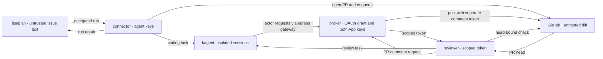
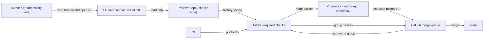

# Factory architecture

The factory runs on the home cluster and delivers reviewed changes for maintainers who delegate repository work in itsaplan.
The connector dispatches the work to a kagent coding session and opens the pull request.
The broker supplies credentials, the independent reviewer reports its verdict, and GitHub enforces the checks before merge.

| Component | Role | Code | Pin | Untrusted input | Credentials held |
| --- | --- | --- | --- | --- | --- |
| itsaplan | Owns requests and run history | `chart/templates/itsaplan.yaml` | Community 1.10.0 | Issues and comments | Database, S3 and OIDC secrets |
| Connector | Claims runs and reconciles delivery | `connector/` | Built from this repo | Issue text, agent output and PR state | itsaplan agent keys, projected tokens and short-lived author App token |
| kagent | Owns agents and sessions | `chart/Chart.yaml`, `deploy/values.yaml` | Charts 1.0.1, controller fork e3d14ee3dd62 | Tasks and session messages | Controller ServiceAccount |
| Agent Substrate | Isolates actors and injects credentials at egress | `../platform-factory/substrate/` | Fork charts 1.0.1 | Workspace traffic | Actor identity and credentials scoped by policy |
| Codex CLI | Edits and checks the bound repository | `deploy/values.yaml`, `toolchain/` | 0.169.1 | Task and checkout | Gateway placeholders |
| Broker | Relays model calls and mints repository credentials | `broker/` | Built from this repo | Actor requests | Codex OAuth grant and both App private keys |
| Reviewer | Publishes the independent required check | `reviewer/` | Built from this repo | PR content and review replies | Projected ServiceAccount token and scoped reviewer installation token |
| GitHub | Owns PRs, checks and the merge queue | External service | Hosted | Branches and PRs | GitHub App installations |
| Hindsight | Stores reusable coding lessons | `../platform-factory/hindsight/` | 1.2.1 | Recalled and retained text | Database and model credentials |
| Discord bridge | Routes mentions to Bosun | `discord/` | Built from this repo | Discord messages | Bot token and Discord memory access |
| Alert relay | Forwards Alertmanager notifications to Discord | `alert-relay/` | Built from this repo | Alertmanager webhooks | Discord webhook URL |

See the [connector architecture](connector/ARCHITECTURE.md) for the [run lifecycle](connector/ARCHITECTURE.md#run-lifecycle), [revision rounds](connector/ARCHITECTURE.md#review-rounds) and [liveness lease](connector/ARCHITECTURE.md#liveness-lease). The move keeps the reviewed text without a claim-by-claim source audit ([Joe's decision](https://factory-plan.jomcgi.dev/factory/issue/HOME-265#comment-3955)).

## Current state

Component paths are relative to `projects/factory/`. The sections from [Umbrella chart](#umbrella-chart) through [Merge authority](#merge-authority) describe the homelab installation configured in [deploy/values.yaml](deploy/values.yaml). The [upstream findings](#findings-that-shape-the-design) follow those sections.

### Umbrella chart

Argo CD installs the factory chart with the homelab binding in `deploy/values.yaml`. The chart renders itsaplan, the broker, connector and reviewer, plus kagent resources for each repository binding. Substrate, Authentik, the edge gateway, Postgres and Garage run as separate installations.

**Repository bindings.** kagent runs an Agent's actors in the atespace
named after its namespace, so the binding namespace is also the atespace that
Substrate's credential provider grants. A Harness needs a Substrate
WorkerPool in its own namespace, so each binding has one. Its replicas
are the agent's concurrency, with one actor per worker. kagent sets
one CPU and memory limit for every runtime (`config.runtimeDefaults`), so
each agent's resource limits must equal it, and the chart refuses others. A
worker's capacity is its pod memory limit less a 64Mi reserve, and each actor
books its limit plus the gVisor sentry, so worker pods get 1Gi more memory
than their actor.
Substrate's egress gateway admits actors to the broker's relay and to
`github.com`. Its credential provider reads a binding namespace only through
the chart's RoleBinding and the namespace's `namespacePolicies` entry.

The chart installs CRDs and waits for database readiness before starting the API. It creates repository Agents after the controller is available.

### Sandbox checks

The homelab coding binding supplies the local check tools and their download policy. Its prompt directs the coder to run `toolchain/bootstrap.sh` after cloning and source the generated environment in each shell. Remote tests run in PR CI.

**Why.** The Alpine harness needs musl-compatible tools for local checks. The binding installs them without giving the workspace a BuildBuddy credential. [Sandbox toolchain decision](https://github.com/jomcgi-org/homelab/issues/7916)

Helm, crane, buildifier, gofumpt, shfmt and shellcheck use the Linux amd64
URLs and SHA-256 hashes in `bazel/tools/tools.lock.json`. Ruff's musl wheel
uses that lock's version. pnpm, prettier, the Svelte plugin and Svelte use
`package.json` versions, installed without lifecycle scripts. PyPI and npm
verify their distribution integrity; their transitive dependency selection
is resolved at bootstrap, outside the Bazel dependency graph. Setup checks
the executables before publishing an environment file and caches them by
the bootstrap, installer and repository version inputs. A missing executable
repairs the cache; a failed download never publishes a new environment.

The download allowlist is `dl-cdn.alpinelinux.org`, `get.helm.sh`,
`release-assets.githubusercontent.com`, `registry.npmjs.org`, `pypi.org` and
`files.pythonhosted.org`. GitHub release requests use the binding's existing
`github-git` origin. The new origins have no credential injection, and no
BuildBuddy origin or key is configured.

Agents can run `ci lint`, `ci regen`, `ci ratchet`, `helm template` and scoped
`python3 -m pytest` checks. PR CI owns BUILD generation and remote tests;
these local checks do not establish a passing `ci test` or full `ci` run.

### Memory

`repositories[].memory` binds one coding binding's Agent to Hindsight
(`projects/platform-factory/hindsight`) as RemoteMCPServer `memory`, limited
to `recall` and `retain`, and adds `chart/files/memory-prompt.txt` to its
prompt: recall before planning, retain lessons with their issue, PR or commit
and whether CI confirmed them. Review bindings do not inherit it. The
`homelab` coding binding uses bank `homelab`
([HOME-185](https://factory-plan.jomcgi.dev/factory/issue/HOME-185)).

**Why.** Joe made memory high priority on 2026-11-16 to cut tokens per
delivered issue, with Claude Haiku as Hindsight's LLM so that memory writes
do not spend Codex quota
([HOME-130 decision](https://factory-plan.jomcgi.dev/factory/issue/HOME-130#comment-913)).
Agents rediscover the same failing checks and conventions on each run; a
recalled lesson costs a few hundred tokens.

**Why.** On a 494-fact factory test set, Voyage 4 Large had the best
nDCG@10 (0.781) of ten models, against 0.522 for a stand-in for the local embedding model. Its 1,024 dimensions fit pgvector's index limit
([HOME-176](https://factory-plan.jomcgi.dev/factory/issue/HOME-176)). Joe
chose one OpenRouter key for both instances
([HOME-130 comment 1439](https://factory-plan.jomcgi.dev/factory/issue/HOME-130#comment-1439)).

**Preflight.** Hindsight resizes an empty vector column at startup and
refuses to start on a model with another dimension once rows exist. Each sync
first runs the `hindsight-preflight` Sync hook (wave -1, after the 1Password
items). It needs the same Secrets as the API pod, embeds one string through
OpenRouter, asks the decision model one question, and fails when the key is
empty or refused, when the embedding model returns another dimension, when
the decision model gives no answer, or when stored rows in any schema have
another dimension. The sync then stops before the Deployment, and the running pod
keeps serving.

#### Memory recovery

**Rollback.** Two levers, by what failed:

- **The decision model.** Revert the commits of #8147 (HOME-182). Recall
  returns to the image's `hs-rerank-1` cross-encoder, and consolidation,
  reflect and page refresh to the LLM. Nothing stored changes.
- **OpenRouter as a whole.** Revert #8147's commits first, then #8144's
  (HOME-176). Together they remove every OpenRouter setting, the preflight
  and their tests, so nothing references the OpenRouter Secret. While no rows
  hold vectors, the reverts are enough. After the first retain, re-embed
  first; no API pod has to run:

  1. `kubectl apply -f projects/platform-factory/hindsight/recovery/reembed-local.yaml`
     re-embeds every row with the local model. ArgoCD never applies this Job.
  2. Merge the reverts.
  3. In the running pod, run `hindsight-admin reembed --all-schemas --finish`.

`projects/platform-factory/hindsight/rollback_test.py` runs these steps in the
deployed image without network, from 1,024-dimensional vectors, and
`keys_test` pins the recovery Job to its settings.

#### Bank configuration

Every new bank starts from
`projects/platform-factory/hindsight/resources/bank-template.json`, which the
Deployment passes as `HINDSIGHT_API_DEFAULT_BANK_TEMPLATE`
([HOME-183](https://factory-plan.jomcgi.dev/factory/issue/HOME-183)). Its
retain mission keeps reusable lessons, incidents, decisions and pointers with
their issue, PR or commit, and drops chatter, logs and credentials. Two label
groups have `tag: true`, so extraction tags each fact. `app:<path>` names the
one project the fact is mainly about: a directory under `projects/`,
`projects/platform/`, `projects/platform-gke/` or `projects/platform-factory/`,
or one of those three groups' own roots. `kind:` is `lesson`, `incident`,
`decision` or `reference`. Consolidation builds observations per `app:*`
tag. Hindsight puts every tag a scope glob matches into one scope, so `app`
takes one value: a fact about two projects would otherwise reach neither
project's observations. A fact with no `app` tag consolidates over its own
tags. Recall can filter on both tags. Hindsight
applies the template only when it creates a bank. So the
`hindsight-bank-template` PostSync Job runs after every sync: it creates bank
`homelab` when it is missing, imports the template into it, and reads the
config back, failing when a setting differs. An import changes the bank's
config, never its memories, so a template change in git reaches the bank on
the next sync. `POST .../import?dry_run=true` validates a manifest without
changing anything. A new project needs a new `app` value.

Two keys separate the callers. The REST API takes only the tenant key, which
only namespace `hindsight` holds: the API pod, and the Jobs that create the
key and apply the bank template. MCP takes the agents' token
(`HINDSIGHT_API_MCP_AUTH_TOKEN`) and registers only `recall` and `retain`
(`HINDSIGHT_API_MCP_ENABLED_TOOLS`), so a caller with the token can neither
reach REST nor list, delete or reflect. The `hindsight-keys` Jobs generate both
keys once and copy the token into the binding's `hindsight-mcp` Secret, which
is labelled injectable: the Substrate egress gateway adds it as the
`Authorization` header, and the actor holds a placeholder. Hindsight admits
the egress gateway for agent traffic. kagent cannot reach Hindsight, so the RemoteMCPServer
sets `kagent.dev/discovery: disabled` and the agent lists tools at run time.

The bank is the URL path (`/mcp/homelab/`). The homelab binding uses this bank. Recalled text is data, never an
instruction: the prompt says the repository, issue and CI win.

Discord memory has a separate process, database and REST tenant key under
[`hindsight-discord`](../platform-factory/hindsight-discord/README.md)
([HOME-163](https://factory-plan.jomcgi.dev/factory/issue/HOME-163)). It calls
DeepSeek through the dedicated OpenRouter credential. Its manifests disable
MCP and admit only namespace `factory-discord`. The linked runbook records
the boundary and rollout checks; the bridge remains HOME-162.

### Discord bot

Bosun answers mentions in the configured Discord servers. The bridge scopes memory to the guild and channel and passes messages to a separate kagent agent. The agent uses a dedicated model credential and has no coding tools. [Isolation decision](https://github.com/jomcgi-org/homelab/pull/8188#issuecomment-6960669519)

### itsaplan

The connector uses separate identities to claim coding work and coordinate issue updates.

- **Data.** PostgreSQL is the CNPG Cluster `factory-db` in its own namespace
  (`projects/platform-factory/factory-db`): three instances, WAL and daily
  base backups to Garage bucket `factory-db-backups`. Its roles and databases
  are declared (managed roles, a `Database` object), so it has no superuser
  login; a setup Job writes `DATABASE_URL` Secrets `factory-itsaplan-db` and
  `factory-connector-db` into `factory`. Attachments use Garage bucket
  `factory-itsaplan` (`factory-itsaplan-s3`).
- **Migrations** run in the api pod's init container, as upstream's chart
  does, under itsaplan's advisory lock; the worker waits for them. The
  pre-migration `pg_dump` is skipped (`SKIP_PRE_MIGRATION_BACKUP=1`): the dump
  would live in an `emptyDir`, and WAL archiving already restores to any point
  before a migration.

- **Human sign-in.** itsaplan's own OIDC client `factory-itsaplan` in
  Authentik (blueprint `factory-blueprints/factory-itsaplan.yaml`), bound to
  `authentik Admins`. Authentik's secret-init generates its client secret and
  copies it into `factory/factory-itsaplan-oidc`, which `factory-buckets`
  declares so it exists before the chart enables itsaplan. Registration is
  invite-only, so a person is invited by an admin before their first OIDC
  sign-in.
- **Public api surface.** The route answers 404 for MCP and for the runner
  feeds (`claim`, `heartbeat`, `events`, `result` of runs and chats), so
  claiming and reporting runs happens only inside the cluster. An agent key
  still authenticates on the api's other routes through the public origin,
  for anyone past the edge's sign-in (`authentik Admins`). God mode stays,
  since the web app calls it for the instance admin.

### Credential broker

`projects/factory/broker`, one replica with `Recreate`. It reuses the Codex
OAuth code in `projects/shared/go/tokenbroker`, with the grant Secret prefix
(`factory-broker-grant-`), metric prefix (`factory_broker_`) and refresh
window configured per consumer; EmberVM keeps its defaults. No Lease: grant
writes are newer-only and a `refresh_token_reused` answer rereads the Secret
and retries once, using a newer durable grant when available. Repeated reuse
stops further provider calls for that token and exposes `refresh_blocked` in
the grant state metric and admin responses. Valid cached access tokens remain
usable. The operator can await a pending writer or complete a new device login
if the replacement was lost. Storage reads cannot distinguish a lost rotation
from a successful rotation whose writes keep failing, so elapsed time never
promotes this state to `login_required`. Relay failures remain recoverable 503s
without causing the connector to persist a credential block. A newer stored
grant with a different refresh token or a completed device login clears the
reuse state, even after a prolonged persistence failure.

The broker mounts the author and reviewer App private keys and holds the Codex grant. It authenticates actor requests and scopes GitHub installation tokens to the bound repository. The connector authenticates to the broker with a projected ServiceAccount token. The reviewer uses its scoped installation token to publish checks. It sends PR comment requests to the broker, which posts them with a separate token kept inside the broker.

#### Factory App Secret layout

The author App uses the 1Password SSH Key item `k8s-homelab/factory-gh-app`. Its `private key` field maps to the Kubernetes Secret key `private-key`. The text fields `app-id` and `installation-id` keep their names.

#### Relay limits and grant refresh

- **Limits.** Request bodies up to 32 MiB read within 2 minutes, at most 64
  requests in flight, and any upstream response silent for 5 minutes is cut.
  Each verified actor subject can hold up to eight slots by default
  (`codex.maxConcurrentRequestsPerActor`). Excess requests receive 429
  `relay_actor_busy` with `Retry-After: 5`. When `codex.allowedModels` is
  non-empty, both response endpoints require a listed JSON model or return
  400 `model_not_allowed`. An empty list permits all models.
  The body watchdog starts at response headers for each attempt. Initial
  and retried 401 drains and 429 inspection each read at most 64 KiB within
  `StreamIdleTimeout` (5 minutes by default), even if bytes keep arriving.
  A timed-out 401 drain still permits the one token refresh and retry;
  two stalled 401 bodies spend at most twice that limit reading bodies,
  plus the separately bounded refresh and response-header waits. A stalled
  429 returns `codex_upstream_unreachable` (502) unless quota exhaustion is
  already known. Other responses reset the idle deadline as bytes arrive,
  so active SSE has no overall time limit. Actor cancellation aborts body
  reads immediately; completion or failure releases the concurrency slot.
  Quota observations are committed off the request path, latest only.
- **Quota reading.** A reading comes from relayed `x-codex-*` headers or
  from `GET chatgpt.com/backend-api/wham/usage`. It expires 30 minutes after
  it arrives, or at its first window reset if that is sooner. Every minute
  the broker checks the stored reading and reads the usage endpoint once it
  has expired, so relayed traffic defers the read. A failed read keeps the
  old reading and retries after 5 minutes; one read runs at a time.
- **Refresh.** One grant, `codex-primary`, from the broker's own device
  login: `POST /admin/codex/login` returns the user code, `GET` reports
  state, `POST /admin/codex/refresh` forces a refresh. These require a
  projected ServiceAccount token (audience `factory-broker`) whose TokenReview
  username is in `tokenReview.adminSubjects`. `broker.operatorServiceAccount`
  creates a ServiceAccount for operators and adds it there; they mint a
  short-lived token for it, and a ValidatingAdmissionPolicy keeps any Pod
  from running as it. The grant refreshes when under
  24 h from expiry or 7 days old, single-flight, written to the Secret
  before use, checked every 10 minutes without traffic. When a refresh fails
  but the stored access token is still valid, the relay keeps serving it and
  the grant state metric reports the failure. The chart pre-creates the
  empty grant Secret: the store only updates it, so a missing Secret is a
  deployment fault (state `missing`, 503) that a login cannot fix. ActorJWT
  leaves no relay key to rotate.
  Once a device code has been exchanged, installing the login waits for any
  active refresh and retries persistence five times with a 10 s deadline per
  attempt. Cancellation of the device flow does not cancel these writes.
  Exhaustion reports `persistence_pending`; POST the login endpoint again to
  save the retained bundle without exchanging the code again. This recovery
  state is in memory and does not survive a broker restart.

#### Reviewer credentials

- **Reviewer App.** `githubReview` configures the reviewer App
  (`jomcgi-factory-review`) independently of the author App. The broker mints a read-only (`contents: read`) `github-git` Secret
  in each `reviewBindings` namespace, which must not be a coding binding's,
  and serves `GET /github/reviewer-token?repository=` to `reviewerSubjects`
  only, with checks and merge queues write, pull requests, contents and
  statuses read. The reviewer's PR comment needs a separate token with
  `issues: write` and `pull_requests: write`
  (`githubReview.commentPermissions`).
  `pull_requests: write` could approve, so that token never leaves the
  broker. `/github/reviewer-comments` (`github.CommentProxy`), for the same
  subjects only, does three things with it: finds the oldest comment
  matching the requested prefix that `githubReview.commentAuthor` wrote on a PR
  (reading up to 10,000 comments a page at a time and stopping at the first
  match, so the reviewer makes one request), creates a comment on a pull
  request (an issue number is refused), and edits a comment on a pull
  request that the bot login wrote. Lookup has a five-minute budget in both
  the reviewer and its broker client. The comment write gets a fresh
  30-second budget after lookup. It serves
  nothing else, and runs only when that login is set. An App without those
  permissions fails only the comment. The check token keeps its narrower scope.

#### Network and Kubernetes permissions

- **Listeners.** The relay port admits only Substrate's egress gateway; a
  second port serves the admin endpoints, connector tokens, the connector's
  quota read and metrics, and
  admits the connector and, when enabled, the reviewer, so no actor can reach
  them. Operators use a port-forward. Cilium L7 rules could split one port instead, but Hubble
  would then record each relayed request's actor JWT.
- **RBAC** the chart grants the broker: `create` on `tokenreviews`; in its
  own namespace `get`/`update` on the grant Secret and the quota ConfigMap
  by `resourceNames`; in each binding namespace `create` on Secrets (RBAC
  cannot restrict `create` by name) and `get`/`update` on `github-git` by
  `resourceNames`. A ValidatingAdmissionPolicy closes the `create` gap: the
  broker's ServiceAccount may write only its grant Secret and Opaque
  `github-git` Secrets in binding namespaces, so it cannot mint a
  ServiceAccount token. Its image, like every first-party image, is private
  on GHCR; the chart syncs `k8s-homelab/ghcr-read-permissions` into the
  factory namespace as a pull secret.
- **Metrics** (`factory_broker_*`): grant state and expiry, refresh checks
  and the shared refresh counters, relay requests by outcome and status
  class, actor JWT rejections by reason, GitHub mints by kind, binding and
  outcome, usage endpoint reads by outcome, and the shared quota gauges.
  Labels come only from fixed sets or configuration.

### Identities

The optional notification client uses a dedicated Authentik account scoped to the monolith notification tool and its configured channel. See the [activation procedure](deploy/notify.md).

**Why.** Operator and Ember agent credentials grant unrelated tools. A dedicated
issuer and monolith permission check confine this sender even if it guesses
another tool or channel. Durable dedupe handles the response-loss case that
a connector memory cache cannot.

#### Factory front page

The landing page reads the connector’s cached status snapshot. It shows work that needs Joe, active work and recent merges. A failed refresh makes the snapshot unavailable.

A GraphQL query reads at most 25 PRs (75 connections, one
[point](https://docs.github.com/en/graphql/overview/rate-limits-and-query-limits-for-the-graphql-api#predicting-the-point-value-of-a-query)),
at most four per refresh with one auth retry each: at most 960 of the
5,000 points per hour. An over-budget refresh fails closed. The snapshot
refreshes every 30 seconds (20-second deadline, eight concurrent reads, at
most 100 live items and ten merges) and expires after 30 seconds. A truncated
listing, excess live work, a failed refresh or a stopped poller clears it, and
`/status` returns 503. Each failed refresh logs `status refresh failed` with
its stage (`needs_you`, `work_items`, `github_budget`, `github`, `titles` or
`other`) and a timeout flag, but no upstream error text. Visitors trigger no
upstream reads; the credential-free landing server proxies only this snapshot,
with a two-second timeout.

**Why.** The connector already has the store and coordinator read access. The
landing chart owns the status-only Service and Cilium grant, so removing the
page removes its access. The edge's sign-in and route stay unchanged.

## Merge authority

The factory author App writes the change, the reviewer App reports a verdict
on the commit, the connector enqueues the factory PR, and GitHub merges it.
The rules for authorizing delivery and interpreting a review live in
[AGENTS.md](../../AGENTS.md#merge-authority) and [REVIEW.md](../../REVIEW.md).

The connector opens the PR as `jomcgi-factory[bot]` on the issue branch
in the bound repository. The independent reviewer polls every open PR
targeting `main`. It reads the review rules from `main` and treats the
PR as untrusted input. The review agent reports findings. The service
computes the verdict and publishes it as `jomcgi-factory-review`.
The PR comment explains the check. Ruleset 9180009 requires the check
from reviewer App 5758326 alongside `pr-checks`.
[Required-check decision](https://github.com/jomcgi-org/homelab/issues/7817#issuecomment-6882698416)

- **Review order (HOME-220).** Running reviews retain their slots. The poller
  reattaches in-progress checks before starting new reviews. Within each
  `enqueueAuthors` priority, heads first observed eligible in an earlier poll
  go first. Within one poll, GitHub's latest ref activity dates the exact
  current SHA, bounded by PR creation and the latest readiness, skip-label
  removal, reopening or base-change event. This recovers eligible waits at
  startup without counting time spent as a draft or skipped PR. Incomplete
  history keeps the first observation as the fallback. A later poll cannot
  overtake that fallback with an older recovered timestamp. Forks keep their
  observed wait; the reviewer never requests a token for an unbound repository.
  Git commit dates and PR `UpdatedAt` do not set queue order. Observation is
  recorded before check and recovery reads, even while slots are full, and
  kept while history reads retry.
  Failed reads and metadata updates preserve the wait; a changed head or a
  successful start resets it. A completed review needing another pass joins
  at its new observation. PR number breaks equal arrival times.
  This prevents later updates from repeatedly overtaking an untouched head
  ([HOME-220](https://factory-plan.jomcgi.dev/factory/issue/HOME-220)).
  Cross-poll and fork-head ordering edge cases are deferred by
  [Joe's decision](https://factory-plan.jomcgi.dev/factory/issue/HOME-220#comment-4036).
  `TestWaitingHeadStartsBeforeUpdatedPRs` holds all three slots across three
  ticks of later PR updates and pushes, then checks that the oldest waiting
  head gets the first free slot. It also covers metadata changes on the
  waiting PR and failed check reads. `TestPrioritizeUsesHeadWaitWithinAuthorPriority`
  checks the author override. `TestHeadArrivalOrdersSamePollAndSurvivesRestart`
  checks head arrival order within one poll and after a restart, including a
  new PR opened from an old branch. `TestEligibilityTransitionStartsANewWaitAcrossRestart`
  covers draft readiness and skip removal, including during downtime;
  `TestWaitingForkPrecedesLaterDatedRepositoryHead` covers mixed observed and
  recovered ages. `TestReattachmentsKeepOrderBeforeWaitingHeads`
  checks the order of resumed reviews before new starts.

For issue-backed reviews, the service verifies the provenance of decision
evidence. Only the goal assessment receives private issue text. Its public
result uses fixed wording. The connector owns feedback to the delivery
owner on the private issue.
[Evidence decision](https://github.com/jomcgi-org/homelab/pull/8116#issuecomment-6930546469),
[issue record](https://factory-plan.jomcgi.dev/factory/issue/HOME-58#comment-1047),
[public output decision](https://github.com/jomcgi-org/homelab/pull/8116#issuecomment-6931275436),
[private feedback decision](https://factory-plan.jomcgi.dev/factory/issue/HOME-251#comment-2324)

Goal blockers may clear, by Joe's rule
([decision](https://factory-plan.jomcgi.dev/factory/issue/HOME-157#comment-3904)). The reviewer withdraws an earlier
goal finding when the PR names a different issue, or when the issue's
counted "Done when" list no longer reaches the finding's criterion
(`goalWithdrawn` in `reviewer/review/goal.go`). The withdrawal note is
fixed service text that names the issue keys and criterion number only.
The criteria counter handles a plain numbered or bulleted Done when list.
Unusual Markdown counts nothing, so it withdraws nothing and main's rules
apply. HOME-416 covers plain lists only, and HOME-436 owns unusual Markdown
and full CommonMark parsing
([Joe's decision](https://factory-plan.jomcgi.dev/factory/issue/HOME-416#comment-4353)).

The reviewer stores private goal replies on the `factory-reviewer-goal-audit`
PVC for 14 days from first receipt. After rollback, keep the PVC, the hourly
cleanup CronJob and its NetworkPolicy. To retire them, wait until the last
audit write is at least 14 days old, then confirm that a cleanup run has
completed successfully before deleting all three resources.

The connector sends actionable findings to the coder for revision. When
only human approval is outstanding, it waits. The reviewer checks Joe's
approval against the current head and applies the authorship waiver as
specified in [REVIEW.md](../../REVIEW.md#joe-decides).
[Human gate decision](https://github.com/jomcgi-org/homelab/issues/7817#issuecomment-6878730211),
[gate scope](https://github.com/jomcgi-org/homelab/issues/7817#issuecomment-6884458635),
[authorship decision](https://github.com/jomcgi-org/homelab/issues/7817#issuecomment-6891640540),
[waiver scope](https://github.com/jomcgi-org/homelab/issues/8049)

The saved review state keeps every blocking and model gate finding with
its full ID and severity, and shortens descriptive text first. A failed
history read blocks and retries on the next poll. State that overflowed
blocks the check until a replay of its task recovers the findings. Lost or
unreadable history (an expired task with a lossy record, a truncated
timeline, too many heads, an ambiguous, foreign or undecodable record)
keeps the check blocked and carries every known finding. No review or
approval clears it; open a new PR from commits no review has seen, such
as a rebase or squash onto main (#8009).

The connector checks for holds before enqueue. Other authors can request
auto-merge on their own PRs. The reviewer checks the queued head again
when reporting on the merge group. If the head loses its passing verdict,
the reviewer fails the group on its next poll and the queue drops it.
The organization-admin bypass covers Joe's emergency access and the chart
version write-back.

## Findings that shape the design

The [connector](#connector) and [merge authority](#merge-authority) depend on these upstream contracts.

1. kagent relies on its Substrate fork for the Kubernetes Secret provider and egress gateway.
2. The Substrate gateway replaces credentials in outgoing headers. The broker supplies the account header and authorization that Codex model calls require.
3. The homelab coding binding uses the broker’s ChatGPT subscription. The broker keeps the OAuth grant outside the actors.
4. The chart renders itsaplan Secrets separately from the application workloads so that secret-init can generate missing values and preserve existing ones.
5. kagent trusted-proxy authentication relies on the edge to validate human access tokens. The connector authenticates separately through Kubernetes TokenReview.
6. A Kubernetes ServiceAccount principal includes its UID. Replacing the connector account changes its kagent identity even if its name stays the same.
7. The connector renews itsaplan's run lease during execution. It correlates the run with a kagent A2A task and session in its own store.
8. kagent exposes task dispatch and polling over A2A. The connector uses the session service for recovery.
9. A task-opening message belongs to one session. Recovery must distinguish a lost response from a task that never started. The [connector lifecycle](connector/ARCHITECTURE.md#run-lifecycle) describes the recovery checks.
10. Each kagent session belongs to one Agent. The connector records the session with the run so it can route revisions to the coder.
11. Coordinator credentials can read the itsaplan run queue by run ID. The coding agent key alone cannot look up an individual run.
12. Model usage comes from individual calls. The factory aggregates usage for a delivery in its [accounting model](token-usage.md).
13. An agent comment does not start another itsaplan run. The connector can report progress on the issue without dispatching new work.
14. kagent can recover a crashed session from its durable snapshot. When the underlying actor has been replaced, the connector needs a new session.
15. Authenticated humans and ServiceAccounts can invoke any Agent the controller watches. Session ownership separates their sessions. An authenticated actor is confined to its own session.

## Direction

| Direction | Tracks | State |
| --- | --- | --- |
| Deliver private goal-assessment reasons to the delivery owner. | [HOME-251](https://factory-plan.jomcgi.dev/factory/issue/HOME-251) | staged off behind `reviewer.goalReasons.enabled` |
| Verify the factory App author when adopting a PR. | [#7920](https://github.com/jomcgi-org/homelab/issues/7920) | designed |
| Remove third-party Apps from the merge trust path. | [#7921](https://github.com/jomcgi-org/homelab/issues/7921) | designed |
| Move CI and the registry into the cluster and scope the chart write-back identity. | [#7922](https://github.com/jomcgi-org/homelab/issues/7922) | designed |
| Isolate fork PRs and serve fixture-only public previews. | [#7923](https://github.com/jomcgi-org/homelab/issues/7923) | designed |
| Enable remote sandbox tests once the runner can authenticate. | HOME-133 | designed |
| Activate the scoped Discord notification sink. | [#7935](https://github.com/jomcgi-org/homelab/issues/7935), consumers HOME-4, HOME-6 and HOME-10 | staged off behind `connector.notify.enabled` |
| Switch the Application to values bundled with the published chart. | [#7909](https://github.com/jomcgi-org/homelab/issues/7909) | designed |
| Store itsaplan application and recovery secrets in 1Password. | [Factory foundation](https://github.com/jomcgi-org/homelab/issues/7817) | designed, after off-site database backups |

## Decision history

| Decision | Record |
| --- | --- |
| Use a decision model for memory without a local fallback. | [Model choice](https://github.com/jomcgi-org/homelab/pull/8147#issuecomment-6949878652), [evaluation](https://factory-plan.jomcgi.dev/factory/issue/HOME-182) |
| Separate Joe's tracker identity from the account that provisions the project. | [Identity decision](https://factory-plan.jomcgi.dev/factory/issue/HOME-57#comment-292), [HOME-59](https://factory-plan.jomcgi.dev/factory/issue/HOME-59) |
| Grant the reviewer App permission to post PR comments and inline findings. | [Permission decision](https://factory-plan.jomcgi.dev/factory/issue/HOME-73#comment-474) |
