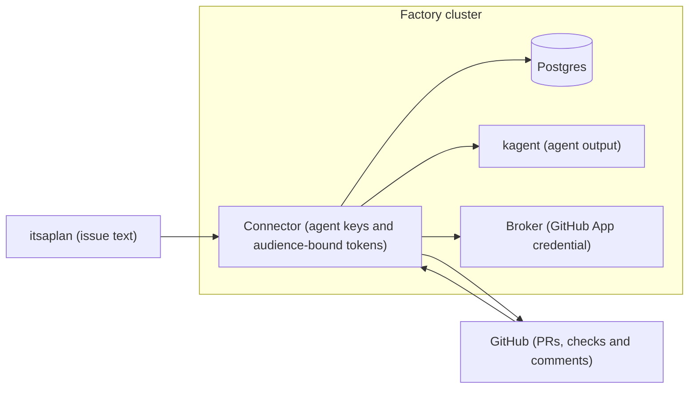
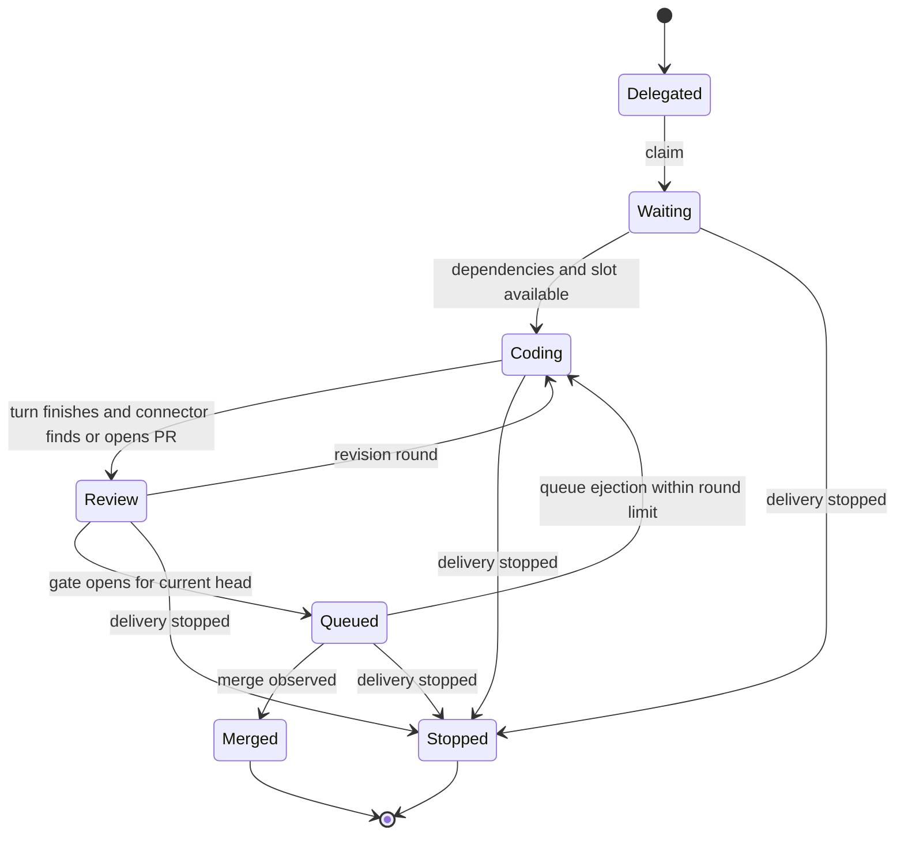
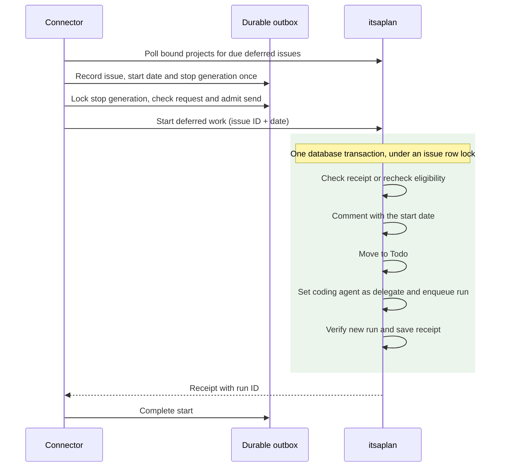
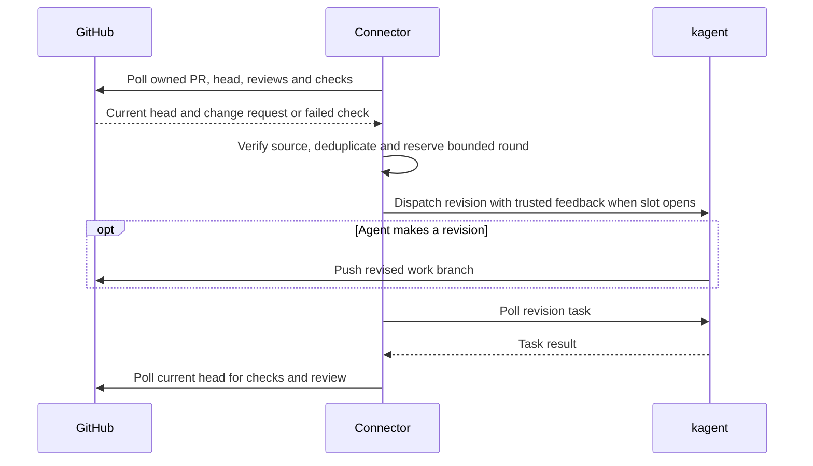
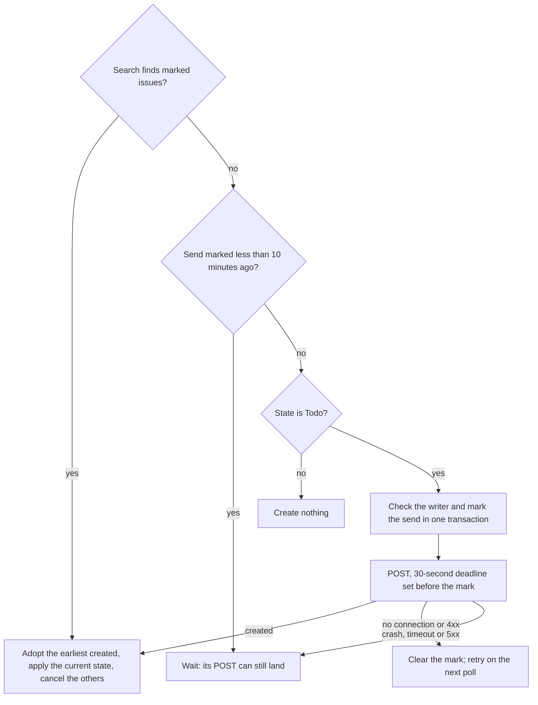
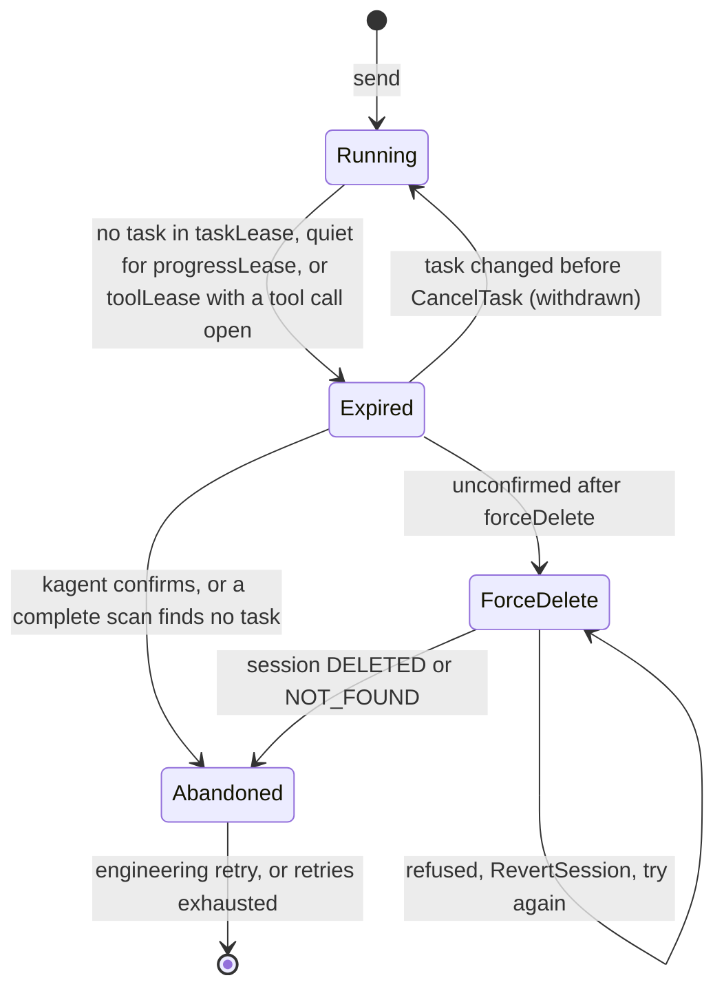

# Connector architecture

The connector runs in the factory cluster. It claims delegated itsaplan runs,
dispatches them to kagent and follows the work branch through GitHub review
and merge. Its Postgres database ties the issue, session, branch and PR together.



| Component | Role | Code | Pin | Untrusted input | Credentials held |
| --- | --- | --- | --- | --- | --- |
| Connector | Claim, dispatch and reconcile | [dispatch](dispatch/) | This repository | Issue text, agent output and GitHub events | itsaplan keys, database login, projected kagent and broker tokens |
| GitHub client | Read checks and update owned PRs | [github](github/) | This repository | PR and check data | Broker-issued installation token |

## Run lifecycle

A delegated run enters through `HandleClaim`. When its coding turn ends, the connector tracks the resulting PR on the work item through review, queueing and merge. [Dispatch](dispatch/engine.go) · [PR delivery](dispatch/delivery.go) · [Delivery outcomes](delivery-outcomes.md)



## Work items and writer ownership

Go, built with rules_go and apko, one replica with `Recreate` and a Postgres
advisory lock. Each takeover increments a writer epoch, and every external
side effect checks it first. The epoch check runs on the lock's own
connection, so a lost session also fails it. kagent guarantees one non-quiescent task per
session and one execution per actor, which keeps one writer per worktree.

Postgres stores work items, runs, attempts, review events, cancellations and
the delivery outbox. Each work item maps an issue to its binding, work branch,
session and PR. Each attempt records its message ID before dispatch.

## Deferred starts

**Deferred starts (HOME-118).** On each poll, the connector reads each bound
project for active issues in Backlog with a `startDate`, no delegate and the
project label `deferred`. Bootstrap creates that label in every bound
project. Dates on or before today in UTC qualify, including dates missed
while the connector was down. The first agent in the binding's `agents`
list receives the delegation.



The connector records each request's stop generation at enqueue. Database
triggers advance that generation when a stop transaction commits, including
writes from rollback versions. The triggers also record explicit
re-admission and stamp requests inserted by older connectors. Re-admission
permits new schedules; older requests keep their generation and stay fenced.
Closing a stopped run permits no new schedule. Send admission locks the
generation through the transaction that records `send_started_at`, under
the writer fence. A stop that commits first prevents the send (HOME-151).

## Planner proposals (designed)

The planner design takes instructions from a schedule template on the base branch. Planner output enters the delegated issue as quoted evidence. The factory triage job adds [allowlisted actions](triage.md) that the connector checks and runs.

**Why.** Joe chose delegated fixes for the three pilots
([decision](https://github.com/jomcgi-org/homelab/issues/7935#issuecomment-6891325789),
HOME-45). A planner can copy an instruction from a CI log or a PR into its
proposal. In this design the template on `main` supplies every instruction, and the
connector quotes and sanitizes planner text so it cannot close its evidence
block. Copied text stays quoted evidence. The rule is [REVIEW.md](../REVIEW.md) "Planner
exception".

## Dispatch and admission

The connector claims assignment, mention and delegation runs by agent key.
Blockers and missing briefs hold the run without taking a slot. The heartbeat
renews the lease. itsaplan reads live connector phases via `factory-run-phases`.
A stop counter fences older delegations across restart and reassignment. A
new work item gets a weighted coder arm ([trial arms](../run-provenance.md)); the homelab split ships off until HOME-444 ([decision](https://factory-plan.jomcgi.dev/factory/issue/HOME-247#comment-4565)).

For a new session the coordinator reads the issue and attachment names. The
attempt stores a bounded brief with quoted issue text, checklists and links.
Resends reuse the recorded prompt. [Issue brief decision](https://factory-plan.jomcgi.dev/factory/issue/HOME-126#comment-841)

Before sending to kagent the connector records the attempt and deterministic
message ID. A definite refusal allows a bounded retry. An ambiguous response
is reconciled by message ID under the current writer epoch.

## Task reconciliation

After any ambiguous response, the connector only reads every task state and
page looking for the original message ID. A positive match attaches the
original task, including a task that finished or is waiting for input. It
never sends that message again or replaces its context merely because the
task or session is missing. kagent may remove an idle session's creation
receipt; resending the same initial message after a long outage could then
create another actor. Its NodeGone deletion path can also hide an actor
whose machine has not physically stopped, so even a complete empty listing
does not prove the original execution ceased.

The liveness lease closes an unknown send only on kagent's evidence: a
complete scan within its bound, or a deleted session. A positively observed original task
continues through the existing completion and lifecycle handling. That does
not prove physical quiescence for every published terminal state: kagent
can publish saved outcomes or synthetic failure after an inferred crash,
and Substrate's NodeGone cleanup can succeed without an independent kill
acknowledgment. That platform fencing gap is tracked separately from send
reconciliation. The liveness lease relies on kagent's force delete of the
Actor and accepts this gap (HOME-141).

Before sending, the connector pins the caller’s token issuer, ServiceAccount
UID, controller authority and endpoints. A changed identity holds the attempt.
Legacy attempts, and every uncertain historical send, need positive evidence
of ownership and quiescence before a new retry can establish ownership.

## Credential refusal retries

The connector rereads its itsaplan key on each call. After HTTP 401 or 403,
claims, heartbeats and events retry next pass. Outbox results, comments and
Done moves back off for up to 12 attempts (about 27 minutes). The issue read
before a Done move waits until it succeeds.

Run-state reads track continuous refusals in memory per attempt. After 30
minutes the connector closes a dispatched run whose attempt itsaplan still
refuses. Admission and authoritative issue reads for initial sessions,
new-session revisions and fenced recovery keep retrying beyond that limit.
Issue reads before PR updates, rounds and enqueue, and stale-run lookups,
hold no slot and retry until the key works.

## Run transcripts

**Run transcripts.** Native Codex text arrives in task artifacts, which can
grow without an assistant history message. The connector journals events
and per-artifact byte cursors in `task_transcript` before posting to itsaplan.
Journal JSON is stored as `bytea`, retaining U+0000 and preserving existing
journals through a conversion migration. itsaplan's JSONB trace storage and
the connector's JSONB result outbox cannot store NUL, so delivered text uses
U+FFFD in its place. Replacement happens after event chunking and does not
change event counts; artifact cursors still count and validate the raw bytes.
Each journal belongs to one run attempt and kagent task, with a fixed base
offset after any earlier engineering retry. Artifact message IDs hash the
full task and artifact IDs; new snapshots append only unseen text. END is
recorded once when the task becomes quiescent because task snapshots omit
the artifact stream's `LastChunk` flag. History retains its existing event
rendering, including offsets acknowledged before the journal was introduced.

**Why.** Re-rendering a growing artifact changes event boundaries and moves
acknowledged offsets. Persisting events and cursors together lets a restart
replay the exact batch after a lost acknowledgement, even if the next task
snapshot has more text. A missing artifact or a changed or shortened prefix
fails the poll without advancing the transcript or reporting completion
(#8017).

## Completion

After a turn completes, delivery compares the branch to the base. If it has
commits, the connector finds or opens one PR and links the issue, session and
attempt. A turn with no commits reports that on the issue. Done needs the
observed merge and `Activation: none`, or a done [follow-up](activation.md).

A credential or quota failure pauses work sharing the grant. The connector
can resume a quota-blocked run after a usable broker reading without spending
an engineering retry. An operator clears a credential block after repairing
the grant. The broker records measured usage by actor and the connector
attributes it to the run. See [token accounting](../token-usage.md).

## Review rounds

For a trusted change request on the current head, `startReviewRound` records the round and `dispatchReviewRound` sends the revision to kagent. [Round implementation](dispatch/delivery.go)



**Review.** Poll owned PRs every 60 s (no public webhook): GraphQL for the
PR, its reviews and review threads, REST for check runs and statuses on the
head. Events that ask for changes are a `CHANGES_REQUESTED` review, or a
failed run of a configured check or status. Each is recorded once by its
GitHub node ID. It acts only if its commit is the current head and its
author is trusted by the binding: a trusted reviewer login, a check run
from the check's App ID, or a status from the check's creator login.
Otherwise it is recorded `stale_head` or `untrusted`. A round acts once per
head, kind and source (reviewer or check name); a later event with the same
key, such as a re-run failing again on an unchanged head, is `duplicate`.
Acting events start one review round with their text and the unresolved
threads, and the start is announced on the issue. The repository is
public, so only thread comments by trusted reviewer logins reach the
prompt or a replacement's context; the rest are dropped and the text says
how many. Thread paths are replaced with a fixed label, since the change
author chooses them, even on threads with trusted comments. A reviewer
App's comments reach the agent only if its bot login
is listed in `trustedReviewers`. Rounds are bounded per
work item (`maxReviewRounds`, default 3); past the bound events are
`round_limit` and the PR waits for a person. Events are read only while
the work item is in review, not while a turn runs.

A review round is a connector-initiated continuation, not an itsaplan
mention-run: itsaplan v1.10.0 starts no run for an agent's comment.
The round is a connector run (negative id, message IDs
`factory-review/<n>/<decision>`) that dispatch sends like any other
continuation in the mapped session, with no lease, transcript or result in
itsaplan; its record lives in the connector database and on the issue. A
round holds a slot of its agent key's concurrency and waits for one. A
failed round returns the work item to review.

## Conflicts and size limits

An open PR outside the merge queue whose mergeability is `CONFLICTING`
starts a rebase round on the next review poll, before the enqueue gate and
without waiting for checks to finish. `UNKNOWN` waits for the next poll.
The prompt asks the agent to rebase on the binding's `origin/<base>`, resolve
the conflicts, rerun affected tests and push. If checks or reviews also ask
for changes on that poll, their feedback goes into that same round. A
synthetic conflict event records the head once, atomically with the round
and its issue announcement; repeated polls and connector restarts cannot
start another rebase on that head. Holds and stopped work items block it
like any other revision trigger.
Once that conflict event is consumed, independently new check failures or
trusted review feedback can still start a review round within `maxReviewRounds`.
Its prompt includes the remaining conflict, but the rebase count does not
increase again for the same head.

Rebase rounds use a separate per-binding `maxRebaseRounds` bound (default 3,
0 disables them), persisted as `work_item.rebase_rounds`. They do not spend
`maxReviewRounds`, including when the prompt also carries review feedback.
Past the bound, one issue comment says the PR conflicts and waits for a
person. `factory_connector_rebase_rounds_total{outcome}` counts starts,
idle rounds and work items reaching the bound (`started`, `idle`, `limited`).
No conflicting head is enqueued. A rebased head needs fresh CI and independent
review before it may enter the queue.

**Why.** Main moving is not a review failure. Before
[HOME-71](https://factory-plan.jomcgi.dev/factory/issue/HOME-71), only queue
ejections carried conflicts back to the agent: PR #8058 repeatedly failed
enqueue with a conflict while its issue stayed silent. Detecting conflicts
during review repairs that case within a separate bound.

The reviewer marks a check that failed only because the PR is over its size
budget with a service-only `split-only` marker. When that check, from the
binding's reviewer App, is the only acting event on the head, it starts a
split round instead of a review round. The prompt asks the agent to reduce
the PR to one coherent part within the budget and to name what it removed in
the commit message. Split rounds use a separate per-binding `maxSplitRounds`
bound (default 1, 0 disables them), persisted as `work_item.split_rounds`.
Past the bound, one issue comment says the PR is over the budget and waits
for a person. `factory_connector_split_rounds_total{outcome}` counts
`started`, `idle` and `limited`. A split request that arrives with other
failures on the head starts the round they would start. The marker changes
no check conclusion, and the reviewer strips its prefix from all PR and
agent text, as it does for the human-gate marker.

**Why.** A size failure is not a review finding, and no review ran.
PR #8062 spent the first of its three review rounds on one
([HOME-107](https://factory-plan.jomcgi.dev/factory/issue/HOME-107)).

## Review responses and CI evidence

Every round prompt says the reviewer reads commit messages, not the agent's
reply. For each finding it does not fix, the agent adds a "Review response"
to the commit it pushes: the finding ID, why, and evidence the reviewer can
check (file:line, a test, a CI run or an issue). With no code change it
records the responses in an empty commit (`git commit --allow-empty`), so
the reviewer reviews a new head.

**Why.** `REVIEW.md` "Clearing a finding without a fix" lets an author
justify a medium or withdraw a wrong finding with evidence, but the agent's
reply reached no one. The reviewer reads PR comments only from
`trustedCommenters` and the PR body, which the connector writes without the
change's intent. On PR #8037 the reviewer repeated a finding verbatim after
the agent's reply showed the read was idempotent. Commit messages are already
public, so this channel publishes nothing new
([HOME-107](https://factory-plan.jomcgi.dev/factory/issue/HOME-107)).

**CI failures by name** (staged off behind `connector.buildbuddy`). A failed
required status linked to `https://<host>/invocation/<uuid>` makes the
connector page BuildBuddy's GetLog API; each page is untrusted output. Only
names that exist at the PR's `baseRefOid` on `main` pass. The prompt quotes
verified names inside an untrusted evidence block, with at most 20 targets
and 30 tests. A merge-queue ejection uses the same path
and PR base, never the synthetic commit. Missing base evidence adds only
`base_read`; GitHub credential refusals use the dispatch retry path.
`factory_connector_ci_log_reads_total` counts invocation outcomes.

**Why.** HOME-15 and HOME-18 could see only a link and "Failed in 43s".
PR #8038 added names, but code under test could print a forged label.
[HOME-49](https://factory-plan.jomcgi.dev/factory/issue/HOME-49) requires base-tree membership as well as syntax checks.
Only the connector mounts the read-only 1Password key `k8s-homelab/buildbuddy`.

## Human approval

**Human gate.** For the Homelab binding's HOME project ([#7935](https://github.com/jomcgi-org/homelab/issues/7935)), `humanGateAssignee` defaults to
`joe`; an explicit empty string disables it, and other bindings opt in.
When the current PR head passes `pr-checks` and the configured reviewer
App marks its failed review `human-gate-only`, the connector creates one
issue titled `Merge #<n> past the human gate`. It is assigned to Joe with
no delegate, in Todo, so it appears in Needs Joe. Its body links the PR,
names the head and includes the review's gated files and findings. It also
names the approval that clears the gate under `REVIEW.md` "Joe decides":

| PR | Approval |
| --- | --- |
| Has a hold label (`human`, `needs-human`) | An APPROVED review of the head by `jomcgi` |
| Authored by `jomcgi` | The one the `factory review` check names. The verified authorship waiver may apply ([decision](https://github.com/jomcgi-org/homelab/issues/7817#issuecomment-6891640540), [#8049 scope](https://github.com/jomcgi-org/homelab/issues/8049)); shared-head, foreign-check and restart-recovery holds need an APPROVED review |
| Any other, such as the factory's | An APPROVED review of the head by `jomcgi` |

The issue follows the PR during coding turns and after delivery stops:
an unready head moves it to Backlog, a ready head to Todo, a merge to Done,
and a close to Canceled. Canceled issues keep polling so reopening a PR
restores Backlog or Todo without resuming stopped coding work.
`human_gate_issue` has one row per repository and PR. Every write first
records a `human_gate_attempt` with its message ID, payload and writer epoch.
Absolute state updates retry with the same message ID and payload for that
revision, and failed terminal moves remain eligible after PR delivery ends.



## Stopping delivery and recovery

**Stopping delivery.** A round has no itsaplan run to cancel, and its
kagent session belongs to the connector, so the connector watches for the
signals a person gives. It reads the issue before a round starts, every
heartbeat interval while one runs, before it opens or updates the PR, and
on every PR poll, so before any enqueue and any merge into Done. Delivery
stops if the issue left the binding's project or sits in a `completed` or
`canceled` column. A closed PR stops it too, whether the PR poll sees it
(including a PR closed while queued) or the heartbeat of a running turn.
`connector cancel <ISSUE> [--by NAME]` stops it from the operator's shell
and records who did. A stopped work item gets no PR updates or rounds.
Every running turn on it, itsaplan's or a round, gets a pending
cancellation and is reported failed, with the reason, only once kagent
confirms the task stopped. Its open PR is still polled: a queued PR is
dequeued with GraphQL `dequeuePullRequest`, and a merge is recorded and
commented but never moves the issue to Done. State writes that would
resume a stopped item (a round start, enqueue, ejection, merge) are
guarded, so a stop that races them stands; an enqueue that lost the race
is dequeued. The stop is announced on the issue. A new itsaplan run on the
issue resumes delivery; a closed PR must be reopened by a person first.

A missing accepted task or a session observed crashed, deleting, deleted,
missing, or unrecoverable enters an explicit fencing hold. The connector does
not revert or replace it automatically: controller absence and READY after a
revert do not prove the old physical writer stopped. A positive original task
clears a missing-task hold; a lifecycle hold remains sticky until attested,
even if the task returns or the session later reports READY. The attempt and
concurrency slot remain occupied, including an unsent continuation whose
previous session is uncertain. The liveness lease settles a held turn by
deleting its session with force; an operator's attestation outranks it.

Inspect the hold for the caller, target, historical attempts, fingerprint and
earliest confirmation time. Before confirming, fence every possible copy,
including executions under historical principals that are no longer visible.
Quiesce retired and in-flight dispatchers, keep them fenced and wait out the
dispatch window. Confirmation records the operator’s attestation that every
copy is fenced. Use `--action cancel` to close the target without a replacement.

```sh
connector recovery inspect HL-123
connector recovery confirm-fenced HOLD_ID --fingerprint HASH --action retry \
  --by OPERATOR --evidence 'fencing evidence or incident reference' \
  --confirm-all-copies-fenced
```

## Merge queue

**Merge.** When the required checks and the trusted reviewer succeed on the
current head, enqueue with GraphQL `enqueuePullRequest` and
`expectedHeadOid` set to that head. The reviewer is the binding's reviewer
check, or without one a trusted reviewer's approval of the head; a trusted
reviewer's standing change request blocks either way. The head's final trailer
is `Activation:` ([activation](activation.md)); a pending one also needs its assessment. A PR
in the queue is never enqueued twice; one against another base never is. On an
observed merge, the connector comments the issue, run, session, PR and merge
links on the issue and moves it to the project's first `completed` column
(or `doneColumn`), or to started with a blocking follow-up. A refused move, such as
a hard WIP limit, is reported and retried with backoff. A move the connector
gives up on is also reported, unless a person canceled the issue since then.

A PR that leaves the queue unmerged, after a second read confirms it did
not merge, starts a revision in the mapped session, counting against
`maxReviewRounds`.
The connector saves the queue entry's synthetic commit while queued, then
reads its failing checks and statuses, matched against configured names,
App IDs and status creators. The prompt uses the configured names and fixed
failure states. Check links are built from the
repository and numeric check ID; statuses link to the merge-group commit's
checks page. CI-provided URLs, summaries and descriptions are omitted. If the
queue entry disappeared before its commit was observed, the prompt says the
evidence is unavailable.
A conflicting ejection round asks the agent to rebase on `origin/<base>` and resolve.
That review round consumes the head's conflict event. At the review cap the
next poll handles the conflict against the separate rebase cap.
HOME-460 traced premature `round_limit` events to `ejected` in
[dispatch/delivery.go](dispatch/delivery.go). At the review cap it recorded
`EventRoundLimit` even before GitHub reported a conflict. On the next poll,
`reviewEvents` skipped the head's event ID at `SeenEvents`, before the rebase
branch could set `limited` from `RebaseRounds >= MaxRebaseRounds`.
For a CI infrastructure flake the agent can rebase and push the same change.
The new head needs the usual checks and independent review.

The ejection and round start commit together and are announced on the issue.
An ejected head is never re-enqueued. A new head
returns to ordinary review without spending a round on the previous entry.
Before starting a revision the connector reads the PR head's reviewer check
for its human-gate marker, even when the synthetic commit was not observed,
then refreshes the issue and PR stops. A `human` label observed while queued
stops delivery durably; removing it does not resume the work item. Other
human holds and the round bound leave the work item in review for a person.
On every review poll, a hold label or the current head's reviewer human-gate
marker blocks all revision triggers, including newly failed checks, statuses
and change requests. Pending events stay unconsumed until the hold clears.
Ejection reads are recorded in `delivery_read` before each external call,
with a stable message ID, writer epoch and attempt count. Retries share the
read ID and always fetch fresh state, including after a writer takeover.
Deployment health is a separate record. After the handover in "Merge
authority" (#7919) the connector still enqueues the factory's PRs, since it
sees their stops, and GitHub's required
`factory review` check gates them.

## Liveness lease

**Liveness lease (HOME-141).** No run holds a coding slot for long without
progress, and freeing it needs no person.



- Each tick, after the runs phase, the connector checks the latest attempt
  of each dispatched run without a stop. A send expires without a task
  `intervals.taskLease` (5 min) after it went out. An accepted turn expires
  with no task event for `intervals.progressLease` (20 min), or for
  `intervals.toolLease` (60 min) while a tool call is open. The longest quiet
  stretch of a turn that completed normally on 2026-11-16 was 8 min 16 s,
  and a 30-minute `ci` run keeps its slot. kagent keeps a tool call open
  when its runtime dies: on 2026-11-17 a replaced worker pod left one open
  with no end (HOME-159).
- A turn with a task is read again first, recorded in `status_read` as for
  `quota_stall`. A changed task restarts the lease. Otherwise the turn gets
  a `lease_expired` cancellation that records the task size. An event before
  the first `CancelTask` withdraws it, and so does a turn that ends first.
- A cancellation of any reason that kagent has not confirmed
  `intervals.forceDelete` (10 min) after it was requested deletes the
  attempt's session with force
  ([sessions.proto](https://github.com/kagent-dev/kagent/blob/558e3d761d8ed2b0d23bfef1867a9d1915210121/proto/kagent/api/v1/sessions.proto#L120-L125)).
  The connector records the call in `session_deletion` (reason `stuck`,
  `force`) under the writer epoch first, keyed by the session ID, and clears
  the session from the work item. kagent revokes the session's dispatch,
  deletes the Actor in Substrate, then marks the session DELETED and its
  active tasks CANCELED
  ([session_deletion.go](https://github.com/kagent-dev/kagent/blob/558e3d761d8ed2b0d23bfef1867a9d1915210121/go/core/internal/database/session_deletion.go#L37-L113)).
  DELETED or NOT_FOUND confirms the cancellation.
- During a node partition, Substrate's NodeGone cleanup can report the Actor
  gone while the old turn still runs on the cut-off machine. A DELETED or
  NOT_FOUND result, or a complete and empty task scan, then frees the slot
  while a second writer may exist. Joe accepted that risk so the factory
  never stays stuck: it is rare on three nodes, and loud, as unexpected
  commits on the work branch
  ([decision](https://github.com/jomcgi-org/homelab/pull/8123#issuecomment-6931498421)).
  Fencing old executions independently stays with HOME-38
  ([#8011](https://github.com/jomcgi-org/homelab/issues/8011)).
- kagent refuses a force delete while an idle suspend holds its claim. The
  run then keeps its slot, since kagent may still run the turn, and the
  `refused` step of `factory_connector_stuck_turns_total` counts it. After
  each refusal the connector sends `RevertSession`, recorded first. It acts
  only on a crashed Actor and fails its turn
  ([recovery.go](https://github.com/kagent-dev/kagent/blob/558e3d761d8ed2b0d23bfef1867a9d1915210121/go/core/internal/service/session/recovery.go#L71-L91)),
  so the turn ends once a person deletes the Actor's worker pod. The
  connector holds no Kubernetes credentials.
- A confirmed `lease_expired` cancellation closes the attempt as
  `abandoned`, unless the turn ended on its own. A stop or a reassignment
  that joined it wins, as for `quota_stall`. The run then spends one
  engineering retry, or reports the existing exhausted failure. After a
  deleted session or an unstarted send, the retry opens a fresh session
  with the work item's recorded brief and a fixed replacement note. After a
  confirmed `CancelTask` it stays in the session.
- An operator's attestation outranks the lease: an attested attempt gets
  no lease, and recovery confirms a pending `lease_expired` cancellation
  before it acts.
- Two cases still hold a slot while kagent cannot list tasks: a claimed
  continuation that cannot check its session is idle, and a first send
  whose session kagent never named. These surface in logs and the tick error metric.

**Why.** On 2026-11-16 all four Codex slots were held for hours while 8
runs waited. Two rounds had working tasks with no event since 13:31 UTC,
and their `CancelTask` timed out against a hung runtime. Two more had
sends with no task, held for an operator. A person freed them with
`connector cancel` and a restart of the coder's worker pods.

## Finished sessions

**Finished sessions.** Every 10 minutes the connector deletes the coder
sessions no run will send to again (`DeleteSession`, without force), at most
10 a sweep:
- the session of a done work item;
- the session of a work item stopped for an hour;
- a session the work item no longer records, such as a replaced one.

It deletes only sessions its pinned caller lists (`ListSessions` lists the
caller's own) that its database records for a work item. It keeps a session
with an open attempt, a pending cancellation, a recovery hold on its work
item, or an attempt that finished within 15 minutes. It also keeps the
recorded session of a work item with an open run, including a claimed run
for its issue. Before deleting a session its work item still records, the
connector clears it from the work item, as operator recovery does. A run that
resumes the work item then opens a new session with the issue brief.

**Why.** Each session keeps a Substrate snapshot (about 340 MB) until it is
deleted, and kagent's idle TTL is 7 days. On 2026-11-16 the connector's 47
sessions held 25 GiB on node-2, 26 of them for work that was done,
stopped or replaced (HOME-136). A stopped work item keeps its session for an
hour, so a run started again soon after a stop keeps the agent's context.
A later run opens a new session with the issue brief, the work branch and the
PR. Joe chose an hour over a day on 2026-11-16
([decision](https://factory-plan.jomcgi.dev/factory/issue/HOME-136#comment-1045),
[on #8117](https://github.com/jomcgi-org/homelab/pull/8117#issuecomment-6930761660)): a suspended
session holds no worker or Codex slot, only disk, and the old context is
rarely worth a day of it.

## Direction

| Direction | Tracks | State |
| --- | --- | --- |
| Fence old executions independently during recovery | HOME-38 | designed |
| Name failed CI targets and tests in round prompts | HOME-125 | `staged off` behind `connector.buildbuddy` |
| Factory triage job acts through a fixed [allowlist](triage.md) | HOME-386 | designed |

## Decision history

| Decision | Date | Record |
| --- | --- | --- |
| Keep stopped sessions for one hour | 2026-11-16 | [HOME-136](https://factory-plan.jomcgi.dev/factory/issue/HOME-136#comment-1045) |
