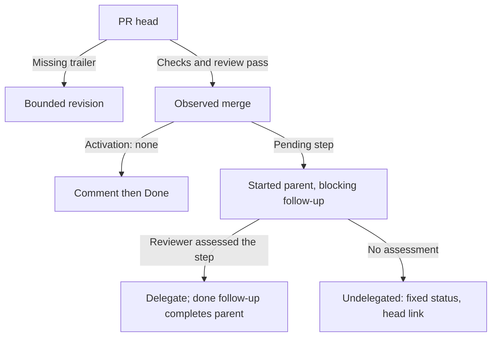

# Activation follow-ups ([HOME-150](https://factory-plan.jomcgi.dev/factory/issue/HOME-150))

Merged code and operational acceptance differ: remaining activation is tracked.

**Trailer.** A coding binding's head commit ends its final trailer block with
one `Activation: none` or `Activation: <step and its precondition>` entry,
after trailers such as `Co-Authored-By`. A missing, empty or duplicate entry
requests a revision under the round limit. CI format commits copy the entry.

**Assessment.** A pending step enqueues only with the configured reviewer's
assessment of the head, never on a human approval alone. The follow-up holds
the step the reviewer assessed
([decision](https://factory-plan.jomcgi.dev/factory/issue/HOME-408#comment-4482)).
Commit text never reaches the tracker. Without an assessment, the merge comment
and an undelegated follow-up carry a fixed status and the delivered head's link
(a squash merge has another SHA), and the handoff keeps it undelegated.

**Follow-up.** After the coordinator's HOME-106 grants check, the connector
creates `Activate HOME-N: <title>` in the first unstarted column with the
`Refs` line, step, issue, PR and head, links it as `blocks`, then delegates.
Markers recover lost creates; an ambiguous create is never resent. The parent
completes only while it is still started and linked: stops, cancellation,
takeover and unlinking prevent it. With no conditional PATCH, a late change can
race. This policy ships with `Activation: none`, cited from `git log`
([restated](https://factory-plan.jomcgi.dev/factory/issue/HOME-150#comment-4576)).
