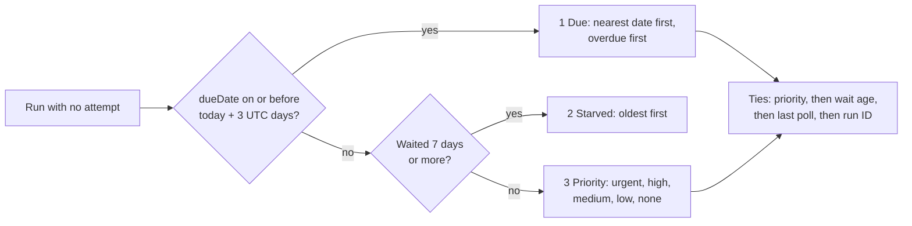

# Admission order ([HOME-822](https://factory-plan.jomcgi.dev/factory/issue/HOME-822))

A free slot goes to the first match in this
order. Only runs with no delivery attempt are ordered, so a resume of a
running session keeps its slot and place. `blocked_by` holds are unchanged: a
held run takes no slot, whatever its rank. The reviewer queue has its own order
([HOME-685](https://factory-plan.jomcgi.dev/factory/issue/HOME-685), HOME-406).

Wait age is the time since the connector claimed the run. Priority and
`dueDate` come from the issue read of the run's last admission poll. A run
not yet read, such as a new claim or any run after a restart, ranks as `none`
for its first pass, and a changed priority applies on the next pass. A slow
read of a new claim never delays an older hold. `DueWindow` (72 h) and
`StarveAfter` (168 h) set the two bounds.

**Why.** Admission used last-poll order, so on 2026-11-24 low work could run
before urgent work: 115 of 132 delegated Todo tickets (39 high, 76 medium,
17 low) had waited 3 days or more. A starved run still runs after a bounded
wait, and a due date jumps the queue.

