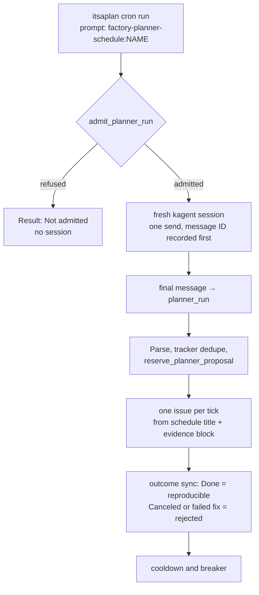

# Planner runtime

An itsaplan `cron` run of `homelab-planner` starts one planner session. The
connector takes the analysis prompt, issue title and issue instructions from a
reviewed schedule on the base branch. Planner output enters the delegated issue
as quoted evidence. The factory triage job adds [allowlisted actions](triage.md)
that the connector checks and runs. The runtime is off until the connector
config has a `planner` block (HOME-40).

- **Claim.** The connector claims runs for the planner agent only when no
  planner run is active, one session at a time. The itsaplan prompt only names
  the schedule. The model never reads it. A run with an issue, an unknown
  schedule, a disabled schedule or one with no prompt is refused.
- **Admission.** `admit_planner_run` runs before any model call. It refuses a
  run during a schedule's minimum interval, while another run is active, or
  after four consecutive low-yield runs. A refused run gets a successful result
  that says it was not admitted. The claim, the admission and the run's
  itsaplan ID commit in one transaction. A redelivered claim finds its row and
  starts nothing (invariant HOME-40-1).
- **Session.** The connector creates a fresh session with the message ID as its
  request ID, records the send intent, then sends once. A lost response is
  reconciled read-only by message ID, and a refusal kagent marks definite may
  retry the same message. A run past `runTimeout`, or one whose itsaplan run is
  gone, cancels its task and fails. The session is deleted after the result is
  reported.
- **Result.** Only the final message of a completed task is kept. The itsaplan
  result is fixed text with the run's token usage, never model text.
- **Dedupe.** Before reserving, the connector reads the HOME board once. An open
  issue that carries a proposal's `factory-planner-fp:` marker, or a reviewed
  `plannerTracked` fingerprint whose issue is open (for HOME-4 to HOME-11),
  counts the proposal as deduplicated. Postgres covers open and cooled-down
  proposals.
- **Outcomes.** The connector reads a few filed issues per tick. Done calls
  `mark_planner_reproducible` and closes the proposal. A Canceled, archived or
  deleted issue, or a delegated issue whose latest coder run failed, closes it
  as rejected. Either closing starts the fingerprint's cooldown, so a failed fix
  is not delegated again inside it.
- **Metrics.** `factory_connector_planner_*`: runs by outcome, proposals by
  outcome (created, delegated, joe, backlog, dropped, deduplicated) added once
  per finished run, last-run gauges, measured tokens, and
  `planner_breaker_open` per schedule. Tokens come from the broker's usage
  records for the session. kagent's usage metadata is the fallback, because the
  Codex harness puts none on the task (finding 12).

**Why.** Joe chose delegated fixes for the three pilots
([decision](https://github.com/jomcgi-org/homelab/issues/7935#issuecomment-6891325789),
HOME-45). A planner can copy an instruction from a CI log or a PR into its
proposal. In this design the template on `main` supplies every instruction, and the
connector quotes and sanitizes planner text so it cannot close its evidence
block. Copied text stays quoted evidence. The rule is [REVIEW.md](../REVIEW.md) "Planner
exception". A single planner slot keeps a runaway schedule from taking coding
capacity.
