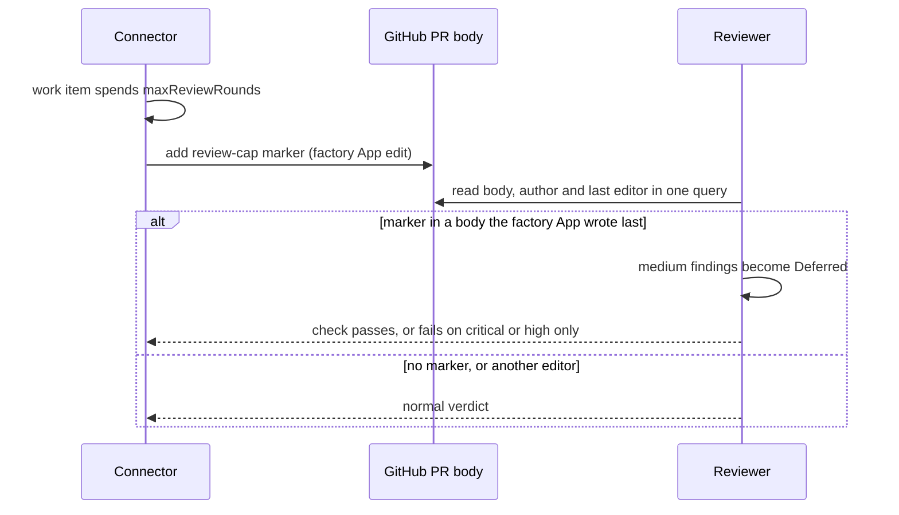
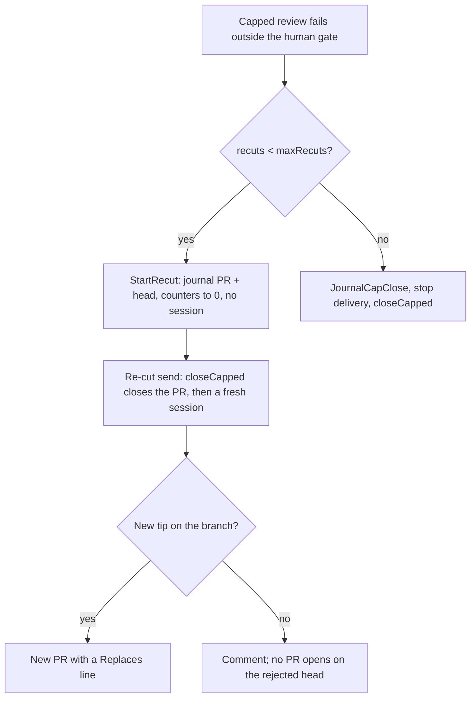

# Review-round cap

At the review-round cap (`maxReviewRounds`) no person decides the leftover
findings ([HOME-756](https://factory-plan.jomcgi.dev/factory/issue/HOME-756),
[Joe's decision](https://factory-plan.jomcgi.dev/factory/issue/HOME-756#comment-10150)):
medium findings become follow-up issues and stop blocking, and a critical or
high finding starts a re-cut in a fresh coder session.

## One count, owned by the connector

The connector counts review rounds per work item; the reviewer does not count
its own failures. When `deferAtReviewCap` is on and a work item has spent
`maxReviewRounds`, the connector adds `github.ReviewCapMarker` to the PR body.
`prBody` writes it on every later sync, and `markReviewCap` adds it on the
review poll to a PR that reached the cap earlier, also one from before this
change. A body with the marker is not written again.

## Why the reviewer trusts the marker

The reviewer applies the cap (`Assessment.AtCap`) only when all hold:

- the binding has `deferAtReviewCap`;
- the PR author is `jomcgi-factory[bot]`;
- one GraphQL read (`PullRequestBodyProof`) shows the body with the marker
  once, on the reviewed head, authored by the factory App and last edited by
  it or never edited.

Only the connector writes PR bodies with the factory App: a coder token has
`contents: write` alone (`broker/config`). A body edit by a person, a
workflow token or another App makes the reading `unverified`, and the normal
verdict applies. The check state records the reading (`State.ReviewCap`).

## What still blocks at the cap

`AtCap` defers an open medium finding only. These keep blocking: critical and
high findings, the human gate, Semgrep evidence, a previous finding the
report did not account for, and a finding whose decision Joe edited or
deleted. Incomplete review history keeps the check failed. Deferred findings
stay in the check state (`State.Capped`), so the next head must account for
them, and `State.Previous` lists them.

When the connector marks the PR after the reviewer failed the head, the
reviewer reviews that head once more per process (`capRecheck`).

## Re-cut

On the review poll at the cap, `capOutcome` reads the newest reviewer check
on the head. A review that applied the cap and still fails outside the human
gate (a critical or high finding, an unaccounted or revoked one, or
incomplete history) ends the PR:

- The close is journaled (`recut_pr`, `recut_head`, `recut_closed = false`)
  in the transaction that changes the work item, before GitHub is called.
  `closeCapped` runs before the re-cut send and on the poll of a stopped
  item. It changes only the PR state, and a PR it finds closed is recorded
  as closed, so a lost response cannot repeat or misread the close.
- The replaced row has the state `recut`: `PullRequestFor` skips it, so its
  close does not stop delivery, and the delivery outcome counts it as
  abandoned. `findOrOpenPR` skips the closed PR on the work branch.
- `capOutcome` reads only the current check, not new events, so it also
  acts on a PR whose failure was recorded as `round_limit` before deferral.
  It changes only a work item in review, so a repeat poll does nothing.
- With `maxRecuts` (default 2) spent, the connector closes the PR and stops
  delivery with a comment on the issue that names the PR. The work item no
  longer holds a slot, and a new run on the issue starts again. No person
  is needed to unblock the factory.
- A CI-only failure at the cap still records `round_limit`, as before.

## Rollout

`deferAtReviewCap` stays off in `deploy/values.yaml` until merge-time filing
of deferred findings is live
([#8446](https://github.com/jomcgi-org/homelab/pull/8446), HOME-640). Then one
values change turns it on for both services, with re-cuts. `maxRecuts: 0`
stops delivery at the first failed capped review instead of re-cutting.
