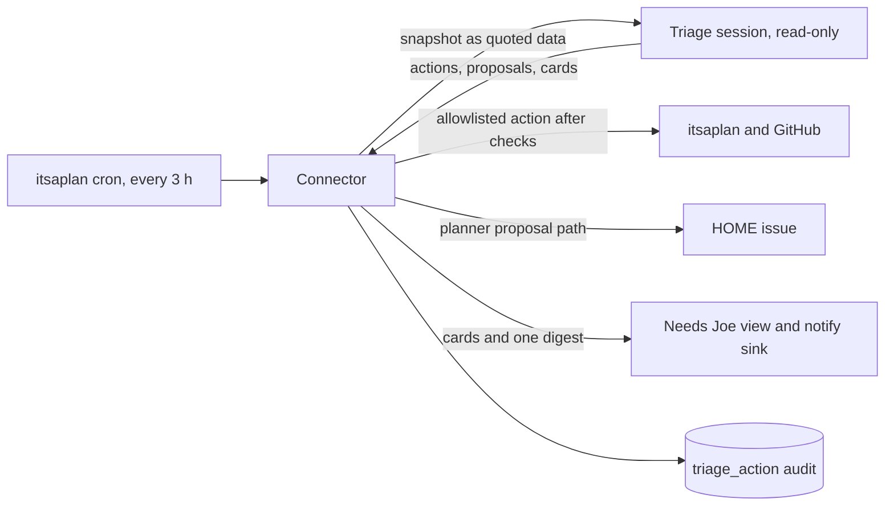

# Triage actions (designed, [HOME-386](https://factory-plan.jomcgi.dev/factory/issue/HOME-386))

The factory triage job (HOME-386) is a planner schedule. Its session can also
return typed actions and decision cards. The model stays read-only, as every
planner does. The connector runs an action only when the allowlist below names
it. Before each action, it reads the target again and checks each precondition
against its own state. It acts with the coordinator key and the author App
token that it holds now, so the job needs no new credential. Only a schedule
whose reviewed values list `actions` may return them. The connector drops
actions from any other schedule.

**Input.** Before the session starts, the connector builds one snapshot: the
HOME board (key, column, priority, position, assignee, delegate, labels,
links, title and description), its own work items, runs, attempts, rounds,
stops and holds, and the newest `factory review` and `pr-checks` conclusion
on each owned PR. The snapshot enters the prompt as quoted data under the
planner exception. Logs come later, from the read-only factory MCP (HOME-504).

**Output.** The final message holds three lists: `actions`
(`{op, target, args, reason}`), `proposals` (the planner shape) and `cards`
(`{pr, findings, recommendation}`). The connector parses them strictly, as
for planner proposals. It drops an unknown op, field or target and counts the
drop.

**Allowlist.** Each row is an item of Joe's HOME-386 decision. Terms:

- A human-owned issue is assigned to a person with no delegate, or has the
  `human` or `needs-human` label.
- A trusted writer is an account in the reviewed `triage.trustedWriters`
  list: `joe` and `joesessions`. The connector reads who last wrote the
  title, the description or a link from the issue's history feed. The coding
  prompt carries the title and the description, so both need a trusted writer.
- A recorded stop is any stop in the connector's database for the issue's
  work item (`connector cancel`, a canceled column or a closed PR) with no
  re-admission by a person.
- Active work is a pending or running itsaplan run, an open attempt or review
  round, or an open PR.

| Op | Joe's item | The connector checks | Effect | Per run |
| --- | --- | --- | --- | --- |
| `delegate` | Delegate ready work, start unblocked follow-ups | Todo in a bound project; no delegate; not human-owned; no `deferred` label; no recorded stop; every `blocked_by` issue completed; a `Done when` checklist; title and description each last written by a trusted writer, or a `split` child whose title and description still have the hashes the connector recorded | Delegate to the binding's coding agent | Free coding slots, at most 4 |
| `set_priority` | Priority in HOME | Open; not human-owned; new value `low`, `medium` or `high` | Change the priority | 10, shared with `move` |
| `move` | Order in HOME | Open; not human-owned; same column | Change the position | 10, shared with `set_priority` |
| `cancel` | Close obsolete work | Open; not human-owned; no active work; a `duplicates` link that a trusted writer added | Move to Canceled | 3 |
| `split` | Split work | Backlog or Todo; no delegate; not human-owned; no active work; title and description each last written by a trusted writer; two or more `Done when` items; a partition that uses each item once | Create sub-tasks that copy the parent's description with their own items, titled "\<parent title\> (part i of n)"; record each child's title and description hashes; block the parent on them | 2 |
| `grant_round` | Raise the round cap by one round | Work item at `round_limit`; no recorded stop; no critical finding and no human-gate marker on the head's review check; no earlier grant on this work item | Allow one more review round on this work item | 3 |
| `recut` | Re-cut a PR that lost review history or has a merge conflict | Factory-authored PR; no human hold; no recorded stop; no re-cut of this issue in 7 days; and either the reviewer's incomplete-state notice on the head check, or a conflict past the rebase cap while the head's review check has no blocking finding | Close the PR with a link; a fixed-text round squashes the work onto `origin/main` on a new branch; the connector opens a new PR that links the old one | 2 |

`delegate`, `grant_round` and `recut` can start or resume work. Each one reads
the connector's stop state under the writer epoch immediately before its
write ("Stops stand" in [REVIEW.md](../REVIEW.md)).

A conflict re-cut needs a head with no blocking finding, so it never drops a
known blocker. The lost-history re-cut is the recovery that the reviewer's
incomplete-state notice prescribes: a new PR from commits no review has seen.

For `grant_round`, the model judges that each remaining finding can wait for
a follow-up under the REVIEW.md severity rule. The connector enforces the
floor in the table.

An obsolete issue that has no `duplicates` link from a trusted writer gets a
card. The model never adds that link.

**Model text.** The model chooses only the op, the target and fixed
arguments: a priority value, a position or a partition. Coder-facing text,
the title and the description, comes only from a trusted writer, a `split`
copy of a trusted writer's issue with unchanged hashes, or a reviewed
template. Model text reaches only the audit
`reason` and the evidence block of a proposal or card, quoted and sanitized.
An instruction copied from a log, a PR or an untrusted edit therefore cannot
reach a coder.

**Stale snapshots.** The connector compares the target's `updatedAt` with the
snapshot. A change since the snapshot refuses the action as `stale`, so the
job never overwrites a person's edit.

**Proposals and cards.** A factory fault becomes a proposal on the planner
path, with the triage schedule's ceiling `delegate` and fingerprints
`homelab:factory:<component>:<failure-class>`. A request to clear a review
finding becomes a decision card: the "Needs Joe" item for that PR (HOME-46),
with the finding IDs. Only Joe's PR comment clears a finding. Each run sends
one digest through the notify sink (HOME-51) with the new cards, the actions
done and the actions refused.

**Never.** The job never clears a finding, approves, enqueues, merges, edits a
label or a gate, confirms a recovery hold, clears a grant block, changes a
human-owned issue, sets `urgent`, deletes a branch or a session, or writes to
the cluster. It sends a card for each of these. Live repairs run only as
reviewed runbook actions (HOME-339) that the job's allowlist names. Until
then the job files a fix or sends a card.

**Rollout and audit.** The job starts in observe mode: the connector records
each action it would run as `observed` and runs none. Reviewed values turn on
one op at a time. A `triage_action` row keeps the run, op, target, arguments,
reason, state before the action and result (`done`, `refused`, `stale` or
`observed`). `connector triage revert <id>` restores the priority, position,
column or delegate from that row. Three runs in a row in which the connector
refuses most actions return the job to observe mode and send a card.

**Why.** On 2026-11-18 the factory stalled for hours and no one saw it. Joe
chose a scheduled triage job that fixes the factory, delegates and
prioritises work, and sends him one digest
([decision](https://factory-plan.jomcgi.dev/factory/issue/HOME-386#comment-3915)).
The model reads PRs, logs and issues that any author can write, so it holds
no write credential, and the connector's fixed checks keep each action inside
Joe's list. Each part of HOME-386 waits only for the HOME-40 parts it uses
([decision](https://factory-plan.jomcgi.dev/factory/issue/HOME-386#comment-6071)).
The rule is [REVIEW.md](../REVIEW.md) "Planner exception".

## Decision history

| Decision | Date | Record |
| --- | --- | --- |
| Scheduled triage job fixes the factory, delegates, prioritises and sends one digest | 2026-11-18 | [HOME-386](https://factory-plan.jomcgi.dev/factory/issue/HOME-386#comment-3915) |
| Write this contract before HOME-40 is Done; block each part only on the HOME-40 parts it uses | 2026-11-19 | [HOME-386](https://factory-plan.jomcgi.dev/factory/issue/HOME-386#comment-6071) |
