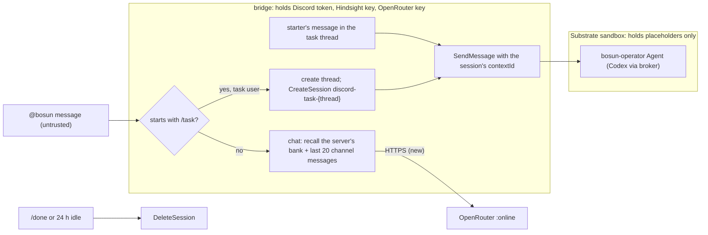

# Discord bridge architecture

The bridge connects Bosun to allowlisted Discord servers. Today a mention
starts one kagent session on the `bosun` Agent in a gVisor Substrate worker,
and the bridge deletes the session after the answer. Joe chose two paths on
2026-11-25: **chat** answers a mention without a sandbox session, and
**`/task`** opens an interactive session in a thread. This note is the
design. Nothing in it is live.

| Component | Role | Code | Pin | Untrusted input | Credentials held |
| --- | --- | --- | --- | --- | --- |
| bridge | Gateway, policy, chat and task routing | `*.go`, `cmd/` | Factory chart | Every Discord message in allowlisted servers | Bot token, Hindsight tenant key, OpenRouter key (new) |
| render | Draws Bosun's reply images | `render/` | Factory chart | Model answers | None |

## Chat

- **(a) Model call.** Recommend: the bridge calls OpenRouter
  `chat/completions` with the dedicated `factory-discord-llm` key and the
  `:online` model. Every kagent `v1alpha3` Agent here needs a `harnessRef`
  to a Substrate pool, so a sandbox-free kagent Agent needs fork work.
- The prompt keeps today's shape (`Prompt`): one JSON value of untrusted data,
  with `recent` added. Retain stays as it is now.
- **Recent history.** The last 20 messages of the same channel, at most
  4,000 characters, read by `REST.MessagesBefore`. Text from other users
  needs the Message Content intent; without it, recall alone feeds chat.

## Task threads

- **(b) Trigger.** Recommend: message text `/task <what>` after the mention.
  The gateway reads only `MESSAGE_CREATE` (no `INTERACTION_CREATE`), and the
  bridge clears slash commands at start-up. The guild and channel allowlist
  (`policy.go`) applies.
- **Who.** Recommend: Joe only, from `operator-user-id`. A wider list is
  Joe's choice, because task turns spend his Codex quota.
- **(c) Link.** The bridge starts a thread on the message. The session
  request ID is `discord-task-<thread id>`, so kagent stores the link and a
  restarted bridge finds the session again (`KagentOperator.Session`).
- **Routing.** A thread that Bosun owns, under an allowlisted channel, is a
  task thread. Each message from the starter is a turn; other authors are
  dropped (operator author rules). No mention is needed.
- **End.** `/done` or 24 hours idle (Discord's auto-archive) deletes the
  session. An hourly sweep finds idle sessions by `ListSessions` and
  `ListTasks`. A message after the end gets a fixed reply: start a new task.
- **(d) Agent.** Recommend: the existing `bosun-operator` Agent: own
  namespace, atespace and pool, Codex through the broker. `/task` replaces
  the operator channels, so there is no third path.
- **Tools.** Recommend: none now. HOME-314 steps 2 to 4 add Backlog filing
  and "do it now" dispatch. Code changes go through the factory PR path.
- **Example.** `@bosun /task Garage disk alert fired; help me pick RF` gives a
  discussion that ends in a filed HOME ticket.

## Limits, egress and data

- **(e) Limits.** At most 2 open task sessions, 1 for each user. Task turns
  count against `UserLimit`, `GuildLimit` and `GlobalLimit`. One task turn
  runs at a time across threads, to match the pool's `concurrency: 1`. An
  idle session is suspended to its snapshot and holds no worker.
- **(f) Egress.** With `enforceAgentPath` on, port 8083 allows only POST
  `^/agents/factory-discord-operator/bosun-operator$` (A2A `SendMessage`,
  `GetTask`, `ListTasks`) and
  `^/kagent\.api\.v1\.SessionService/(CreateSession|RevertSession|ListSessions|DeleteSession)$`.
  The `bosun` A2A path goes. A new FQDN rule allows `openrouter.ai:443`.
- **(g) Data.** Chat recalls only the bank of the gateway event's guild, with
  the channel tag and `all_strict`. A task session gets no recall, no
  retain and no Hindsight key. Task threads are not ingested.
- **(h) Out of scope.** Sub-agents, a third tier, DMs, slash commands, task
  sessions for other users, and repository or cluster tools.

## Direction

| Direction | Tracks | State |
| --- | --- | --- |
| Chat without a sandbox; `/task` threads on the operator Agent | [HOME-162](https://factory-plan.jomcgi.dev/factory/issue/HOME-162) | designed |

## Decision history

| Decision | Date | Record |
| --- | --- | --- |
| Chat without a sandbox session; `/task` opens an interactive thread session | 2026-11-25 | [HOME-162](https://factory-plan.jomcgi.dev/factory/issue/HOME-162) |
