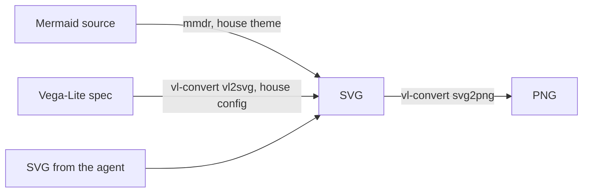

# factory-discord-render

POST a raw Vega-Lite JSON document to `/vega-lite`, UTF-8 Mermaid source to
`/mermaid` or an SVG document to `/svg` on port 8080. A successful request
returns `image/png`. Requests over 65,536 bytes receive HTTP 413. External
inputs, unsupported specs and outputs over 4096 pixels on either side receive
HTTP 422. A conversion killed at the five-second deadline receives HTTP 504.

The drawing step has 3 seconds and the raster step has 2 seconds. A drawing
whose longer side is at most 2048 pixels rasterizes at twice its size, so it
stays sharp on phone screens.

## House theme

The renderer applies one theme to every image. The agent cannot replace it.

- `theme/mermaid.json` is the mmdr config: the `modern` preset with Inter,
  slate nodes and lines, and the chart palette for pie slices. Mermaid
  source cannot carry its own theme: the renderer refuses `%%{` directives
  and front matter.
- `theme/vega-lite.json` is merged over the chart's own `config`. House keys
  win; other keys of the chart stay. The renderer removes a top-level
  `background`.
- Every image has an opaque white background, so it reads on Discord's dark
  and light themes.
- The categorical palette is the validated eight-hue order from the
  `dataviz` reference palette: blue, orange, aqua, yellow, magenta, green,
  violet, red.

The image ships Inter 4.1 (text), Noto Color Emoji 2.051 (emoji) and DejaVu
2.37 (fallback for other glyphs).

## Engine choice

On 2026-11-27 mmdr 0.3.1 was compared with mermaid-cli 12.2.0 (headless
Chrome, ELK layout) on a 15-node flowchart with two decisions and loop-backs,
a sequence diagram and a small flowchart. ELK gave no clearly better layout:
it also routed the long loop-back around the whole chart and added stair-step
edges. Per diagram, mermaid-cli took about 1.1 s and 130 MB against mmdr's
0.4 s and 17 MB, and it needs a browser in the image. The renderer keeps
mmdr. The PR that added the house theme shows the comparison images.

Known mmdr limit: a chained edge after a labelled edge
(`B -- no --> D[Render] --> C`) prints `D[Render]` as text. Write one edge
per line.

## Fidelity suite

Run `python3 fidelity.py http://localhost:8080` against the running service.
It posts every `goldens/*.mmd` and `goldens/*.json` and compares the result
byte for byte with the PNG of the same name. Six Mermaid fixtures come from
mermaid-rs-renderer's basic conformance cases; `busy.mmd` is a 15-node
flowchart with an emoji label. Review the images when you change the
engines, fonts or theme.

The Bazel target `//projects/factory/discord/render:image` packages the Rust
server, native engines, fonts and theme. The published factory chart pins
its digest and deploys the service with the bridge, in the bridge namespace.
A Cilium deny rule also covers the cluster's baseline DNS allowance.
