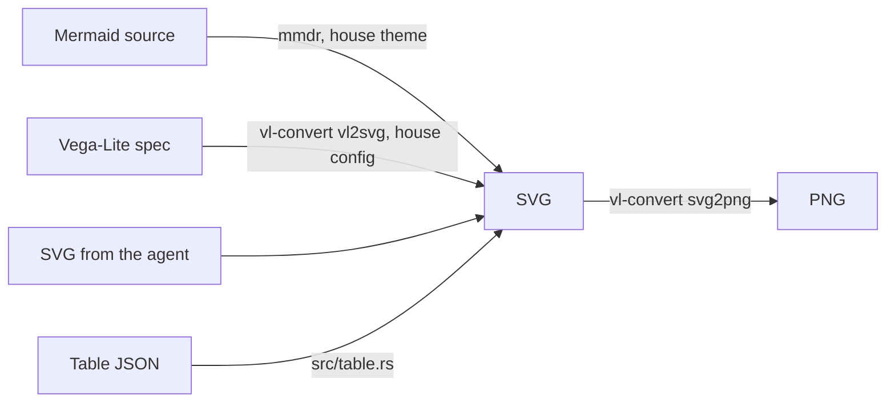

# factory-discord-render

POST a raw Vega-Lite JSON document to `/vega-lite`, UTF-8 Mermaid source to
`/mermaid`, an SVG document to `/svg` or a table to `/table` on port 8080. A successful request
returns `image/png`. Requests over 65,536 bytes receive HTTP 413. External
inputs, unsupported specs and outputs over 4096 pixels on either side receive
HTTP 422. A conversion killed at the five-second deadline receives HTTP 504.

A table is `{"columns": [...], "align": ["left"|"center"|"right", ...],
"rows": [[...], ...]}` with 1 to 12 columns, at most 100 rows and 1000
characters a cell. The renderer draws it itself: a header band, zebra rows,
cells that wrap at 300 px, and escaped text, so the drawing refers to
nothing outside it. The bridge sends each Markdown table in an answer here,
because Discord shows no Markdown tables. A table it cannot draw, or one
past the four-image limit, becomes an aligned monospace table in a code
block. Memory keeps the table as Markdown.

The drawing step has 3 seconds and the raster step has 2 seconds. A table
or an agent's SVG has no drawing step, so its raster step has 5 seconds.

Discord fits an image into a box about 550 CSS pixels wide on desktop, and
about 390 points wide (3 device pixels a point) on a phone. A PNG needs about
1,200 to 2,000 pixels of width to stay sharp there and in the full-size view.
So the raster scale is 2048 divided by the drawing's width, at least 2 and at
most 8, and neither side of the PNG passes 4096 pixels. A seven-bar Vega-Lite
chart in the house theme becomes 1800 by 2616 pixels; at 2x it was 442 by
636. An agent's SVG with no viewBox and not both a width and a height
keeps the 2x scale, because resvg sizes it to its content.

The house theme keeps chart text at 14 pixels or larger. The prompt asks for
drawings about 600 pixels wide and top-to-bottom Mermaid chains, because a
1,800-pixel-wide flowchart shrinks to a third of its size in Discord.

## House theme

The renderer applies one theme to every image. The agent cannot replace it.

- `theme/mermaid.json` is the mmdr config: the `modern` preset with Inter,
  slate nodes and lines, and the chart palette for pie slices. Mermaid
  source cannot carry its own theme: the renderer refuses `%%{` directives
  and front matter.
- `theme/vega-lite.json` is merged over the chart's own `config`. House keys
  win; other keys of the chart stay. The renderer removes a top-level
  `background`.
- Every image has an opaque white background, so it reads on Discord's dark
  and light themes.
- The categorical palette is the validated eight-hue order from the
  `dataviz` reference palette: blue, orange, aqua, yellow, magenta, green,
  violet, red.

The image ships Inter 4.1 (text), Noto Color Emoji 2.051 (emoji) and DejaVu
2.37 (fallback for other glyphs).

## Engine choice

On 2026-11-27 mmdr 0.3.1 was compared with mermaid-cli 12.2.0 (headless
Chrome, ELK layout) on a 15-node flowchart with two decisions and loop-backs,
a sequence diagram and a small flowchart. ELK gave no clearly better layout:
it also routed the long loop-back around the whole chart and added stair-step
edges. Per diagram, mermaid-cli took about 1.1 s and 130 MB against mmdr's
0.4 s and 17 MB, and it needs a browser in the image. The renderer keeps
mmdr. The PR that added the house theme shows the comparison images.

Known mmdr limit: a chained edge after a labelled edge
(`B -- no --> D[Render] --> C`) prints `D[Render]` as text. Write one edge
per line.

## Fidelity suite

Run `python3 fidelity.py http://localhost:8080` against the running service.
It posts every `goldens/*.mmd` and `goldens/*.json` and compares the result
byte for byte with the PNG of the same name. Six Mermaid fixtures come from
mermaid-rs-renderer's basic conformance cases; `busy.mmd` is a 15-node
flowchart with an emoji label, and `capabilities.table.json` (posted to
`/table`) is a capability matrix with emoji. Review the images when you change the
engines, fonts or theme.

The Bazel target `//projects/factory/discord/render:image` packages the Rust
server, native engines, fonts and theme. The published factory chart pins
its digest and deploys the service with the bridge, in the bridge namespace.
A Cilium deny rule also covers the cluster's baseline DNS allowance.
