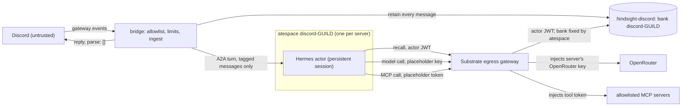
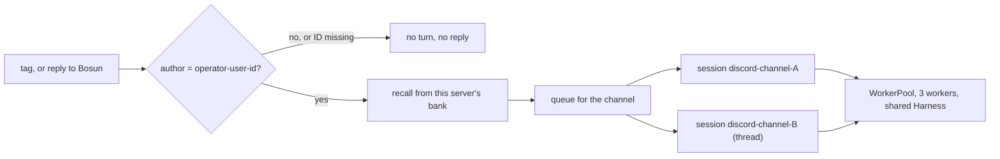
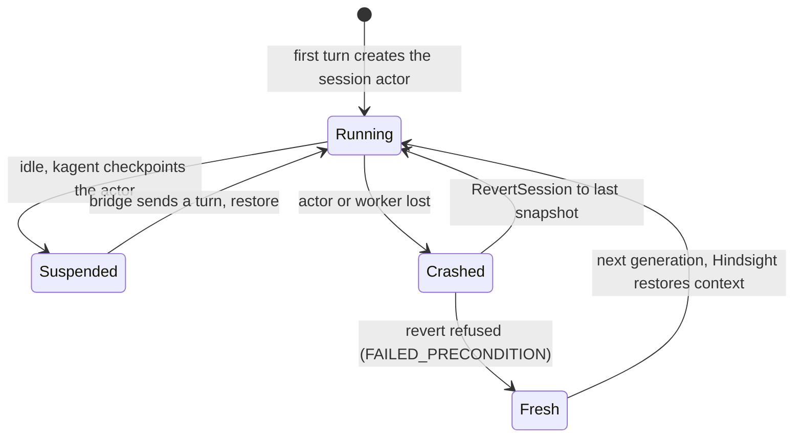
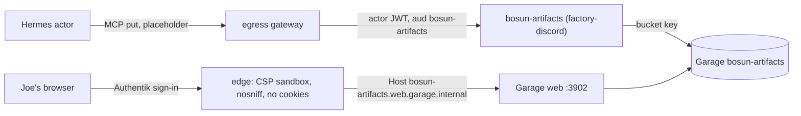
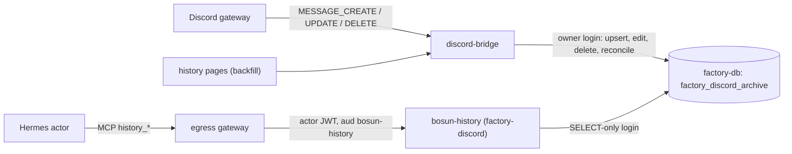
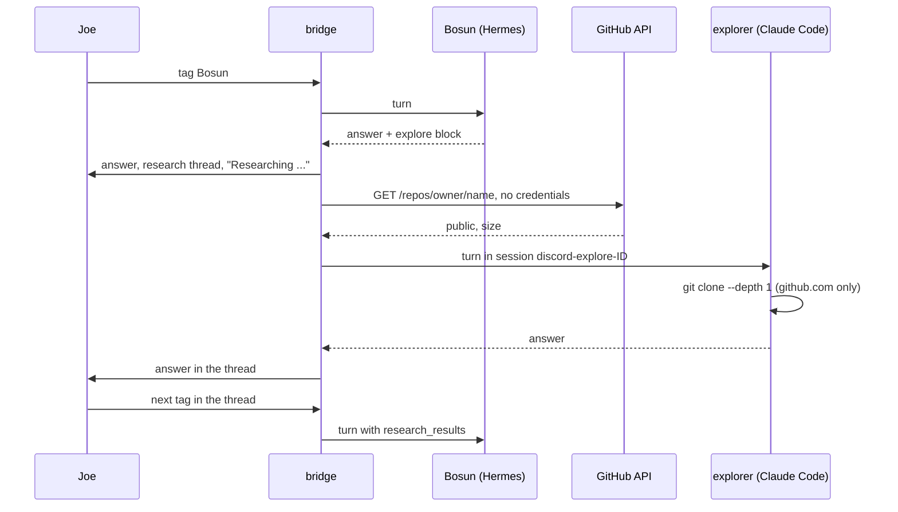

# Per-server Discord agents

Design for [HOME-905](https://factory-plan.jomcgi.dev/factory/issue/HOME-905).
Each allowlisted Discord server gets its own persistent Hermes agent on ATE.
The agent wakes when the bridge sends it a turn and suspends when idle. It
reads and writes only its own server's Hindsight bank, and it gets only the
MCP tools that its server's values list. The homelab agent's image and
chart exist (slice 2). Slice 4 (HOME-909) routes tagged messages to the
homelab agent: a policy entry `serverAgents` maps each guild to the Agent,
and the bridge keeps one session per channel with request ID
`discord-channel-<channel>` (`operator.go`, `ChannelRequestID`). Until slice 3, the bridge still recalls
and puts memories in each prompt. In a server with `ingest`, each prompt
also carries `channel_messages_since_your_last_turn` (`channel.go`): the
bridge reads one page of the channel's history from Discord before the
tagged message and keeps the messages after Bosun's last one there (at most
50 lines and 8,000 characters, newest kept; 30 lines when no message of
Bosun's is in the page). The boundary comes from Discord, so a retained
ingest buffer or a restarted bridge loses no context. The channel's session
gets each line once. Text that leaves the bridge (prompt, ingest, import)
names mentions (`mentions.go`): `@username (nick)`, `@role`, `#channel`,
`:emoji:`; an unknown user is `@unknown-user`, never a raw ID. See [Joe only](#joe-only-one-session) for
who the bot answers today. Actions: when
the agent's answer holds a fenced `poll` block (JSON, Discord's poll
limits), the bridge posts it as a Discord poll after the text reply
(`poll.go`). Memory stores `[poll: <question>]`, not the JSON. Fenced
`react`, `thread` and `pin` blocks (`actions.go`, at most one of each) react
to the tagged message with 1 to 3 emoji, start a public thread from it that
gets the reply, and pin the reply. The bot's role needs Add Reactions, Create
Public Threads, Send Messages in Threads and Pin Messages; a refused action
is logged and skipped, and the reply goes to the channel when the thread
fails. Memory stores `[thread: <name>]`, `[reacted: <emoji>]` and
`[pinned]` only for actions Discord did. Each `react`, `thread` and `pin`
block takes an optional `target`, and a `reply` block `{"target": ...}`
posts the answer as a reply to that message (`allowed_mentions` parse `[]`,
`replied_user` false). A target is `tagged` (the default), `replied` (the
message the tag replies to) or the `id` of a
`channel_messages_since_your_last_turn` line (`m1` is the oldest). The
bridge maps labels to Discord IDs for this turn only (`Targets`); any other
target is logged and ignored. A pin with no target pins the answer. In a server with a `channels` list,
the bridge does not answer a tag inside a new thread: its ID is not listed.
Follow-up: reminders need state that survives a restart, so they wait for a
persisted store. Other controls below are not seen live yet, so each one is
`designed`.

Joe's decisions are on
[HOME-162 comment 12817](https://factory-plan.jomcgi.dev/factory/issue/HOME-162#comment-12817)
(2026-11-26). The goal is "smooth, helpful and fast".



| Component | Role | Code | Untrusted input | Credentials held |
| --- | --- | --- | --- | --- |
| bridge | The one Discord gateway and policy point | `discord/` | Every Discord message | Bot token, Hindsight tenant key, kagent invocation token |
| Hermes actor | Answers one server's turns with a persistent session | `../harness/hermes/`, `../chart/templates/discord-server-agents.yaml` | Tagged messages, recalled memories, tool output | Placeholders only |
| egress gateway | Injects the model key, tool tokens and actor JWT | `../../platform-factory/substrate/` | Actor requests | Per-atespace injectable Secrets |
| hindsight-discord | Stores and recalls each server's memory | `../../platform-factory/hindsight-discord/` | Retained text | Database login, OpenRouter key |

## Today

Bosun runs one kagent Agent for all four servers. Each tagged message
creates a fresh session actor `session-<id>` and restores it from a
checkpoint. The Bosun worker log shows `Restore timing breakdown` with
`ate.snapshot.fidelity: volumes` (2026-11-24 and 25). The actor runs one turn, checkpoints it and deletes the session
(`agent.go`, HOME-162 "Short sessions"). The bridge recalls before the turn
and retains after it; the agent has no tools except `:online` web search.

Measured on 2026-11-26, one Bosun turn spends:

| Step | Time |
| --- | --- |
| Hindsight recall | 0.5 to 0.6 s |
| gVisor actor create or restore | 0.06 to 0.32 s |
| Model call | 3.4 to 5.4 s |

The model call is about 85% of the turn. No actor snapshot reached the
Garage `ate-snapshots` bucket yet, so session state today has no copy off
the worker volume.

## Hermes fit

Hermes Agent is Nous Research's MIT-licensed agent in Python. Release
v0.23.4 was published on 2026-11-24. Each fact below links its source; the
[last section](#hermes-facts) lists what the docs do not state.

| Need | Hermes | Source |
| --- | --- | --- |
| Take turns from another service | API server (`/v1/runs`, `/v1/responses`), A2A, ACP over stdio, webhooks, one-shot CLI | [api-server](https://github.com/NousResearch/hermes-agent/blob/main/website/docs/user-guide/features/api-server.md), [a2a](https://github.com/NousResearch/hermes-agent/blob/main/website/docs/user-guide/messaging/a2a.md), [integration](https://github.com/NousResearch/hermes-agent/blob/main/website/docs/developer-guide/programmatic-integration.md) |
| Persistent session | `/v1/runs` and `/v1/responses` keep a conversation by `X-Hermes-Session-Key`; Chat Completions uses `X-Hermes-Session-Id`; sessions in SQLite `state.db` | [api-server](https://github.com/NousResearch/hermes-agent/blob/main/website/docs/user-guide/features/api-server.md), [memory](https://github.com/NousResearch/hermes-agent/blob/main/website/docs/user-guide/features/memory.md) |
| Memory | `MEMORY.md` and `USER.md`, loaded at session start; one external provider, Hindsight among them | [memory](https://github.com/NousResearch/hermes-agent/blob/main/website/docs/user-guide/features/memory.md), [providers](https://github.com/NousResearch/hermes-agent/blob/main/website/docs/user-guide/features/memory-providers.md) |
| Compaction | Summarises at `compression.threshold` (default 0.50 of the window) with `auxiliary.compression` | [compression](https://github.com/NousResearch/hermes-agent/blob/main/website/docs/developer-guide/context-compression-and-caching.md) |
| MCP client | `mcp_servers`, stdio or Streamable HTTP, `tools.include` per server | [mcp config](https://github.com/NousResearch/hermes-agent/blob/main/website/docs/reference/mcp-config-reference.md) |
| Model | `provider: custom` with `base_url`; OpenRouter via `OPENROUTER_API_KEY` | [providers](https://github.com/NousResearch/hermes-agent/blob/main/website/docs/integrations/providers.md) |
| Tool limits | `agent.disabled_toolsets`, `platform_toolsets`; `approvals.mode` and `unattended_mode` | [configuration](https://github.com/NousResearch/hermes-agent/blob/main/website/docs/user-guide/configuration.md), [security](https://github.com/NousResearch/hermes-agent/blob/main/website/docs/user-guide/security.md) |
| Long-lived process | `hermes gateway`; state in `HERMES_HOME`; image `nousresearch/hermes-agent` | [docker](https://github.com/NousResearch/hermes-agent/blob/main/website/docs/user-guide/docker.md) |

Hermes fits: it runs headless behind an API, keeps sessions on disk and has
a Hindsight provider.

## Joe only, one session per channel

Joe's decisions on 2026-11-27 (HOME-909) change the per-server design
below for now:

- **Who.** The policy's `users: operator` answers only Joe, by the
  `operator-user-id` field of the bot's 1Password item
  (`discord.operator.userIdKey`). Another author's tag gets no turn and no
  reply. Without a readable ID, nobody gets a turn.
- **Where.** `discord.serverAgents.homelab.servers: all` routes Joe's tags
  in all four allowlisted servers to the homelab agent.
- **Sessions.** One Hermes session per Discord channel; a thread has its
  own channel ID, so it has its own session. Each session is a kagent
  Session, so one actor, on the shared Harness: the same key, compaction,
  tools and gate. Each channel has its own turn queue, so a session never
  gets two turns at once. `concurrency: 3` gives the WorkerPool 3
  workers, so 3 channels answer at once; idle sessions suspend. The old
  whole-server session `discord-server-<guild>` is no longer used, and its
  Hermes context does not carry over.
- **Replies.** When Joe's message replies to another message, the prompt
  holds that message's author and text (`reply_to`, at most 2,000
  characters) and `from_you` when Bosun wrote it. A reply to Bosun's
  message starts a turn without the ping. The Joe-only gate still applies.
- **Recall.** Each turn recalls from the bank of the message's own server,
  and the prompt names the server and channel. There is no cross-server
  recall.
- **Snapshots.** Each channel session that suspends writes its own
  snapshot under the Harness `snapshotPolicy` prefix, so storage grows
  with the number of channels Joe uses. Watch the `ate-snapshots` bucket
  size for `discord-1501965852042330302/`.
- **Unchanged.** Ingest and history backfill run for every server as
  before. Bosun's Agent and template stay rendered but get no turns; Joe
  may reuse them as a separate app for friends.



## 1. Gateway: keep the bridge

**Recommendation.** The bridge stays the only Discord gateway and the only
policy point. Hermes runs with its Discord platform off and receives
turns from the bridge through kagent A2A.

| Concern | Bridge owns gateway (recommended) | Hermes owns gateway |
| --- | --- | --- |
| Bot tokens | One token, one process (no double replies) | One token per agent, or one shared token in four actors |
| Server allowlist (rule 8) | Values, checked before any model call | Hermes config in each actor |
| Rate limits (rule 7) | User, guild and global limits in one place | Not confirmed in Hermes |
| Ingest into Hindsight | Every message, tagged or not | Lost, or each actor must ingest |
| Wake on activity | Bridge sends a turn; actor sleeps between turns | Actor must stay connected to Discord, so it can never suspend |
| No pings (rule 6) | `allowed_mentions {"parse": []}` on every reply | Hermes reply path |
| Untrusted input as data (rule 1) | Bridge wraps Discord text in one JSON value | Hermes sees raw text |

A Discord gateway connection is a long-lived websocket. An actor that holds
one cannot suspend. Hermes' relay mode moves the bot token to a separate
connector, but the actor still holds an open WebSocket to it
([relay](https://github.com/NousResearch/hermes-agent/blob/main/website/docs/user-guide/messaging/relay.md)).

Hermes does not need its Discord adapter. The adapter calls the API
server's non-streaming `/v1/responses` with `X-Hermes-Session-Key` and
`conversation` both set to the server's session. With `unattended_mode: deny`, a `/v1/runs` or
streaming client still gets approval requests and the run parks in
`waiting_for_approval`; an MCP tool with `trust: untrusted` parks the same
way. So the adapter also answers every approval request with deny, and a
turn never waits on a person. The
Hermes Discord adapter documents user, role and channel allowlists but no
server allowlist ([discord](https://github.com/NousResearch/hermes-agent/blob/main/website/docs/user-guide/messaging/discord.md)).

## 2. Runtime on ATE

**Recommendation.** Each server has one kagent Agent on a `spec.hermes`
Harness, in its own namespace and WorkerPool. The kagent fork's
`kagent-hermes` runner speaks kagent's private A2A contract and sends each
turn to the Hermes API server on loopback (section 1). It starts
`hermes gateway` on the first turn, with the API on loopback and no
messaging platform. The harness image
(`../harness/hermes/`) holds the runner and the pinned Hermes Agent without
its browser, media, Node.js and compiler parts. The chart renders the
agent from `discord.serverAgents` (`chart/templates/discord-server-agents.yaml`).

The bridge keeps one persistent kagent session per server, the same way the operator session keeps one per thread
(`operator.go`). The session request ID derives from the guild ID, so a
restarted bridge finds the same session. One session serves every channel
in the server; each turn's JSON names its channel and author.



- **State.** Hermes keeps its home directory (`HERMES_HOME`) on the actor's
  volume: `state.db` (sessions), `memories/` and `config.yaml`. The
  harness writes `config.yaml` from values at start, so git owns config and
  the volume owns only conversation state.
  The checkpoint that kagent writes on suspend carries the volume.
- **Snapshot store.** The Harness `snapshotPolicy` writes to
  `s3://ate-snapshots/<namespace>/`, as Bosun's does. Slice 1 proves that a
  suspend writes an object to Garage before any other server moves.
- **Backup.** Garage keeps three copies on the factory nodes. Substrate's
  PostgreSQL and the snapshots have no off-site backup
  (`projects/factory-cluster/README.md`). Hindsight is the durable record:
  the bridge ingests every message there, so a lost actor costs only
  Hermes' own session notes.
- **Restore.** Order: `RevertSession` to the last snapshot; else a new
  session generation whose first turn carries a server-wide recall. A
  weekly drill deletes the homelab session and checks that the next turn
  answers a question about last week from Hindsight.
- **Suspend wedge.** A suspend over 30 s wedged sessions on kagent v1.0.1
  (kagent#3311/#3312). The controller fork carries kagent#3653, a 2 min
  `snapshotTimeout`. A small Hermes home keeps checkpoints short. An alert
  fires when a suspend takes more than 60 s.
- **Resources.** kagent applies one limit to every runtime (4 CPU, 8Gi).
  Workers request 100m and 512Mi, so a suspended agent holds no memory
  beyond its worker pod. One worker per server; four servers need four
  worker pods.

## 3. Isolation

**Recommendation.** One namespace, atespace and identity per server. The
actor holds placeholders only. The Hindsight bank follows from the actor's
identity at the gateway, never from the prompt.

- **Atespace.** `discord-<guild_id>`, also the namespace. The credential
  provider's `namespacePolicies` grants each atespace only its own Secrets.
- **Model key.** One OpenRouter key per server, each with its own monthly
  limit, labelled `substrate.ate.dev/injectable`. The gateway injects it for
  that atespace only. This keeps HOME-162 rule 2 and bounds each server's
  spend on its own.
- **Hindsight.** Today the tenant key opens every bank, so it never enters
  an actor. Hermes' Hindsight provider runs in `local_external` mode with
  `bank_id: discord-<guild>` and `memory_mode: context`. Its config has no
  key field; the placeholder goes in env `HINDSIGHT_API_KEY`
  ([provider](https://github.com/NousResearch/hermes-agent/blob/main/website/docs/user-guide/features/memory-providers.md),
  [keys](https://hindsight.vectorize.io/sdks/integrations/hermes)). The
  gateway replaces the placeholder with an actor JWT (audience
  `hindsight-discord`). A Hindsight extension, like the factory's
  `/ext/connector/retain`, verifies the JWT with the broker's rules
  (`ARCHITECTURE.md`, "Codex relay"): signature, `iss`, `aud`, `exp` and
  `nbf`; subject exactly `actor/discord-<guild>/session-*` with the
  `actor.ate.dev` claim; no `worker-for-actor` token; atespace in an
  `allowedAtespaces` list. It maps the subject to bank `discord-<guild>`
  and refuses every other bank. It refuses retain and reflect for actor
  tokens, so only recall is open. The bank in the config is a convenience;
  the JWT check is the control.
- **JWT binding.** In this repository `actorJwt` exists only on ModelConfig
  (`chart/templates/_binding.tpl`, `discord-operator.yaml`). Which kagent
  resource binds the hindsight-discord origin to an actor JWT is not
  confirmed. The fallback is a per-guild injectable token that the
  extension maps to one bank.
- **Network.** The `hindsight-discord` ingress policy admits the egress
  gateway for that route only. The bridge keeps its own path.
- **Writes.** The bridge stays the only writer of Discord messages
  (section 5).

## 4. Tools per server

**Recommendation.** A per-guild MCP allowlist in values, empty by default,
and read-only tools only until Joe names a write tool for one server.

```yaml
discord:
  servers:
    "1501965852042330302":   # homelab
      model: <model id>
      mcpServers:
        - name: factory
          url: https://factory-mcp.jomcgi.dev/mcp
          secret: discord-homelab-factory-mcp
          tools: [<read-only tool names from HOME-902>]
```

- The chart renders one RemoteMCPServer per entry in the server's
  namespace, with discovery off and the listed tools only, as
  `repositories[].mcpServers` does today.
- The gateway injects the tool token from key `token` of the named Secret.
- Hermes' own toolsets stay off through `agent.disabled_toolsets`:
  terminal, file, code execution, browser, web, delegation, cron, skills
  and the `discord` and `discord_admin` toolsets
  ([toolsets](https://github.com/NousResearch/hermes-agent/blob/main/website/docs/reference/toolsets-reference.md)). Web search stays in the
  model call (`:online`).
- **Homelab agent.** People other than Joe can post in the homelab server,
  and an answer shows them what a tool returned. So the allowlist names
  read tools by the data they return:

  | Data class | Example | Slice 5 |
  | --- | --- | --- |
  | Public repository state | PR state, check results, merged commits | Allowed |
  | Status fields | Issue key, column and title; run state and times | Allowed |
  | Alert state | Firing alert names and severity | Allowed |
  | Issue and run text | Descriptions, comments, agent output, logs | Refused: can hold private data |
  | Decisions and credentials | Joe's comments, secrets, tokens | Refused |

  It gets no tool that files, dispatches, approves or merges. factory-mcp (HOME-900) is a Joe-only OAuth server, so
  the agent needs its own read-only service identity there.
- Other servers get no MCP tools in the first slices.

### Artifacts (HOME-909)

The homelab agent can publish a page or file and give Joe a link. The
`bosun-artifacts` MCP server (`artifacts/`, chart
`discord-artifacts.yaml`) writes to Garage bucket `bosun-artifacts`.
Garage's website endpoint serves it at `https://artifact.jomcgi.dev` for
`authentik Admins` only.



| Control | Where |
| --- | --- |
| Only routed server agents' actors call the tools: actor JWT with audience `bosun-artifacts`, atespace in `ACTOR_JWT_ATESPACES` | `artifacts/mcp.go`, broker's `actorjwt` |
| Files go under `<server>/<channel>/`; the server must be a `bridge.policy.guilds` key, the channel a snowflake | `artifacts/artifacts.go` |
| Extensions `.html .md .txt .csv .json .svg .png`; the type comes from the extension; at most 2 MiB; PNG checked by magic bytes; Markdown served as plain text | `artifacts/artifacts.go` |
| Bucket quota 2 GiB and 20,000 objects; website access on this bucket only | `garage_init.py` `WEBSITES` |
| Every response: `Content-Security-Policy: sandbox allow-scripts allow-popups` with fetch directives that allow only inline and `data:` content, `nosniff`, `Referrer-Policy: no-referrer`, `CORP: same-origin`; `Set-Cookie` and `Access-Control-Allow-Origin` removed; `Cookie` and `Authorization` not sent to Garage | edge `artifact-route.yaml` |
| Only the edge proxy reaches Garage's port 3902; only the egress gateway reaches the service | Cilium policies |

The sandbox gives each page an opaque origin. Thus a page cannot read
cookies or storage, and it cannot load other artifacts. The fetch
directives (`default-src 'none'`, `connect-src 'none'`) stop a page from
reaching any origin, so it cannot send what it holds past the egress
gateway's scanner. An HTML artifact must inline its CSS, scripts and
images; a CDN library does not load. The tools' descriptions tell the
model this. The read-only `template` tool returns the house page
(`artifacts/template.html`): colour tokens, light and dark themes through
`prefers-color-scheme`, a system font stack and no external assets. Residual: a page can still navigate itself to another URL.

The prefix is not a security boundary. One homelab session answers Joe in
all four servers (`servers: all`), so the actor JWT names the homelab
atespace for every turn. The JWT does not carry the server or channel, so
the caller states them. The server allowlist bounds them. Joe is the only
reader.

**Wiring (not live).** The server-agents template renders no MCP servers
yet. The "Bosun Hermes: tools" work adds them. Add this entry for the
homelab agent:

```yaml
discord:
  serverAgents:
    homelab:
      mcpServers:
        - name: artifacts
          # The cluster domain is required: Substrate resolves actor
          # destinations as absolute names (../ARCHITECTURE.md, "Codex relay").
          url: http://bosun-artifacts.factory-discord.svc.cluster.local:8080/mcp
          # No Secret: the gateway injects an actor JWT.
          actorJwt:
            audiences: [bosun-artifacts]
          tools: [put, template, list, delete]
```

It renders to this RemoteMCPServer in `discord-1501965852042330302`, and
the Agent's tools name it with `tools: [put, template, list, delete]`:

```yaml
apiVersion: api.kagent.dev/v1alpha3
kind: RemoteMCPServer
metadata:
  name: artifacts
  labels:
    kagent.dev/discovery: disabled
spec:
  url: http://bosun-artifacts.factory-discord.svc.cluster.local:8080/mcp
  protocol: STREAMABLE_HTTP
  actorJwt:
    audiences: [bosun-artifacts]
```

The egress gateway already reaches the service on 8080
(`../../platform-factory/substrate/resources/network-policy.yaml`). Check
that kagent admits the origin for the actor, as it does for a
RemoteMCPServer with `headersFrom`. Then a `put` from the agent returns a
URL that opens after Joe signs in.

### Visual style (HOME-909)

HOME-909 sets one visual style for Bosun. These parts hold it:

| Part | Where |
| --- | --- |
| One house theme for every Mermaid, Vega-Lite and SVG image: Inter, slate palette, color emoji, white background, 2x raster. The agent cannot replace it. | `render/theme/`, `render/README.md` |
| The prompt's "Visual style" lines: one story per diagram, about 10 nodes at most, one direction, short labels, no emoji in Mermaid, Vega-Lite for data, lists over tables, the artifact template for rich pages | `chart/values.yaml` `systemPrompt` |
| The prompt's "Accuracy" line: no invented motives, quotes or facts about real people; a joke must be obvious | `chart/values.yaml` `systemPrompt` |

### Message history (HOME-909)

Hindsight returns extracted memories by similarity. It cannot find an exact
message or read the messages around one. So the bridge also keeps a
verbatim archive of every conversation message in the allowlisted servers,
and `bosun-history` gives Bosun three read tools on it.



**What is stored.** One row per message (`archive/store.go`,
`discord_message`): server, channel and channel name, thread parent,
message ID, author ID and name (`username (display name)`), send time,
edit time, the replied-to message ID, a Bosun flag and the text. The text
has mentions named as in ingest (`mentions.go`) and placeholders such as
`[attachment: plan.pdf]`, `[embed: title]`, `[sticker: name]`. No file,
image or embed body is stored. A full-text index covers the text with the
`english` and `simple` configurations, and the author name.

**What is not stored.** Joe's operator channels and their threads, other
bots' and webhooks' messages (unless `backfill.includeBots`), system
messages, and servers off `bridge.policy.guilds`.

**Writes** (`archive.go`):

- Live: each `MESSAGE_CREATE` of a server with `ingest`, Bosun's replies
  included. Events go through a bounded queue (2,048) so the gateway never
  waits. A full queue drops the event and counts it.
- Edit: a `MESSAGE_UPDATE` with `edited_timestamp` replaces the text. An
  older edit never replaces a newer one.
- Delete: `MESSAGE_DELETE` and `MESSAGE_DELETE_BULK` mark the row deleted
  and clear its text and reply link. A delete of a message the archive does
  not hold yet leaves a tombstone, so a later history page cannot add it.
- Backfill: each history page the backfill reads (every pass, every
  server with `history`) is upserted by message ID, so a pass is idempotent
  and resumes where a stopped one ended. Archived messages in the page's ID
  range that Discord did not return are marked deleted. Thus a create or a
  delete that the live path dropped is repaired on the next pass (6 h).

**Read tools** (`archive/read.go`, `archive/mcp.go`):

| Tool | Arguments | Answer |
| --- | --- | --- |
| `history_search` | `server`, `query` (web search syntax), `author`, `channel` (ID includes its threads), `from`, `to`, `limit` (20, at most 50) | best match first with a query, else newest |
| `history_around` | `server`, `message_id`, `before`, `after` (10, at most 25 each) | the channel's messages around one, oldest first |
| `history_day` | `server`, `channel`, `date` (UTC), `after`, `limit` (100, at most 200) | one channel's day, oldest first; `next_after` continues it |

Each message has its ID, channel, author, time, text and jump link. Text is
cut at 2,000 bytes per message and 30,000 per answer. Every answer carries
a note that the text is untrusted data. The log names the tool, server and
count, never the query or the text.

| Control | Where |
| --- | --- |
| Only routed server agents' actors call the tools: actor JWT with audience `bosun-history`, atespace in `ACTOR_JWT_ATESPACES` | `archive/mcp.go`, broker's `actorjwt` |
| A call reads one server, which must be in `bridge.policy.guilds` (`HISTORY_SERVERS`) | `archive/read.go` |
| The reader login `factory_discord_archive_reader` may only `SELECT` the table; the bridge's login owns it | factory-db `cluster.yaml`, `archive.Migrate` |
| Only the egress gateway reaches the service; only the bridge and the service reach factory-db from `factory-discord` | Cilium policies |

The trust limit is the one artifacts have: the actor JWT names the homelab
atespace for every turn and does not carry the server. The caller states
the server, and the allowlist bounds it. Today Bosun answers Joe alone, so
an answer from another server's archive goes to Joe. Before Bosun answers
other people, the bridge must bind the server to the turn.

**Retention and deletion.** Rows stay while the server is allowlisted.
They stay in the cluster: factory-db on local disks, and its 14-day base
backups and WAL in the in-cluster Garage bucket `factory-db-backups`. No
tool or job exports them. To delete a server's archive, remove it from
`bridge.policy.guilds`, add its ID to `discord.archive.purge` and deploy:
the bridge deletes its rows at start and logs the count. The bridge never
purges an allowlisted server. Backups keep the rows until they age out (14
days). Turn the whole archive off with `discord.archive.enabled: false`;
the rows stay until the database is dropped.

**Wiring (not live).** The "Bosun Hermes: tools" work adds MCP servers to
the server-agents template. Add this entry for the homelab agent:

```yaml
discord:
  serverAgents:
    homelab:
      mcpServers:
        - name: history
          url: http://bosun-history.factory-discord.svc.cluster.local:8080/mcp
          actorJwt:
            audiences: [bosun-history]
          tools: [history_search, history_around, history_day]
```

Add this line to Bosun's prompt, beside the memory guidance:

> Message history: history_search, history_around and history_day read the
> exact messages of this server; pass the server ID of the current message.
> Use memories for what you know. Use history for exact quotes, dates, what
> happened around a message, and to check a memory before you rely on it.

### Research (HOME-909)

Bosun can research a public GitHub repository through an explorer agent
that clones it in a sandbox. Bosun writes a fenced `explore` block:
`{"repo": "owner/name", "question": "...", "research": "new"}`. For a
follow-up, `research` is the research ID that the thread shows.



- **Explorer.** Kagent Agent `explorer` in namespace and atespace
  `discord-explorer` (`chart/templates/discord-explorer.yaml`). It runs the
  unmodified Claude Code harness (the planner's image) with
  `claude-opus-5-5`. Model calls go through the broker's Claude relay with
  an actor JWT: the relay is live, the broker admits the atespace, and
  `broker.claude.modelAllowlist` lists `actor/discord-explorer/session-*`.
  The relay uses Joe's Claude subscription, so research does not stop when
  the Console key's credits end on 2026-12-03.
- **Egress.** EgressPolicy `public-github` admits `https://github.com`,
  `https://codeload.github.com` and `https://objects.githubusercontent.com`
  with no credential. The relay is the only other origin. The actor gets no
  GitHub token or placeholder, and git has no credential helper, so it can
  read only what GitHub serves to anyone and can push nothing.
- **Public check.** Before each explorer turn the bridge calls
  `GET https://api.github.com/repos/owner/name` with no credentials. It
  refuses unless GitHub answers 200 with `private: false` and `visibility:
  public`. The bridge's egress policy admits `api.github.com` for this.
- **Validation.** The block must be strict JSON: `repo` in GitHub's
  owner/name syntax (no URL, no `.git`), a question of 1 to 2,000
  characters, and `research` either `new` or a Discord snowflake.
- **Sessions.** One kagent session per research, with request ID
  `discord-explore-<research>` and the research ID as its name. A new
  research's ID is the ID of Joe's tagged message. The actor suspends 10 min
  after a turn; a follow-up restores it with its clone and context from the
  snapshot under `s3://ate-snapshots/discord-explorer/`.
- **Thread.** A new research starts a thread `Research: owner/name` from
  Bosun's reply. Inside a thread, Discord refuses a new thread, so the
  research stays in that thread. A follow-up posts where Joe asked.
- **Answer.** The bridge posts it as text that pings nobody and runs no
  action, in at most 3 messages of 3,800 characters, then clips it.
  Artifacts are an MCP tool of Bosun's actor; the bridge holds no actor
  JWT, so it cannot publish a long answer as an artifact.
- **Back to Bosun.** The bridge holds the last 3 answers per channel, in
  memory, for the research thread and the channel of the tag. Bosun's next
  turn there gets them as `research_results`, at most 6,000 characters
  each. The prompt and Bosun's system prompt say that they are untrusted
  data. A bridge restart drops held answers; the thread still shows them.
- **Bounds.**

  | Bound | Value | Where |
  | --- | --- | --- |
  | Explorer turns | 20 per hour, all research | `discord.explorer.limit` |
  | Turns at once | 2, one worker each | `concurrency` |
  | Turn time | 15 min | `timeout` |
  | One turn per research | a second gets "still running" | bridge |
  | Repository size | 512 MB by GitHub's `size`, shallow clone | `maxRepoMB` |
  | Sessions kept | 10; a new research deletes the oldest idle one | `maxSessions` |
  | Session TTL | 7 days after the last turn, swept each hour | `ttl` |

  The bridge keeps turn times in memory. After a restart its first sweep
  waits an hour, and a session with no turn since the restart counts its
  TTL from its creation.

### Formatting and events (HOME-909)

Bosun's replies are top-level Components V2 text displays and media
galleries, with no container: a container narrowed text on mobile and put
the white diagram images in a dark box (Joe, 2026-11-27). `REST.Post` runs
`Reply.Layout` (`layout.go`): a `---`, `***` or `___` line outside a code
block becomes a divider separator. Discord allows 40 components in a
message. When the parts pass that limit, the reply keeps its own text
displays and galleries. The 4,000-character limit and the image order stay
as before. The bridge does not escape text, so dynamic timestamps
(`<t:UNIX:F>`) show in each reader's time zone. `allowed_mentions` stays
`parse: []`, so no text pings. Polls are unchanged: a poll cannot carry
components.

Bosun creates a server event from a fenced `event` block:

```event
{"name": "Pub quiz", "start": "2026-12-04T19:30:00+00:00",
 "location": "The Crown", "description": "Teams of four"}
```

`channel` (a voice channel name) replaces `location`; `end` is optional.
The bridge takes the first valid block and leaves others as text. It
refuses a block with unknown fields, a time without an offset, both or
neither place, a name or location over 100 characters, a description over
1,000, an end before the start or over 7 days later, or text with
`@everyone`, `@here` or a `<@…>` or `<#…>` mention. At turn time it
refuses a start in the past or over a year ahead. A location event without
an end lasts one hour, because Discord needs an end for an external event.

The bridge creates a server-only event (`privacy_level` 2) through
`POST /guilds/{id}/scheduled-events` in the message's server. Then it adds
`📅 name · <t:start:F>` and `https://discord.com/events/{server}/{event}`
to the answer. For a voice event it finds the one voice channel with that
name. A refusal logs the reason and adds a `-# I couldn't create the
event: …` line. Memory records `[event: name, start]`.

Permissions Joe grants the bot's role in each server:

| Permission | For |
|---|---|
| Create Events | create an event |
| View Channel, Connect | a voice channel event, on that channel |

Manage Events also lets the bot create events. Without a permission,
Discord answers 403 and the bridge logs `event refused: the bot lacks the
Create Events permission`.

## 5. Model and token cost

**Recommendation.** A model per server in values, a hard token budget per
turn, and one memory owner per kind of fact.

- **Model.** `discord.serverAgents.<key>.model` and `provider`. `openAI`
  renders an OpenAI-compatible ModelConfig (OpenRouter); `anthropic`
  renders an Anthropic one, which the kagent fork (jomcgi-org/kagent#5)
  writes as a Hermes provider with `api_mode: anthropic_messages`. The
  actor holds a placeholder; the egress gateway injects the key as
  `x-api-key` and admits only `api.anthropic.com`.
- **Homelab agent (Joe, 2026-11-27).** `claude-opus-5-5` answers and
  `claude-sonnet-5-5` writes the compaction summaries, both on Joe's
  Anthropic Console key (item `factory-discord-anthropic`). Prompt caching
  is on with a 1 h TTL (`cacheTTL: 1h`), which matches the 1 h idle
  compaction.
- **Credits end 2026-12-03 00:00 GMT.** The key spends about $196 of
  promotional credits. A Console organization prepays: at zero balance the
  API refuses requests, and the bridge replies "I couldn't answer that
  right now". A card is charged only if auto-reload is on for the
  organization; keep it off. Before 2026-12-03, move the agent to a plan
  path or another model by PR.
- **Budget.** Each turn has a cap on output tokens and on tool calls (about
  4). Hermes resends the whole session on each turn. Without a
  `compression` key it compacts only at half the window, which is 500k
  tokens on a 1M-token model. The Harness sets
  `spec.hermes.compression` (kagent fork, jomcgi-org/kagent#4):

  | Setting | Value | Effect |
  | --- | --- | --- |
  | `thresholdTokens` | 256,000 | Size backstop: compact when the prompt reaches it |
  | `minTailUserMessages` | 3 | The last 3 user messages stay verbatim |
  | `model` | `claude-sonnet-5-5` | Summary model, through the same `kagent` provider and key |

  Cost on Opus 5.5 ($4/M input, $8/M 1 h cache write, $0.20/M cache read,
  $20/M output): a warm turn near 256k reads the cached prefix for about
  $0.05. A cold turn near 256k writes it again for about $2. Each
  compaction rewrites the prefix, so it costs one cache miss on the next
  turn, plus the Sonnet summary ($2/M input), about $0.50 for a 256k
  session. A low trigger, such as 32k,
  would compact almost every turn, because Hermes keeps a 25k-token tail
  on a 1M window. That breaks caching.

  Joe chose an idle trigger too: compact when the session resumes after 1 h
  idle, when the cache is cold anyway. Hermes 0.23.4
  `compression.idle_compact_after_seconds` does not fire on this path. The
  API server builds a new agent for each request, so the idle gap is
  always about 0 s. An adapter-side trigger is a follow-up. Per-turn cache
  hits (`cached_tokens` against prompt tokens, seconds since the last turn)
  are not logged yet: Hermes's `/v1/responses` usage has no cache fields.
  That is a follow-up too, to tune the 1 h value against the real cache
  lifetime.

  A per-turn input cap in Hermes is not confirmed, so the key's balance
  (or the per-server OpenRouter limit) is the hard bound. The bridge's existing limits still bound
  turns per user, server and day.
- **Memory split.**

  | Memory | Owner | Holds |
  | --- | --- | --- |
  | Session context | Hermes, compacted | The recent turns in this server |
  | Agent notes | Hermes `MEMORY.md`, off at first | The agent's own durable notes, at most 2,200 characters |
  | Server history | Hindsight, bridge ingest | Every human message, server-wide |

- **No double memory.** For a server with an agent, the bridge stops putting
  recalled memories into the prompt. Hermes' Hindsight provider recalls
  instead (`auto_recall: true`, `recall_budget` bounds it).
  `memory_mode: context` keeps the `hindsight_retain`, `hindsight_recall`
  and `hindsight_reflect` tools out of the model's tool list; the default
  `hybrid` exposes them, and `auto_retain: false` alone leaves retain. The
  extension refusing retain is the control, so Hermes never writes a
  second copy of Discord history. Compaction keeps recent turns; Hindsight answers about anything
  older.
- **Agent notes.** `MEMORY.md` loads into every session's system prompt
  ([memory](https://github.com/NousResearch/hermes-agent/blob/main/website/docs/user-guide/features/memory.md)), and people other than Joe
  write the turns. Slice 2 disables the memory tool so a Discord user cannot
  plant a standing instruction. Joe decides whether to turn it on.

## 6. Migration from Bosun and HOME-162 rule changes

**Recommendation.** Move the homelab server first; the other three stay on
Bosun until slice 6's measures pass. The chart's
`discord.serverAgents.<key>.route: true` adds the server to the policy's
`serverAgents`; without it the server stays on Bosun. Rollback is
`route: false`.

Joe confirms each change below. Rules 1, 2, 3, 5, 6, 7 and 8 are worded
from the code and chart comments that cite them. Rule 4 is inferred from
the operator exception in `operator.go`; Joe checks it against HOME-162.

| Rule | Old | New |
| --- | --- | --- |
| 1 | Discord text reaches the agent as data, in one JSON value | Same |
| 2 | One dedicated model key for Bosun | One dedicated key per server agent, each with its own limit |
| 3 | The agent has no tools; the bridge is the only Hindsight client | Per-server MCP allowlist, read-only by default; the agent recalls its own bank through the gateway |
| 4 | A turn's context is the tagged message and its channel's memory | The server's persistent session also carries earlier turns in that server |
| 5 | Recall reads one channel's tag (ingest already amended retain, HOME-833) | Recall is server-wide inside the server's bank (HOME-904). Decided: Joe chose this on 2026-11-26, told that it can show private-channel text to members who cannot see that channel |
| 6 | Replies ping nobody | Same |
| 7 | User, guild and global turn limits | Same, plus a token and tool-call budget per turn |
| 8 | Server allowlist; one bank per server | Same, plus one atespace and identity per server |
| "Short sessions" | A fresh session per turn, deleted after | One persistent session per server, suspended when idle |

## 7. Measures

The bridge records each measure per server. Slice 6 compares the homelab
agent with Bosun's baseline from the same week.

| Measure | Source | Target |
| --- | --- | --- |
| End-to-end time, tag to reply, p50 and p90 | Bridge timing log (slice 6) | p50 at most Bosun's; p90 at most 12 s |
| Wake time: restore to first model byte | Bridge timing log (slice 6) | p90 at most 2 s |
| Suspend time | kagent controller log | p99 at most 60 s |
| Input and output tokens per turn | OpenRouter usage per key | Median input at most 2 times Bosun's |
| Tool calls per turn | Hermes or MCP logs | Median at most 1 |
| Answer quality | 10 fixed questions per server, graded pass or fail | At least Bosun's score |

A server's question set holds 5 questions about its own history (the answer
is in its bank) and 5 general questions. The homelab set adds 3 questions
that need factory MCP. The grader and the questions live beside the bridge
tests; no Discord user text goes into the repository.

## 8. Rollout

Each slice is one sub-ticket of HOME-905 and one PR. Slices 1 to 6 touch
the homelab server only.

| Slice | Title | Done when |
| --- | --- | --- |
| 1 | Build a Hermes harness image for kagent | An A2A turn through kagent gets a Hermes answer in CI, with Discord and local tools off |
| 2 | Run a persistent homelab agent on ATE | The homelab session suspends when idle, writes an object to `ate-snapshots` and restores on the next turn |
| 3 | Scope Hindsight recall to the actor's server | The homelab actor recalls bank `discord-1501965852042330302`; another bank, retain and reflect fail; the actor JWT binds the origin, or else a per-guild injectable token does |
| 4 | Route homelab turns to its agent | A tag in the homelab server answers from the agent; the other three servers still answer from Bosun |
| 5 | Give the homelab agent factory MCP read tools | The agent answers a run-status question; a write tool call fails |
| 6 | Measure the homelab agent against Bosun | p50, p90, tokens and the question-set score are recorded on HOME-905 for 7 days |
| 7 | Move the other servers one at a time | Each server meets slice 6's targets, then Bosun's Agent is removed |

## Open decisions

Each decision names the rule that needs Joe.

| Decision | Rule | Options, recommended first |
| --- | --- | --- |
| Gateway owner | HOME-162 rules 1, 6, 7, 8 | Bridge keeps the gateway; Hermes owns it per server |
| HOME-162 rule changes | HOME-162 is Joe's contract | Accept the table in section 6; accept it without rule 3 (no agent tools yet); keep Bosun |
| Homelab agent's factory access | factory-mcp is Joe-only (HOME-900) | Read-only service identity for the agent; no factory tools |
| Model key per server | HOME-162 rule 2 | One OpenRouter key and limit per server; one shared key with bridge limits only |
| Hermes `MEMORY.md` writes | HOME-162 rule 1 | Off; on for the homelab server only; on everywhere |
| Private channels in recall (follow-up) | HOME-904 | Tag non-public channels at ingest and leave them out of server-wide recall; keep server-wide recall as decided |
| Session scope | HOME-162 rule 4 | One session per server; one session per channel (one actor each) |
| First server | HOME-905 scope | homelab only; homelab and Loom together |

## Hermes facts

Read on 2026-11-26 from the repository's `main` branch
([docs tree](https://github.com/NousResearch/hermes-agent/blob/main/website/docs/)). Not confirmed in the docs:

- A Discord server (guild) allowlist in the Hermes adapter.
- A per-server placeholder in Hindsight's `bank_id_template` (`{chat}` and
  `{platform}` exist). The design sets `bank_id` per actor instead.
- A per-turn input-token cap.
- Which kagent resource binds the hindsight-discord origin to an actor JWT
  (only ModelConfig has `actorJwt` here).
- Resource needs outside Docker (the Docker page states 1 GB and 1 core
  minimum, 2 to 4 GB and 2 cores recommended).
- Whether the `discord` toolsets work without the native adapter.
- How large `state.db` grows per month of turns, which sets checkpoint time.

Slice 1 (HOME-906) found two facts in the v0.23.4 source:

- Hermes' A2A endpoint is JSON-RPC over HTTP. kagent's BYO contract is
  private A2A gRPC with the control-plane TaskStore and a bootstrap bundle,
  so the two do not match.
- On `/v1/responses`, `X-Hermes-Session-Key` alone does not replay earlier
  turns (`history_from_session` stays false). A `conversation` name chains
  each turn to the last stored response.
