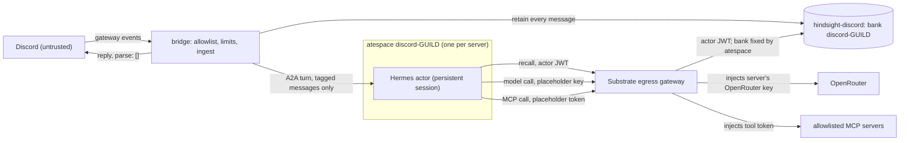
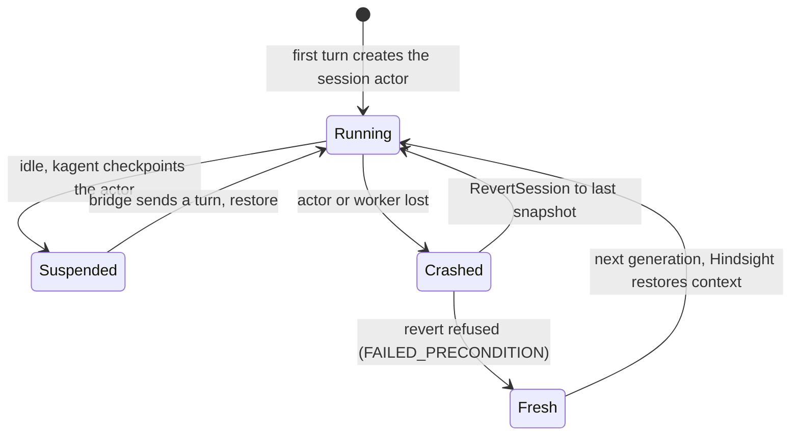

# Per-server Discord agents

Design for [HOME-905](https://factory-plan.jomcgi.dev/factory/issue/HOME-905).
Each allowlisted Discord server gets its own persistent Hermes agent on ATE.
The agent wakes when the bridge sends it a turn and suspends when idle. It
reads and writes only its own server's Hindsight bank, and it gets only the
MCP tools that its server's values list. The homelab agent's image and
chart exist (slice 2). Slice 4 (HOME-909) routes the homelab server's
tagged messages to its agent: a policy entry `serverAgents` maps the guild to
the Agent, and the bridge keeps one session per server with request ID
`discord-server-<guild>` (`operator.go`, `ServerRequestID`). Until slice 3,
the bridge still recalls and puts memories in each prompt. Actions: when
the agent's answer holds a fenced `poll` block (JSON, Discord's poll
limits), the bridge posts it as a Discord poll after the text reply
(`poll.go`). Memory stores `[poll: <question>]`, not the JSON. Other controls
below are not seen live yet, so each one is `designed`.

Joe's decisions are on
[HOME-162 comment 12817](https://factory-plan.jomcgi.dev/factory/issue/HOME-162#comment-12817)
(2026-11-26). The goal is "smooth, helpful and fast".



| Component | Role | Code | Untrusted input | Credentials held |
| --- | --- | --- | --- | --- |
| bridge | The one Discord gateway and policy point | `discord/` | Every Discord message | Bot token, Hindsight tenant key, kagent invocation token |
| Hermes actor | Answers one server's turns with a persistent session | `../harness/hermes/`, `../chart/templates/discord-server-agents.yaml` | Tagged messages, recalled memories, tool output | Placeholders only |
| egress gateway | Injects the model key, tool tokens and actor JWT | `../../platform-factory/substrate/` | Actor requests | Per-atespace injectable Secrets |
| hindsight-discord | Stores and recalls each server's memory | `../../platform-factory/hindsight-discord/` | Retained text | Database login, OpenRouter key |

## Today

Bosun runs one kagent Agent for all four servers. Each tagged message
creates a fresh session actor `session-<id>` and restores it from a
checkpoint. The Bosun worker log shows `Restore timing breakdown` with
`ate.snapshot.fidelity: volumes` (2026-11-24 and 25). The actor runs one turn, checkpoints it and deletes the session
(`agent.go`, HOME-162 "Short sessions"). The bridge recalls before the turn
and retains after it; the agent has no tools except `:online` web search.

Measured on 2026-11-26, one Bosun turn spends:

| Step | Time |
| --- | --- |
| Hindsight recall | 0.5 to 0.6 s |
| gVisor actor create or restore | 0.06 to 0.32 s |
| Model call | 3.4 to 5.4 s |

The model call is about 85% of the turn. No actor snapshot reached the
Garage `ate-snapshots` bucket yet, so session state today has no copy off
the worker volume.

## Hermes fit

Hermes Agent is Nous Research's MIT-licensed agent in Python. Release
v0.23.4 was published on 2026-11-24. Each fact below links its source; the
[last section](#hermes-facts) lists what the docs do not state.

| Need | Hermes | Source |
| --- | --- | --- |
| Take turns from another service | API server (`/v1/runs`, `/v1/responses`), A2A, ACP over stdio, webhooks, one-shot CLI | [api-server](https://github.com/NousResearch/hermes-agent/blob/main/website/docs/user-guide/features/api-server.md), [a2a](https://github.com/NousResearch/hermes-agent/blob/main/website/docs/user-guide/messaging/a2a.md), [integration](https://github.com/NousResearch/hermes-agent/blob/main/website/docs/developer-guide/programmatic-integration.md) |
| Persistent session | `/v1/runs` and `/v1/responses` keep a conversation by `X-Hermes-Session-Key`; Chat Completions uses `X-Hermes-Session-Id`; sessions in SQLite `state.db` | [api-server](https://github.com/NousResearch/hermes-agent/blob/main/website/docs/user-guide/features/api-server.md), [memory](https://github.com/NousResearch/hermes-agent/blob/main/website/docs/user-guide/features/memory.md) |
| Memory | `MEMORY.md` and `USER.md`, loaded at session start; one external provider, Hindsight among them | [memory](https://github.com/NousResearch/hermes-agent/blob/main/website/docs/user-guide/features/memory.md), [providers](https://github.com/NousResearch/hermes-agent/blob/main/website/docs/user-guide/features/memory-providers.md) |
| Compaction | Summarises at `compression.threshold` (default 0.50 of the window) with `auxiliary.compression` | [compression](https://github.com/NousResearch/hermes-agent/blob/main/website/docs/developer-guide/context-compression-and-caching.md) |
| MCP client | `mcp_servers`, stdio or Streamable HTTP, `tools.include` per server | [mcp config](https://github.com/NousResearch/hermes-agent/blob/main/website/docs/reference/mcp-config-reference.md) |
| Model | `provider: custom` with `base_url`; OpenRouter via `OPENROUTER_API_KEY` | [providers](https://github.com/NousResearch/hermes-agent/blob/main/website/docs/integrations/providers.md) |
| Tool limits | `agent.disabled_toolsets`, `platform_toolsets`; `approvals.mode` and `unattended_mode` | [configuration](https://github.com/NousResearch/hermes-agent/blob/main/website/docs/user-guide/configuration.md), [security](https://github.com/NousResearch/hermes-agent/blob/main/website/docs/user-guide/security.md) |
| Long-lived process | `hermes gateway`; state in `HERMES_HOME`; image `nousresearch/hermes-agent` | [docker](https://github.com/NousResearch/hermes-agent/blob/main/website/docs/user-guide/docker.md) |

Hermes fits: it runs headless behind an API, keeps sessions on disk and has
a Hindsight provider.

## 1. Gateway: keep the bridge

**Recommendation.** The bridge stays the only Discord gateway and the only
policy point. Hermes runs with its Discord platform off and receives
turns from the bridge through kagent A2A.

| Concern | Bridge owns gateway (recommended) | Hermes owns gateway |
| --- | --- | --- |
| Bot tokens | One token, one process (no double replies) | One token per agent, or one shared token in four actors |
| Server allowlist (rule 8) | Values, checked before any model call | Hermes config in each actor |
| Rate limits (rule 7) | User, guild and global limits in one place | Not confirmed in Hermes |
| Ingest into Hindsight | Every message, tagged or not | Lost, or each actor must ingest |
| Wake on activity | Bridge sends a turn; actor sleeps between turns | Actor must stay connected to Discord, so it can never suspend |
| No pings (rule 6) | `allowed_mentions {"parse": []}` on every reply | Hermes reply path |
| Untrusted input as data (rule 1) | Bridge wraps Discord text in one JSON value | Hermes sees raw text |

A Discord gateway connection is a long-lived websocket. An actor that holds
one cannot suspend. Hermes' relay mode moves the bot token to a separate
connector, but the actor still holds an open WebSocket to it
([relay](https://github.com/NousResearch/hermes-agent/blob/main/website/docs/user-guide/messaging/relay.md)).

Hermes does not need its Discord adapter. The adapter calls the API
server's non-streaming `/v1/responses` with `X-Hermes-Session-Key` and
`conversation` both set to the server's session. With `unattended_mode: deny`, a `/v1/runs` or
streaming client still gets approval requests and the run parks in
`waiting_for_approval`; an MCP tool with `trust: untrusted` parks the same
way. So the adapter also answers every approval request with deny, and a
turn never waits on a person. The
Hermes Discord adapter documents user, role and channel allowlists but no
server allowlist ([discord](https://github.com/NousResearch/hermes-agent/blob/main/website/docs/user-guide/messaging/discord.md)).

## 2. Runtime on ATE

**Recommendation.** Each server has one kagent Agent on a `spec.hermes`
Harness, in its own namespace and WorkerPool. The kagent fork's
`kagent-hermes` runner speaks kagent's private A2A contract and sends each
turn to the Hermes API server on loopback (section 1). It starts
`hermes gateway` on the first turn, with the API on loopback and no
messaging platform. The harness image
(`../harness/hermes/`) holds the runner and the pinned Hermes Agent without
its browser, media, Node.js and compiler parts. The chart renders the
agent from `discord.serverAgents` (`chart/templates/discord-server-agents.yaml`).

The bridge keeps one persistent kagent session per server, the same way the operator session keeps one per thread
(`operator.go`). The session request ID derives from the guild ID, so a
restarted bridge finds the same session. One session serves every channel
in the server; each turn's JSON names its channel and author.



- **State.** Hermes keeps its home directory (`HERMES_HOME`) on the actor's
  volume: `state.db` (sessions), `memories/` and `config.yaml`. The
  harness writes `config.yaml` from values at start, so git owns config and
  the volume owns only conversation state.
  The checkpoint that kagent writes on suspend carries the volume.
- **Snapshot store.** The Harness `snapshotPolicy` writes to
  `s3://ate-snapshots/<namespace>/`, as Bosun's does. Slice 1 proves that a
  suspend writes an object to Garage before any other server moves.
- **Backup.** Garage keeps three copies on the factory nodes. Substrate's
  PostgreSQL and the snapshots have no off-site backup
  (`projects/factory-cluster/README.md`). Hindsight is the durable record:
  the bridge ingests every message there, so a lost actor costs only
  Hermes' own session notes.
- **Restore.** Order: `RevertSession` to the last snapshot; else a new
  session generation whose first turn carries a server-wide recall. A
  weekly drill deletes the homelab session and checks that the next turn
  answers a question about last week from Hindsight.
- **Suspend wedge.** A suspend over 30 s wedged sessions on kagent v1.0.1
  (kagent#3311/#3312). The controller fork carries kagent#3653, a 2 min
  `snapshotTimeout`. A small Hermes home keeps checkpoints short. An alert
  fires when a suspend takes more than 60 s.
- **Resources.** kagent applies one limit to every runtime (4 CPU, 8Gi).
  Workers request 100m and 512Mi, so a suspended agent holds no memory
  beyond its worker pod. One worker per server; four servers need four
  worker pods.

## 3. Isolation

**Recommendation.** One namespace, atespace and identity per server. The
actor holds placeholders only. The Hindsight bank follows from the actor's
identity at the gateway, never from the prompt.

- **Atespace.** `discord-<guild_id>`, also the namespace. The credential
  provider's `namespacePolicies` grants each atespace only its own Secrets.
- **Model key.** One OpenRouter key per server, each with its own monthly
  limit, labelled `substrate.ate.dev/injectable`. The gateway injects it for
  that atespace only. This keeps HOME-162 rule 2 and bounds each server's
  spend on its own.
- **Hindsight.** Today the tenant key opens every bank, so it never enters
  an actor. Hermes' Hindsight provider runs in `local_external` mode with
  `bank_id: discord-<guild>` and `memory_mode: context`. Its config has no
  key field; the placeholder goes in env `HINDSIGHT_API_KEY`
  ([provider](https://github.com/NousResearch/hermes-agent/blob/main/website/docs/user-guide/features/memory-providers.md),
  [keys](https://hindsight.vectorize.io/sdks/integrations/hermes)). The
  gateway replaces the placeholder with an actor JWT (audience
  `hindsight-discord`). A Hindsight extension, like the factory's
  `/ext/connector/retain`, verifies the JWT with the broker's rules
  (`ARCHITECTURE.md`, "Codex relay"): signature, `iss`, `aud`, `exp` and
  `nbf`; subject exactly `actor/discord-<guild>/session-*` with the
  `actor.ate.dev` claim; no `worker-for-actor` token; atespace in an
  `allowedAtespaces` list. It maps the subject to bank `discord-<guild>`
  and refuses every other bank. It refuses retain and reflect for actor
  tokens, so only recall is open. The bank in the config is a convenience;
  the JWT check is the control.
- **JWT binding.** In this repository `actorJwt` exists only on ModelConfig
  (`chart/templates/_binding.tpl`, `discord-operator.yaml`). Which kagent
  resource binds the hindsight-discord origin to an actor JWT is not
  confirmed. The fallback is a per-guild injectable token that the
  extension maps to one bank.
- **Network.** The `hindsight-discord` ingress policy admits the egress
  gateway for that route only. The bridge keeps its own path.
- **Writes.** The bridge stays the only writer of Discord messages
  (section 5).

## 4. Tools per server

**Recommendation.** A per-guild MCP allowlist in values, empty by default,
and read-only tools only until Joe names a write tool for one server.

```yaml
discord:
  servers:
    "1501965852042330302":   # homelab
      model: <model id>
      mcpServers:
        - name: factory
          url: https://factory-mcp.jomcgi.dev/mcp
          secret: discord-homelab-factory-mcp
          tools: [<read-only tool names from HOME-902>]
```

- The chart renders one RemoteMCPServer per entry in the server's
  namespace, with discovery off and the listed tools only, as
  `repositories[].mcpServers` does today.
- The gateway injects the tool token from key `token` of the named Secret.
- Hermes' own toolsets stay off through `agent.disabled_toolsets`:
  terminal, file, code execution, browser, web, delegation, cron, skills
  and the `discord` and `discord_admin` toolsets
  ([toolsets](https://github.com/NousResearch/hermes-agent/blob/main/website/docs/reference/toolsets-reference.md)). Web search stays in the
  model call (`:online`).
- **Homelab agent.** People other than Joe can post in the homelab server,
  and an answer shows them what a tool returned. So the allowlist names
  read tools by the data they return:

  | Data class | Example | Slice 5 |
  | --- | --- | --- |
  | Public repository state | PR state, check results, merged commits | Allowed |
  | Status fields | Issue key, column and title; run state and times | Allowed |
  | Alert state | Firing alert names and severity | Allowed |
  | Issue and run text | Descriptions, comments, agent output, logs | Refused: can hold private data |
  | Decisions and credentials | Joe's comments, secrets, tokens | Refused |

  It gets no tool that files, dispatches, approves or merges. factory-mcp (HOME-900) is a Joe-only OAuth server, so
  the agent needs its own read-only service identity there.
- Other servers get no MCP tools in the first slices.

## 5. Model and token cost

**Recommendation.** A model per server in values, a hard token budget per
turn, and one memory owner per kind of fact.

- **Model.** `discord.servers.<guild>.model`, rendered as Hermes
  `model.provider: custom` with `base_url` set to OpenRouter and a
  placeholder key. Start every server on
  Bosun's `deepseek/deepseek-v4.1-flash-1017:online`; change one server at a
  time against its question set (section 7).
- **Budget.** Each turn has a cap on output tokens and on tool calls (about
  4). Compaction bounds input: `compression.threshold_tokens` at 32,000
  keeps a turn's prompt near Bosun's size, with `auxiliary.compression` on a
  cheap model. A per-turn input cap in Hermes is not confirmed, so the
  per-server OpenRouter limit is the hard bound. The bridge's existing limits still bound
  turns per user, server and day.
- **Memory split.**

  | Memory | Owner | Holds |
  | --- | --- | --- |
  | Session context | Hermes, compacted | The recent turns in this server |
  | Agent notes | Hermes `MEMORY.md`, off at first | The agent's own durable notes, at most 2,200 characters |
  | Server history | Hindsight, bridge ingest | Every human message, server-wide |

- **No double memory.** For a server with an agent, the bridge stops putting
  recalled memories into the prompt. Hermes' Hindsight provider recalls
  instead (`auto_recall: true`, `recall_budget` bounds it).
  `memory_mode: context` keeps the `hindsight_retain`, `hindsight_recall`
  and `hindsight_reflect` tools out of the model's tool list; the default
  `hybrid` exposes them, and `auto_retain: false` alone leaves retain. The
  extension refusing retain is the control, so Hermes never writes a
  second copy of Discord history. Compaction keeps recent turns; Hindsight answers about anything
  older.
- **Agent notes.** `MEMORY.md` loads into every session's system prompt
  ([memory](https://github.com/NousResearch/hermes-agent/blob/main/website/docs/user-guide/features/memory.md)), and people other than Joe
  write the turns. Slice 2 disables the memory tool so a Discord user cannot
  plant a standing instruction. Joe decides whether to turn it on.

## 6. Migration from Bosun and HOME-162 rule changes

**Recommendation.** Move the homelab server first; the other three stay on
Bosun until slice 6's measures pass. The chart's
`discord.serverAgents.<key>.route: true` adds the server to the policy's
`serverAgents`; without it the server stays on Bosun. Rollback is
`route: false`.

Joe confirms each change below. Rules 1, 2, 3, 5, 6, 7 and 8 are worded
from the code and chart comments that cite them. Rule 4 is inferred from
the operator exception in `operator.go`; Joe checks it against HOME-162.

| Rule | Old | New |
| --- | --- | --- |
| 1 | Discord text reaches the agent as data, in one JSON value | Same |
| 2 | One dedicated model key for Bosun | One dedicated key per server agent, each with its own limit |
| 3 | The agent has no tools; the bridge is the only Hindsight client | Per-server MCP allowlist, read-only by default; the agent recalls its own bank through the gateway |
| 4 | A turn's context is the tagged message and its channel's memory | The server's persistent session also carries earlier turns in that server |
| 5 | Recall reads one channel's tag (ingest already amended retain, HOME-833) | Recall is server-wide inside the server's bank (HOME-904). Decided: Joe chose this on 2026-11-26, told that it can show private-channel text to members who cannot see that channel |
| 6 | Replies ping nobody | Same |
| 7 | User, guild and global turn limits | Same, plus a token and tool-call budget per turn |
| 8 | Server allowlist; one bank per server | Same, plus one atespace and identity per server |
| "Short sessions" | A fresh session per turn, deleted after | One persistent session per server, suspended when idle |

## 7. Measures

The bridge records each measure per server. Slice 6 compares the homelab
agent with Bosun's baseline from the same week.

| Measure | Source | Target |
| --- | --- | --- |
| End-to-end time, tag to reply, p50 and p90 | Bridge timing log (slice 6) | p50 at most Bosun's; p90 at most 12 s |
| Wake time: restore to first model byte | Bridge timing log (slice 6) | p90 at most 2 s |
| Suspend time | kagent controller log | p99 at most 60 s |
| Input and output tokens per turn | OpenRouter usage per key | Median input at most 2 times Bosun's |
| Tool calls per turn | Hermes or MCP logs | Median at most 1 |
| Answer quality | 10 fixed questions per server, graded pass or fail | At least Bosun's score |

A server's question set holds 5 questions about its own history (the answer
is in its bank) and 5 general questions. The homelab set adds 3 questions
that need factory MCP. The grader and the questions live beside the bridge
tests; no Discord user text goes into the repository.

## 8. Rollout

Each slice is one sub-ticket of HOME-905 and one PR. Slices 1 to 6 touch
the homelab server only.

| Slice | Title | Done when |
| --- | --- | --- |
| 1 | Build a Hermes harness image for kagent | An A2A turn through kagent gets a Hermes answer in CI, with Discord and local tools off |
| 2 | Run a persistent homelab agent on ATE | The homelab session suspends when idle, writes an object to `ate-snapshots` and restores on the next turn |
| 3 | Scope Hindsight recall to the actor's server | The homelab actor recalls bank `discord-1501965852042330302`; another bank, retain and reflect fail; the actor JWT binds the origin, or else a per-guild injectable token does |
| 4 | Route homelab turns to its agent | A tag in the homelab server answers from the agent; the other three servers still answer from Bosun |
| 5 | Give the homelab agent factory MCP read tools | The agent answers a run-status question; a write tool call fails |
| 6 | Measure the homelab agent against Bosun | p50, p90, tokens and the question-set score are recorded on HOME-905 for 7 days |
| 7 | Move the other servers one at a time | Each server meets slice 6's targets, then Bosun's Agent is removed |

## Open decisions

Each decision names the rule that needs Joe.

| Decision | Rule | Options, recommended first |
| --- | --- | --- |
| Gateway owner | HOME-162 rules 1, 6, 7, 8 | Bridge keeps the gateway; Hermes owns it per server |
| HOME-162 rule changes | HOME-162 is Joe's contract | Accept the table in section 6; accept it without rule 3 (no agent tools yet); keep Bosun |
| Homelab agent's factory access | factory-mcp is Joe-only (HOME-900) | Read-only service identity for the agent; no factory tools |
| Model key per server | HOME-162 rule 2 | One OpenRouter key and limit per server; one shared key with bridge limits only |
| Hermes `MEMORY.md` writes | HOME-162 rule 1 | Off; on for the homelab server only; on everywhere |
| Private channels in recall (follow-up) | HOME-904 | Tag non-public channels at ingest and leave them out of server-wide recall; keep server-wide recall as decided |
| Session scope | HOME-162 rule 4 | One session per server; one session per channel (one actor each) |
| First server | HOME-905 scope | homelab only; homelab and Loom together |

## Hermes facts

Read on 2026-11-26 from the repository's `main` branch
([docs tree](https://github.com/NousResearch/hermes-agent/blob/main/website/docs/)). Not confirmed in the docs:

- A Discord server (guild) allowlist in the Hermes adapter.
- A per-server placeholder in Hindsight's `bank_id_template` (`{chat}` and
  `{platform}` exist). The design sets `bank_id` per actor instead.
- A per-turn input-token cap.
- Which kagent resource binds the hindsight-discord origin to an actor JWT
  (only ModelConfig has `actorJwt` here).
- Resource needs outside Docker (the Docker page states 1 GB and 1 core
  minimum, 2 to 4 GB and 2 cores recommended).
- Whether the `discord` toolsets work without the native adapter.
- How large `state.db` grows per month of turns, which sets checkpoint time.

Slice 1 (HOME-906) found two facts in the v0.23.4 source:

- Hermes' A2A endpoint is JSON-RPC over HTTP. kagent's BYO contract is
  private A2A gRPC with the control-plane TaskStore and a bootstrap bundle,
  so the two do not match.
- On `/v1/responses`, `X-Hermes-Session-Key` alone does not replay earlier
  turns (`history_from_session` stays false). A `conversation` name chains
  each turn to the last stored response.
