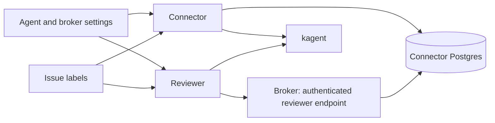
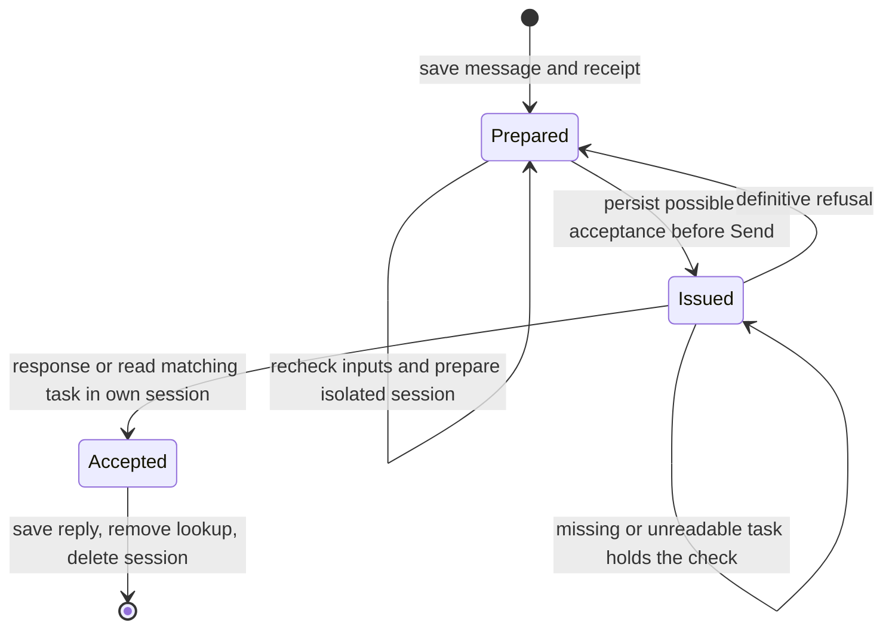

# Run provenance

Refs HOME-245. The connector database records the inputs of each new coder,
rework and reviewer run before dispatch. The six columns on `run` are `model`,
`reasoning_effort`, `arm`, `base_sha`, `prompt_hash` and `task_class`.



The chart renders each dispatch runtime from the Agent model and system prompt
and the broker effort setting. The arm is `control`; this change does not route
experiments. A coder continuation retains the model, arm and system prompt
recorded for its session. The broker applies the current effort to every call.
A session without an earlier snapshot can use current settings only if kagent
confirms its pinned revision is still current. Otherwise the connector records
a recovery hold. The existing operator fencing attestation permits a fresh
session with verified provenance; no retry guesses the old model.

For a new coder branch, `base_sha` is the resolved base branch commit. For an
existing work branch, including rework, it is the resolved work branch commit.
If a verified coder session retries before publishing its branch, it uses the
starting commit from that session's first accepted receipt. A missing branch
cannot move the retry onto a newer main commit; other read errors still hold it.
The task tells the coder to start its worktree at that exact commit. Reviewer
records use the base commit from which the service reads guidance; the PR head
under review is also present in the reviewer message ID. Goal checks use the exact PR head
that their read-only checkout inspects.

`prompt_hash` is lowercase SHA-256 of the rendered Agent system prompt, one NUL
byte, and the exact rendered task text. It includes issue context and revision
feedback, so it identifies the complete input, not just a template filename.
Each coder attempt stores its rendered text and six provenance values. Resends
after a connector restart check the runtime again. A changed runtime retires a
definitively unaccepted attempt and records a new message and receipt. The old
attempt remains readable. An ambiguous send is reconciled without replacement.
Run columns describe the first execution: only a run whose attempts were all
definitively unaccepted can replace its proposed snapshot. Engineering retries
retain their own attempt receipts. Rework has a separate run and snapshot.

`task_class` is a sorted JSON array of the issue label names, or `unclassified`
when there are no labels or no linked issue. Multiple labels remain distinct.
A missing label definition prevents dispatch until the read succeeds. Neither
model output nor PR labels classify the task.

The migration leaves every historical row null, including runs already admitted
when it applies. New claims may also be null while waiting for their first
send. There is no backfill that guesses historical settings.

Reviewer tasks, including goal checks, use `origin = 'reviewer'`. Their rows
have connector state `closed` and reason `tracked_externally`: the reviewer
service owns execution and the GitHub check owns its outcome. This state does
not mean a review finished or passed. The broker authenticates the reviewer
ServiceAccount and checks the repository binding. Its existing accounting role
can call only the append function, with no direct table or sequence access.
The message ID deduplicates retries. Conflicting provenance for the same ID
fails instead of replacing the earlier record. A reviewer quota retry finalizes
its `/quota-N` suffix before writing its receipt, so the new task can record
changed inputs without overwriting the previous task's receipt.
Goal checks persist a lookup from the stable prompt MAC to a dispatch on the
reviewer's private audit volume. Each dispatch has a retry-stable nonce, a MAC
of all receipt inputs, and its own session, prepared before the first send.
The session request is idempotent. Preparing a session does not send a task.



A prepared dispatch rechecks all receipt inputs before each send. Changed
inputs get a new message ID and session; the earlier receipt stays immutable.
An issued dispatch is never recovered by sending again. Recovery reads its
known task, or lists only its isolated session and verifies the opening message
ID. An unrelated task's history cannot block the check. A late accepted task
keeps its original receipt even after runtime or label changes.

Legacy indexes with a task ID remain readable. An index without a task ID or
session, or an issued session with no visible matching task, holds the check:
absence cannot prove that an earlier request did not execute. Lookups retain
the audit volume's 14-day expiry and are removed after the reply is saved,
before session deletion.

## Implementation evidence

| Requirement | Write path and regression coverage |
| --- | --- |
| Six values for coder and rework dispatch | `dispatch.prepareProvenance` and `store.RecordProvenance` write the run and attempt before `MarkIssued`; `TestCoderAndReworkRunProvenance` exercises dispatch. |
| Six values for reviewer dispatch | `review.recordProvenance` and `goalCall` require the broker receipt before sending; `TestReviewerMessageRecordsProvenanceBeforeDispatch` and `TestGoalReviewRequiresProvenanceBeforeSending` cover both task types. |
| Historical nulls and new database columns | `20261119040000_run_provenance.sql` adds nullable fields without a backfill; `TestProvenanceMigrationLeavesHistoricalRunsNull` applies the migration to an existing row. |
| Immutable reviewer receipts | The migration's `record_reviewer_run` function writes all six values; `TestReviewerProvenanceIsAppendOnlyAndIdempotent` reads them back and rejects conflicting input. |
| Reviewer quota retries | `TestReviewerQuotaRetryRecordsSentMessage` checks the receipt against the accepted message after a restart, with unchanged and changed runtime settings. |
| Coder failure before its first push | `TestCoderProvenanceRetryBeforeFirstPush` checks the session's recorded SHA after main advances, current effort with pinned session runtime, and holds on 403/503 reads. |

A retry's changed effort is read from its delivery attempt, not the run row,
and the coder's actual start commit is not verified yet.
[Joe deferred both](https://factory-plan.jomcgi.dev/factory/issue/HOME-245#comment-4034).

## Rollout verification

After the connector migration and updated services roll out, select one new
coder receipt and one new reviewer receipt. Confirm the reviewer message was
accepted by kagent in the reviewer service logs. This query must show six
non-empty values for each selected run:

```sql
SELECT id, origin, trigger, issue_key, model, reasoning_effort, arm,
       base_sha, prompt_hash, task_class, reviewer_message_id
FROM run
WHERE provenance_required
  AND model IS NOT NULL
  AND (origin = 'reviewer' OR EXISTS (
      SELECT 1 FROM delivery_attempt a WHERE a.run_id = run.id AND a.issues > 0))
ORDER BY created_at DESC
LIMIT 20;
```

Also confirm that rows admitted before the migration still have null values.
The local PostgreSQL tests cover the migration and write paths. Live rollout
verification needs the deployed services and is a separate acceptance step.
