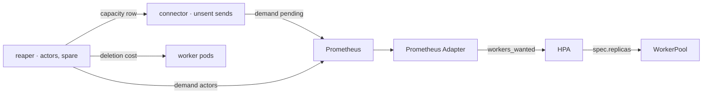
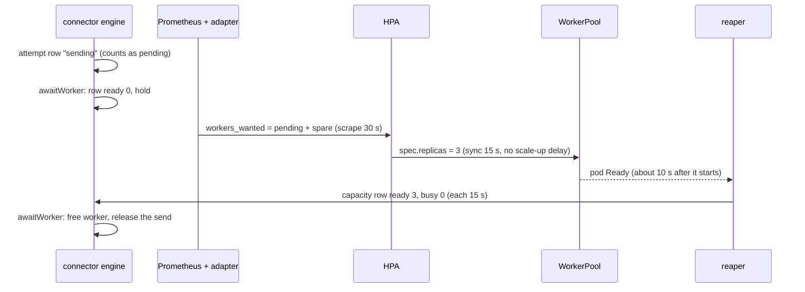

# Worker pool autoscaling

The [factory architecture](ARCHITECTURE.md#worker-pool-autoscaling) gives
the summary. This page gives the design, state, rollout and runbook.

A pool can scale to zero when idle. The nodes request 98% of memory while
the coder and reviewer pools hold about 12 GiB of idle workers. The design
uses the Kubernetes HorizontalPodAutoscaler on the WorkerPool, through the
CRD's scale subresource. Kubernetes 1.37 lets an HPA with `minReplicas: 0`
scale a workload to and from zero from an Object or External metric
(`HPAScaleToZero`, beta, on by default;
[post](https://kubernetes.io/blog/2026/09/02/kubernetes-v1-37-hpa-scale-to-zero-beta/)).

**State.** The chart renders an HPA only for a pool with
`agents.<name>.autoscaling.enabled`. The coder pool (`homelab-codex`) has it on.
All parts are on main:

| Part | PR | Adds |
| --- | --- | --- |
| Connector series | #8591 | `factory_worker_pool_demand{source="pending"}` |
| Reaper census | #8592 | `demand{source="actors"}`, `factory_worker_pool_spare`, the scrape job |
| Send wait | #8593 | the `worker_pool_capacity` row and `intervals.workerWait` |
| Adapter | #8594 | the External Metrics API |
| This switch | #8595 | the HPA, `FACTORY_REAPER_POOLS`, the reaper's `patch` on pods |
| Deletion cost | #8596 | `pod-deletion-cost` on workers that host an actor |
| First enabling change | #8597 | the coder pool between 1 and 12 workers |
| Repo-server egress | #8599 | the chart repository the HPA's chart needs |



**Demand.** The HPA scales the pool to `workers_wanted`, which is
`actors + pending + spare × (actors + pending > 0)`.

- `actors`: worker pods that host an actor. The reaper counts them from
  Substrate's actor table each 15 s, for every pool, whoever sent the work.
  Substrate's own `ate.workerpool.workers` goes to Honeycomb, not Prometheus.
  The census fails on a row it cannot read, and then publishes nothing.
- `pending`: delivery attempts the connector recorded, for live runs, and
  kagent has not accepted. The row commits before the send, so a run that
  arrives at zero workers raises demand before it is sent.
- `spare`: `autoscaling.spare` (default 2), kept while a pool has any
  demand. An idle pool asks for 0.

Prometheus Adapter serves the result as an External metric. The HPA uses
`AverageValue: 1`, so replicas equal the metric. The metric has a value only
if all three series exist for the pool: `factory_worker_pool_demand` with
`source="actors"`, the same with `source="pending"`, and
`factory_worker_pool_spare`. If any is missing or stale, the metric has no
value and the HPA holds the replica count (`ScalingActive=False`). A sum over
the remaining series would undercount and remove workers under live actors.

The HPA ignores a gap below its tolerance, 10% by default. With
`AverageValue: 1` that hides one worker above about 10 replicas. The chart
sets `tolerance: 0` on both behaviors. The API accepts the field in 1.37
(`kubectl explain` shows it), but the `HPAConfigurableTolerance` gate drops it
when off. Check `describe hpa` after enabling.

**Scale-down.** The HPA lowers `spec.replicas` and the ReplicaSet picks the
pods to remove. A removed worker with a live actor leaves that actor CRASHED.
The worker drain sends SIGTERM to the actor's container and kills it after up
to 30 min. The connector holds a run on a CRASHED session for recovery. A turn
in progress is lost, and the reaper's lease path frees the run. A SUSPENDED
actor holds no worker and is unaffected.

- The floor covers every live actor, so the HPA never asks for fewer workers
  than there are actors.
- The pool follows the highest demand of the last 30 min, and one worker
  leaves each 5 min.
- The reaper marks a worker that hosts an actor with a higher
  `pod-deletion-cost`, so the ReplicaSet removes idle workers first.

An actor placed on a worker between two reaper passes (15 s) can still lose
its worker. The turn then recovers as any lost worker does.

**Cold start.** A run that arrives at zero waits for a worker. The path:



The held send stays `sending` (never issued), so no task lease runs on it and
no ambiguous outcome is recorded. `intervals.workerWait` bounds the wait
(unset: off). A new session needs a ready worker with no actor, less the sends
the connector let through since the row was written. A continuation needs a
ready worker.

The reaper writes a row for each pool it is given (`FACTORY_REAPER_POOLS`),
also a pool with no pods: `ready 0, busy 0`. A pool at zero therefore holds
the send. The gate sends at once, and the send can fail with "no worker has
room", in only these cases:

- No row exists: the reaper has never written the pool.
- The row is older than 45 s: the census failed or the reaper is not the
  leader. The HPA has no value then either, because its `actors` series comes
  from the same census, so a pool at zero stays at zero. Fix the reaper first.
- `workerWait` passed with no worker: the pool could not start in time (no
  node fits the pod, or the metric has no value).

Known limit: the reservation counts only the sends of one connector process.
An actor that another caller places in the same 15 s window can still take the
worker, and that send fails as it does today.

**Which pools.** Only the coder pool has a `pending` source: its sends go
through the connector. The reviewer and the Discord bot send to kagent
themselves, so the connector publishes no `pending` series for their pools.

- The reviewer pool can autoscale. The reaper publishes `pending` at 0 for a
  pool listed in `FACTORY_REAPER_UNBOUND_POOLS` (the chart lists the pools of
  an autoscaled reviewer). The 0 means "no unsent connector send", not "no
  waiting caller": the reviewer's own sends are invisible, so two floors cover
  them.
  - `minReplicas` at least `reviewer.concurrency` (3). A review send is
    never left to a scale-up, because nothing signals it. The chart refuses a
    lower value.
  - `spare` at least 1 (2 in the plan). The pool grows only from the actors
    it hosts, so with a spare of 0 it never grows past `minReplicas`. A goal
    check session runs after its review turn, while the review session's
    actor still holds a worker, so each review needs a second worker. The
    spare supplies it. The chart refuses a spare of 0.
- The reviewer pool's `maxReplicas` is its fixed size today (5):
  `concurrency + spare` would give 7.
- A static cut below 5 workers is not safe. On 2026-11-22 five reviews on five
  workers left 23 of 70 goal checks without an answer in 2 h. The cut to 3
  reviews plus 2 spare workers fixed it, and no measurement shows 4 workers
  are enough.
- This chart cannot enable Bosun: its WorkerPool renders no HPA.
- `microvm-spike` is not part of the factory chart.

**Reviewer pool sizing.** Idle, the pool holds 3 workers: 1.25 GiB less
requested memory than 5 (2 × 640Mi). The workers use far less than they
request (7 to 51 Mi each on 2026-11-23), but the nodes request 98% of memory,
so the request is what costs. During reviews the pool still grows to 5, so
the peak does not change. A burst after idle finds 3 workers for its 3
reviews. The 2 extra workers start within about 2 min (reaper pass 15 s, HPA
sync 15 s, pod start), before the first goal check send, which follows a
review turn of minutes. Only a review turn shorter than that lag can find no
free worker for its goal send. The result is "goal check unavailable", as
before the 11-22 fix. The pool leaves 5 only after 30 min with no actor.

**Failure modes.**

| Failure | Effect | Recovery |
| --- | --- | --- |
| Adapter, reaper or connector series missing | The metric has no value. The HPA holds its replicas (`ScalingActive=False`). | A pool above zero keeps its workers. A pool at zero stays at zero until someone revives it (see below). |
| Reaper capacity row stale | The connector sends without waiting. | The send can fail with "no worker has room", as before. |
| `workerWait` passes with no worker | The send goes and can fail as above. | Find why the pool did not start: `describe hpa`, pod events. |
| A binding with a non-control arm at `minReplicas: 0` | The arm's sends have no wake signal and no hold. | The chart refuses the render; set `minReplicas: 1`. |
| `HPAScaleToZero` off | A pool at zero reads as paused and stays there. | Set `minReplicas: 1` while the pool is still at 1 or more. |

**Rollout.** Each step is its own reviewed change:

1. Merge the parts above in order. Done.
2. Enable one pool with `autoscaling.enabled` and `minReplicas: 1`. Done
   (#8597).
3. Raise the coder pool to `minReplicas: 0` and set `intervals.workerWait` in
   the same change. Check the metric first.
   The Argo CD waves put the connector first: the ConfigMap (wave -1), then
   the connector Deployment (wave 1, which restarts through
   `checksum/config`), then the HPA (wave 3). So `workerWait` is live before
   the pool can reach zero. The HPA's 1800 s scale-down window holds the
   highest recommendation of the last 30 min, so a pool that has read 0 for
   that long goes from 1 to 0 at the first HPA sync after the new spec
   applies, not 30 min later.
4. Enable the reviewer pool, after the chart and connector image that
   publish `pending` at 0 are live (chart 0.126.4): `autoscaling: {enabled:
   true, minReplicas: 3, spare: 2, maxReplicas: 5}` under `agents.reviewer` in
   `deploy/values.yaml` (and its `values-homelab.yaml` mirror), an
   `ignoreDifferences` entry for `homelab-reviewer` in `application.yaml`, and
   the new `render.sha256`. The pool starts at 5. After the 30 min window the
   HPA removes 2 workers, one per 5 min, and the deletion cost keeps the
   workers that host an actor. To roll back, revert that change: Argo CD then
   restores `concurrency` (5). Read-only checks after merge, in order:
   - `factory_worker_pool_demand{source="pending",pool="homelab-reviewer"}`
     exists (0) beside the `actors` and `spare` series. Without it the metric
     has no value and the HPA reports `ScalingActive=False`.
   - `describe hpa homelab-reviewer` shows `ScalingActive=True` and a current
     metric.
   - `factory_worker_pool_demand{source="actors",pool="homelab-reviewer"}`
     over a day: the pool should reach 0 actors for 30 min or more. If it
     never does (idle actors never suspend), the pool stays at 5 and the
     change saves nothing.
   - Goal checks keep answering: no rise in "goal check unavailable" with
     reason `rejected` after the pool shrinks.

**Precondition for trial arms.** A coder pool with `minReplicas: 0` cannot
serve a binding that has a non-control arm. The connector stores such a send
under the Agent `<pool>-<arm>`. The capacity row, the `pending` series and the
send wait then name a pool that no HPA scales, so at zero the send has no wake
signal and no hold. The chart fails the render for this combination. A change
that adds non-control arms (#8582, HOME-811) must set the coder pool's
`minReplicas` to 1 or more in the same PR, or first make the wait and the
`pending` series follow the arm's pool to the base pool.

`maxReplicas` is 12 for the coder pool, the fixed pool's size, on nodes that
request 98% of memory.

`application.yaml` has an `ignoreDifferences` entry (group `ate.dev`, kind
`WorkerPool`, `/spec/replicas`) for the pool. Argo CD uses server-side apply
with self-heal and would reset the HPA's value. `autoscaling_test.py` renders
the deploy values and fails when an HPA's pool has no entry.

**Revive a paused pool.** An HPA scales a pool to zero and records
`ScaledToZero=True` on itself. A target at zero without that condition counts
as paused, and the HPA does not wake it. This happens when the pool was set to
zero by hand, or the HPA was deleted or replaced at zero. To revive it, use
one of:

- `kubectl scale workerpool <name> -n <namespace> --replicas=1` (someone with
  the rights). The HPA then resumes control.
- Remove the pool's `ignoreDifferences` entry together with `enabled: false`,
  so Argo CD restores `concurrency`.

Setting `enabled: false` alone prunes the HPA and leaves the pool at its last
replica count, and a pool at zero stays at zero while the entry exists.

To revert a pool that is at 1 or more, set its `minReplicas: 1`. That does not
revive a pool already at zero (same rule).

**Verify.** Sessions use `KUBECONFIG=~/.kube/factory-sessions.yaml`, which
reads the HPA and pods but cannot read the External Metrics API, and cannot
create or edit HPAs.

```bash
kubectl -n factory-r-homelab describe hpa homelab-codex
#   Conditions: ScalingActive=True, ScaledToZero=True at zero
#   Metrics: "factory_worker_pool_workers_wanted" 0 / 1 (avg) when idle
kubectl -n factory-r-homelab get hpa homelab-codex \
  -o jsonpath='{.status.conditions[?(@.type=="ScaledToZero")]}'
kubectl -n factory-r-homelab get workerpool homelab-codex
kubectl -n factory-r-homelab get pods -l ate.dev/worker-pool=homelab-codex
```

After the change that sets `minReplicas: 0`, watch in this order:

1. The connector rolls first (new pod, `workerWait` in its ConfigMap).
2. The HPA shows `Min replicas: 0`.
3. The pool reaches 0 in 1 to 3 min, and the HPA records `ScaledToZero=True`.
4. On the first run at zero, the HPA events show `New size: 3`, a pod is Ready
   in about 2 min, and `factory_connector_worker_waits_total` counts `waiting`
   then `ready`.

`timeout` or `unknown` means the gate did not hold; the warning alert
`FactoryWorkerWaitNotHolding` fires on either in 15 min.
