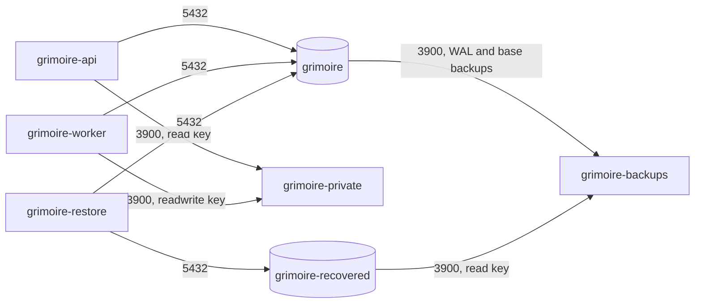
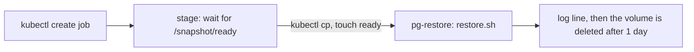

# Grimoire private data

The [grimoire-data](../../platform-factory/grimoire-data/) Application runs
Grimoire's private database, object keys and runtime identities on the factory
cluster. Design and reasons: [ARCHITECTURE.md](../ARCHITECTURE.md).

## Quickstart

```bash
ci test -- //projects/grimoire/deploy:restore_test   # restore a synthetic pgvector dump
ci test -- //projects/platform-factory/grimoire-data:provisioning_test   # pin peers, keys and logins
```

## Identities and peers



The three service accounts also have DNS to CoreDNS and nothing else. The restore and grants
Jobs run as `grimoire-restore`. Both buckets are in Garage, and neither has a
public mirror. No identity has inference egress: the chart that configures an
inference endpoint adds that exact peer to `grimoire-api` and
`grimoire-worker`.

## Inputs

| Input | Where it comes from | Used for |
| --- | --- | --- |
| `grimoire-app` | The operator, at initdb | The owner login `grimoire_restore` |
| `grimoire-api-login`, `grimoire-worker-login` | `grimoire-db-init` generates each password once | The runtime logins; the operator sets each role's password |
| `grimoire-*-s3` | garage-init, from the claims in `storage.yaml` | One scoped Garage key for each user |
| `grimoire.dump`, `vector.metadata` | The source database ([HOME-484](https://factory-plan.jomcgi.dev/factory/issue/HOME-484)) | The restore |

## Operate

### Change a grant

The `grimoire-db-grants` PostSync Job runs
[grants.sql](../../platform-factory/grimoire-data/resources/grants.sql) as
`grimoire_restore` after every sync. The runtime logins read and write rows
and call `nextval`. They cannot call `setval`, own nothing and cannot create
objects. The Job replaces a grant made by hand, so change a grant in
`grants.sql`.

### Restore a dump

[restore.sh](restore.sh) refuses a database that has tables. It also refuses
a dump with a NOT VALID foreign key before it imports anything, so the target
stays empty for a retry. It restores the dump as `grimoire_restore` in one
transaction, then counts the valid foreign keys and pgvector indexes against
the dump. CI runs it on a synthetic dump.
HOME-484 owns the real hub dump, the private object copy with checksums and
the rehearsal on real data.

The `grimoire` Application deploys the CronJob `grimoire-restore`
([restore-cronjob.yaml](restore-cronjob.yaml)) and the ConfigMap that
[kustomization.yaml](kustomization.yaml) generates from `restore.sh`. The
CronJob is suspended, so a sync starts nothing. Each run gets its own volume.
Its `stage` container waits until you copy the dump in.



1. On the source, record the pgvector version and schema in `vector.metadata`:

   ```sh
   psql -XAtq -v ON_ERROR_STOP=1 -c "SELECT extversion, nspname FROM pg_extension JOIN pg_namespace ON pg_namespace.oid = extnamespace WHERE extname = 'vector'" > vector.metadata
   ```

2. Take a custom-format dump of the scoped source: `pg_dump -Fc -f grimoire.dump`.
3. Start a run, copy both files into it, then release it:

   ```sh
   job=grimoire-restore-$(date -u +%Y%m%d%H%M%S)
   kubectl -n grimoire create job "$job" --from=cronjob/grimoire-restore
   until kubectl -n grimoire exec "job/$job" -c stage -- true; do sleep 5; done
   pod=$(kubectl -n grimoire get pod -l job-name="$job" -o jsonpath='{.items[0].metadata.name}')
   kubectl -n grimoire cp grimoire.dump "$pod:/snapshot/grimoire.dump" -c stage
   kubectl -n grimoire cp vector.metadata "$pod:/snapshot/vector.metadata" -c stage
   kubectl -n grimoire exec "$pod" -c stage -- touch /snapshot/ready
   kubectl -n grimoire wait "pod/$pod" --for=condition=Initialized
   kubectl -n grimoire logs -f "$pod" -c pg-restore
   ```

4. Read the log line `restored with N valid foreign keys and M valid pgvector indexes`.
5. Run [inventory.sql](inventory.sql) on the source and on `grimoire`, then compare:

   ```sh
   psql -XqAt -v ON_ERROR_STOP=1 -f inventory.sql > grimoire.inventory
   diff -q source.inventory grimoire.inventory
   ```

6. Delete the run: `kubectl -n grimoire delete job "$job"`. This deletes the
   dump with the run's volume. Otherwise the Job and its volume go 1 day after
   the run ends. A run that gets no dump ends after 1 day.

### Restore a backup

The `grimoire` Cluster archives WAL to `s3://grimoire-backups/grimoire-v1`.
`grimoire-daily` takes a base backup at 03:15 UTC. The retention is 14 days.

1. Stop the Grimoire writers.
2. Wait for a completed Backup after the last write. Record its name.
3. In a one-shot change, add `recovery.yaml` to `resources` in
   [kustomization.yaml](kustomization.yaml). The `grimoire-data` resources
   include this directory, so the Application deploys
   [recovery.yaml](recovery.yaml).
4. Wait until Cluster `grimoire-recovered` is healthy. It reads backups with the read-only `grimoire-recovery-s3` key.
5. From a pod that runs as `grimoire-restore`, run `inventory.sql` on `grimoire` and on `grimoire-recovered`.
6. Compare the two outputs. They must match.
7. In the next change, remove `recovery.yaml` from that `resources` list.
   The Application prunes `grimoire-recovered`.

## Troubleshooting

| Symptom | Cause | Fix |
| --- | --- | --- |
| `grimoire-db-init` waits, then the sync fails | garage-init has not filled `grimoire-backup-s3` | Check CronJob `garage/garage-bootstrap`, then sync `grimoire` again |
| `grimoire-db-grants` fails: role does not exist | The operator has not created the managed roles yet | The Job retries. Read the role errors in the Cluster status |
| `restore only into an empty database` | The target has tables | Restore into a new database |
| `NOT VALID foreign keys in the dump` | The source has a foreign key that was never validated | Fix the orphan rows, run `ALTER TABLE ... VALIDATE CONSTRAINT` on the source, then dump again |
| `cmp` reports that the metadata files differ | The target's pgvector version or schema differs from the source | Change the operator's pgvector image to match the source |
