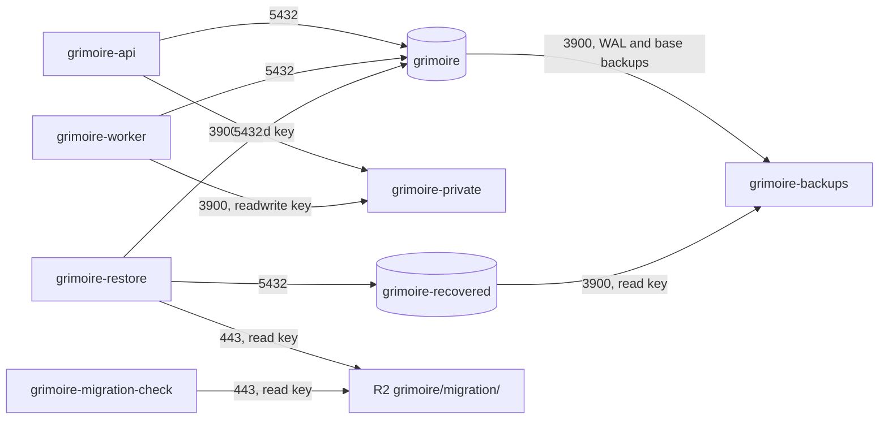
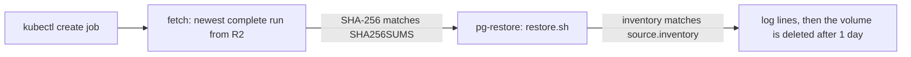

# Grimoire private data

The [grimoire-data](../../platform-factory/grimoire-data/) Application runs
Grimoire's private database, object keys and runtime identities on the factory
cluster. Design and reasons: [ARCHITECTURE.md](../ARCHITECTURE.md).

## Quickstart

```bash
ci test -- //projects/grimoire/deploy:restore_test   # restore a synthetic dump and a hub-script dump
ci test -- //projects/platform-factory/grimoire-data:provisioning_test   # pin peers, keys and logins
ci test -- //projects/monolith:grimoire_migration_test   # the hub run's objects and SHA256SUMS
ci test -- //projects/monolith/chart:grimoire_migration_dump_test   # the hub CronWorkflow
```

## Identities and peers



The four service accounts also have DNS to CoreDNS and nothing else. The
restore and grants Jobs run as `grimoire-restore`. Both Garage buckets are
private, and neither has a public mirror. The R2 peer is the exact host
`7c56b458cd657d96b095c63d181c051f.r2.cloudflarestorage.com`. Only the
restore's `fetch` container and the migration check hold the R2 key. No
identity has inference egress: the chart that configures an inference
endpoint adds that exact peer to `grimoire-api` and `grimoire-worker`.

## Inputs

| Input | Where it comes from | Used for |
| --- | --- | --- |
| `grimoire-app` | The operator, at initdb | The owner login `grimoire_restore` |
| `grimoire-api-login`, `grimoire-worker-login` | `grimoire-db-init` generates each password once | The runtime logins; the operator sets each role's password |
| `grimoire-*-s3` | garage-init, from the claims in `storage.yaml` | One scoped Garage key for each user |
| `grimoire-migration-r2` | 1Password item `grimoire-migration-r2`: an R2 API token with Object Read only on bucket `grimoire`, fields `access-key-id` and `secret-access-key` | The restore's fetch and the migration check |
| A run under `migration/` in R2 bucket `grimoire` | The hub CronWorkflow `grimoire-migration-dump` ([HOME-484](https://factory-plan.jomcgi.dev/factory/issue/HOME-484)) | The restore and the migration check |

## The hub migration run

No factory identity can read the hub. The hub CronWorkflow
`grimoire-migration-dump` (`projects/monolith/chart/templates/grimoire-migration-dump.yaml`)
writes one run under `migration/<run id>/` of the private R2 bucket
`grimoire`. The run id is a UTC timestamp, such as `20261119T120000Z`.

| Object | Contents |
| --- | --- |
| `grimoire.dump` | `pg_dump -Fc` of schema `grimoire` |
| `vector.metadata` | The source's pgvector version and schema |
| `source.inventory` | [inventory.sql](inventory.sql) on the source, in the dump's snapshot |
| `objects/<key>` | A copy of each object in the bucket outside `migration/` |
| `missing-references.txt` | Each `s3://` location that a row in the dump's snapshot references and the copy lacks |
| `SHA256SUMS` | The SHA-256 of each object above, read back from R2. Each object matches its source, or the run stops |

The job writes `SHA256SUMS` last. A run without it is incomplete, and the
factory jobs ignore it. Each run holds copyrighted book text, so it stays in
the private bucket. No route serves `migration/`.

### Start a hub run

Joe starts each run, because only he can reach the hub:

```sh
argo submit --from cronworkflow/grimoire-migration-dump -n monolith-workflows
```

The job log ends with `wrote s3://grimoire/migration/<run id>/ with N
objects (B bytes); M referenced objects missing`.

### Check a run

The one-time `grimoire-migration-check-home-746` Job uses the same pod
template as the suspended CronJob. Argo CD creates the named Job on sync.
Read its logs for the export run ID, matched checksum count and
missing-reference count before starting the restore.

For a later run, start the suspended CronJob's template on demand. It reads
every object of the newest complete run and compares it with `SHA256SUMS`:

```sh
job=grimoire-migration-check-$(date -u +%Y%m%d%H%M%S)
kubectl -n grimoire create job "$job" --from=cronjob/grimoire-migration-check
kubectl -n grimoire wait "job/$job" --for=condition=Complete --timeout=4h
kubectl -n grimoire logs "job/$job"
```

A good run logs `run migration/<run id>: N objects match SHA256SUMS` and
`M referenced objects missing`. Any other object or digest fails the Job.


## Operate

### Change a grant

The `grimoire-db-grants` PostSync Job runs
[grants.sql](../../platform-factory/grimoire-data/resources/grants.sql) as
`grimoire_restore` after every sync. The runtime logins read and write rows
and call `nextval`. They cannot call `setval`, own nothing and cannot create
objects. The Job replaces a grant made by hand, so change a grant in
`grants.sql`.

### Restore a dump

[restore.sh](restore.sh) refuses a database that has tables. It also refuses
a dump with a NOT VALID foreign key before it imports anything, so the target
stays empty for a retry. It restores the dump as `grimoire_restore` in one
transaction, then counts the valid foreign keys and pgvector indexes against
the dump. With `SOURCE_INVENTORY`, it then compares the target's inventory
with the source's. CI runs it on a synthetic dump and on the output of the hub
dump script.

The `grimoire` Application deploys the CronJob `grimoire-restore`
([restore-cronjob.yaml](restore-cronjob.yaml)) and the ConfigMap that
[kustomization.yaml](kustomization.yaml) generates from `restore.sh`,
`migration.sh` and `inventory.sql`. The CronJob is suspended, so a sync
starts nothing. Each run gets its own volume.



1. Start a hub run and check it (above).
2. Start a restore and follow its log:

   ```sh
   job=grimoire-restore-$(date -u +%Y%m%d%H%M%S)
   kubectl -n grimoire create job "$job" --from=cronjob/grimoire-restore
   kubectl -n grimoire logs -f "job/$job" -c fetch
   kubectl -n grimoire logs -f "job/$job" -c pg-restore
   ```

3. Read the log lines `restored with N valid foreign keys and M valid
   pgvector indexes` and `the restored database matches the source
   inventory`.
4. Delete the run: `kubectl -n grimoire delete job "$job"`. This deletes the
   dump with the run's volume. Otherwise the Job and its volume go 1 day after
   the run ends.

restore.sh compares the inventories after the commit, so a mismatch leaves
the restored tables. On a live hub, a sequence line can differ: a writer can
draw a value between the dump and the inventory, and sequences are outside
the snapshot. The final transfer runs with the hub writers closed.

### Restore a backup

The `grimoire` Cluster archives WAL to `s3://grimoire-backups/grimoire-v1`.
`grimoire-daily` takes a base backup at 03:15 UTC. The retention is 14 days.

1. Stop the Grimoire writers.
2. Wait for a completed Backup after the last write. Record its name.
3. In a one-shot change, add `recovery.yaml` to `resources` in
   [kustomization.yaml](kustomization.yaml). The `grimoire-data` resources
   include this directory, so the Application deploys
   [recovery.yaml](recovery.yaml).
4. Wait until Cluster `grimoire-recovered` is healthy. It reads backups with the read-only `grimoire-recovery-s3` key.
5. From a pod that runs as `grimoire-restore`, run `inventory.sql` on `grimoire` and on `grimoire-recovered`.
6. Compare the two outputs. They must match.
7. In the next change, remove `recovery.yaml` from that `resources` list.
   The Application prunes `grimoire-recovered`.

## Troubleshooting

| Symptom | Cause | Fix |
| --- | --- | --- |
| `grimoire-db-init` waits, then the sync fails | garage-init has not filled `grimoire-backup-s3` | Check CronJob `garage/garage-bootstrap`, then sync `grimoire` again |
| `grimoire-db-grants` fails: role does not exist | The operator has not created the managed roles yet | The Job retries. Read the role errors in the Cluster status |
| `restore only into an empty database` | The target has tables | Restore into a new database |
| `no complete run under R2:grimoire/migration/` | No hub run has written `SHA256SUMS` | Start a hub run and wait for it to succeed |
| `fetch` fails with `AccessDenied` or `CreateContainerConfigError` | Secret `grimoire-migration-r2` is missing or its token cannot read bucket `grimoire` | Check the `grimoire-migration-r2` OnePasswordItem status and the token's bucket scope |
| `sha256sum` reports `FAILED` in `fetch` | An input differs from the run's `SHA256SUMS` | Run the migration check, then start a new hub run |
| `differs from the source inventory` | The restored rows, sequences, indexes or keys differ from the hub's | Read the listed lines. Sequence lines alone come from writes during the hub run |
| `NOT VALID foreign keys in the dump` | The source has a foreign key that was never validated | Fix the orphan rows, run `ALTER TABLE ... VALIDATE CONSTRAINT` on the source, then dump again |
| `cmp` reports that the metadata files differ | The target's pgvector version or schema differs from the source | Change the operator's pgvector image to match the source |
