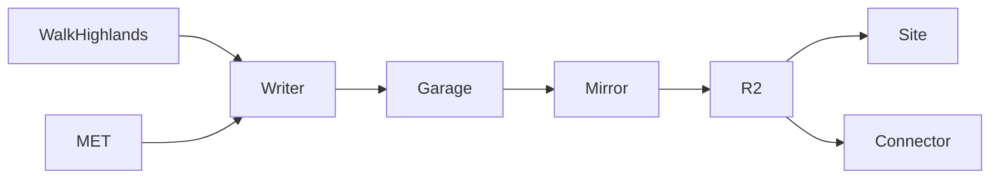

# Walk snapshot publication

The factory chart deploys three jobs with the Go entry point in `projects/scotland-connector/cmd/hikes-writer`. The manual catalogue job follows WalkHighlands area, sub-area and route links, then merges metadata by the hub's coordinate UUID. The refresh fetches locationforecast/2.0/complete on a shared rate limiter. Each successful response replaces one walk's daylight hours. The hourly prune filters elapsed hours.

The last complete Garage snapshot supplies the next job's state. Jobs hash and spool schema-v2 JSON one walk at a time, upload the immutable object, then conditionally replace the manifest using the previous ETag. A conflicting job fails and Kubernetes retries with current state. The platform mirror copies payloads to the dedicated R2 bucket before the manifest. Readers validate the referenced digest.

| Component | Untrusted input | Credentials held |
| --- | --- | --- |
| Writer | Route HTML and meteorological forecasts | Scoped Garage write key |
| Mirror | Public Garage objects | Scoped Garage read key and R2 write token |

## Direction

The factory manifest becomes the public source after reader parity and cache policy verification.

## Same-corpus replay

A single offline replay used all 1,619 positive-duration routes in the hub SQL seed and 48 identical hourly MET records per coordinate starting at 2026-06-20 00:00 UTC. Both processes decoded each response, applied the production forecast conversion and encoded schema-v2 JSON. Route metadata and all 55,098 daylight tuples matched after decoding. Timestamps used the same fixed instant. The Python replay used the hub's parse_hourly and compute_hours with compact json.dumps. The Go replay used forecast and encode.

| Implementation | User + system CPU seconds | Maximum RSS (KiB) |
| --- | ---: | ---: |
| Python 3.12 | 1.23 | 45,456 |
| Go 1.27 | 0.48 | 41,352 |

These process measurements exclude provider latency, database reads, object storage and cluster scheduling.
