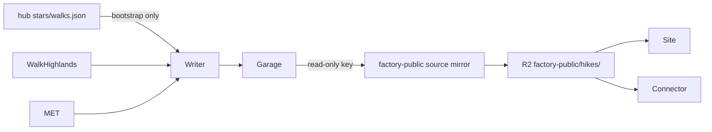

# Walk snapshot publication

The factory chart deploys a bootstrap hook and three CronJobs with the Go entry point in `projects/scotland-connector/cmd/hikes-writer`. While Garage has no generation, the bootstrap seeds from the hub's schema-v2 `stars/walks.json` and runs the first catalogue. The monthly catalogue job follows WalkHighlands area, sub-area and route links, then merges metadata by the hub's coordinate UUID. The refresh fetches locationforecast/2.0/complete on a shared rate limiter. Each successful response replaces one walk's daylight hours. The hourly prune filters elapsed hours.

The last complete Garage snapshot supplies the next job's state. Jobs hash and spool schema-v2 JSON one walk at a time, upload the immutable object, then replace the manifest. Each job takes an exclusive Linux flock on the same local-path volume before it reads the generation, and holds it through publication. The bootstrap first checks for `latest.json` without the lock and stops if it exists. The claim pins concurrent pods to the same node, and process exit releases the lock. A source mirror in the `factory-public` release copies payloads, then the manifest, to prefix `hikes/` of R2 bucket `factory-public`. This namespace holds no R2 write credential (HOME-492). Readers validate the referenced digest.

| Component | Untrusted input | Credentials held |
| --- | --- | --- |
| Writer | Route HTML and meteorological forecasts | Read and write access to the hikes Garage bucket |
| Bootstrap hook | The hub walk snapshot and route HTML | The writer's Garage key and the read-only R2 token `r2-s3-public-read` |
| Source mirror, in namespace `factory-public` | Public Garage objects | Garage read key and the `factory-public` R2 token |

## Direction

The factory manifest becomes the public source after reader parity and cache policy verification.

## Same-corpus replay

A single offline replay used all 1,619 positive-duration routes in the hub SQL seed and 48 identical hourly MET records per coordinate starting at 2026-06-20 00:00 UTC. Both processes decoded each response, applied the production forecast conversion and encoded schema-v2 JSON. Route metadata and all 55,098 daylight tuples matched after decoding. Timestamps used the same fixed instant. The Python replay used the hub's parse_hourly and compute_hours with compact json.dumps. The Go replay used forecast and encode.

| Implementation | User + system CPU seconds | Maximum RSS (KiB) |
| --- | ---: | ---: |
| Python 3.12 | 1.23 | 45,456 |
| Go 1.27 | 0.48 | 41,352 |

These process measurements exclude provider latency, database reads, object storage and cluster scheduling.
