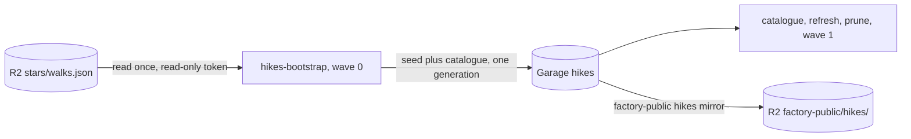

# Hikes

The factory writer publishes WalkHighlands route facts and daylight hours from MET Norway. See the [architecture](ARCHITECTURE.md).

## Jobs

The schedules (UTC) follow the [met.no budget](../../docs/static-page-writers.md#metno-budget).

| Job | Runs | Does |
| --- | --- | --- |
| `hikes-bootstrap` | Argo CD Sync hook, wave 0, on every sync | If Garage has no `latest.json`, seeds from the hub snapshot, runs the catalogue and publishes one generation. Otherwise it stops. |
| `hikes-catalogue` | `45 5 1 * *`, wave 1 | Merges WalkHighlands route metadata by walk ID. |
| `hikes-refresh` | `40 1-23/2 * * *`, wave 1 | Replaces each walk's daylight hours from met.no. |
| `hikes-prune` | `10 * * * *`, wave 1 | Removes elapsed hours. |

## Activation (HOME-477)

`suspendWriters: false` turned the jobs on. Argo CD syncs them in this order:



1. In wave 0, the bootstrap hook runs with its network policy and the lock claim `hikes-writer-lock`.
2. If Garage has no `latest.json`, the hook reads the hub's `stars/walks.json` with the read-only token `r2-s3-public-read`. It needs schema version 2 and one or more walks. The seed keeps the walk IDs and last good forecasts of routes that the first catalogue cannot fetch.
3. The hook runs the catalogue over the seed and publishes one generation. If the catalogue fails, the hook publishes nothing and the sync fails. The next sync tries again.
4. In wave 1, Argo CD syncs the three CronJobs. The first refresh reads the bootstrap generation.

After the first generation, the hook finds `latest.json` and stops before it takes the lock. The `factory-public` release mirrors the Garage bucket `hikes` to prefix `hikes/` of R2 bucket `factory-public` (HOME-492). Its `hikes` source runs since HOME-477. This chart holds no R2 write credential.

## Live check

After the rollout:

1. Argo CD shows `hikes` Synced and Healthy. No `hikes-bootstrap` Job stays, because Argo CD deletes a successful hook. The three CronJobs have `suspend: false`.
2. Check the public generation:

   ```bash
   base=https://factory-data.jomcgi.dev/hikes
   curl -sSI "$base/latest.json" | grep -i '^cache-control'  # public, max-age=60
   key=$(curl -sS "$base/latest.json" | jq -r .walks)         # walks-<sha256>.json
   curl -sSI "$base/$key" | grep -i '^HTTP\|^cache-control'   # 200, public, max-age=31536000, immutable
   curl -sS "$base/$key" | sha256sum                           # equals the digest in $key
   curl -sS "$base/$key" | jq '{schema_version, generated_at, fetched_at, walks: (.walks | length)}'
   ```

   Only the factory writer writes Garage `hikes`, and the hub writes no `walks-<sha256>.json` key. A key under `hikes/` is thus a factory generation. After the first refresh, `fetched_at` is later than the rollout.
3. Compare walk IDs, metadata, hourly windows and per-walk `forecast_fetched_at` with the hub's `stars/walks.json`. Every hub walk ID is in the factory generation. Check the refresh logs for fetch failures.

## Reader switch and hub retirement

HOME-521 switches the readers. Grant the site and Scotland connector credentials read access to `factory-public`. The site snapshot and the connector resolve the manifest's walk key from the bucket root. Change both to resolve it under `hikes/`. Then set the site's hikes source in `projects/jomcgi-site/data/sources.json` to bucket `factory-public` and manifest `hikes/latest.json`. Set the connector chart's `config.walksBucket` and `config.walksKey` to the same values. Exercise the deployed hikes page and connector walk answers.

HOME-522 retires the hub scrape, refresh and prune entries, after a check of the other consumers of the hub hikes database. Rollback uses the old reader settings while hub publication is active.

## Rollback

1. To stop the jobs, set `suspendWriters: true`. Argo CD suspends the CronJobs and removes the bootstrap hook and its seed credential.
2. To stop the mirror, set the `hikes` source in `projects/factory-public/chart/values.yaml` to `suspend: true`. R2 keeps what it has.

Readers use the hub snapshot until HOME-521, so neither step changes a public page.
