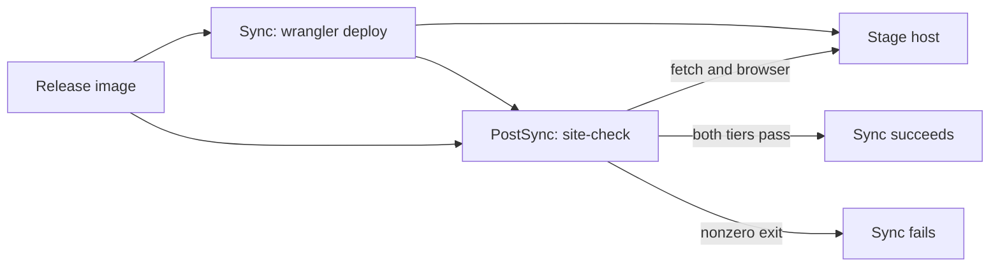

# Site verification

The stage's Argo CD Application verifies each synced release with a `site-check`
PostSync Job (HOME-181). Its stage argument and sole egress host follow the
chart's `stage` value. PostSync wave 1 waits for prod's edge route update.
Dev always runs the check. Prod runs it only with `edge.serveRoutes=true`;
when routes are off, the hub serves the host and there is no Worker release
to verify there. The chart refuses prod without `edge.enabled`, so the edge
Job always runs in prod. With routes off, it deletes every route of the Worker
and reads the zone back, or the sync fails. The refresh CronJob's data-only
redeploys of the same release are not a sync, so they get no check.

**Why.** happy-dom cannot enforce CSP or measure rendered colour contrast.
[HOME-181](https://factory-plan.jomcgi.dev/factory/issue/HOME-181) requires a
browser against the stage host before a deployment counts as verified.

## Verification contract

Tier 1 uses Node `fetch`. Dev checks every HTML page in the bundled release.
Prod selects pages from the edge Job's `edge/routes.json`: Blog, CV, the
leaderboard, Scotland and its policy pages, and the drafts note. Exact route exceptions keep query
variants, the Scotland connector and `/slop/factory` on the hub.
It checks real response headers, all built assets, internal links and
JavaScript transfer sizes. Each owned page prefix has a junk path that must
return HTTP 404 and the release's 404 HTML, including the retired prefixes
in prod. The probe fills the route wildcard without adding a slash, so
legacy descendant redirects do not capture it. Both `/cv*` and `/prefix/*`
route forms are supported.
HTML and asset bytes must match the release. Redirects cannot leave the stage
origin. Each page retains HOME-174's 150 KiB JavaScript budget. The fetch
dispatcher counts compressed response bytes before Node decodes them.
Links to hub-owned paths still require HTTP 200. Those pages keep their own
HTML and headers until their routes move to the Worker.

Tier 2 uses Playwright with pinned `chrome-headless-shell` from
`@sparticuz/chromium`. It runs axe with colour contrast enabled on every page,
in light and dark mode at 390px and 1280px. Console errors, uncaught errors,
failed resources and CSP violations fail the check. It also checks links
created by JavaScript. CSP stays enabled during the audit. The deliberate
404 document's network error is excluded. The staged Factory section also
allows 404 responses under `/data/factory/` until HOME-213 publishes it.
A test requires removing that allowance when the snapshot source is added.

`check/browser.test.mjs` calls the full tier-2 entry point on a test page.
The page first passes all four colour-mode and viewport combinations. The
test then serves low-contrast text from its external stylesheet and requires
an `axe color-contrast` rejection. The test log includes that measured failure.

The same image contains the release, both checks, the browser and its
libraries. The Job downloads no tools. Its writable `/tmp` holds unpacked
browser files and profiles. It runs as uid 65532 with a read-only root, no
service account token and no deploy credentials. The browser uses Playwright's
container launch defaults; pod isolation and network policy bound its access.

`check/deployed.test.mjs` audits built dev and prod pages with both tiers.
Testing the packaged image under the Job's restrictions remains a separate
HOME-181 follow-up. PR #8160 defers that Docker harness to fit the review
budget; its implementation is preserved at commit `9c5de89a6`.

The Job has no retries and exits after 180 seconds. Argo CD keeps a failed
hook for diagnosis and replaces it on the next sync. Its only application
egress is HTTPS to the stage host. The factory's existing DNS allowance
supports name resolution. Node and browser request guards also reject other
origins before following redirects.

## Published data

`check/freshness.json` checks `/data/stars/latest.json` and
`/data/hikes/latest.json`, now published by the R2 snapshot (HOME-209).
Each snapshot writes `generatedAt` separately from `asOf`, the newest source
object modification time. Unchanged source data can remain valid; an index
older than one hour signals a stopped 30-minute refresh. This allows one
refresh interval of delay beyond the normal schedule.

Each new section in `data/sources.json` must add a freshness entry. A test
checks that the manifests agree and that the snapshot producer emits the
configured timestamp. Dev checks all sections. Prod checks them when their
`/data/` routes move from the hub to the Worker.

Missing endpoints, invalid timestamps, stale data and timestamps over one
minute in the future fail tier 1. Prod checks entries only under its owned
routes. No external data host is permitted by this Job's network policy.

## Direction

| Work | Issue |
| --- | --- |
| Move stage verification from PostSync to Kargo verification | HOME-116 slice 2 |
