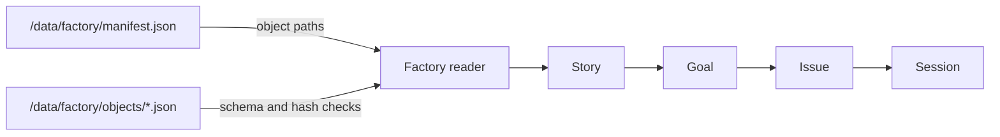

# jomcgi.dev site

The public jomcgi.dev site as static files on Cloudflare (HOME-174). An
assets-only Worker serves the pages, so no script runs for any request.
Serving costs nothing, a crawler cannot cause per-request charges, and no
public request reaches a cluster. Sections move here one path at a time.

```
web/ (Astryx pages) ──vite, pre-render──► dist ──┐
wrangler/ (pinned CLI) ──────────────────────────┤
data/ (R2 snapshot) ─────────────────────────────┤
wrangler.jsonc, run.sh ──────────────────────────┴─► image
image ─► run.sh (Sync hook Job, and refresh CronJob every 30 min):
           copy site to /tmp ─► snapshot R2 into dist/data ─► wrangler deploy --env <stage>
  dev  → Worker jomcgi-site-dev on next.jomcgi.dev
  prod → Worker jomcgi-site, then the edge Job (PostSync):
         edge/routes.json + edge/cache-rules.json ─► zone jomcgi.dev
```

## Layout

| Path             | What                                                                                                                          |
| ---------------- | ----------------------------------------------------------------------------------------------------------------------------- |
| `web/`           | The Astryx app: one HTML entry per page, the nav and section list in `src/sections.ts`, hosting headers in `public/_headers`. |
| `wrangler.jsonc` | The Worker, its assets and the dev host. Prod lists no routes.                                                                |
| `data/`          | The data snapshot: `sources.json` and the tool that copies them into the site before each deploy (HOME-209).                  |
| `edge/`          | The prod Worker's routes and the zone's cache rules, and `apply`, which makes Cloudflare match them (HOME-192).               |
| `wrangler/`      | The pinned `wrangler` CLI, packaged as image layers by rules_js.                                                              |
| `apko.yaml`      | The deploy image: bash and busybox for the rules_js launcher, CA roots, and Node's C++ runtime.                               |
| `chart/`         | The deploy Job (factory Helm library), its 1Password items and its only egress, `api.cloudflare.com:443`.                     |
| `deploy/`        | The stages' Argo CD Applications: `application.yaml` (dev) and `application-prod.yaml` (prod).                                |

## Contracts

- **URLs.** A section has one top-level prefix (`/hikes`). It stays linked to
  its current jomcgi.dev page until it goes live here. Setting `live: true` in
  `src/sections.ts` and adding its patterns to `edge/routes.json` moves it.
  Removing them rolls it back: the edge Job deletes each route of Worker
  `jomcgi-site` that is not in the file, and the path falls back to the hub.
  `wrangler` cannot do this: with a zone-scoped token it adds routes but never
  deletes them, so the prod env lists none. Cloudflare matches a route against the
  whole URL, query string included, so a pattern ends in `*` (`jomcgi.dev/cv*`
  also serves `/cv?ref=x`). An exact pattern is allowed only with a reason in
  `exactBecause`, and a test keeps every pattern off paths the hub or other
  services still own.
- **Rollback.** `edge.serveRoutes` in the prod Application turns every route
  on or off. Off, the edge Job deletes all routes of `jomcgi-site`, so every
  jomcgi.dev path goes back to the hub, and the cache rules still apply. The
  prod Application is registered with it off, and a later PR turns it on, so
  reverting that PR is the rollback; it needs no chart publish. Remove the
  Application only after its routes are gone, because removing it does not
  delete them. Prod pins below the first chart with this switch refuse or
  ignore it, so do not lower the prod pin below that version.
- **Zone rules.** `edge/cache-rules.json` is the whole cache-settings
  entrypoint. A live rule that is not in the file blocks the cache-rules
  write, so a dashboard rule is never lost; import it by PR. Routes and cache
  rules are independent halves: a blocked half changes nothing, the other half
  still applies, and then the edge Job fails and names what it skipped. Only
  the prod stage runs the edge Job (`edge.enabled`), because zone config is
  not per stage.
- **Pre-render.** `build.mjs` runs the Vite build, then renders each page
  with React at build time into its HTML entry, in place of `<!--ssr-->`.
  A page reads fully, with its preview tags, before any script runs, and the
  browser hydrates the same tree (`src/root.tsx`). `:prerendered_test` fails a
  built page whose root is empty, and a unit test fails a page whose
  hydration does not match its HTML. Each entry imports only its own page.
- **Data.** A section that shows changing data reads
  `/data/<section>/latest.json` on the site's own origin, then the
  content-named files it lists (`/data/<section>/v/<name>-<sha256:12>.json`).
  `data/sources.json` names each section's source objects in R2.
  `run.sh` copies the site to `/tmp`, runs the snapshot (`data/`) to fill
  `web/dist/data`, then deploys the copy. The Sync-hook Job runs it on every
  sync and the `jomcgi-site-refresh` CronJob every 30 minutes, so data is at
  most one refresh interval plus one deploy behind R2. Each deploy carries its
  release (chart version and image digest) as its deployment message. A
  refresh deploys only while the live deployment is its own release: it
  checks at the start and just before deploying, and every step runs under
  `timeout -k`, so it ends within 240 seconds plus a 5-second kill grace. The hook re-checks for 300 seconds after its deploy and deploys
  again if a refresh replaced it, so the hook always deploys last and an
  older refresh never leaves an older release live; it then confirms its
  release is live (only its own label counts; "no deployment" does not),
  or fails the sync so Argo CD retries. Every check runs
  under a timeout. A failed check fails the refresh Job; only "another
  release is live" is a skip. Same-origin static assets need no CORS and cost
  nothing per request. HOME-178 planned a public bucket on `data.jomcgi.dev`;
  until it exists, this is the data path, and moving to it changes only the
  base path pages read.
- **Caching.** `/assets/*` files are named by content hash and cached forever.
  A deploy serves new files at once, so routine releases need no cache purge.
- **Performance.** Each page's initial JavaScript must stay under 150 KiB
  gzipped. `budget.mjs` measures it, `:budget_test` runs it on the build, and
  a unit test proves it fails an over-budget page.
- **Accessibility.** Pages have no axe violations in happy-dom, and the colour
  tokens in `src/palette.css` meet WCAG contrast in light and dark modes.
  Colour contrast on real CSS is checked in a browser after deploy (HOME-174).

## Blog

The HOME-198 migration serves the index and every manifest post as static
HTML at its existing URL. The hub's [post manifest](../monolith/frontend/src/lib/public/posts/posts-manifest.json)
remains the content source; markdown, titles, summaries, dates and tags are
read from it without a runtime request.

```text
hub manifest + shared markdown renderer + original Svelte figures
  -> web/blog-content.mjs (build-time HTML and figure CSS)
  -> virtual:blog/<slug> -> each registered page
  -> web/build.mjs -> dist/blog.html and dist/blog/<slug>.html
```

[blog-content.mjs](web/blog-content.mjs) calls the shared `renderDoc` and
server-renders all nine original inference figures. It moves their numeric
inline dimensions into CSS. [vite.config.ts](web/vite.config.ts) takes an
HTML input for every manifest slug; [build.mjs](web/build.mjs) fills each
entry from [pages.tsx](web/src/pages.tsx) before it is shipped.

| URL | HTML entry | Page module |
| --- | --- | --- |
| `/blog` | [blog.html](web/blog.html) | [blog-page.tsx](web/src/blog-page.tsx) |
| `/blog/ember-conformance` | [ember-conformance.html](web/blog/ember-conformance.html) | [blog-ember-conformance-page.tsx](web/src/blog-ember-conformance-page.tsx) |
| `/blog/125b-on-a-4090` | [125b-on-a-4090.html](web/blog/125b-on-a-4090.html) | [blog-125b-on-a-4090-page.tsx](web/src/blog-125b-on-a-4090-page.tsx) |

Each entry script imports its own page. The browser hydrates the rendered
HTML; the index applies `?tag=` and follows browser history. Add an HTML
entry, entry script and registered page when adding a manifest post.

[blog-embed.tsx](web/src/blog-embed.tsx) starts imports only after its Load
button is activated. Conformance loads `ConformanceReplay`; research and
coding load `QwenReplay` with their respective `qwen-replay.json` and
`agent-replay.json` recordings. The latter includes `CodeOutput` and
`DraftTrace`; research includes `IncidentGraph`. The components and recording
files are shared with the hub, without copied datasets. Playback, scrubbing,
graph interaction and the coding trace run locally after loading.

The automated checks below are wired in [web/BUILD](web/BUILD); target names
are relative to `//projects/jomcgi-site/web`.

| Contract | Evidence in the checkout | Bazel target |
| --- | --- | --- |
| Every manifest post has an emitted page, title, sections and index link | [prerendered.mjs](web/prerendered.mjs) opens the built HTML and compares it with the manifest | `:prerendered_test` |
| Original content, figures, tags and preview metadata; tag history navigation | [blog.test.tsx](web/src/blog.test.tsx), including all nine figures and the original title, description, canonical, Open Graph and Twitter values | `:test` |
| Intent loading, retries, disposal, play, scrub and graph interaction | The replay tests in [blog.test.tsx](web/src/blog.test.tsx) mount the shared components and run axe on the loaded embeds | `:test` |
| Every route has its own entry and passes structural axe checks | [a11y.test.tsx](web/src/a11y.test.tsx) enumerates all HTML entries and registered pages | `:test` |
| Light/dark contrast, distinct replay keys, no inline styles or colour literals outside the palette | [contrast.test.tsx](web/src/contrast.test.tsx) checks the site, shared replay styles and generated figure CSS | `:test` |
| Every route stays under 150 KiB initial gzipped JavaScript | [budget.mjs](web/budget.mjs) follows each built entry's initial imports, excluding deferred imports | `:budget_test` |

`edge/routes.json` includes the blog and shared asset patterns. The prod
edge apply job owns these routes; `wrangler.jsonc` lists no prod routes.
[sections.ts](web/src/sections.ts) marks Blog live. The `jomcgi.dev/blog*`
pattern covers the index, posts and `?tag=` queries under the route contract
above. Removing it from [routes.json](edge/routes.json) returns those URLs
to the hub. [apply.test.mjs](edge/apply.test.mjs) checks these URLs and keeps
the remaining hub paths outside the site's routes.

## LLM leaderboard

`/llm-leaderboard` pre-renders the hub report. Its selector, charts and
sortable tables hydrate on intent or a linked `?m=` selection.
`/app/llm-leaderboard` and its descendants redirect with 301 responses.
The deploy image serves `web:build` through an assets-only Worker.

`projects/model-bench` writes the sole snapshot at
`projects/monolith/frontend/src/lib/public/llm-leaderboard/leaderboard.json`.
The site imports it and the hub model through `:leaderboard_sources`.

| Contract | Checks in `web/` |
| --- | --- |
| Static HTML, redirects, deferred snapshot and 150 KiB JS budget | `:leaderboard_built_test` reads emitted files; `:budget_test` measures every route. |
| Content, metadata, hydration and input replay | `leaderboard.test.tsx` and `leaderboard-intent.test.tsx`. |
| Palette-only paint and accessibility | `contrast.test.tsx`, component axe tests and emitted-HTML axe. `leaderboard-browser.mjs` adds full browser axe, including contrast, after selection and axis changes. |

`:leaderboard_browser_test` runs in PR CI against `:build`. The lockfile pins
Playwright and `@sparticuz/chromium`, including its browser, libraries and fonts.
From `web/`, run `pnpm build` and `pnpm test:browser` on Linux x64 with glibc.
No browser download is needed. `SITE_CHROMIUM_EXECUTABLE` optionally selects
a local browser. The check uses the production CSP at 390/1280 px in both
themes, delays the report chunk, checks hydration, and scans selections.
After dev deploy, verify the page, both legacy redirects and a linked
selection on `https://next.jomcgi.dev` before prod promotion.

## Build and test

From `web/`: `pnpm build`, `pnpm test`, `pnpm typecheck`, `pnpm budget`,
`node leaderboard-built.mjs dist`, `node prerendered.mjs dist`, `node marketplace.test.mjs dist`, and
`node scotland-built.test.mjs dist`, plus `node factory-built.test.mjs dist`.
The catalog check compares the built
file with the hub handler byte for byte. The Scotland build check reads the
emitted HTML with scripts disabled and compares its content and metadata
with the hub sources, runs structural axe checks, checks linked assets and
headers, and checks that all six exact routes have files in the build output.
Bazel runs the same checks: `bb remote test //projects/jomcgi-site/...`.

`/docs` uses `web:docs_manifest`, with the hub's `repo_docs_srcs`, generator
and public-content guard. `web:docs_pages` renders the filtered entries with
the shared markdown renderer and generates each document's HTML entry and
page module. `src/pages.tsx` registers them for pre-rendering and axe tests.
The browser hydrates the document HTML already in the page; it does not
download the body again. The same filtered manifest supplies a static full-text
search index. A dynamic import loads it only when a reader focuses the search
box or types. Ctrl/Cmd+K focuses search; Enter opens the first result, and
arrow keys move between results. No search request reaches the hub.

Mermaid diagrams are rendered to SVG during the build with pinned Chromium,
Puppeteer and Mermaid packages. The temporary renderer and browser stay out
of `dist`. The SVGs use `src/docs-diagrams.css` and the checked light/dark
palette, with no inline styles. Each diagram has a name from its section heading
and a text equivalent describing its nodes, groups, connections, message order
or state transitions. SVG title/description references expose these to screen
readers. Separate disclosures offer the equivalent as a text list and retain
the original source. The build reads Mermaid's parsed graph, so descriptions
stay current when generated STPA docs change. Unsupported diagram semantics
fail the build unless the author supplies Mermaid `accDescr` text.
Wide code and tables accept keyboard focus so readers can scroll them.

The local pnpm commands generate these inputs first. Install the workspace
dependencies, including `monolith-frontend` for the shared renderer's `marked`
dependency. After `pnpm build`, run
`python3 -m pytest -q projects/jomcgi-site/web/docs_build_test.py` from the
repository root to check published-page coverage and the public-content
boundary. Bazel runs this with the repository's pytest runner as
`web:docs_build_test`. Generated manifests and
page sources stay out of version control and the published assets.

From `web/`, `node docs-built.test.mjs` (`web:docs_contract_test`) compares each
published document's complete body and metadata to the shared hub renderer. It also checks
the overview's metadata, full-text index coverage and Worker routing for every
manifest URL with and without a query string. It checks the exact description
values in the emitted HTML.

After building, `node browser.test.mjs` (`web:browser_test`) checks every HTML
entry at mobile and desktop widths in both colour modes, under the published
CSP. It runs axe including contrast on pages and open search results, checks
hydration, static diagrams and their computed accessibility names/descriptions,
and search loading on intent
with keyboard navigation. The Sextant generation flow and
state transitions must have meaningful text equivalents without JavaScript. The
browser uses only local assets. Linux builds use the pinned browser and native
libraries, with fontconfig pointing at the actual `TMPDIR` extraction path;
set `CHROMIUM_PATH` to use an installed browser on another platform.

## HOME-199 acceptance

PR #8165 moves the complete docs section to the static site. Docs and blog use
the shared Markdown renderer in `monolith/frontend/src/lib/server/markdown.js`;
docs navigation and metadata stay in `docs.js`, with a small hub adapter for
signed image URLs. Rendering, static search and route activation ship together.

| Criterion | Implementation and executable evidence |
| --- | --- |
| 1: Same public sources and filter; every entry has a page and excluded content stays private. | `web/BUILD:docs_manifest` consumes `//projects/monolith:repo_docs_srcs` with the shared generator and `public_content.py`. `web:docs_pages` generates HTML entries and page modules. `src/pages.tsx` registers them; `build.mjs` pre-renders them. `docs_build_test.py::test_published_pages_are_exactly_the_filtered_manifest` compares the manifest to the generator and the full set of published HTML paths. The excluded-candidate and content-guard tests exercise the publication boundary. `web:docs_build_test` uses the repository's pytest runner. `docs-built.test.mjs` compares the complete published bodies with the shared hub renderer. |
| 2: Sidebar, tabs, static search, budget, axe and contrast. | `src/docs.test.tsx` checks the manifest routes' navigation and search matching; `src/docs-search.test.tsx` checks loading on intent and Enter selection. `docs-built.test.mjs` checks that every filtered document is in the full-text index and that no other document is indexed. `browser.test.mjs` checks every published route in light/dark and mobile/desktop under the production CSP, including axe contrast, diagram accessibility and real keyboard search navigation. `budget.mjs` checks each HTML entry against 150 KiB gzipped initial JavaScript; `src/contrast.test.tsx` checks palette tokens and forbidden styles. |
| 3: Live metadata and production routing. | `docs-built.test.mjs` checks each emitted page's title, exact description, canonical, Open Graph and Twitter tags against the shared hub metadata, including the overview. Docs is live in `src/sections.ts`; `edge/routes.json` uses `jomcgi.dev/docs*` to cover the overview, nested documents and query strings under the current routing contract. `docs-built.test.mjs` checks routing for every manifest URL; `edge/apply.test.mjs` checks the boundary with hub-owned paths. |

CI publishes the dev build after merge. The landing owner must verify the deployed
`next.jomcgi.dev/docs` overview, all manifest URLs, keyboard search and diagrams
before production promotion. Local build and browser results do not establish
deployed verification. Removing `jomcgi.dev/docs*` rolls docs back to the hub.

## Deploy

CI publishes the image and chart on merge. A sync of the stage's Application
runs the deploy Job as an Argo CD Sync hook. Argo CD does not diff hooks, so
the `jomcgi-site-release` ConfigMap carries the chart version, the image
digest, the stage and the edge switches (`edge`, `serveRoutes`). Each new
chart or image, a change to a Job alone, and a change to `edge.serveRoutes`
alone make the Application OutOfSync and sync it again. A failed deploy is a
failed sync.

Both Applications are listed through `deploy/kustomization.yaml`, which
`projects/platform-factory/kustomization.yaml` includes. CI write-back moves
the dev pin (`application.yaml`) on every chart change. The prod pin
(`application-prod.yaml`) moves only by PR, after the same chart is verified
on `next.jomcgi.dev`: that PR is the promotion. The Jobs read 1Password item
`vaults/k8s-homelab/items/jomcgi-site-cloudflare` (fields `api-token` and
`account-id`; permissions are listed in HOME-178). The token allows calls
from the home network only, and pods reach Cloudflare over IPv4. Kargo
takes over both pins when HOME-116 slice 2 lands.

`public/robots.txt` lets crawlers fetch every page, so they can read each
page's indexing rules. `public/_headers` sends `X-Robots-Tag: noindex` for
the preview host and the unlisted `/slop` drafts note. The note also keeps its
`noindex, nofollow` meta tag.

After the dev deployment, check the three blog URLs above on
`next.jomcgi.dev`. With JavaScript disabled, the index and post text must
remain readable, including the section headings and figures. With JavaScript
enabled, check tag filtering and Back navigation. Each replay's code and
recording should appear in the network panel only after its Load button is
activated; check play, scrub and graph selection after loading. Run browser
axe checks in light and dark modes at phone and desktop widths, including
the loaded demos. These live checks need the deployed build; a local build
does not verify the dev deployment.

## Scotland and drafts migration (HOME-207)

The build emits these files before deployment. `site_tar` in `BUILD` packages
the complete `web:build` output at the assets directory in `wrangler.jsonc`.
The Worker has no request handler; its HTML handling serves the files at the
existing extensionless URLs.

| URL | File under `web/dist/` | Page module or data under `web/src/` |
| --- | --- | --- |
| `/scotland` | `scotland.html` | `scotland-page.tsx` |
| `/scotland/privacy` | `scotland/privacy.html` | `scotland-privacy-page.tsx` |
| `/scotland/terms` | `scotland/terms.html` | `scotland-terms-page.tsx` |
| `/scotland/support` | `scotland/support.html` | `scotland-support-page.tsx` |
| `/scotland/marketplace.json` | `scotland/marketplace.json` | `scotland-data.ts` |
| `/slop` | `slop.html` | `slop-page.tsx` |

`web/build.mjs` renders each HTML entry registered in `web/src/pages.tsx` and
serializes the catalog from the same data that the landing page uses. The
pages contain text, links and code samples, with no large dataset or widget
to load on intent. Each entry hydrates only its own page through `mount.tsx`.

| Contract | Evidence and CI target |
| --- | --- |
| Final build output at every migrated URL | `web/scotland-built.test.mjs` reads all five emitted HTML files with scripts disabled, checks their hub copy and metadata, absence of inline styles, structural axe results, linked assets, headers and JS budgets, and maps all six exact routes to built files (`web:scotland_built_test`). |
| Filled HTML and one page per entry | `web/prerendered.mjs` (`web:prerendered_test`); `web/src/a11y.test.tsx` checks the entry/module mapping (`web:test`). |
| Unchanged copy, commands, policy dates and SEO tags | `web/src/scotland.test.tsx` compares the copied data and rendered prose with the hub sources, and checks every entry's title, description, canonical, Open Graph and Twitter tags (`web:test`). |
| Byte-compatible marketplace | `web/marketplace.test.mjs` compares the built file with the hub's actual GET response, including the trailing newline (`web:marketplace_test`). |
| Hydration and the 150 KiB JS limit | `web/src/prerender.test.tsx` hydrates every page without recoverable errors (`web:test`); `web/budget.mjs` measures initial JS from built entries (`web:budget_test`). |
| Palette, inline styles and accessibility | `web/src/contrast.test.tsx` scans TypeScript and CSS and checks both palette modes; `web/src/a11y.test.tsx` runs axe on every registered page (`web:test`). |
| Exact routes and unlisted drafts | `edge/apply.test.mjs` checks route patterns against the connector and factory paths (`edge:apply_test`); `web/src/scotland.test.tsx` checks `live`, the drafts index exclusion, and noindex metadata and headers (`web:test`). |

The [local browser verification](validation/scotland-browser.md) records
hydration with the compiled scripts and full axe results for these five pages.
All 20 light/dark and desktop/mobile cases passed, including colour contrast.

The six URLs use exact patterns in `edge/routes.json`. The connector keeps
`/scotland/mcp` and `/scotland/v1/*`; `/slop/factory` stays on the hub. The hub
pages remain available for rollback when the section patterns are removed.
`exactBecause` records HOME-207's explicit exceptions to the wildcard rule:
query-string variants such as `/scotland?ref=x` and `/slop?ref=x` still reach
the hub. Descendants are also outside these six exact patterns. The edge
tests check this alongside the query-safe wildcard routes from HOME-203.

Local artifact checks do not establish a live migration. Production serving
still depends on the `edge.serveRoutes` switch and promotion described above.
After the dev deploy, the HOME-207 delivery owner verifies these six URLs on
`next.jomcgi.dev`, including rendered content without JavaScript, the drafts
meta/header rules, catalog bytes and browser accessibility. That live check
remains pending until this revision is deployed.

## Factory preview (HOME-224)

`web/factory/index.html` is the pre-rendered shell for `/factory`.
`web/public/_redirects` rewrites `/factory` and `/factory/*` to `/factory/`; the story,
goal, issue and session routes share that entry. Client navigation preserves
ordinary links and focuses the selected record or transcript turn.



The reader uses `projects/factory-storyboard/schema` and polls each minute.
Successful immutable objects are reused; failed objects retry on the next poll.
An unavailable object gets an inline state. A failed manifest refresh keeps
the last snapshot with a visible notice. Text stays plain text, and narrative
numbers come from the story's named stats. Unknown stats show an en dash.

Vite serves the invented fixtures on `/data/factory/` in development. Tests
use the same files. Production builds include no fixtures and show unavailable
states until HOME-213 publishes snapshots. SVG charts have value tables;
the layout uses the shared light/dark palette and 16px phone gutters.

The [Factory acceptance evidence](validation/factory.md) maps each required
case to its test and records the local commands and results.
`web:test` covers fixtures, failures, navigation, text rendering, axe, CSP and
palette rules. `web:factory_built_test` checks the emitted shell and publication
boundary. `web:budget_test` measures the Factory entry against 150 KiB.

**Why.** HOME-178's "One site" decision places the storyboard in this site.
HOME-224 keeps `sections.ts` at `live: false`, with no changes to production
edge routes, charts or deployment files. HOME-225 activates `/factory` and the
legacy redirects after HOME-213. After the dev deploy, the delivery owner checks
`https://next.jomcgi.dev/factory` and `/factory/goals/x` for HTTP 200 and the
shell's unavailable states. Local build checks do not establish that rollout.

## Engineering migration (HOME-197)

`web/engineering.html` and `web/src/engineering.tsx` serve `/engineering` without
the hub's SvelteKit runtime. The build pre-renders all 11 records and diagrams;
the browser hydrates the systems index. The page makes no data request.
Unmigrated application links keep their `jomcgi.dev` destination on the preview host.

The source is `projects/monolith/frontend/src/routes/public/engineering/`.
Its data and Svelte files are inputs only to the parity test, through
`//projects/monolith/frontend:engineering_migration_sources`; the production
entry imports the React page and its copied data and diagrams.

| HOME-197 requirement | Implementation and executable evidence |
| --- | --- |
| Every content record and all 11 diagrams survive the move | `web/src/engineering-parity.test.tsx` compares all hub data exports and each diagram's box, group and arrow labels. `engineering.test.tsx` checks every rendered record, fact, snippet, link and diagram. |
| Keep `/engineering`, its own HTML entry and page module, and build-time rendering | `web/engineering.html` loads only `src/engineering.tsx`; `src/pages.tsx` registers it for `build.mjs`. `a11y.test.tsx` checks the page registry and import boundaries; `:prerendered_test` checks built HTML. |
| Copy the metadata | `engineering.test.tsx` checks the title, description, canonical, Open Graph and Twitter tags. The parity test compares title and description with the hub's `<Seo>`. |
| Hydrate interaction and stay within 150 KiB JS | `engineering.test.tsx` exercises the systems index observer and cleanup; `prerender.test.tsx` checks hydration without a mismatch. `:budget_test` measures the built entry and its imported JS. There is no large data request or heavy optional interaction to load on intent. |
| No inline styles, colour literals outside the palette, axe violations or low-contrast token pairs | `engineering.test.tsx` checks the rendered page for inline styles, `contrast.test.tsx` scans all styles and both palettes, and `a11y.test.tsx` runs axe on the registered engineering page. |
| Mark the section live and route it through the prod Worker | `src/sections.ts` marks engineering live; `edge/routes.json` uses `jomcgi.dev/engineering*` for `/engineering` and its descendants, including query strings. `edge/apply.test.mjs` tests URL coverage, applying the route and removing it for rollback. The prod chart checks cover the deploy and route reconciliation Jobs. |

The frontend tests run in `//projects/jomcgi-site/web:test`; the edge tests
run in `//projects/jomcgi-site/edge:apply_test`.

Local checks establish source and build parity. After the dev deploy, verify
`https://next.jomcgi.dev/engineering` before production promotion; a local
pass does not establish a live rollout.
