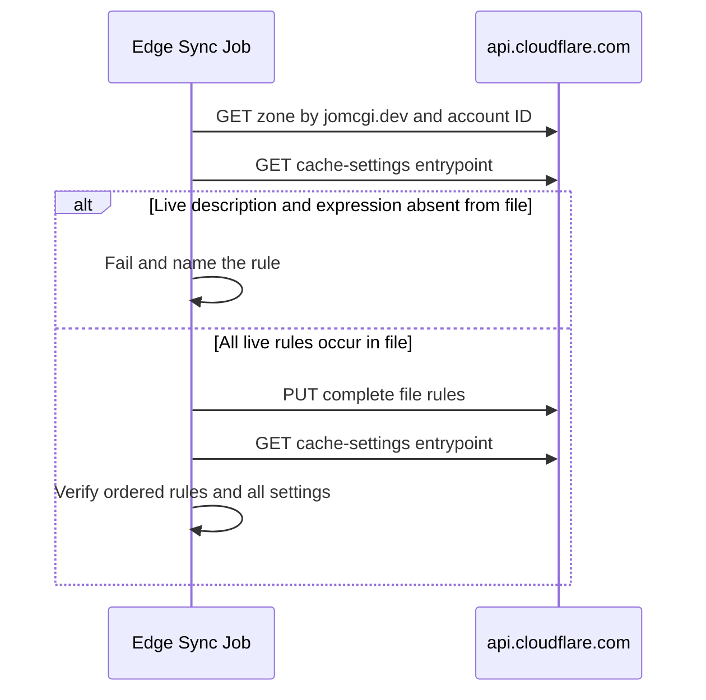

# jomcgi.dev site

The public jomcgi.dev site as static files on Cloudflare (HOME-174). An
assets-only Worker serves the pages, so no script runs for any request.
Serving costs nothing, a crawler cannot cause per-request charges, and no
public request reaches a cluster. Sections move here one path at a time.

```
web/ (Astryx pages) ──vite──► dist ─┐
wrangler/ (pinned CLI) ─────────────┼─► image ─► Argo CD Sync hook Job ─► wrangler deploy --env <stage>
wrangler.jsonc ─────────────────────┘
  dev  → Worker jomcgi-site-dev on next.jomcgi.dev
  prod → Worker jomcgi-site on the jomcgi.dev routes in wrangler.jsonc
```

## Layout

| Path | What |
| --- | --- |
| `web/` | The Astryx app: one HTML entry per page, the nav and section list in `src/sections.ts`, hosting headers in `public/_headers`. |
| `wrangler.jsonc` | The Worker, its assets and each stage's routes. |
| `wrangler/` | The pinned `wrangler` CLI, packaged as image layers by rules_js. |
| `edge/` | The zone's complete cache-settings rules, their Node apply launcher and tests. |
| `apko.yaml` | The deploy image: bash and busybox for the rules_js launcher, CA roots, and Node's C++ runtime. |
| `chart/` | The deploy and edge Jobs (factory Helm library), their 1Password items and their only egress, `api.cloudflare.com:443`. |
| `deploy/` | The dev stage's Argo CD Application. |

## Contracts

- **URLs.** A section has one top-level prefix (`/hikes`). It stays linked to
  its current jomcgi.dev page until it goes live here. Setting `live: true` in
  `src/sections.ts` and adding the prefix to the prod `routes` in
  `wrangler.jsonc` moves it. Removing the route rolls it back.
- **Caching.** `/assets/*` files are named by content hash and cached forever.
  A deploy serves new files at once, so routine releases need no cache purge.
- **Performance.** Each page's initial JavaScript must stay under 150 KiB
  gzipped. `budget.mjs` measures it, `:budget_test` runs it on the build, and
  a unit test proves it fails an over-budget page.
- **Accessibility.** Pages have no axe violations in happy-dom, and the colour
  tokens in `src/palette.css` meet WCAG contrast in light and dark modes.
  Colour contrast on real CSS is checked in a browser after deploy (HOME-174).

## Build and test

From `web/`: `pnpm build`, `pnpm test`, `pnpm typecheck`, `pnpm budget`.
Bazel runs the same checks: `bb remote test //projects/jomcgi-site/...`.
From the repository root, `node --test projects/jomcgi-site/edge/apply.test.mjs`
checks the edge apply against a local HTTP fixture. Bazel runs it as
`//projects/jomcgi-site/edge:apply_test`.

## Deploy

CI publishes the image and chart on merge. A sync of the stage's Application
runs the deploy Job and, when `edge.apply` is true, the edge Job as Sync hooks.
Argo CD does not diff hooks, so the `jomcgi-site-release` ConfigMap carries
the chart version, image digest, stage and edge settings. Each new chart or
image, including a Job-only change, or changed edge setting makes the
Application OutOfSync and syncs it again.
Either Job failing fails the sync.

The dev Application is listed in
`projects/platform-factory/kustomization.yaml`. Its Job reads 1Password item
`vaults/k8s-homelab/items/jomcgi-site-cloudflare` (fields `api-token` and
`account-id`; permissions are listed in HOME-178). The token allows calls
from the home network only, and pods reach Cloudflare over IPv4. Kargo
takes over the stage pins when HOME-116 slice 2 lands.

`public/robots.txt` lets crawlers fetch every page, so they can read each
page's indexing rules. `public/_headers` sends `X-Robots-Tag: noindex` for
the preview host only.

## Zone cache rules

`edge/cache-settings.json` owns the complete `http_request_cache_settings`
entrypoint for `jomcgi.dev` (HOME-192). The imported Monolith rule is unchanged.
The `data.jomcgi.dev` rule enables caching and stale serving, and respects
origin edge and browser TTLs. The publisher sets `Cache-Control` to
`public, max-age=60` for `latest.json` and
`public, max-age=31536000, immutable` for hashed files.



The Job ignores only Cloudflare's rule IDs, refs, versions and timestamps
during verification. API failures, malformed responses and readback differences
fail the Job. A dashboard-only rule must be imported and reviewed before sync.
The apply sends one PUT per run, with the same body on each repeat.

`edge.apply` defaults to false. Only `deploy/application.yaml` enables it for
dev. Zone rules are shared by all stages. When prod exists, move the setting
from dev to prod in the same change. The Job reads the zone and cache-settings
entrypoint and writes only that entrypoint, using the existing token and account
fields. It requires zone read access as well as cache-settings read/write access.
It makes IPv4 HTTPS requests only to `api.cloudflare.com`.

Rate limits and cache-key changes are outside this configuration. Redirects
remain in `web/public/_redirects`.
