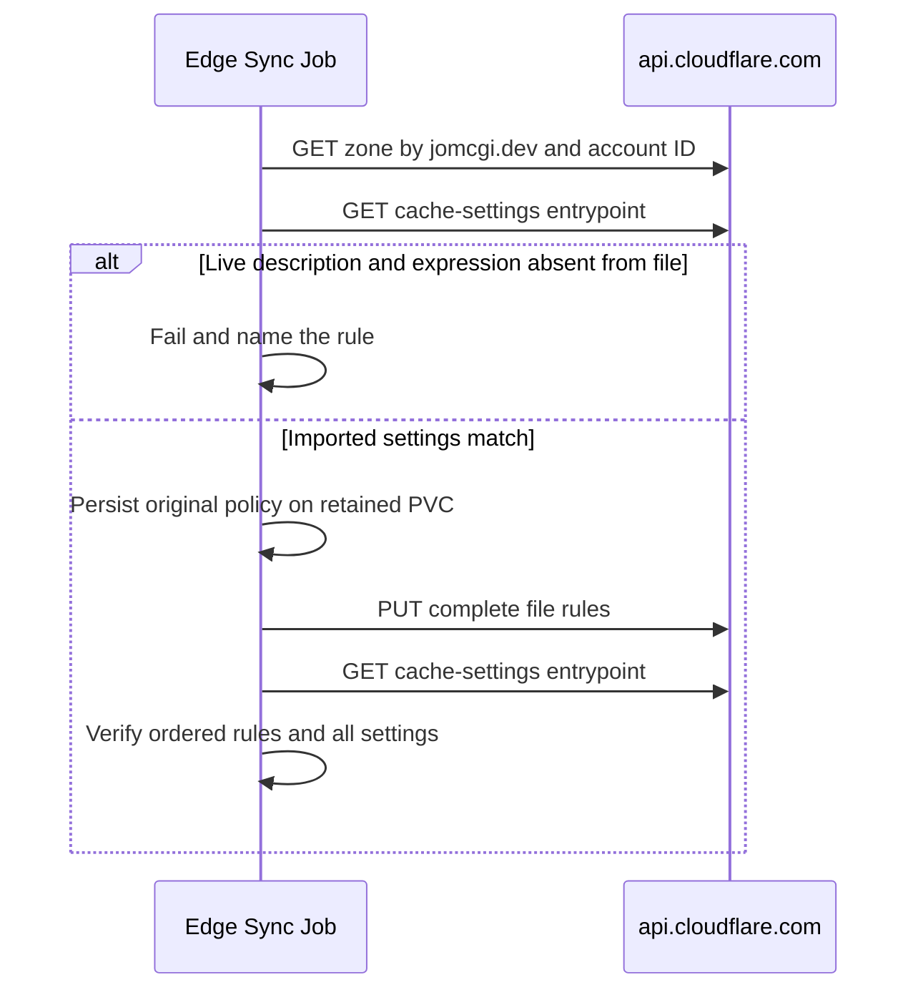

# jomcgi.dev site

The public jomcgi.dev site as static files on Cloudflare (HOME-174). An
assets-only Worker serves the pages, so no script runs for any request.
Serving costs nothing, a crawler cannot cause per-request charges, and no
public request reaches a cluster. Sections move here one path at a time.

```
web/ (Astryx pages) ──vite──► dist ─┐
wrangler/ (pinned CLI) ─────────────┼─► image ─► Argo CD Sync hook Job ─► wrangler deploy --env <stage>
wrangler.jsonc ─────────────────────┘
  dev  → Worker jomcgi-site-dev on next.jomcgi.dev
  prod → Worker jomcgi-site on the jomcgi.dev routes in wrangler.jsonc
```

## Layout

| Path | What |
| --- | --- |
| `web/` | The Astryx app: one HTML entry per page, the nav and section list in `src/sections.ts`, hosting headers in `public/_headers`. |
| `wrangler.jsonc` | The Worker, its assets and each stage's routes. |
| `wrangler/` | The pinned `wrangler` CLI, packaged as image layers by rules_js. |
| `edge/` | The zone's complete cache-settings rules, their Node apply launcher and tests. |
| `apko.yaml` | The deploy image: bash and busybox for the rules_js launcher, CA roots, and Node's C++ runtime. |
| `chart/` | The deploy and edge Jobs, retained cache recovery, their 1Password items and API-only egress. |
| `deploy/` | The dev stage's Argo CD Application. |

## Contracts

- **URLs.** A section has one top-level prefix (`/hikes`). It stays linked to
  its current jomcgi.dev page until it goes live here. Setting `live: true` in
  `src/sections.ts` and adding the prefix to the prod `routes` in
  `wrangler.jsonc` moves it. Removing the route rolls it back.
- **Caching.** `/assets/*` files are named by content hash and cached forever.
  A deploy serves new files at once, so routine releases need no cache purge.
- **Performance.** Each page's initial JavaScript must stay under 150 KiB
  gzipped. `budget.mjs` measures it, `:budget_test` runs it on the build, and
  a unit test proves it fails an over-budget page.
- **Accessibility.** Pages have no axe violations in happy-dom, and the colour
  tokens in `src/palette.css` meet WCAG contrast in light and dark modes.
  Colour contrast on real CSS is checked in a browser after deploy (HOME-174).

## Build and test

From `web/`: `pnpm build`, `pnpm test`, `pnpm typecheck`, `pnpm budget`.
Bazel runs the same checks: `bb remote test //projects/jomcgi-site/...`.
From the repository root, `node --test projects/jomcgi-site/edge/apply.test.mjs`
checks the edge apply against a local HTTP fixture. Bazel runs it as
`//projects/jomcgi-site/edge:apply_test`.

## Deploy

CI publishes the image and chart on merge. A sync of the stage's Application
runs the deploy Job and, when `edge.apply` is true, the edge Job as Sync hooks.
Argo CD does not diff hooks, so the `jomcgi-site-release` ConfigMap carries
the chart version, image digest, stage and edge settings. Each new chart or
image, including a Job-only change, or changed edge setting makes the
Application OutOfSync and syncs it again.
Either Job failing fails the sync.

The dev Application is listed in
`projects/platform-factory/kustomization.yaml`. Its Job reads 1Password item
`vaults/k8s-homelab/items/jomcgi-site-cloudflare` (fields `api-token` and
`account-id`; permissions are listed in HOME-178). The token allows calls
from the home network only, and pods reach Cloudflare over IPv4. Kargo
takes over the stage pins when HOME-116 slice 2 lands.

`public/robots.txt` lets crawlers fetch every page, so they can read each
page's indexing rules. `public/_headers` sends `X-Robots-Tag: noindex` for
the preview host only.

## Zone cache rules

`edge/cache-settings.json` owns the complete `http_request_cache_settings`
entrypoint for `jomcgi.dev` (HOME-192). The imported Monolith rule is unchanged.
The `data.jomcgi.dev` rule enables caching and stale serving, and respects
origin edge and browser TTLs. The publisher sets `Cache-Control` to
`public, max-age=60` for `latest.json` and
`public, max-age=31536000, immutable` for hashed files.



Before PUT, the Job checks the imported Monolith settings and position against
the [supplied baseline](edge/imported/README.md). Drift stops the Job instead of
changing Monolith. The Job saves the actual prior ordered cache policy on a
retained PVC before writing. If a matching data rule already exists, the
snapshot preserves its settings. Repeated applies keep that original snapshot.
A failed snapshot write stops the Job before PUT.

Verification checks rule order and all cache settings. It ignores Cloudflare
rule IDs, refs, versions and timestamps. No custom Cloudflare reference is sent
or used as evidence of ownership. API failures, malformed responses and readback
differences fail the Job. A dashboard-only rule must be imported and reviewed
before sync. Each apply sends one PUT with the same body on each repeat.

`edge.apply` defaults to false. Only `deploy/application.yaml` enables it for
dev. Zone rules are shared by all stages. The Job reads the zone and entrypoint
using the existing token and account fields. It needs zone read access and
cache-settings read/write access. All requests use IPv4 HTTPS to
`api.cloudflare.com`.

## Automatic downgrade recovery

The chart retains three resources when a downgrade or revert removes edge
support: the snapshot PVC, the recovery CronJob and their Cilium network policy.
They have `Prune=false,Delete=false` and Helm keep annotations. The CronJob uses
the same digest-pinned site image and existing Cloudflare Secret.

```mermaid
sequenceDiagram
  participant Argo as Argo CD
  participant Recovery as Retained recovery CronJob
  participant PVC as Retained snapshot
  participant CF as api.cloudflare.com
  Argo->>Argo: Sync old chart; edgeApply key disappears
  Recovery->>Recovery: Read projected release marker each minute
  Recovery->>PVC: Read original and last applied policies
  Recovery->>CF: GET live entrypoint
  alt Live matches last applied policy
    Recovery->>CF: PUT original policy and GET to verify
    Recovery->>PVC: Mark recovery complete
  else Live already matches original
    Recovery->>PVC: Mark recovery complete
  else Live has other changes
    Recovery->>Recovery: Fail without PUT
  end
```

The release ConfigMap is not retained. Its missing `edgeApply` key, or a value
of `false`, triggers recovery. A value of `true` makes recovery exit without
contacting Cloudflare. The projected ConfigMap needs no Kubernetes API client,
service-account token or API egress. The marker syncs before either edge pod.

The `standard-rwo` CSI volume uses `ReadWriteOncePod`, so only one apply or
recovery pod can mount it, including on the same node. The snapshot writer
flushes a temporary file, renames it atomically, then flushes the directory.
The backup survives a killed Job. Recovery is retried each minute; after a
successful rollback it records completion and stops writing. Allow for pod
scheduling and disk attachment time after a downgrade.

An explicit `edge.mode: restore` also restores this snapshot. It does not use
the issue import as a substitute for the actual prior policy. A pre-existing
data rule is restored rather than deleted. Unknown rules, changed settings or
a different order stop restoration. It does not purge cached objects.

Keep the PVC and recovery resources until rollback has completed. Namespace
or storage deletion is not a chart downgrade and destroys the recovery path.
Before moving ownership to prod, disable dev and verify its recovery completes;
then enable prod. Do not enable both stages together.

## Writer coordination

The PVC serializes site apply and recovery pods. It does not lock dashboard
writers. Pause automated syncs and wait for any edge Job to finish before
editing the dashboard. Import dashboard changes before resuming syncs.

The Cloudflare generated [entrypoint update contract](https://github.com/cloudflare/cloudflare-typescript/blob/0eb9ef0ea40c1fe38e4b19be92f41bd7466bc1d6/src/resources/rulesets/phases/phases.ts#L9323)
exposes no expected-version parameter. The GET/PUT sequence does not provide
an atomic concurrency check. A dashboard write between them can be overwritten;
writer coordination remains an operational requirement, not an enforced lock.

Rate limits and cache-key changes are outside this configuration. Redirects
remain in `web/public/_redirects`.
