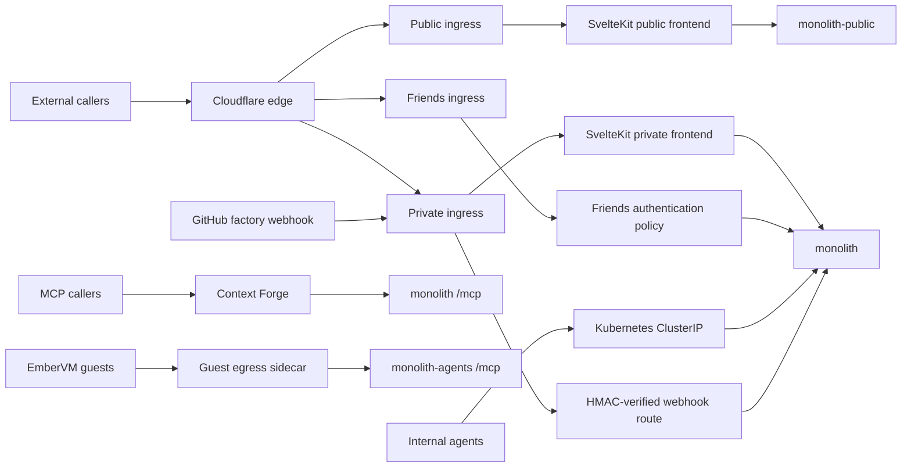

# Monolith Architecture

Factory ownership is consolidated under `factory.module` within this application.
The factory owns private interactions/MCP, its published public viewer, and the
orchestration/session execution lifecycle. Its public descriptor is composed
separately from private mutation and execution hooks. Execution and orchestration
implementations live in `factory.execution` and `factory.orchestration`. Legacy
`swarm` and `agent_sessions` modules only retain persisted exception names and
the existing Discord thread adapter. SQL schemas and DBOS workflow names keep
their deployed identities. The workflow source fingerprint normalizes only the
relocated import module names, preserving active workflow recovery across this
package move.
The public reader ships `factory.public_view` and excludes the entire
private execution and orchestration packages. It reads only published public API
views and snapshots with the existing restricted database role.
The private board and snapshot publisher live in `factory.private_view` and
`factory.publication`. Factory bearer controls and MCP status tools share the
standing human operator rule in `factory.access`; browser decisions retain the
verified gateway email gate in that same module. None of these private modules
ship in the public image. Factory MCP interactions, including the voice
companion, require the operator group. The earlier anonymous companion
exception is retired; anonymous catalogue discovery remains available to the
gateway, while anonymous tool calls are denied.

Intake stages per-sweep issue observations in the existing audit store and
finalizes them after locked receipt admission. The aggregate sweep audit ID is
the observation identity. Candidate audit insertion and a latest private
inventory snapshot commit together under the singleton factory lock. Readers
load that snapshot and current indexed work-item/receipt state; they do not scan
candidate audit history. A full lane still runs observation at the existing
sweep cadence. Public snapshot publication disables the private backlog reader.

**Why.** Receipt creation only queues work. Separating observation from its
finalization records actual admission without rewriting append-only history.
The snapshot preserves the latest observation per issue across partial sweeps,
with its original timestamp and explicit coverage. This adds no scheduler,
admission authority or public database grants (Refs #7459).

The existing private `factory-public-snapshot` job also fetches broker quota
before opening its database session. `factory.publication.shape_quota` adds an
allowlisted `quota` object to the board JSON: provider, window duration, account
counts, mean usage, mean time remaining, reset range and observation age. Grant
names, account identifiers and credentials never enter the published object.
The public reader continues to serve the snapshot without broker access.

**Why.** Subscription capacities are unknown, so the overview labels usage as an
equal-account mean. Per-account reports take precedence over provider rollups;
provider-only reports expose unknown account coverage. Windows group by reported
duration, since Codex's `primary` label can describe a week. Expired or invalid
reports cannot become zero usage. Incomplete coverage and reports older than
15 minutes retain their measured usage without a fresh pace comparison. The
browser refreshes the board every minute and hides the current aggregate after
its first account reset until a new snapshot arrives. The same board JSON keeps
eight days of bounded observations for a quota-remaining graph, with a steady
consumption baseline calculated from the matching reset clocks. History begins
with collected observations and breaks across missing evidence and reset cycles.
It preserves provider-only observations with their coverage label. This extends
the existing publication contract without another database table or scheduled
job (Refs #6998).
Broker pacing adds advisory state counts without account identities. Complete,
fresh reports with the same longest budget duration expose an equal-account
mean of remaining percentage points per day. A short-window burst does not
imply weekly overspend; an exhausted short window still blocks that account.
Mixed account states remain visible in the headline. Short resets retain the
provider-reported timestamp range across accounts. Limited accounts expose their
actual binding reset range separately; an unknown binding reset stays unknown.
No later reset cycles are projected. Daily pacing is labelled as a recommendation. Unknown duration blocks reassuring guidance,
while a known fast weekly budget can still advise conservation. The browser
expires this advice at the earliest reset or when observations age past 15
minutes. Older broker snapshots retain measured usage without invented guidance.
These fields do not change admission, dispatch, routing or paid API authority
(Refs #7122).
Broker failure leaves quota unavailable while the rest of the board publishes.
The cron job respects the broker's SPIFFE mode; missing workload credentials in
that mode fail closed without an HTTP fallback.

Routine-job reconciliation uses the narrow existing contracts in `factory.api`.
The domain boundary test checks factory internals
and requires its dependencies on other domains to pass through their APIs.
Discord integration is outside this consolidation.
(see: /projects/monolith/factory/module.py)
(see: /projects/monolith/factory/public_module.py)

The monolith is the FastAPI and SvelteKit application suite for the knowledge
graph, conversational agents, isolated agent sessions, and small public data
products. It is deployed as separate private, public, and agent compositions
over a shared Postgres data plane, with a separately gated friends surface.
Production serves from the GKE hub since the September 2026 cutover; the home
cluster deployment is dormant.
(see: /projects/monolith/app/main.py)
(see: /projects/monolith/app/main_public.py)
(see: /projects/monolith/app/agents_main.py)
(see: /projects/gke-apps/monolith/application.yaml)

Current as of 7b90da040 (2026-09-18)

## 1. What it is and request paths

The backend is a FastAPI application assembled from domain modules, while the
browser application is SvelteKit. Together they host the knowledge graph,
Discord agent, agent console, Grimoire, and public applications.
(see: /projects/monolith/framework/core.py)
(see: /projects/monolith/frontend/src/routes)

The deployed service has three audience tiers, plus the agents tier of sections
2 and 7: the private monolith carries the full route and MCP surface, the public
deployment is a pruned composition on a read-only database role with a
separately scoped writer for Grimoire chat, and the friends tier
exposes only the moving planner, its browser API, and the SvelteKit bundle. The
friends hostname has no Cloudflare Access application in front of it, only an
authentik `SecurityPolicy` that is a separate object from its route, so verify
the deny path against the live URL with the checklist kept beside the
`cfIngress.friends` values rather than trusting the manifest.
(see: /projects/monolith/app/modules_private.py)
(see: /projects/monolith/app/modules_public.py)
(see: /projects/monolith/deploy/values.yaml)
(see: /projects/monolith/chart/templates/httproute-friends.yaml)

The public and private ingress split, the friends policy, and the internal
service ports are rendered by the Helm chart. The GitHub factory webhook route
on the private hostname carries no `SecurityPolicy` on purpose: it reaches the
backend through a Cloudflare Access IP bypass and is authenticated by the
handler's HMAC verification alone, which is why it lives on its own HTTPRoute
rather than as a rule on the private one.
(see: /projects/monolith/chart/templates/httproute-private.yaml)
(see: /projects/monolith/chart/templates/service.yaml)
(see: /projects/mcp/ARCHITECTURE.md)

The inert Cilium policy templates were removed in #5816. The hub has no
Cilium policy CRDs, and removing those templates adds no enforcement. Public
and private network-policy successors remain #5276 and #5277. The chart retains a
native Kubernetes
`NetworkPolicy` for the same app endpoint. Its overlay leaves that template
disabled because Kubernetes NetworkPolicy has no additive audit mode. The API
and resolver address lists also stay empty until GKE network-policy logs cover
a representative live window, including periodic leader jobs and the
secret-backed ICAL feed. An enabling change must validate both addresses from
the live hub. Until then, the hub has no private-monolith egress enforcement.

When enabled, exact pod selectors and ports admit internal dependencies. The
resolver pod selector is paired with its validated service address so policy
does not depend on the dataplane's service-translation order. A public TCP 443
rule excludes cluster-addressable, loopback, link-local, shared-address, and
multicast ranges. Native policy cannot select FQDNs, so arbitrary public HTTPS
remains an accepted residual.

The native egress policy intentionally selects only the private app endpoint, not every
pod rendered into the namespace. Searxng, CNPG, Atlas migration jobs,
and batch pods in `monolith-workflows` keep their existing egress behavior.
They have distinct service accounts, credentials, and execution roles, and
folding them into one policy would replace destination-specific review with a
namespace-wide union of every workload's privileges. Add a separate policy
when one of those boundaries needs default-deny.
(see: /projects/monolith/chart/templates/networkpolicy-egress.yaml)
(see: /projects/monolith/deploy/values-gke.yaml)

**Why.** The anonymous SSR surface once shared a pod, backend, database role,
and full secret set with the private application, so an ingress mistake or
public-process compromise crossed every boundary at once (ADR security/004).
A feature-flagged full application and a replica without scoped grants were
rejected because both retain that escalation path. Separate compositions,
database identities, and fixed audience routes make private exposure the
default, accepting another deployment and several policy bindings to operate
(ADR networking/002, ADR services/010).

## 2. Modular framework

`framework/core.py` defines the registry contract through `Tier`, `Profile`,
`Module`, and `build_app`. A profile selects public or private behavior and
controls MCP, telemetry, static frontend, deep health, and leader singleton
wiring. Each domain exports a `Module` and contributes private routes, public
routes, MCP registration, startup work, leader hooks, or health checks.
Registration uses module hooks, while MCP tools themselves use FastMCP
decorators.
(see: /projects/monolith/framework/core.py)
(see: /projects/monolith/app/modules_private.py)
(see: /projects/monolith/core/mcp_app.py)

Cross-domain imports must enter another domain through its `api` module. The
boundary test parses every non-test Python file in its explicit domain set and
reports internal imports, with no standing exceptions. Its Bazel target carries
the selected sources as runfiles and an independently generated manifest, then
requires exact, nonempty coverage before checking imports. The set is explicit
because not every top-level package is currently classified as an architecture
domain; adding one is an architecture decision rather than a test-side guess.

The retired `app/architecture_test.py` encoded two older conventions that are
not current contracts. Domain composition now uses `Module` descriptors rather
than requiring every package `__init__.py` to expose `register(app)`. Route
ownership is expressed by each descriptor's registration hooks, and routes may
intentionally use `/api`, `/internal`, or `/webhooks` namespaces, so there is no
blanket `/api/{domain}` prefix rule. Router ownership and any narrower prefix
rules remain separate, domain-specific review concerns.
(see: /projects/monolith/import_boundaries_test.py)
(see: /projects/monolith/BUILD)

The public profile registers only `register_public` hooks and has no private
lifespan, MCP mount, telemetry setup, or static frontend mount. The public
binary also prunes private domains and private write paths from its file set,
and a subprocess test checks that forbidden modules never enter its import
closure.
(see: /projects/monolith/BUILD)
(see: /projects/monolith/app/main_public_imports_test.py)

The agents tier is a third composition with no registry at all. Its entrypoint
builds a Starlette app that serves an explicit ten-tool catalogue over
stateless MCP plus one health route, behind identity middleware that rejects
anonymous callers. The binary is pruned by source glob, and an import test
proves the private domains never enter its closure.
(see: /projects/monolith/app/agents_main.py)
(see: /projects/monolith/app/main_agents_imports_test.py)

**Why.** Domain boundaries originally existed only by convention, allowing
internal imports and composition glue to spread while public and private
entrypoints risked drifting (ADR platform/008, ADR services/010). Independent
services and databases per domain were rejected as disproportionate, and a
base-class or dependency-injection framework was rejected because it would
couple every domain to more machinery. Plain module descriptors, one
`build_app`, endpoint-shaped `api.py` seams, and an AST boundary test preserve
one deployable system while making future extraction and review explicit. The
agents tier applies the same rule to guests: a pruned binary with its own
database identity, rather than an MCP sidecar inside the private pod, bounds
what an agent can write by a grant set and a source glob instead of by trust
in the guest.

## 3. Data

One CloudNativePG cluster holds the monolith data. Production sets two
instances, which gives one primary and one streaming hot standby for
availability and read traffic. The hub's cluster was bootstrapped by recovery
from the home cluster's Barman archive in Google Cloud Storage and keeps
archiving there under its own server name, so the two archives never share a
prefix. Daily base backups plus continuous WAL archiving keep fourteen days.
(see: /projects/monolith/deploy/values-gke.yaml)
(see: /projects/monolith/chart/templates/cnpg-cluster.yaml)
(see: /projects/monolith/deploy/cnpg-gcs-backup-secret.md)

Atlas owns schema migration from the SQL files in `chart/migrations`. The
database is divided into domain schemas including `knowledge`, `chat`,
`agent_sessions`, `claude_agent`, `grimoire`, `ships`, `stars`, `trips`,
`campsites`, and `swarm`. The migration bundle is rendered into a ConfigMap for
Atlas, and bulk seed data is kept out of it because client-side apply records
the manifest in an annotation with a 256 KiB ceiling.

Historical migrations still define the retired private demo load tables, the
Semgrep scan-performance tables, and the Semgrep exhibit savings counter. Their
application writers and readers are gone,
but the tables remain because removing them would delete production schema and
data. Any later cleanup requires a separately authorized migration and retention
decision.
(see: /projects/monolith/chart/templates/atlas-migration.yaml)
(see: /projects/monolith/chart/templates/migrations-configmap.yaml)
(see: /bazel/tools/hooks/check-large-migration-sql.sh)

Application sessions use a cached SQLModel engine configured for psycopg, and
domain code opens bounded session contexts around database work. Knowledge
chunks store 1,024-dimensional pgvector embeddings under a cosine HNSW index,
and the knowledge store ranks semantic matches before hydrating note and graph
context.
(see: /projects/monolith/core/db.py)
(see: /projects/monolith/chart/migrations/20260408000000_knowledge_schema.sql)
(see: /projects/monolith/knowledge/store.py)

The public read role receives explicit schema and object grants, including
definer's-rights views (deliberately not `security_invoker`) that expose only
public knowledge rows. The public write role has DML only on the bounded public
chat schemas and specific demo latch tables. The agents tier connects as
`agents_writer`, whose grant set is read across `knowledge` plus insert on four
tables, plus SELECT on `agent_view.cluster_snapshot`, and nothing at all on
the private application schemas. Each of these
roles takes its password from an out-of-band basic-auth Secret because the
1Password operator cannot emit the Secret type CNPG requires.
(see: /projects/monolith/chart/migrations/20260617000000_public_reader_role.sql)
(see: /projects/monolith/chart/migrations/20260904180000_agents_writer_role.sql)
(see: /projects/monolith/chat_public_grants_test.py)
(see: /projects/monolith/deploy/agents-writer-secret.md)

The home overlay's nightly logical refresh into a development database was
retired with the home-cluster configuration (#6914); the hub has no
development database to refresh.

**Why.** Keeping Obsidian and Postgres as writable peers created synchronization,
conflict, and recovery questions, while a filesystem mount inside every replica
expanded the serving path and security surface (ADR platform/006). Postgres was
chosen as the body of record and as Grimoire's hot tier so transactions,
pgvector, grants, and backups share one operational substrate rather than adding
a service or datastore per domain (ADR services/011, ADR services/012). Schemas,
roles, and definer's-rights views provide the isolation; the physical standby is
accepted for availability and load isolation, not confidentiality (ADR
security/004).

## 4. Agents

[FACTORY.md](factory/orchestration/FACTORY.md) is the factory design document.
This section records monolith ownership, trust boundaries, acceptance and rationale.
The Conductor owns operator-facing coordination, the policy-pinned Planner proposes
the task graph, and the Executor dispatches admitted nodes. Role names grant no authority.

### Ownership and trust

Factory owns orchestration, session execution, recovery and private projections.
Postgres owns durable records, EmberVM owns isolated execution and physical cessation,
DBOS owns bounded workflow recovery, and Argo owns batch cadence. Mutable graph
reconciliation stays outside durable replay. Shared authentication establishes identity;
factory controls require a standing human in `operators`. Browser decisions instead
require the single Envoy-projected `X-Auth-Email`, optionally narrowed by
`FACTORY_OPERATOR_EMAILS`. A caller-supplied Cloudflare email header grants nothing.

The private MCP surface includes receipt status/detail/context, submission, decisions,
controls and exact recovery operations; [factory MCP](factory/MCP.md) records their
contracts. Execution MCP includes session start/send/status/detail and legacy swarm
decisions. These surfaces do not share a blanket per-record authorization guarantee:
task tools and session reads/mutations retain caller-scoping gaps, alongside note
lookup and turn-detail reads. These are examples, not an exhaustive gap inventory.
Section 7's surface matrix remains the authentication and result-access reference.
The pruned agents tier lacks verified delegated task identity; planner preview
binding fails closed even with its flag enabled. Public composition uses published,
read-only projections and the restricted public database role.
See [domain ownership](factory/orchestration/FACTORY.md#domain-ownership) and
[planner preview](factory/orchestration/FACTORY.md#planner-preview).

### Owned records

Schema and durable workflow identities survive the package consolidation.
The model definitions are [orchestration records](factory/orchestration/factory_models.py),
[graph records](factory/orchestration/models.py) and [session records](factory/execution/models.py).

| Store | Owned records |
| --- | --- |
| `swarm` | `factory_control`, `factory_receipt`, `factory_start`, `factory_audit`, `factory_planner_preview` |
| `swarm` | `work_item`, `work_item_edge`, `work_item_event`, `factory_webhook_delivery`, `factory_github_issue_state`, `factory_class_tier`, `factory_review_verdict` (retained historical routing/review records) |
| `swarm` | `swarm_task`, `swarm_plan_version`, `swarm_plan_node`, `swarm_node_run`, `swarm_conductor_call`, `swarm_decision` |
| `agent_sessions` | `agent_sessions`, `agent_turns`, `pending_messages`, `capacity_pool`, `capacity_reservations`, `probe_observations`, `result_receipts`, `reservation_reviews`, `voice_ui_companions`, `voice_ui_ledger` |
| `claude_agent.routine_jobs` | Existing drainer queue and leases |
| `scheduler.scheduled_jobs` | Retained list/get and legacy run-now compatibility; table retirement needs separate scope |

Session records retain model selection, workflow ownership and EmberVM lineage.
Factory receipts retain issue/branch ownership while paused or landing-held.
See [authoritative records](factory/orchestration/FACTORY.md#authoritative-records-and-context)
and [cadence ownership](factory/orchestration/FACTORY.md#cadence-and-singleton-ownership).

**Why.** Work item pointer comments link each GitHub-sourced work item to its
durable factory record. They exist only for display and reference and are never
read back, so issue-side changes cannot steer factory state through them.

### Funding consolidation

**Why.** The eight funding, judgement, reservation, watchdog, continuation,
allocation and metering modules answered overlapping policy questions (#7454).
Task grants, exact-artifact continuations, reservation verdicts and opt-in meter
outcomes now share `factory_funding.decide`; its judge call is a bounded step.
The existing adapters retain authentication, exact-dispatch revalidation, stop
ownership, unknown-outcome charges and lease deadlines. Historical operator
holds remain binding. Unresolved attempts wait for their existing owner, legacy
dollar-threshold audits rearm from the current turn count, and an unresolved
funding escalation or budget proposal cannot request a second judge. See [Funding](factory/orchestration/FACTORY.md#funding).

**Why.** Canonical `funding_*` audit events commit with marked legacy projections
so old binaries still enforce continuation leases and meter trips on rollback.
Current readers select canonical and unmarked historical rows, excluding those
projections to avoid duplicate bindings and charges. Historical rows are never
rewritten and no schema migration is required. PostgreSQL policy-row tests share
meaningful assertions; source/test reductions are measurements under the revised
acceptance, not numeric gates. Required CI and independent exact-head review
remain mandatory. Rollback is reverting the PR.

**Why.** `FACTORY_CONDUCTOR_FUNDING_ENABLED` stages judge-reviewed funding.
`FACTORY_MERIT_JUDGE_ENABLED` adds criteria and server-read evidence to the same
judge path, and doubt steers to an operator card under a pinned turn ceiling.
`FACTORY_RESERVATION_REVIEW_ENABLED` reviews the running invocation's lease. Two
continuation contracts remain: the legacy final correction pair behind
`FACTORY_AUTONOMOUS_CONTINUATION_ENABLED`, which cannot renew itself, and an
operator two-hour lease for one paused recovered task. The switch contract is in
[Funding](factory/orchestration/FACTORY.md#funding).

### Factory acceptance

Repository delivery and operational acceptance are separate. These rows move from
section 11 unchanged, including their owners, holds and unresolved live checks.
The linked issues own current acceptance; a closed repository issue alone proves no rollout.
See [live-check handoff](factory/orchestration/FACTORY.md#handing-off-live-checks).

| Direction | Decided in | Tracks | State |
| --- | --- | --- | --- |
| Escalation cards survive the factory's own gate writes, declined landing recovery is named, and optimizer verdicts are final once the window ends and its attempts settle | section 4; evidence on the issue | #7495 | repository delivery; 72-hour before and after counts remain on the issue |
| Per-sweep intake decisions, private backlog age and digest evidence | section 4; repository-only Conductor rescope | #7459 | staged repository delivery; rollout, first-sweep distribution and credential-backed follow-up remain on the issue |
| One funding decision owns continuation, steering and stop while accounting retains reservations and unknown outcomes | Funding consolidation; repository acceptance in #7454 | #7454 | policy tests consolidated, task grant, progress and continuation decisions unified, allocation recovery folded into funding, shadow and reservation dollar-ceiling paths retired; reservation and meter decisions share the funding resolver; canonical funding audits retain rollback projections; reduction percentages are measurements |
| Optional queue-driven inventory refill, default-off with durable advisory execution and bounded issue publication | section 4, recorded Conductor rescope and cap decision | #7376 | repository-only; operational checklist remains on the issue; no shipped policy enablement |
| Admit agent-ready security findings under existing ownership and eligibility fences | Joe's 2026-10-28 decision, section 4 | [#7372](https://github.com/jomcgi-org/homelab/issues/7372) | repository-only staged delivery; guarded migration, rollout and natural-sweep acceptance remain |
| Automatic pauses retain actionable questions and audit superseded cards | The factory conductor | #7165 | repository-only staged delivery under an unmerged landing hold; historical pause attribution and post-rollout checks remain |
| Release execution capacity for quiescent paused or landing-held tasks while retaining ownership and durable authorized resume intent | section 4; Joe's 2026-10-18 decision | #7163 | repository implementation staged; separately authorized rollout and live capacity, ownership and reacquisition checks remain |
| Sol-first planner implementation follows pool routing and role effort, with structured complex-work overrides | The factory conductor, implementation admission | #6992 | admission fix staged; merge and deployment held for operator confirmation |
| Restore Astra planning and refinement, retain Sol routine implementation and Opus independent review | #6983, factory model pools | #6983 | follow-up migration staged for the already-allowed Astra policy; rollout and live Astra planner observation remain |
| The human issue label excludes both factory lanes and durably hands admitted work off after normal attempt accounting | The factory conductor, human ownership | #6781 | implemented in repository; rollout pending |
| Factory outcomes use mature delivery predicates, complete attempt accounting, and task-class/role/model cohorts with explicit unknown evidence | section 4, recorded Conductor rescope | #6716 | repository report staged for manual read-only invocation; standby accounting, CI, revert, metadata, and query-cost checks remain |
| One operator-facing Conductor above every per-task Planner selects and coordinates work, acting on Joe's behalf | The factory conductor | #5784 (open child #5788) | roles (#5785) and staged MCP mutation enforcement (#5789) delivered; #5786, #5787 and #5804 closed not planned; continuity enablement is #6561 |
| One factory conversation spans web, Discord, and voice for the same conductor | The factory conductor | #5788 | not started |
| Execution profiles (implement, investigate, debug, research) become policy dimensions beside difficulty and risk | The factory conductor | #5784 | not started; conductor and planner on Astra since generation 11 |
| Trusted `factory/dependency-evidence` gate with App-pinned identity, exact-head assessments and invalidation | PR #6806, staged rollout | [#6799](https://github.com/jomcgi-org/homelab/issues/6799) | repository-only; 7-item live checklist on [the issue](https://github.com/jomcgi-org/homelab/issues/6799#issuecomment-6545691566); #7186 owns the Renovate switches and schedule activation |
| Post-guest proof settles bound zero-turn attempts with read-only live evidence per item | The factory conductor, staged flag | [#6559](https://github.com/jomcgi-org/homelab/issues/6559) | repository delivery merged, default-off; 6-item live validation plus runbook detail on [the issue](https://github.com/jomcgi-org/homelab/issues/6559#issuecomment-6545695108) |
| Trusted `factory/review` check publisher with session-distinct approval and dedicated token | PR #6213 | [#3835](https://github.com/jomcgi-org/homelab/issues/3835) | repository-only; 4-item activation checklist on [the issue](https://github.com/jomcgi-org/homelab/issues/3835#issuecomment-6545692966) |
| Fail-closed push-format validation for source guests, staged repository-only | The factory conductor, staged flag | [#7458](https://github.com/jomcgi-org/homelab/issues/7458) | repository-only; PR #7473 merged 2026-10-31; hypothesis, 14-day window and stop conditions on the issue; trial pending |

### Intake and planning rationale

**Why.** The intake queue's filtered count keeps optional refill aligned with
ownership, dependencies and receipt history. Bounded, default-off execution and
duplicate-post fences protect uncertain publication (#7376).
See [refill](factory/orchestration/FACTORY.md#queue-driven-backlog-refill).

**Why.** The dated #7366 inventory brief gave way to five rotating one-sentence
maintenance routines. The collector picks its own analysis, while the independent
review, durable publication and breakers are unchanged. A routine run no
longer opens a needs-human summary issue; the summary stays in its settled audit,
and starts recorded before routines keep theirs. `factory_configure_refill`
preserved an open low-yield breaker and only a full policy re-post cleared it,
which is board-only and, with active work, forces a generation advance. The
opt-in `reset_breaker` records the same reset and `min_new_issues` sets the
floor, so neither needs the full post (#7376, #7489).

**Why.** The static planner charter grew to about 1,800 words, mostly restating
mechanics the server already enforces and explains through its schema, refusal
codes and `decision_feedback`. Outcome-level prompts with guardrails and exit
criteria are preferred, restoring a line only after repeated failure. The charter
keeps authority, untrusted-data scoping, exit criteria and the defaults the server
cannot infer, at about 560 words. The cut is measured against the prior 14 days
by planner refusal rate, planner rounds per task, first-pass review rejection
and planner input tokens (#7489). See
[charter content](factory/orchestration/FACTORY.md#operating-rules).

**Why.** Native registration and client visibility are separate observations.
Stale discovery cannot justify another control route or access change.
See [discovery](factory/orchestration/FACTORY.md#native-registration-and-caller-discovery).

**Why.** A ceased learning guest can leave an unknown historical result that must
still fence its session without permanently blocking a cadence change. Missing
remote records prove nothing. For a pruned guest projection, a fresh authenticated
EmberVM verifier may instead establish the exact positive terminal journal chain,
complete retained successor coverage and no remaining restore authority. Monolith
binds that proof to local lineage ownership, preview digest and audited replay;
incomplete history remains fenced. See [learning reconciliation](factory/orchestration/FACTORY.md#settled-learning-execution).

**Why.** A second dispatch settled as uninvoked does not establish the first
dispatch's missing result. A retained terminal EmberVM row can still authorize
workspace restoration, so current absence of successors is insufficient.
Explicit settled-retry recovery combines an immutable, journaled lineage fence
with positive parking evidence and complete successor checks, then rechecks the
exact local owner before failing only the factory attempt at unknown cost. The
private management boundary is unchanged. Native history and accounting remain
intact; partial remote effects are reconciled through a durable request intent.
See [supervised cessation](factory/orchestration/FACTORY.md#supervised-cessation).

**Why.** Outcome comparisons need complete receipt cohorts and attempt accounting.
Missing evidence must remain unknown; priced turns and ledger bounds answer
different questions. See [outcome evidence](factory/orchestration/FACTORY.md#outcome-evidence-ci-at-merge-reverts-after-it).

**Why.** Removing an unsupported model must preserve admission history and expired
deadlines without creating funding or execution authority.
See [receipt restrictions](factory/orchestration/FACTORY.md#restrict-receipt-model-choices).

**Why.** Planner-local envelope feedback avoids paying for repeated rejected
submissions. Advisory previews cannot authorize submission; unavailable delegated
identity must preserve the operator boundary. See [preview](factory/orchestration/FACTORY.md#planner-preview).

**Why.** Immutable ancestry does not become fresher when reread. A bounded
publication scan exceeded the shared file cache and evicted its own comparisons;
unknown evidence still needs a fresh read. See [read pacing](factory/orchestration/FACTORY.md#github-read-pacing).

**Why.** A process-wide GitHub cooldown avoids repeated refused ownership reads.
Unknown ownership still cannot authorize dispatch, and diagnostic logs must not
expose credentials or query content. See [read pacing](factory/orchestration/FACTORY.md#github-read-pacing).

**Why.** Autonomous intake removes manual issue copying while keeping readiness
observable on GitHub. Judgment work has no machine oracle, so quota pressure must
preserve its capability floor (agents/038, #6002). See [intake](factory/orchestration/FACTORY.md#autonomous-intake-and-refine).

**Why.** Security risk and human ownership are different labels. Excluding every
security finding discarded otherwise eligible work; custom eligibility fences
must survive migration (#7372). See [intake](factory/orchestration/FACTORY.md#autonomous-intake-and-refine).

**Why.** Repository identity belongs to work and receipts. A second repository
must not replace homelab's policy, freeze inherited limits or start work merely
by being added (#6463). See [repositories](factory/orchestration/FACTORY.md#serving-more-than-one-repository).

**Why.** Planner prompts are static-first so the byte-identical prefix stays
cacheable across rounds and tasks; whether the cache hits is measured through
`cache_read_tokens`, never assumed.

**Why.** Reasoning effort pins by role, with Planner and review nodes at
`xhigh` and `role_effort` overrides; the Astra coding policy makes new workers
and implementers prefer Astra at `medium`, never downgrades a failed Astra
attempt to Sol, and leaves Opus as the independent reviewer. The Opus review
floor is a capability constraint with the judgment floor ignoring quota
(#6461, #6992).

**Why.** A GitOps policy change is a one-shot guarded migration that bumps the
version and writes an audit row; rollback uses the normal policy control, and
the historical migration is never rerun or rewritten (#6983).

### Capacity and delivery rationale

**Why.** A completed Claude quota probe could destroy its guest after bounded
receipt-fence release retries failed, then retain its binding forever because
workflow cleanup excludes probes. The leader now retries only delivered Claude
quota probes with an exact saved receipt, settled permit and fresh positive
original-generation destroyed guest record. It rechecks the full identity under
the control, capacity and session locks, then retires the matching fence and
binding together with an audit. Missing guests, changed identities, aliases,
pending work and unknown outcomes remain held. Result history, accounting,
observer timestamps and prior lineage are preserved; this cleanup never invokes
or deletes a guest. Only the existing bounded probe can refresh provider quota.
(see: /projects/monolith/factory/completed_probe_cleanup.py)

**Why.** Conflicting chart and lane ceilings starved advisory work; hourly sweeps
then filled capacity too slowly. Factory work can wait, so shared background
capacity must remain for drainers and probes (#6002). See [lanes](factory/orchestration/FACTORY.md#two-lanes).

**Why.** Approval without delivery left #3877 open after PR #6007 and invited
duplicate intake. Delivery needs its own receipt and issue-closing evidence;
merge observation and live acceptance remain separate. See [landing](factory/orchestration/FACTORY.md#landing).

**Why.** Publishing open-PR review checks before observing external merges hid
merged work permanently. Observing a merge grants no new merge authority and
must preserve pauses and explicit holds. See [landing](factory/orchestration/FACTORY.md#landing).

**Why.** Quiescent tasks awaiting a person filled delivery slots (#7163).
Execution capacity follows unresolved work while ownership persists; competing
resumes and admissions must share one capacity decision. See [release intent](factory/orchestration/FACTORY.md#execution-capacity-and-release-intent).

**Why.** Rollout acceptance must follow only the merged change's Applications.
Unrelated chart publications must not widen scope, and unreadable scope evidence
must fail closed (#6660). See [landing](factory/orchestration/FACTORY.md#landing).

**Why.** Node names cannot prove recovery occurred. Durable request-bound
correction evidence and fresh independent exact-head approval prevent old or
rejected reviews from completing recovery. See [recovery](factory/orchestration/FACTORY.md#landing-recovery-authority).

**Why.** A guest's read-only prompt cannot attenuate its shared GitHub credential.
Review-only recovery needs a tool-free provider boundary, dedicated configuration
and preserved holds. It sends immutable base and head evidence to a tool-free
reviewer through one fixed provider endpoint, with no guest or session. See [review-only recovery](factory/orchestration/FACTORY.md#explicit-review-only-recovery).

**Why.** Escalations need decisions a person can select, rather than many threads
to reinterpret. Server-side, idempotent effects avoid another guest turn; browser
authority must use verified Access identity. See [decisions](factory/orchestration/FACTORY.md#escalation-decisions).

**Why.** Resuming #3824 and #3832 replayed unanswered pauses because issue comments
never entered planner context. Direction must survive re-admission, and resuming
must not silently choose to close the issue. See [delivery pauses](factory/orchestration/FACTORY.md#a-delivery-pause-is-a-decision-request).

**Why.** Paused tasks can retain uncertain execution or a nonrenewable envelope.
Recovery questions must neither infer an answer nor create continuation authority;
historical attribution and observation remain on #7165. See [pause questions](factory/orchestration/FACTORY.md#automatic-pause-questions).

**Why.** Advisory work consumes no delivery review, so one concurrency bound
rationed the wrong resource. Review independence survives a cheaper opinion;
judgment floors and unknown quota evidence still constrain routing (#6002).
Reviewer independence is a property of the session, never the model.
See [reviewer fallback](factory/orchestration/FACTORY.md#reviewer-fallback-while-the-claude-window-is-spent).

**Why.** One-node planning spent nine starts on five pieces of work in #5981;
five starts were planner turns.
Mechanical correction loops add no new planning information; lost re-review
verdicts supply no fresh findings (#5419). See [execution](factory/orchestration/FACTORY.md#execution-and-evidence).

**Why.** An exhausted implementation opens a verification handoff instead of
another retry: Joe chose option 3 on #6296 on 2026-10-01 to remove the person
from this loop without assuming an infrastructure-dead attempt never reached a
model. `attempts_spent` and `NO_MODEL_POST_PHASES` stay unchanged (#6296).

**Why.** The 2026-09-13 MVP decision keeps four operating rules: human-equivalent
review, one line per task, cost per accepted PR, and shared planner and
implementation starts (#5956).

### Execution and recovery rationale

**Why.** Sixteen of the thirty-one resolved cards in the newest fifty were
dismissed because the issue body changed. Four came minutes after the card, on
issues already carrying the factory's own gate blocks, so the hash excludes
those blocks. An optimizer window that has ended cannot gain traffic, so once
its attempts settle the verdict is final and releases the selection; one
experiment had held the loop for four weeks (#7495). See [automatic pause questions](factory/orchestration/FACTORY.md#automatic-pause-questions).

**Why.** KG admission needs a fresh permitting grant; a stale pool can block
the traffic that refreshes it. Inference-free usage refresh and a bounded probe
must preserve account selection and freshness. See [quota evidence](factory/orchestration/FACTORY.md#quota-evidence-and-probe-cleanup).

**Why.** Held probes must not hide unheld cleanup candidates or permit duplicate
probes. Aging orphan evidence must not expire a live guest's fence.
See [probe cleanup](factory/orchestration/FACTORY.md#quota-evidence-and-probe-cleanup).

**Why.** Charging an unpriced completion at its ceiling is conservative, but
recorded Codex tokens are priceable. Charging those ceilings overstated spend;
cheap planning also needs its own turn bound (#7161). See [accounting](factory/orchestration/FACTORY.md#funding).

**Why.** Fixed turn caps stranded valid plans and overfunded trivial ones.
Reserving every possible review round repeated that failure; refusals must name
reserve-aware headroom (#5419, #5981, #6000). See [allowances](factory/orchestration/FACTORY.md#escalation-decisions).

**Why.** Serial nodes reflected one shared branch, not their dependency graph.
Sibling branches avoid Git ref conflicts, and integration must precede review
of the combined head (#5419, #5861). See [execution](factory/orchestration/FACTORY.md#execution-and-evidence).

**Why.** Unknown delivery is one hold across turn, permit, job and health views.
Only exact fresh cessation evidence can release capacity; held-job and legacy
swarm coverage must stay explicit (#5983). See [permit boundaries](factory/orchestration/FACTORY.md#permit-supervision-boundaries).

**Why.** A reserved start can precede session creation. Funding and deadline
fences can then strand it indefinitely; elapsed time or a missing binding alone
cannot prove no delivery (#6285). See [execution](factory/orchestration/FACTORY.md#execution-and-evidence).

**Why.** Zero local turns do not prove no guest ran. Bound-zero-turn recovery
requires a terminal owning workflow, a run and start still active and unpriced,
and a session owning one bound guest with zero turns and one matching running or
uncertain permit. It must retain the cost ceiling and exclude late writers until
exact remote proof and conditional cleanup agree (#6559). See [settlement](factory/orchestration/FACTORY.md#bound-zero-turn-settlement-runbook).

**Why.** Eleven cessations coincided with promotions (#6670): observer cleanup
outlived drain, and DBOS teardown preceded handoff. The attempted POST identity
must survive cancellation. See [execution](factory/orchestration/FACTORY.md#execution-and-evidence).

**Why.** Losing an invoke response does not stop its guest. Rollouts once failed
working attempts (#5938, #4322); native receipts preserve results without paying
for another invocation. See [execution](factory/orchestration/FACTORY.md#execution-and-evidence).

**Why.** A receipt that beat its POST could leave a reuse fence with no release
owner. Eight leaked guests filled the workload cap and stalled delivery (#6050);
cleanup must preserve an uncommitted receipt's acceptance window. See [cleanup](factory/orchestration/FACTORY.md#guest-reuse-cleanup).

**Why.** Existing row readers and manual callers still need scheduler compatibility.
Removing dormant Python registration does not authorize table retirement or a
migration change (#6921). See [cadence](factory/orchestration/FACTORY.md#cadence-and-singleton-ownership).

**Why.** Terminal-lived runs and process-local queues lost restart history and
frontend-shared state (agents/007). Per-turn Argo objects imposed etcd churn
(019, 022). Durable polling accepts reconciliation latency for one shared record
(049, 053, 060). Reusing the job lease avoids a second queue and hosted Claude
work babysitting work billed elsewhere (038, 061); mutable graphs recover
incorrectly inside replay (062). See [cadence](factory/orchestration/FACTORY.md#cadence-and-singleton-ownership).

**Why.** Factory improvements need a baseline, success measure and bounded
evaluation to retain useful changes and retire failed ones. The
[evolution contract](../../docs/agents/evolution.md) preserves pinned limits and
holds. See [evolution](factory/orchestration/FACTORY.md#factory-evolution-follows-delivery-authority).

**Why.** A launched factory exits the process after orderly shutdown instead of
destroying and relaunching DBOS in process: surviving workflow threads can race
recovery, and teardown reordering leaves the lease shorter than the rollout
drain. A normal rollout still fences admission on SIGTERM and drains native
executor handoffs (#6798).

**Why.** The DBOS application version pins to the node workflow source, so a
deploy that leaves those functions alone recovers in-flight nodes natively.
Every checkpoint-sequence change is gated with `DBOS.patch`, retired only once
no pre-patch workflow can still be PENDING (#6659).

**Why.** A replica lost mid-invoke holds the turn with stop reason
`response_lost` under a durable dispatch-exact hold; DBOS recovery brings the
node back and the next dispatch poll finishes the attempt from that receipt.
Response loss, timeouts and unknown invocations keep the uncertain path, and
a separate control-plane result cache stays unplanned (#5938, #4322).

**Why.** A receipt still inside its acceptance window with nothing committed
keeps its guest fenced, because until that body arrives the guest is the only
path to the turn. See [guest reuse](factory/orchestration/FACTORY.md#guest-reuse-cleanup).

**Why.** A guest that answers its turn with a provider error before doing any
work settles permit, attempt and start in one transaction under the
`provider_error_before_work` proof; any tool activity before the error keeps
the attempt on the uncertain path (#6468).

**Why.** The lost-before-session sweep settles an aged reserved start with no
session, permit, receipt, cost or outcome as failed at zero cost, and only when
the owning workflow is proven `ERROR`, `CANCELLED` or absent. The terminal graph
transition fences a delayed submitter, and elapsed time or a missing binding
alone cannot refund an attempt with contradictory execution evidence (#6285).

**Why.** A drained factory turn has a separate settlement path behind
`FACTORY_DRAINED_LOSS_SETTLEMENT_ENABLED`, staged off in chart defaults;
sessions 8410 and 8416 stay unchanged by that delivery, with remediation and
final acceptance on #6271.

**Why.** `factory_cessation.py` closes the unknown-hold gap for an attempt
whose run and start are both `uncertain` and whose node workflow is terminal;
the automatic path runs more than two hours past the task deadline behind
`FACTORY_ACTIVE_CESSATION_ENABLED`, and `request_cessation` runs the same steps
for one exact attempt on an operator reviewed fingerprint (#6025, #6288).

**Why.** `FACTORY_DRAIN_RELAY_CONTINUATION_ENABLED` carries a brick-drain relay
through to an owner in the node workflow, with continuation retirement and
stop supervision; a stranded state otherwise needs the control-plane root
cause on #6091 (#6256).

## 5. Chat

The Discord bot handles direct messages, mentions, replies, ambient engagement,
slash commands, thread sessions, and streamed response edits. The bot and its
two supporting loops run only on the elected leader. Synchronous replies use a
hosted route pinned to one OpenRouter provider for speed; clearing the model
and base URL in values reverts to the Spark path without a code deploy, and on
the hub that path is Meta's hosted API rather than an in-cluster server.
(see: /projects/monolith/chat/bot.py)
(see: /projects/monolith/deploy/values.yaml)
(see: /projects/monolith/deploy/values-gke.yaml)

The operational `chat.discordAmbientEnabled` switch maps to
`DISCORD_AMBIENT_ENABLED`. False pauses attention classification (including
ordinary child threads) and automatic message-trigger dispatch without changing
channel grants or trust safeguards. Message storage and existing KG feeds,
explicit mentions/replies, slash commands, agent-thread sessions and Notify stay
on their existing paths. Scheduled changelogs and reminders are separate. The
UK-move pause has no expiry; restore the deployment value to true and roll out
only when Joe requests resumption.

Proactive work is scheduled rather than reactive: hourly changelog summaries
for three repositories, a reminders drain every two minutes, a weekly directive
observation pass and a daily directive autopilot, daily channel summaries, and
weekly safeguards training, all as CronWorkflows. The orchestrator
`compile()` decides only chat versus session on channels that hold the
`orchestrator` consent grant, with an ordered provider fallback chain that
fails open to direct submit. It makes no `submit_plan` call. Each enabled,
granted attempt records one routing telemetry row; a session verdict carries its
row id for thread linkage. Sessions use the caller's raw prompt, selected repo
and model.

**Why.** The generated plan had no runtime consumer after the session executor
retirement. Joe chose to remove plan generation and its recipe catalog in
#7043. Repository grants and the chat reply guidance remain in the routing tier.
Historical telemetry stays readable in the existing JSON column.
(see: /projects/monolith/chart/values.yaml)
(see: /projects/monolith/chat/orchestrator_client.py)
(see: /projects/monolith/chat/acl.py)

Persisted message triggers match bounded regular expressions after optional
channel and user filters, then dispatch a response, crosspost, or owner-gated
agent run. A conditional database update claims each trigger's cooldown before
the action runs, and trigger dispatch stays off the normal chat response path.
(see: /projects/monolith/chat/triggers.py)
(see: /projects/monolith/chart/migrations/20260914120000_chat_triggers.sql)

**Why.** Multiple bot replicas can observe the same eligible trigger, so the
cooldown claim is a conditional database write committed before dispatch. The
database selects one winner and prevents duplicate side effects after a
restart, while accepting that a failed action still consumes its cooldown.

Trust and safety is a per-server, per-user ledger with three detection lanes:
narrow regex heuristics on every observed message, an asynchronous LLM intent
classifier on relevant messages, and an offline-trained random forest that is
shadow-only until a model row is promoted to live. Scores start at a ceiling,
decay back on a fixed per-day recovery, and soft-lock engagement below a
threshold; the constants live in `chat/safeguards.py` and are
environment-overridable. A pardon restores the score and relabels recent
training events as benign, turning a false positive into supervised feedback.
(see: /projects/monolith/chat/safeguards.py)
(see: /projects/monolith/chart/migrations/20260711220000_chat_safeguards.sql)

Public chat v3 verifies a Turnstile challenge before minting a session and
applies turn, token, prompt-size, concurrency, and shared GPU admission limits.
The write path uses its restricted public database identity. On the hub its
inference is the hosted Spark API at a global concurrency of one, set as a
whole environment list in the GKE overlay because the chart carries that list
as a literal. Grimoire chat is a parallel public chat surface grounded by
pgvector retrieval over the Grimoire corpus; it streams model output, compacts
long conversations, and shares the same admission and resource-control pattern,
but its chat input is text rather than a multimodal message payload.
(see: /projects/monolith/grimoire_chat/limits.py)
(see: /projects/monolith-public/deploy/values-gke.yaml)
(see: /projects/monolith/grimoire_chat/router.py)

Public chat purges run only from the jobs image. A daily `chat-public-retention`
CronWorkflow (04:15 UTC) deletes sessions idle past 30 days and snapshots older
than 365 days. A manual-only `chat-public-takedown` CronWorkflow, submitted with
`argo submit --from cronworkflow/chat-public-takedown -n monolith-workflows -p
session-id=<id>` (or `-p ip-hash=<stored hash>`), removes one session or every
session sharing a stored `ip_hash`, with its transcript, session details and
shared snapshots. Every run writes one `chat_public.purge_audit` row.
(see: /projects/monolith/chat_public/retention.py)
(see: /projects/monolith/chart/migrations/20261001150000_chat_public_purge_audit.sql)

**Why.** `shared_snapshots.source_session_id` is `ON DELETE SET NULL`, so
deleting a session first would orphan its snapshots and no later takedown could
find them. Every purge therefore resolves snapshots through
`source_session_id` and deletes them before the session rows, in one
transaction, and retention keeps a shared session until its snapshot expires so
a takedown can always resolve it. The audit holds counts and a sha256 digest of
the takedown selector only, never a raw id or hash, and `public_writer` cannot
read or rewrite it. Takedown takes the stored `ip_hash` because the hashing salt
lives only in monolith-public. The 30 and 365 day windows are reversible
defaults (env overrides read at call time), not policy commitments. Out of
scope: `response_cache` is keyed by message rather than session, Grimoire chat
has its own schema, and a forked session copies a transcript with no lineage,
so takedown does not follow forks.

**Why.** LLM-only abuse detection was rejected because it charges a model call
for every message and lets a flood turn the detector into the resource drain;
hard bans and deletion were rejected because recoverable red-team play is part
of the friends surface (ADR chat/003). One ledger and one enforcement choke point
combine cheap deterministic signals, asynchronous semantic judgment, and a
shadow-first learned model. The design accepts delayed LLM verdicts and tunable
false positives, with score recovery and pardon providing the correction path.
Anonymous chat adds Turnstile and bounded admission because its GPU and write
paths cannot rely on an authenticated principal (ADR security/005).

### Household gateway retired

The WhatsApp gateway and its household integration are removed in #6915.
The forward migration retires five transport-only chat tables and whatsmeow's
runtime tables and schema. Shared goosecracker columns remain intact.
The staged follow-up (#6988) drops only
`dr_jobs.nhs_vacancies.notified_whatsapp` with restrictive dependency behavior.
Before production application, an authorized operator must clear live database
dependencies and verify all deployed vacancy consumers no longer select it.
Repository tests do not establish those live facts. The moving calendar job keeps
optional credentials under `monolith-google-calendar`; provisioning them is separate
operator work.

**Why.** Joe chose removal on 2026-10-17 (#6915). The home cluster was retired
in #6914. The gateway stayed disabled through the cutover and was never
re-enabled on GKE. It held a singleton external identity and about 6,000 lines
of maintained gateway and chat integration with no remaining consumer.

## 6. Knowledge and Grimoire

The knowledge graph learns from evidence lanes. Every input becomes an
immutable `knowledge.raw_inputs` row, body content-addressed in object storage,
with a `source` naming its lane: finished Ember sessions (a leader loop with a
per-session watermark and a pinned since-floor), local Claude and Codex
sessions uploaded by a collector on the Mac over the tailnet, an hourly
read-only repository diff scout, and the intentional reports
`report_knowledge`, `dispute_fact`, and `report_distress`. Extraction is a
`kg-drain` job on the drainer: the monolith builds the prompt with a
source-specific lens, Luna returns candidate assertions, and the monolith
parses them and writes atoms and provenance server-side through
precision-first gates. Guests never write the graph. The account-hosted
routines and the in-process gardener that preceded this are retired. No
knowledge CronWorkflow remains today except the publication lane (15-minute
visibility flip for verified/unverified agent facts).
(see: /projects/monolith/knowledge/extraction.py)
(see: /projects/monolith/factory/execution/kg_feed.py)
(see: /projects/monolith/chart/migrations/20260903000000_knowledge_scoped_assertions.sql)
(see: /projects/monolith/deploy/values.yaml)

All extraction sources share the usefulness lens: keep reusable behavior,
constraints and decision rationale, with PRs and commits in provenance.
The server rejects assertions whose subject is a numbered PR, issue or commit
announcement, and returns a reason to the existing one-turn correction path.
Exact claim fingerprints supplement semantic deduplication within the same
scope. Identical concurrent claims acquire ordered transaction locks; repeated
claims in one raw input cannot add provenance or confidence twice.

**Why.** Confirming a PR's status or repeating a change announcement consumes
review capacity without adding a reusable engineering fact. The admission
checks preserve raw evidence and rejection reasons so a discarded candidate
can be inspected. Existing notes are retained; this gate applies to extraction.

**Why.** Knowledge stays in Postgres beside the evidence lanes rather than moving
to a Loom deployment (#5991, closed 2026-09-14). Loom was removed from the
cluster in 81c58b2ae, the entity spine (`knowledge/entities.yaml`, b3b2ea20b)
and the recall floor (#5828) already anchor facts to projects and services in the
same database the factory reads, and a second store would split provenance and
scope enforcement (#5573) across two systems before either had a measured
retrieval baseline. Expansion is gated on that baseline: #6128 measures a
labelled set of real agent queries with expected evidence, including abstention
cases, and each later slice (entity-aware drain, work-item linkage, runtime
revalidation, component overviews) lands as its own issue only after the
baseline names the failure it fixes.

Facts are anchored to entities seeded from a committed manifest
(`projects/monolith/knowledge/entities.yaml`); `note_entities` edges link facts
to entities with role constraints, and extraction uses the closed vocabulary of
project, service, environment, and issue kinds, together with the scope grammar,
to derive facts about the repository rather than hallucinations.

**Why.** Facts needed a subject so the public record and the extraction lens
could speak about tangible entities (projects, organizations) rather than
hypothetical ones, and a committed manifest keeps the extraction anchors derived
from the repository rather than from model inference.

**Why.** Facts publish automatically so the public tier reflects what agents
record without a human gate on every row, while the audit queue and human holds
keep the human in the loop for review and override.

Derived facts carry `scope`, `verification_state`, `confidence`, and a validity
window as columns. A dispute opens a `knowledge.disputes` row keyed by the
stable note id, so it survives a reindex, and never deletes the disputed fact;
a resolution that dead-letters ends `resolution_failed`, stays visible as
disputed, and alerts Discord through `ops_health`. Replay reopens the dispute.
Resolution states describe the dispute: `confirmed` upholds it and keeps the
note disputed, while `rejected` means the fact holds as written and restores
its captured verification state when safe.
A distress report notifies Discord and is retained but never extracted. Doc
drift found by the repository diff feed opens independently reviewed documentation PRs
on the routine lane, a demand-driven review turn verifies them against main,
and the switch that would let it enqueue one stays off. Recall closes the loop:
every new Ember session except a `kg-drain` one gets the top facts by embedding
similarity written into its system prompt once, from its first prompt, each
marked with its verification state, and the block does not refresh as the task
evolves.
(see: /projects/monolith/knowledge/mcp.py)
(see: /projects/monolith/knowledge/docfix.py)
(see: /projects/monolith/knowledge/recall.py)

The sampled KG audit (#6721) is controlled by `knowledge.audit.enabled`, false
in chart defaults and enabled in the hub values. Its scheduled `kg-audit` row uses
the ordinary `kg-drain` lane and admission caps. Each invocation pins a
repository-only sample before Luna starts: six uniform notes and six weighted
by recent retrievals, observation age and provenance count, with a daily
interval and a 14-day cooldown. Reconciliation updates a changed interval
without replacing a claimed invocation. The audit ledger keeps these streams
separate. Defects request at most five ordinary open disputes per run, with
reporter `kg-audit`; the normal
resolver session handles each repair. Clarity-only repairs and process-issue
filing have separate default-off bounds. Expansion reserves at most eight
neighbours across two depths, including pending jobs, under the scheduled
root's locked ledger row. Links in either direction, shared entities and
same-raw embedding neighbours reuse the eligibility filter and prompt.
MCP search counts returned notes in a separate best-effort transaction. The
agents tier mirrors `knowledge.audit.enabled` and has only the column grants
needed to insert counters and update their count. Activate or disable the same
kill-switch key on both deployments; this tier starts no audit jobs.
Trailing-window metrics report Wilson 95% intervals for uniform findings,
resolver outcomes joined through disputes, expansion hit rate and causes.
Turn costs are recorded before output validation. Any scheduled root's known
bill above $2, including late expansions after newer roots, defers subsequent
scheduled intervals until the ceiling is raised or the recorded cost is
reconciled. Missing costs
stay NULL; the sample, expansion, dispute and turn-timeout bounds still apply.
After scheduled apply, process feedback aggregates defects over 28 days. Five
defects across three distinct scheduled roots propose one extraction lens,
prompt or ranking change in a GitHub issue keyed by cause. Expansion findings
count under their scheduled root. At most two issues can be filed in a trailing
seven-day window. A committed `write_started` row reserves the cause and weekly
slot before HTTP; ambiguous writes reconcile the exact issue marker across
open and closed issues without another create. Unresolved writes retain their
slot until reconciled. Filing
requires both the audit kill switch and `issues.enabled`, and failures leave
the audit job successful. The loop gates and reroutes no work. Its only repair
writes are ordinary disputes and process issues. Clarity repairs stay off until
a 20 to 30 note labelled calibration set exists.

**Why.** #6721 requires a measured error rate and process feedback from repeated
defects. A uniform stream measures repository error without weighting it by
retrieval popularity. Weighted sampling finds defects in frequently recalled
or poorly supported notes. Reusing dispute resolution preserves its evidence
and public visibility contracts; the audit cannot confirm itself or edit a
note's verification, confidence or validity. Repo scope limits v1 evidence to
the checkout.

An independent `kg-fact-review` drain job handles due prose facts under
`knowledge.factReview.enabled`. Protocol v3 groups up to `batchSize` claims
(32 in production) into one Luna session under the existing KG permit. Each
fact retains its own pinned revision, evidence, verdict and renewal transaction
in `knowledge.fact_review_runs`. `knowledge.fact_review_batches` preserves
membership, main's SHA, the first model response and resource measurements.
Production permits at most 20,000 fact selections in a rolling day with a
one-second delay after completion, inside the shared 22,000-job KG allowance.
The fact allowance counts every selected member, including failures and
unsupported sources. Prepared claim revisions cannot be selected again while
their outcomes remain unresolved. Fewer-attempted revisions precede retries.

**Why saved-result recovery is separate.** A completed raw extraction may retain
its routine lease when the parent workflow stops before applying the saved result.
The default-off `knowledge.completedRawRecoveryEnabled` gate permits a standing
operator to preview and apply that exact result through the dedicated
`monolith_agent_*_completed_raw_recovery` tools. Preview binds the stored turn,
raw input, lease owner, terminal workflow, settled permit and extraction version.
Apply rechecks them under ownership locks and uses the normal validating writer.
Its knowledge writes, job completion and durable recovery receipt commit together.
A replay returns the same receipt even after the routine row disappears. No model
is invoked, no job is rearmed, and execution/cost history is unchanged. Unknown,
error, multi-turn, dispute, already-applied or ambiguous states stay fenced; they
are not evidence of a missing result. The gate and exact operator action are
separate from deploying this supported path. Refs #6659.

**Why explicit review recomputation.** Node loss can leave a prepared review
batch with an unknown model result indefinitely. Automatic reconciliation keeps
that uncertainty fenced. A standing human operator may instead use
`monolith_agent_preview_fact_review_recovery` and
`monolith_agent_apply_fact_review_recovery` for the exact `kg-fact-review`
session and permit, acknowledging duplicate computation and writes. These are
separate tool identities with required typed arguments, so stale discovery
cannot mistake a recovery preview for an ordinary scheduling call. Preview
accepts no operation selector and cannot apply. Apply requires the digest, key
and exact acknowledgment, with no legacy-trigger fallback. The older trigger's
optional recovery interface remains compatible, but operators must wait for
the dedicated callable schemas before using these tools. The state
digest and idempotency key bind one audited decision. Only unfinished members
become abandoned; completed receipts, source evidence, unknown turns and prior
session bindings remain. Abandoned members reject late writes and become
eligible for a fresh cycle under the existing daily allowance. The old permit
stays capacity-charged unless a fresh server-owned control-plane read proves
cessation of the exact persisted dispatch. Cessation can precede the client's
unknown-result timestamp without proving a successful result. The override
never changes automatic recovery defaults, admission limits or coverage flags.

An already-audited recomputation may retain its old permit until cessation is
observed. Supervision validates that durable decision and all protected attempt
state before recognizing its outcome-only identity transition. For a two-dispatch
retry attached to the same guest invocation, matching receipt ownership and
supersession must place both receipt issuances before the fresh terminal guest
stamp. This releases only the old permit as `operator_recompute_ceased_unknown`,
without another rearm, a successful-result claim, or changes to the original
operator audit and guest binding. Missing receipts or changed identity remain
fenced. Unreviewed unknown attempts retain the existing stricter dispatch rule.

A batch shares source responses only during its bounded preparation, at the
same pinned main revision. Collection permits at most 64 requests, 512 KB of
cached responses and 90 seconds; the complete prompt is bounded to 256 KB.
Existing per-claim source and byte limits remain. A shared source pool carries
an explicit allowed-source list for every claim. The reviewer must support
every clause and qualification, and cite exact quotations from that claim's
sources. Partial coverage cannot renew a fact.

`knowledge.factReview.coverageEnabled` defaults to false. When enabled, both
review paths resolve cited files through non-recursive directory trees at one
pinned main commit and verify decoded bytes against the returned Git blob hash.
Wire responses and their serialized JSON are capped at 192,000 bytes, decoded
files at 128,000 bytes, and per-claim transfer at 512,000 bytes. The existing
48,000-byte evidence bound includes JSON escaping and metadata. Batch transfer
and retained cache each have a 512,000-byte bound. Single prompts are capped at
96,000 bytes; batch prompts retain their 256,000-byte bound. Fetch deadlines,
request limits and the 30-minute evidence age still apply.
Tree sizes preflight aggregate base64 transport, including escaped line breaks
and a 1,024-byte envelope allowance per blob, before any blob is fetched. The
same per-blob bound is enforced while streaming. Prior responses count their
actual wire size or serialized size, whichever is larger; batches include the
shared pin response. Preflight reserves one final streaming chunk so rejected
response bytes remain charged. Preflight overflow is unsupported with a resolved
file identity and leaves the batch reader available to later members.

HTTP 401/403/429, server errors and transport failures stop further batch reads;
the enabled path isolates a single read timeout to its member. HTTP 404 remains
member-local. Invalid JSON/UTF-8 response envelopes, unexpected content encoding
and response serialization overflow record unavailable outcomes with backoff on
both enabled paths, without creating source blocks. Blob content failures and
explicit wire/file/coverage bounds retain deterministic unsupported outcomes.

**Why.** A shared provider failure must not fan out across the remaining batch.
Malformed response envelopes cannot establish that a cited source is unsupported.

Files that do not fit the evidence bound can supply positive literal witnesses.
Every nonempty title/body line must match the closed grammar
`` `projects/path.py` contains the exact text `literal text`. ``
with at most twelve clauses. The server finds every literal in the verified
file bytes before supplying any witness. Each witness records its blob identity,
byte offsets, line numbers and omitted byte ranges. Renewal requires an exact
citation for every witness, including distinct literals in one file. Broader
behavioral statements, negative claims, missing literals and extra qualifications
are unsupported. Missing coverage never produces a changed verdict or dispute.
There is no rewrite of an existing note into the supported grammar.

Deterministic file-coverage failures keep an additive
`knowledge.fact_review_source_blocks` record with the note revision/content hash,
outcome ID, cited-file blob identities and coverage algorithm version. Unchanged
blocks are excluded in SQL before fact selection. Reconsideration reserves at
most two metadata probes per fifteen minutes under the shared admission lock,
with a six-hour per-block cooldown persisted before I/O. A failed probe retains
the block. Only fully resolved old identities can be released by changed cited
blobs. Placeholder identities stay blocked until the claim revision/content or
algorithm version changes. A fresh probe resolving a placeholder is insufficient.
Neither main's SHA nor the directory tree hash is a retry identity.
Probes allocate no fact-review receipt, append no review outcome
and consume no fact-selection allowance. Prepared and unknown-outcome receipts
retain their existing fences. Network/provider failures keep ordinary backoff.

**Why.** Exact literal presence can be established from a bounded positive
witness without reading omitted regions into the model prompt. General source
behavior needs context this representation does not establish. The closed grammar
gives the server a complete-claim check before model inference. Content-addressed
file identities permit reconsideration without polling unchanged oversized bodies
or charging another review because an unrelated file moved (#6995).

Each verdict passes the existing source-subject, quotation, 30-minute evidence
age and revision/dispute checks. A missing, duplicate or malformed verdict
records an unavailable outcome only for its claim; valid sibling verdicts can
still commit. Recovery uses the first durable model response and applies each
receipt once. Changed claims create ordinary disputes. Unsupported claims wait
for a new revision. Known session failures release unfinished receipts with
backoff; unknown invocations retain their fences. The pre-session recovery sweep
retires batch receipts in the same transaction as its proven permit cancellation
and dead-holder lease release. A wholly unavailable batch, empty eligible set
or exhausted allowance backs off for 15 minutes.

**Why.** Batching amortizes session startup and repeated source reads while
retaining the freshness owner's per-fact renewal contract. One model judgment
cannot grant freshness to the rest of a batch. Protocol v3 retains v2's worker
cycle rotation, permit ownership and failure circuit breaker. Existing
single-fact receipts still replay through their original path. Registration
updates only unlocked, scheduled rows and preserves unknown-outcome holds.

Operator inspection reports rolling attempts, distinct facts and outcomes,
plus last-hour completions, batch latency, source requests/cache hits and
reported model cost. Missing provider cost stays unreported. These measurements
must establish sustained throughput before claiming the 20,000/day target in
#6996. Semantic support remains a model judgment. Review never changes the
original observation, confidence, verification label or publication policy.
The independent sampled audit remains unable to renew its own findings.
(see: /projects/monolith/knowledge/audit.py)
(see: /projects/monolith/knowledge/audit_feedback.py)
(see: /projects/monolith/knowledge/disputes.py)

Knowledge RAG embeds a query, performs cosine retrieval over HNSW-indexed
chunks, ranks matching notes, and returns note, section, snippet, and edge
context. Public retrieval reads only the `public_api` views, never the
`knowledge` schema. The note visibility predicate is fail-closed: only an
explicit `public` value is public, public routes strip links to anything
outside the known public note set, and database views repeat the same
visibility condition.
(see: /projects/monolith/knowledge/store.py)
(see: /projects/monolith/knowledge/visibility.py)
(see: /projects/monolith/chart/migrations/20260617020000_public_api_knowledge_views.sql)

Grimoire is Postgres-first: a typed hot-tier schema (a CTI entity spine with
typed detail tables, jsonb only for irregular display payloads) rather than a
document store. The shared corpus, typed entity details, embeddings, mentions,
relationships, campaign state, and knowledge grants all live in Postgres today.
Campaign reads centralize the viewer predicate: global entities are visible to
everyone in the campaign, while non-global entities require a matching grant,
and projection then applies full, partial, or recognition-only scope.
(see: /projects/monolith/grimoire/models.py)
(see: /projects/monolith/chart/migrations/20260703070000_grimoire_schema.sql)
(see: /projects/monolith/grimoire/visibility.py)

**Why.** Grimoire stays a corpus browser with a thin play layer rather than a
live-play platform, and grows one table-driven slice at a time. A real table
will use it (decided 2026-09-13, #3942), which is why authenticated campaign
membership and private ACLs (#3959) were approved first: every later feature
reads or writes campaign-private data, and the `?as=` viewpoint override on the
private routes had to become a real membership check before any of it. Character
sheets as the mechanical source of truth (#3960) and a session transcript
pipeline (#3961) remain proposals, each gated on membership landing and on Joe
naming the concrete table workflow it serves with a bounded first deliverable;
finishing membership does not authorise sheets, transcription, auto-reveals,
combat automation or public replays. Voice capture with in-cluster transcription
is deliberately last because the hub has no selected GPU capacity for an ASR
service. The former GKE GPU proposal
([#5461](https://github.com/jomcgi-org/homelab/issues/5461)) closed as not planned,
so a new capacity decision would be required. Derived character-knowledge
automation (#3910) was dropped in favour of explicit DM grants until manual
assignment is shown to be a burden.

The Grimoire ingest path converts extracted documents into ordered text and
image-derived chunks, records section hierarchy and image references, embeds
chunks, and extracts typed entities and relationships through a hosted model
whose endpoint, model and concurrency are values. Chunk loading runs daily;
extraction and hierarchy backfill are suspended, manual-only jobs.
Post-extraction stat verification and alias merging remain accepted design
work rather than current runtime passes (#3912, #3913).
(see: /projects/monolith/grimoire/ingest.py)
(see: /projects/monolith/grimoire/extract.py)
(see: /projects/monolith/deploy/values.yaml)

**Why.** Postgres replaced the vault as the served-content authority because
two writable stores made synchronization and conflict policy load-bearing (ADR
platform/006). Grimoire reused that typed, pgvector-capable hot tier instead of
adding a standalone service, and compiles audience rules into grants rather than
growing every read predicate with contextual logic (ADR services/011, ADR
services/012, ADR services/013). Extraction moved from account-hosted routines
to a queue lane on the drainer because a hosted hourly routine spent Claude
quota to schedule work Luna bills elsewhere, and a queue consumer can be
paused, capped and reasoned about with the same levers as every other drainer
job (ADR agents/063). Guests never write the graph because identity and
provenance are server-stamped: the guest that produced a candidate fact must
not be the party that asserts its provenance.

## 7. MCP surface

`monolith_agent_schema_retirement_inventory` is a parameterless private-tier
operator read for the exact feature-retirement manifest in PR #7134 at
`16708fa99b2ab3e1fdee69d326b4949e6a3da0e0`. It uses the existing standing human
operator gate and application database connection, with no new credentials or
grants. All queries run in a repeatable-read, read-only transaction, with
five-second statement and one-second lock timeouts. Each section is limited to
1024 rows and the combined inventory to 192 KiB. Any query failure or overflow
returns `complete: false` without partial inventory or exception text.

The fixed inventory includes target presence, the exact zero-argument function
and notification trigger, both retired namespaces, recursive catalog dependency
closure and edges, and retained relation identities, column signatures and
effective `public_reader` privileges. The closure conservatively includes owning
relations of dependent columns, rules, defaults, constraints and triggers. It is
an inspection set, not a simulated DROP result. No application rows, SQL bodies,
default values, comments or credentials are exported. The manifest and query
digest bind the observation to this implementation. A complete snapshot does
not prove dynamic or external consumer compatibility, a future DDL-free window,
public-origin health, or post-migration replica catch-up, and does not authorize
the destructive migration. Those remain separate acceptance requirements.

The direct `mcp.jomcgi.dev` route is staged, not live until the hub value flips
(#3832). `cfIngress.mcp.enabled` defaults to false. When enabled, the chart uses
the private Gateway to serve RFC 9728 metadata at
`/.well-known/oauth-protected-resource/mcp` and forward `/mcp` unchanged to the
monolith Service's API port, 8000. `PrincipalMiddleware` verifies the bearer
without an ingress-tier label or `SecurityPolicy` on this route. The values-only
cutover pairs enabling it with Context Forge's `httpRoute.rootMcp.enabled: false`.

Two MCP surfaces exist. Context Forge remains the front door for people and
hosted agents and stores the private monolith `/mcp` server as a registered
streamable-HTTP upstream. That mount is one shared FastMCP instance populated
by modules whose profile enables MCP: cluster, agent, agent sessions, chat
directives and trust, knowledge and tasks, sandbox,
screenshotting, the swarm factory read tools, and the updates journal. Most
register by a side-effect import of their decorated tool module during
application composition; shotter calls an explicit `register_mcp_tools()`
instead, so its BDD specs can attach the tools deterministically.
(see: /projects/mcp/ARCHITECTURE.md)
(see: /projects/monolith/core/mcp_app.py)
(see: /projects/monolith/shotter/module.py)

The agents tier is the second surface, intended for guests.
`monolith-agents` runs in its own namespace and serves four knowledge tools (`search_knowledge`,
`report_knowledge`, `dispute_fact`, `report_distress`), three staged board tools
(`post_message`, `read_board`, `ack_message`), two Kubernetes observation
tools (`kubernetes_read`, `kubernetes_pod_logs`), `verify_deployment`, and the
database-only `cluster_snapshot` tool over stateless MCP.

`cluster_snapshot` reads the bounded `agent_view.cluster_snapshot` summary,
refreshed every 2 minutes by the private monolith job. It exposes Application
sync, health, deployed and desired revisions, plus unhealthy workload rows,
without manifests or logs. Any authenticated principal can read it; snapshots
older than 600 seconds or marked incomplete mean unknown, never healthy.
**Why.** Guests need cluster state for refine verdicts. On 2026-10-01 Joe chose
a job-written snapshot over agents-tier RBAC or a proxy (#6061), keeping cluster
credentials out of this read path and accepting data up to a few minutes old.
The tool adds no Kubernetes permissions or egress to the agents tier.

**`verify_deployment` is served on both surfaces with one rule set.** The
private surface and the agents tier each read the ArgoCD Application through
their own client and hand the raw object to `shared/rollout.py`, which returns
verified, in_progress or failed with the checks behind it (sync, health, ArgoCD
error conditions, the last operation, the live revision, an optional expected
revision, and up to ten unhealthy resources). `status.sync.revision` is only
what ArgoCD last compared against, so the live revision is that target while
the app is Synced (a main commit that renders identically leaves a git app
Synced with no operation) and the last successful sync or history entry
otherwise. A failed operation counts only when it ran for the current target,
and `Missing` health fails only once the app is synced with nothing running. **Why.** "Is my change live?" was the step
every agent skipped or answered differently; one pure function means a factory
worker, Claude and Joe get the same verdict, and ArgoCD's own health roll-up
already encodes rollout completeness, so the verdict needs one GET, not a walk
over workloads. The agents tier reads the object through
`RestrictedKubernetesClient.get_unprojected`, which keeps the rule table,
timeout and error classification but skips the model-facing projection; only
the bounded verdict leaves the process.
For an app Kargo promotes (it names its Stage in the
`kargo.akuity.io/authorized-stage` annotation), both surfaces also read that
Stage, its upstream Stages and the project's Freight, and the verdict gains a
`kargo` block and check. A Promotion that failed for the expected version
fails the verdict with its message once ArgoCD has settled short of that
version (a Promotion can time out while its sync still lands), and so does an
upstream Stage's failed Promotion of it, since the Freight can then never be
verified there. One still running or Freight waiting on upstream verification
reads `in_progress` with the reason. A promotion that succeeded while the
settled app runs something older fails as drift, except while another
Promotion (a rollback) is running; a revert made through git rather than Kargo
also reads as drift until Kargo promotes that version. The expected Freight's
`verified_in` and `approved_for` show whether it passed the gate or was
approved by hand. A failed Kargo read is reported in the block and never
changes the verdict. **Why.** On 2026-09-26 `verify_deployment` said embervm
was `in_progress` for two days: a Promotion had failed and Kargo never retries
one, and nothing on either surface could read a Stage to say so.

**`kargo_promote` re-runs a Kargo Promotion, on the private surface only.** It
resolves the app's Stage from the same annotation, finds the Freight for the
exact chart version, and creates a Promotion carrying the Stage's own
`promotionTemplate` steps and vars, which is the Promotion auto-promotion would
have made. `cluster/kargo.py` refuses while a Promotion for the Stage is running or
queued, refuses a version older than the Stage runs or last promoted unless
the caller passes `rollback` (on a `direct` Stage every discovered Freight is
available, so a stale verdict could otherwise roll production back), and
refuses Freight the Stage could not already take: it must be verified upstream and
soaked there (per the Stage's `availabilityStrategy` and `requiredSoakTime`),
approved for the Stage, or direct from a Warehouse. It never approves Freight
and never aborts a Promotion. `dry_run` submits through admission, Kargo's
webhook included, without creating anything. The grant is a Role per Kargo
Project namespace (`rbac.kargoPromote`) with `list` and `create` on promotions and the
custom `promote` verb on stages, which Kargo's webhook checks; dev disables it,
because dev shares production's Kargo Projects. **Why.** Kargo never retries a
failed Promotion, so a transient failure strands a chart until someone
re-promotes it, and until now that someone had to be Joe in the Kargo UI.
Approval and abort stay human levers: approval waives a gate, and the
abort annotation's format could not be confirmed from the pinned chart.
Identity middleware rejects anonymous callers, the tokens are minted by
authentik's agent provider, and an Ember guest reaches the tier only through
its egress sidecar, since the guest itself has no network. The tier holds its
own database and object-storage credentials, synced into its namespace, and a
ServiceAccount with its own enumerated read RBAC. Namespaced workload reads are
separate Roles in the recorded namespace allowlist; Argo CD Applications are
limited to `argocd`, Kargo Freight and Stages to the four Kargo Project
namespaces (`kargo-embervm`, `kargo-monolith`, `kargo-monolith-agents`,
`kargo-monolith-public`), and
the only cluster-scoped exceptions are nodes, namespaces, and node metrics.
There is no watch, mutation, Secret, exec, attach, port-forward, or proxy grant.
The read tools independently require the standing workload principal
`kg-agent-sa` in `kg-agents` on every invocation. The knowledge tools retain
the tier's existing non-anonymous gate.

The agent board is repository-staged and disabled by default with
`AGENT_BOARD_ENABLED=false`. It stores expiring claim, lane or service blocker,
and distress mirror messages in one table. Every read labels bodies as untrusted
data and returns provenance and expiry. Authorization does not come from a topic
or the shared bearer. A separate server-trusted binding must resolve the exact
session principal, receipt, task, repository, branch or worktree, issue, pull
request, lane, and allowed services. No production resolver exists in this
slice, so enabling storage alone returns `scope_unavailable` for shared
`kg-agent-sa` callers. Distress mirroring is idempotent and best effort, and it
never invokes the human notification path.

These are repository manifests and application code, not a claim about live
permissions. The hub consumes a hand-advanced chart pin, so the permissions do
not exist there until this chart is published, pinned, and reconciled. The
source change does not verify that rollout.
(see: /projects/monolith/app/agents_main.py)
(see: /projects/monolith-agents/chart/values.yaml)
(see: /projects/gke-apps/monolith-agents/application.yaml)
(see: /projects/embervm/ARCHITECTURE.md)

Context Forge filters tool visibility tags against caller team membership,
which is tool-granular authorization. The monolith validates any bearer token
on each stateless MCP message, while anonymous discovery remains allowed.
Knowledge search applies the principal-derived retrieval policy described
below on both the MCP and private HTTP entrypoints. The broader gateway
architecture, identity limitations, and catalogue refresh behavior are documented in
[MCP architecture](../mcp/ARCHITECTURE.md).
(see: /projects/monolith/auth/middleware.py)
(see: /projects/mcp/ARCHITECTURE.md)

### Current authentication trust boundary

The next platform enrollment and access boundary is recorded in
[auth/architecture.md](auth/architecture.md). Joe's 2026-10-05 direction requires
a platform invitation before account creation, Authentik-backed identity,
separate application permissions and shared HTTP/MCP management commands. That
module is not implemented or enabled; the current mechanisms below remain live.

**Status: Accepted for the current source boundary.** This record describes
mechanisms present at the current task head. The future delegation design in
#4940 remains gated. The deployment values declare both standing issuers and
the EmberVM token broker grant. Source and manifests establish code and
configuration presence only. The dated runtime observation in
`projects/mcp/ARCHITECTURE.md` remains deployment evidence from 2026-09-05;
this source-only reconciliation adds no newer production observation.

Supported human callers authenticate to Context Forge with an authentik
`mcp-friends` token. Context Forge forwards that bearer to the shared monolith
`/mcp` mount, where `PrincipalMiddleware` calls
`TokenResolver.resolve`. Supported EmberVM guests do not hold the authentik
client secret: the token broker uses the `mcp-agents` client and the
`kg-agent-sa` service account, then the egress sidecar presents the resulting
bearer to `monolith-agents`. Both resolve as standing identities. Delegation is
absent.
The relevant declarations are `mcp-auth.yaml` (`mcp-friends`, `mcp-agents`,
and `kg-agent-sa`), `projects/embervm/deploy/values-gke.yaml`
(`tokenBroker.authentik`), and the two monolith deployment value files.

`AuthentikStandingVerifier.verify` first uses the unverified `iss` only to
choose an owning verifier. For a token it owns, it requires an RS256 header and
non-empty `kid`, finds that key in the configured JWKS, verifies the signature,
strict issuer and configured audience, and requires `exp`, `iss`, `aud`, and
`sub`. PyJWT also rejects expired and not-yet-valid tokens. The verifier then
requires `sub` to be a non-empty string, `groups` to be a list of strings, and
`scope` to be a string; a non-empty string `email` is retained. It does not
check `azp`, infer a resource permission, or validate a dedicated human versus
workload claim. `Principal.kind` currently infers human from email presence.
That classification grants nothing.
(see: /projects/monolith/auth/verifier.py)
(see: /projects/monolith/auth/principal.py)

The request outcomes differ by surface:

| Surface | Missing or unusable authorization | Valid standing token | Resource and result authorization |
| --- | --- | --- | --- |
| Shared private `/mcp` | No header, a blank header, or a non-Bearer scheme becomes the anonymous principal. Anonymous `tools/list` returns the catalogue for Context Forge refresh, but `GroupPolicyMiddleware.on_call_tool` denies every non-public tool. No current tool carries `mcp:public`. `Bearer` without a credential and any invalid or unrecognized bearer return 401; verifier or JWKS configuration faults return 503. | The verified claims become a standing `Principal`. Listing is filtered and calls require the literal `operators` group unless a tool is explicitly tagged public. | `GroupPolicyMiddleware` owns the coarse call gate. Domain checks can narrow it further. Factory orchestration uses `factory.access.is_operator`, Grimoire HTTP mutations require a standing human operator, and `submit_product_update` requires `updates:submit`. Tool visibility, a populated `Principal`, and network reachability do not grant permission. |
| Agent `/mcp` | `/healthz` is open. The MCP gate turns the anonymous principal into 401, while an invalid bearer is rejected by `PrincipalMiddleware` with 401 and an infrastructure fault with 503. | The resolver is configured for both `mcp-friends` and `mcp-agents`; `_AuthenticatedPrincipalGate` accepts any non-anonymous principal for the four knowledge tools. The three board tools additionally require the default-off board flag and an internal server-trusted binding, so a shared bearer alone returns `scope_unavailable`. Each of the two Kubernetes observation tools additionally requires a standing, undelegated workload principal whose subject is `kg-agent-sa` and whose groups include `kg-agents`. | `search_knowledge` maps exact verified scope grants plus the `homelab-admin` and `kg-agents` groups to a database allow-list. Personal and legacy NULL scopes require explicit opt-in and a durable audit row. The reporting tools record the resolved subject and authority for attribution. Board scope derives from the trusted session, task, resource, lane, and service binding, never caller content. Kubernetes reads are confined again by the client allowlist, bounds, and the tier's separate Roles. Identity facts alone do not widen either surface. |
| Private HTTP API | Only routes that opt into `get_principal` parse a bearer. On those routes, absence becomes anonymous and invalid bearer material returns 401 or 503; their owner may then return 403. Most private routes do not opt in and ignore bearer identity. | Grimoire alias owners require a standing human in `operators`. Browser factory decisions instead use the single `X-Auth-Email` claim projected from a verified Cloudflare Access JWT and optionally narrow it with `FACTORY_OPERATOR_EMAILS`. | Cloudflare Access owns the external ingress gate. The application defines no blanket anonymous-principal policy. For example, `GET /api/agents/sessions/{session_id}` returns prompts and verbatim turn results without an application-level principal or per-session ownership check. Direct network reachability supplies no permission. The missing object-level result check remains unresolved and does not redefine the edge policy. |
| Result receipt callback `/ingest/results/{receipt_id}` | Missing, malformed, unknown, or mismatched receipt bearer material returns 401. An expired acceptance window returns 410 and a different body for an already captured receipt returns 409. It never falls back to an anonymous principal. | `result_receipts.authenticate_receipt` compares the presented capability hash before reading the body; `capture_result` rechecks it, the expiry, and exact-byte idempotency. | This is a write-only callback for one receipt minted by `prepare_receipt` while the session, turn, dispatch owner, and guest are active. Capturing is evidence only; later consumption revalidates current executor ownership. The callback exposes no result-reading operation and does not use the authentik `Principal`. |

Identity and attribution stay separate from permission to act. Middleware logs
the resolved subject, kind, authority, and groups; report and decision records
may persist subject and authority. Those facts explain who was observed. The
surface or resource owner still has to check groups, scopes, an edge-verified
claim, a receipt capability, target ownership, and state preconditions as
appropriate. There is no central policy engine that turns every representable
`Principal` field into authority.

Historical #4942 explains the origin of the auth package, but history is not
deployment evidence. `Authority.DELEGATED`, `Principal.actor`, and
`Principal.scope` can represent future authority; the default resolver
constructs only `Authority.STANDING`, with an empty actor chain, or the local
anonymous principal. No code here mints a delegation, verifies a
monolith-issued delegation, brokers GitHub mutations, or performs a
session-token swap.

Those proposals remain gated. #4943 requires a named caller whose existing
authentication is inadequate. #4944 and #4946 require a concrete agent
operation, exact issue and verb set, and demonstrated permission gap before
delegation or a broker is selected. #4945 proceeds only if that selected design
needs a new credential-delivery path. These closed gates may be reopened with
their evidence; they are not accepted future architecture. The independent
result-scoping work (#4569, consolidated into #5573) and the factory-control
enforcement delivered under #5789 do not wait for this record or for delegation.
(see: /projects/monolith/core/mcp_policy.py)
(see: /projects/monolith/app/agents_main.py)
(see: /projects/monolith/factory/access.py)
(see: /projects/monolith/factory/execution/result_receipts_router.py)
(see: /projects/monolith/factory/execution/result_receipts.py)
(tracks: #4940, #4941, #4943, #4944, #4945, #4946)

**Accepted risk: one operators tier spans the production levers.** Every
principal in the authentik `operators` group reaches every monolith MCP tool,
including `k8s_sync_argocd_app` (with `prune`) and `kargo_promote` (with
`rollback`). Kargo authorizes the Promotion against the monolith
ServiceAccount, not the caller, so an agent holding a forwarded operators token
could roll production back or prune an Application. Joe accepted this on
2026-10-01 (#6475): the operators group holds only Joe and his agents, every
lever is reversible through GitOps (re-sync, promote forward, or lower a pin),
and a second tier would add an authentik group and token path for one operator.
Attribution is the compensating control (#6476, staged in the repository and
not yet verified live). Each tool reads the verified request subject from
`current_principal()` when it is invoked, never from a tool argument. A sync
records that subject as `.operation.initiatedBy.username`. A Promotion carries
it in the `monolith.jomcgi.dev/requested-by` annotation, beside whatever actor
annotations Kargo's webhook adds. Both success log lines name the subject,
authority, target and flags. A call without a bearer, reachable only with
`MCP_GROUP_POLICY_ENFORCED` off, is recorded as `anonymous`. This is a label,
not Kubernetes impersonation: the API server and Kargo still authenticate the
monolith ServiceAccount. A shared token yields one shared subject, so callers
sharing a token are indistinguishable. Revisit if the operators group gains a
member who is not Joe or one of his agents.
(see: /projects/monolith/core/mcp_policy.py)
(see: /projects/monolith/cluster/mcp.py)
(tracks: #6475, #6476)

**Why.** A federating gateway originally replaced one authentication workaround
and local proxy per backend, giving remote agents one catalogue and one place for
tool-level entitlement (ADR agents/003). Per-domain MCP servers were rejected
because they duplicate deployment and access plumbing, but gateway ACLs cannot
decide whether a returned domain object belongs to the caller. The caller's
verifiable identity therefore has to reach the monolith, and ADR agents/059
chooses a direct monolith endpoint once authentik federation is ready. The live
gateway is an accepted transition cost, including catalogue refresh and a
tool-wide failure domain (ADR agents/055, ADR agents/059). Guests got a pruned
tier with its own identity instead of a sidecar in the private pod, so that
what a guest can write is bounded by a grant set and a source glob rather than
by trust in the guest.

## 8. Public apps

- `/app/hikes`: walk catalogue and forecasts, served as cacheable public data. (see: /projects/monolith/hikes/router.py)
- `/app/trips`: geotagged trip and photo feed with a private ingest path and public cached reads. (see: /projects/monolith/trips/read_router.py)
- `/app/stars`: astronomy forecasts and historical climatology heatmaps. (see: /projects/monolith/stars/router.py)
- `/app/ships`: current and historical maritime tracks and heat cells. (see: /projects/monolith/ships/router.py)
- The World Cup page is retired (#6916); its stored-data routes under `worldcup/` remain until that lane removes the backend.
- `/app/grimoire`: public knowledge graph, entity explorer, adventure index, and open-book reader with extracted illustrations. (see: /projects/monolith/grimoire/router_public.py)
- `/app/notes`: public knowledge graph browsing, including note links from the factory context viewer. Notes chat is retired.
- `/app/grimoire/chat`: Turnstile-gated Grimoire RAG chat. (see: /projects/monolith/grimoire_chat/router.py)
- `/app/llm-leaderboard`: model-bench results scatter. (see: /projects/monolith/frontend/src/routes/public/app/llm-leaderboard/+page.svelte)
- `/ember/firecracker`: recorded restore timings and a local replay. The retired Bazel and Postgres exhibit URLs redirect to this replay; `/ember/agents` remains an explainer.
- `/artifact/{id}`: agent-built HTML served from object storage in a sandboxed opaque origin. (see: /projects/monolith/artifact/router.py)
- `/blog`, `/docs`, `/engineering`: the posts, the published repository documents (this file among them), and the engineering index. (see: /projects/monolith/frontend/src/routes/public/docs)
- `/agents` (private hostname): the agent console of section 4. (see: /projects/monolith/frontend/src/routes/private/agents/+page.svelte)

The obsolete `/app/dr-jobs` and `/app/campsites` frontend pages are retired.
Their former URLs, including query-string bookmarks, use the root path-aware
404 page. They have no replacement destination. Their backend APIs, records,
refresh jobs and backups remain independent of this frontend retirement.

Public application responses follow the anonymous cache pattern established by
the platform CDN decisions, with route handlers declaring cache and ETag
semantics where their data permits it.
(see: /projects/platform/ARCHITECTURE.md)
(see: /projects/monolith/hikes/router.py)

**Why.** These data products share the monolith's typed data, composition,
frontend, and operational controls, so splitting each into a service would add
deployment boundaries without removing their shared storage dependency (ADR
services/010). Anonymous reads use explicit origin cache semantics and a
hostname-scoped CDN rule; per-path rules were rejected once the public hostname
became the stronger routing boundary (ADR platform/002, ADR platform/003).
Authenticated or writable features stay on private routes or use narrowly scoped
public writers, accepting the public route composition as a load-bearing review
and test boundary (ADR security/004).

**Why (visual language).** On 2026-10-17 Joe decided that every surface
converges on the technical-drawing language the blog and the slop factory
already use, after the cohesive-theme exploration in #6822: one bright sheet,
a spine beside a text measure, records in outlined panels, one mono label
style, meaningful colour only, light and dark from one toggle. The shared
vocabulary lives in `src/lib/public/styles/technical-drawing.css` (the tokens,
the `.sheet` page classes, and the `--ds-*` roles that let the
`@homelab/design-system` primitives render on a sheet), with the trail, the
site index and the scheme chrome under `src/lib/public/components/`. Four
separate systems were kept apart on purpose until then; `.impeccable.md`
records each one's vetoes. The cost was four sets of chrome, three duplicated
page vocabularies and a public baseline no other page could share. The
engineering index, the docs and the root error page moved first, then home
and the CV; on 2026-10-30 the public apps, the Ember pages and stories, the
private tools and the friends screens followed, the brutalist nav retired,
and the Grimoire ledger theme became a bridge onto the sheet tokens. #7016
tracks live acceptance; the legacy stylesheets leave the tree under #7160,
the brutalist one once the Grimoire rehearsal clears its removal from the
root error page.

## 9. Observability and health

`/healthz` is process liveness. `/api/health` executes a database query and all
registered module checks concurrently, returns 503 for fatal failures, and
reports advisory degradation without changing the 200 response. The public
`/health` route proxies it, hides internal detail strings, lists only failing
component names, caches only healthy responses, and returns an uncached 503
when the backend is unhealthy or unreachable.
(see: /projects/monolith/framework/core.py)
(see: /projects/monolith/frontend/src/routes/public/health/+server.js)

The public tier checks its database and stars data. The private tier retains the
Codex session probe for production agent execution. #4338 built an Ember
durability consumer that was never armed; #7058 removes it with the control-plane
detector. The live public demo latches and combined hourly demo CronWorkflow
are retired. **Why.** Recorded Firecracker replays explain the VM lifecycle
without coupling public-site health to an exhibit workload. Codex remains the
one automatically scheduled agent probe; Spark is manual-only.
The CD latch writer defaults to a 300-second interval, while its public reader
uses an independent 750-second constant. That is currently the same 2.5x
allowance, and changes to either value must keep the pair consistent.
(see: /projects/monolith/ember_public/health.py)
(see: /projects/monolith/core/platform_probe.py)
(see: /projects/monolith/factory/orchestration/health.py)
(see: /projects/monolith/chart/values.yaml)

Each Codex or Spark probe run has an independent `ember.probe.<demo>` root
span with final `ember.probe.demo`, `ember.probe.ok` and bounded
`ember.probe.detail` attributes (ERROR status on failure). The retrying demo
probes (Bazel, pages, Postgres) and their `ember.probe.attempt.*` child spans
left with the public exhibits (#6913). The Honeycomb
`ember-demo-probe-failed.yaml` trigger counts failed root outcomes in
`monolith-backend`, grouped by demo and trace ID, over an hour every 15
minutes. The trigger uses `on_change`, so it notifies once while open and a
second component failing in the same window sends no new notification. Probe
outcomes use spans; no OTLP probe metric is emitted.
(see: /projects/monolith/ember_public/synthetic_probe.py)
(see: /projects/platform/honeycomb/triggers/ember-demo-probe-failed.yaml)

The private profile instruments FastAPI and outbound HTTP calls and exports
spans over HTTP/protobuf to the platform's OpenTelemetry collector, which
forwards to Honeycomb. The endpoint value must spell out the collector's HTTP
port and the full traces path, because the exporter posts to it verbatim, and
the service name must stay on the collector's allow list or the spans are
dropped after they arrive. The frontend exports nothing and there is no trace
query API. The public Firecracker story still serves its committed measurements,
but its former bake workflow depended on the retired private demos API and the
removed SigNoz ClickHouse store, so it cannot regenerate those measurements.
The public stats ticker reads a Postgres snapshot of Kubernetes resource counts
and usage, knowledge counts and GitHub/deploy metadata. The private stats rollup
collects those sources; public requests only read the snapshot.
(see: /projects/monolith/deploy/values.yaml)
(see: /projects/monolith/frontend/src/lib/public/fcstory/bake-fc-story.sh)
(see: /projects/monolith/home/observability/stats.py)
(see: /projects/platform/ARCHITECTURE.md)

**Why.** The hub has no GPU exporter after the home GPU operator's retirement
(#6914). Removing the DCGM scrape, its configuration and the public GPU
presentation together stops new snapshots from carrying unsupported GPU status
(#7028). Cached snapshots can retain the old field until refreshed; the frontend
ignores it. This is repository-only staged delivery, with live acceptance still
tracked on #7028.

**Why.** Process liveness alone stayed green through downstream failures, while
alert-only maintenance failures could remain unread for days.
Composite checks therefore classify immediate serving failures as fatal and
slower debt as advisory, rather than making every degraded dependency trigger a
rollback. Healthy-only edge caching prevents an old green result from hiding an
outage, and the public response strips internal details. The private profile
exports its spans through the shared collector, while the public profile
accepts less in-process detail to keep the anonymous runtime's dependency and
credential surface smaller (ADR security/004).

## 10. Delivery

The monolith Helm chart is published as an OCI artifact. Every ArgoCD
Application for it uses the OCI chart as one source and a Git source, named
through a `$values` reference, as the second source for environment values.
Pull requests do not change the chart version or production target revision:
after merge, the publishing workflow calculates the next version, publishes the
chart, and writes the version back on the main branch.
(see: /projects/monolith/chart/Chart.yaml)
(see: /bazel/helm/write-back-versions.sh)
(see: /projects/platform/ARCHITECTURE.md)

Production is the GKE hub. Its Application layers the shared production values
and then a GKE overlay that restores replicas, turns off the development
refresh, points chat at hosted inference, and exposes the
API port on the tailnet. The checked-in `targetRevision` there is a frozen
bootstrap floor that the write-back does not maintain. Kargo owns the live
revision for `monolith` and `monolith-public`: with no development stage on the
hub, production subscribes to the chart warehouse directly, promotes
automatically, and gates only on ArgoCD reaching synced and healthy at that
moment. Git differing from the live value is correct here rather than a stuck
deploy. Read the live one:

    kubectl get application monolith -n argocd \
      -o jsonpath='{.spec.sources[0].targetRevision}'

(see: /projects/gke-apps/monolith/application.yaml)
(see: /projects/monolith/deploy/values-gke.yaml)
(see: /projects/platform/kargo/values.yaml)

The home Application is dormant (backend replicas zero by values commit)
and keeps its write-back-maintained revision as the revert lever.
The hub is the sole management plane
([#4964](https://github.com/jomcgi-org/homelab/issues/4964) closed 2026-09-18, not
planned), so the overlay is a revert lever and not a placement target. The development
overlays are inert until development Applications exist on the hub.
(see: /projects/monolith/deploy/application.yaml)

**Why.** Branch-side version bumps made concurrent pull requests collide and
could leave a merged change unpublished, while floating OCI revisions are not
supported by ArgoCD's Helm range handling (ADR platform/009, ADR platform/011).
Post-merge, commit-derived publishing and monotonic write-back remove shared
version lines from feature branches. Kargo owns live promotion so a promotion
that cannot come up stops rather than sitting half-rolled, accepting that
runtime `targetRevision` is cluster state and, on the hub, that a point-in-time
health wait stands in for a settling window until a development stage exists
there (ADR platform/009).

A frontend deploy replaces its hashed JS chunks, but Cloudflare keeps serving
cached page HTML for up to an hour (plus stale-while-revalidate), and during a
rolling update a page from one pod can request chunks from another. A page that
fails to load a chunk reloads once with a unique `_fresh` query, which misses
the edge cache and returns HTML for the current build. A session-storage guard
stops a second reload within 30 seconds, and the marker is removed from the
address bar on arrival.
(see: /projects/monolith/frontend/src/app.html)
(see: /projects/monolith/frontend/src/hooks.client.js)

**Why.** Before this, visitors got SvelteKit's 500 page until the edge copy
expired. Purging Cloudflare on each rollout would also fix cached HTML, but it
needs a zone API credential in the cluster and still leaves rollout skew;
publishing every build's chunks to persistent storage removes both, at the
cost of an asset bucket and upload step. The reload costs affected visitors one
extra page load and needs neither.

The two document manifests are build outputs, not committed files. The
`:repo_docs_manifest` genrule writes the repo-docs NDJSON (the docfix path
allowlist `knowledge/repo_docs.py` loads), which the backend, jobs and domain
images carry as their own layer at `/etc/monolith`; the frontend's
`:docs_manifest` genrule writes the public `/docs` manifest into the vite source
tree. Both read the markdown gathered by `:repo_docs_srcs`, one `repo_docs`
filegroup per package that owns a doc, and a format-stage check fails when a
tracked doc falls outside it. Run locally, the generators write gitignored
copies for a local backend and `pnpm dev`.
(see: /projects/monolith/BUILD)
(see: /projects/monolith/frontend/BUILD)
(see: /bazel/images/validate-generate-scripts.sh)

**Why.** Committed, each manifest embedded every document's full text on one
line per document, so any two pull requests touching any doc conflicted on a
line nobody could resolve by hand, and the format bot's regeneration commits
pushed branches further apart (#6446). Generating them in the build removes
the conflict; the cost is a filegroup in every doc-owning package, held
complete by the coverage check. One pretty-printed committed file per doc was
the fallback: mergeable, but still generated state in git.

## 11. Direction

Decided and not yet built, each with the issue that tracks it. A row leaves
this table when the work ships or the issue closes without it. Factory acceptance
is tracked in [section 4](#factory-acceptance).

| Direction | Decided in | Tracks | State |
| --- | --- | --- | --- |
| Retire the DCGM stats dependency and public GPU presentation together | section 9, observability | #7028 | repository retirement staged; rollout, scheduled rollup and public rendering acceptance remain |
| Review due facts in bounded batches with independent claim evidence and renewal receipts | section 6; Joe approved batching on 2026-10-18 | #6996 | implementation staged; sustained 20,000 distinct reviews/day still requires live measurement and source-failure work |
| Bound oversized source coverage with exact literal witnesses and reconsider deterministic blocks by cited blob identity | section 6, source coverage | #6995 | default-off contract; broader behavioral and negative claims require complete evidence |
| Every public, private and friends surface renders in the technical-drawing language; the brutalist, ember and grimoire stylesheets retire with their last consumer | section 8, visual language | #7016 | every tier renders on the sheet in the repository; live acceptance of the rollout and the final stylesheet retirement (#7160, after the Grimoire rehearsal) remain |
| Retire the household gateway and its exclusively owned schema, retaining shared data | section 5, Household gateway retired | #6915 | repository retirement staged; merge, rollout, migration and shared-job acceptance remain |
| Platform invitations create Authentik-linked platform users; application grants and campaign membership remain separate, with reusable HTTP/MCP management commands | [Platform enrollment and access](auth/architecture.md) | #6858 | design recorded; API, enrollment binding, permissions and MCP implementation remain unbuilt; signup remains disabled |
| The knowledge graph gains project context, runtime evidence and known-work linkage in bounded slices behind a measured retrieval baseline | section 6 | #5829 (open sub-issues #6812, #6813) | baseline #6128 delivered by PR #6297; Joe chose its follow-ups on 2026-10-02 (#6712, #6713, #6718 to #6721, all closed); per #5829's 2026-10-17 record, temporal slice #6812 is merged and in its live pilot and #6813 waits on it; #5849 closed not planned, #5881 completed; catalog identities, entity-aware drain, work-item linkage and component overviews have no issue and stay needs-thought |
| Evidence-lane follow-ons: deployment observations (#5571), default retrieval scopes with personal opt-in (#5573) | section 6 (agents/063) | #5571, #5573 (parent #5527 closed 2026-10-01) | slice live 2026-09-03; #5574, #5569 and #5587 closed completed |
| A Discord voice adapter is the primary transcript capture for Grimoire's online table, through the #6618 ingest and the #6620 Google Speech-to-Text seam | section 6 | #3961 | agent-ready 2026-10-01; #6618 ingest delivered by PR #6953 on 2026-10-18; blocked by #6620; Joe's table plays online over Discord voice |

### Reversible gates

**Why.** Reversible parameter, repository/live-acceptance and existing-branch
questions consumed operator attention without adding needed authority (#6208).
The [gate design](factory/orchestration/FACTORY.md#conductor-owned-reversible-gates)
preserves spending, production deletion, external-account and branch ownership
decisions, independent review and required Linux CI. Delegating these gates
grants no deployment or credential authority.

**Why.** Successful repository delivery cannot complete outstanding operational
acceptance. Durable checklists must survive interrupted graph edits, re-admission
and externally observed merges. See [live-check handoff](factory/orchestration/FACTORY.md#handing-off-live-checks).

### Control loops that gate work

A factory control loop that can demote, pause or reroute work ships only with an
independently reviewed bound recorded in [FACTORY.md](factory/orchestration/FACTORY.md)
and linked here first: what it measures, the threshold, how it recovers, and the
longest it may hold a class or lane restricted before it escalates to a person.

Use `AGENTS.md` "Merge authority" to land changes within established goals and
policies. A new policy decision or exception to an existing bound needs Joe's
input; an aligned implementation does not need routine human approval.

**Why.** On 2026-09-19 a factory-authored class-tier gate demoted `bug-fix` to
the advisory tier on first-pass approval rate, 32 seconds after its window
filled. First-pass approval is the input to the review loop, not its outcome
(7 of 8 first-pass rejections in that window merged), infrastructure `blocked`
rows sat in the denominator, and recovery sampled a different model pool from
the one being gated. Nothing was delivered for about nine hours and about $112
of Opus went on recovery samples that could not converge. No ARCHITECTURE
section described the loop, so no reviewer saw its bound. Quality routing
stays retired; review rounds already bound quality (#6283, closed 2026-10-01).

The [no-progress watchdog](factory/orchestration/FACTORY.md#funding)
records its measurement and recovery contract in the factory design.

### Adversarial dependency PR intake

`intake.dependency_pr_authors` is an explicit list of GitHub account logins
(default `[]`); for example `["dependabot[bot]"]`. With intake enabled, the
existing bounded PR sweep selects open, ready, same-repository PRs from those
accounts targeting the configured base. They share delivery WIP, daily caps,
budget and generation deduplication with issue work. Allowlisting permits
inspection only. PR text, changed repository instructions and upstream package
material remain untrusted even for an allowlisted author.

`dependency_prs.py` fetches the full changed-file inventory, GitHub dependency
comparison and open Dependabot alerts. Unavailable, null, malformed or
truncated comparison evidence holds the PR; a successful empty comparison
requires supplemental coverage; added versions with known
vulnerabilities are refused. The receipt adopts the original PR and pins its
head, base, numeric author identity and evidence digest. The conductor uses a
read-only `implement_*` investigation followed by a separate `review_*` session
that challenges the investigation. Both structured assessments must cover
provenance, install scripts, transitive changes, vulnerability remediation,
compatibility, authorization scope, evidence coverage and validation with concrete evidence. Dependency inspection
nodes have `side_effects=false`; source integration and automatic correction
rounds are refused. The guest is instructed to inspect hostile scripts before
execution and use isolated validation without production credentials; this
prompt is not a new guest capability boundary.

Completion and trusted review publication recheck the dependency
evidence. Both sessions must report safe assessments for the same head, base
and digest, and the existing exact-head approval and required Linux CI gates
still apply. Any change invalidates approval and requires fresh review under a
new authorized generation. Rejected or unsupported changes stay held for an
operator; missing access to Dependabot alerts is never treated as no alerts.
The GitHub read identity needs Dependabot alerts read permission in addition
to access to the repository and dependency graph. This lane never dismisses
alerts. The factory landing function never arms dependency auto-merge. The staged
Renovate policy and weekly maintenance request native platform auto-merge only
after the separate activation prerequisites; GitHub retains merge authority. The trusted
`factory/dependency-evidence` publisher is staged off by default
(`factory.dependencyGate.enabled: false`). It checks PR heads and GitHub
merge-queue entry heads using each entry's actual base, through a dedicated
`FACTORY_DEPENDENCY_GATE_TOKEN` App installation identity for reads and writes.
Missing credentials publish nothing and return a silent skip without an
audit, database session, control lock or GitHub call. The publisher never
uses `GITHUB_API_TOKEN`.

Server-fetched Bot identity, an explicit numeric ID in
`intake.dependency_pr_author_ids`, or a `renovate/` or `dependabot/` branch forces
dependency evidence. Numeric IDs and refs grant no intake or approval authority.
Both author lists remain empty by default. Human and factory issue PRs receive
a passing context after identity checks. Dependency PRs require the latest
settled receipt generation and independent safe assessments on its exact PR
head. Queue comparison permits different commit IDs only when the reviewed
file inventory (including blob SHAs), dependency changes and open alerts are
identical. Missing file SHAs in older receipts require fresh review. Combined
queue prefixes containing a dependency PR are conservatively refused. A moved
head, unsafe assessment or changed evidence invalidates that generation in the
audit ledger; reverting the evidence does not restore its approval. The
publisher never changes generation or starts a review itself.

Both assessment artifacts must agree on complete base/head OSV inventories,
bound to the reviewed commits and corresponding changed files. Reviewers
establish the actual dependency/SBOM closure, occurrence and artifact identities,
exposure fingerprints and feed applicability. The server re-fetches every exact
package/version or Git commit query without credentials at completion and
publication, and binds the complete response contents to that review. Unknown
packages with empty responses are not proof of coverage. Partial remediation
preserves the established non-regression policy: unrelated findings may remain
only on exactly unchanged components, including their exposure and artifacts.
Added vulnerable versions or occurrences, new exposure and changed advisory
content invalidate approval. If findings remain, a changed PR or queue base also
invalidates approval before CI/OSV reads: main may already have fixed them or
changed exposure despite identical candidate blobs. Fresh review must establish
that baseline. Clean candidates retain equivalent-content queue comparison.
Incomplete responses and unsupported sources refuse.
Every dependency success waits for exact-head `pr-checks`; each target is
revalidated immediately before publication, including durable approval, with a
60-second collection budget.

Activation still requires the operator checklist on [issue #6799](https://github.com/jomcgi-org/homelab/issues/6799#issuecomment-6545691566), including
App-pinned ruleset enforcement on both PR and merge-group commits and resolving
the BuildBuddy credential boundary (#7005). Tick-time checks and revocation
cannot guarantee atomic freshness when an advisory appears after a successful
check and before merge. GitHub checks have no expiry field: a missing publisher
or token cannot revoke a stored success. This is point-in-time verification of
the exact queue commit. Live canary evidence and Joe's explicit acceptance of
the residual race are required before activation; this change does not introduce
a mandatory expiry service.
For separately authorized merges, landing verifies publication and managed rollout
before recording repository delivery complete. It never closes a PR through
the issue-close API. Runtime activation is a live policy update after rollout;
shipping this code alone enables no author accounts. BuildBuddy currently
injects secrets into same-repository PR events and executes the PR branch
workflow (`buildbuddy.yaml`). This merge gate does not isolate those earlier
CI executions. #7005 has no active owner or receipt as of the 2026-10-27
read-only check. The provider must enforce credential and snapshot isolation
before executing PR/queue code; PR-editable shell guards or action splits do
not provide that boundary. No live provider controls are changed here.

**Why.** A compromised bot account or malicious upstream release can produce
a plausible version bump and green CI. Author reputation, semver and a clean
vulnerability feed do not establish safety. Independent adversarial judgment
plus server-fetched, commit-bound evidence makes those claims inspectable and
keeps merge authority outside the guest. Queue commit identities can change
without changing the reviewed dependency content; the comparison binds blob
SHAs and advisory data as well as package versions. The default-off publisher
and unconditional landing refusal retain the activation boundary while the
required context and CI credential isolation are unverified. Adopting the
original PR preserves Dependabot's history without replacement changes.

### The factory conductor

Source-role dispatch carries an exact task/node push-format contract to the
guest (#7458). The runtime validates outgoing Git objects in detached linked
worktrees and returns prevented-drift paths through native usage. The existing
result transaction appends only newly observed paths to the factory audit under
the task lock. This preserves workflow checkpoint ordering and keeps evidence
after a worker corrects its tree. Image tools use repository pins and generator
sources; CI's formatter remains unchanged. The staged experiment and live
acceptance are recorded on [issue #7458](https://github.com/jomcgi-org/homelab/issues/7458).

**Why.** The September policy removed Astra to conserve Codex quota before a
reset. On 2026-10-17 both grants had substantial headroom and Joe chose to use
Astra for more planning and difficult work (#6983). Restore that routing for
new admissions while preserving Sol's routine implementation role, Opus's
independent review role, task bounds and pinned receipts. Available quota is
capacity for useful delivery, not permission to repeat a stalled funding loop.

**Why.** Routine planner implementation follows the pinned implementation pool
and role effort. For new non-judgment implementation admissions with a Sol-first
pool, omitted models and explicit `sol` requests use quota-aware selection.
Another allowed model or effort above the role floor requires a structured
complex-work exception naming the risk and why the default is insufficient
(#6992). UI migrations, refactors and renames alone do not justify it. Validation
checks the declaration's structure and substantive length; its truth remains a
review responsibility. Other roles and operator pool orders retain their routing.
Recorded graph and run pins, running sessions, retries and engine-owned correction
rounds retain their existing behavior.

One logical Conductor per operator sits above every per-task Planner and drain
lane. It runs in a replaceable fenced EmberVM session, on Astra since policy
generation 11, and selects and coordinates work on Joe's behalf. An
escalation means Joe is needed. Its default view answers what advanced, what is
running, what needs Joe, and why capacity is idle. Its objective is to keep all
safely available subscription quota doing useful work toward agreed product
goals while preserving platform health, interactive responsiveness, and the
capacity to finish and verify what it started. The monolith owns the durable
state and the deterministic enforcement; planning and execution stay in EmberVM
guests. Tracked by #5784; the Owner column below names each aspect's issue and
its state. The full design text is on #5784.

**Why.** The `human` issue label declares human ownership independently of
assignment and readiness. Both intake lanes exclude it, queued receipts check
the synchronized work item at admission, and the reconciler reads live ownership
before further starts. An observed handoff durably fences the receipt and drains
existing attempts through normal accounting before cancellation with
`human_handoff` provenance. It does not manufacture a delivery success or a
missing-label escalation, release unknown reservations, close issues or PRs,
or resume a receipt when the label is removed. Refinement also checks the live
label at settlement to cover a handoff during briefing.

**Why.** Operators need to cancel one admitted task without stopping the factory
or declaring a human ownership handoff (#7164). `cancel_task` takes an exact
`task_id` and an explicit `cancellation_reason` through the authenticated,
version-bound control request ledger. It accepts admitted and uncertain receipts,
including paused ones; queued work uses `cancel_receipt`, and landing or settled
work is refused. Ordinary ticks reconcile existing attempts and reservations
without new starts, retries or delivery work. Settlement records
`operator_cancelled` only with the successful operator audit and quiescence in
both the start and graph-run ledgers. Global stop and human handoff retain their
own provenance. The issue, labels and PR remain untouched, including by later
PR lifecycle sweeps, and intake keeps its normal cooldown.

| Aspect | Decision | Owner |
| --- | --- | --- |
| Entry point | One factory conversation across web, Discord, and voice, integrating the existing launcher (#4781) on the private agents page; no choice of model, session, run, or conductor is required | #5788 |
| Responsiveness | Factory controls and exact decision requests are persisted and acknowledged independently of KG maintenance; pause and stop are authenticated deterministic controls that bypass the model; status reads from records when the model is busy | #5788; #5789 delivered staged |
| Roles and context | Factory deploys and orchestrates agents on Ember; the operator-facing Conductor selects work and delegates one bounded task to the Astra Planner; the Planner creates or amends its DAG; the Executor dispatches recorded nodes under existing identities and authorization; operator instructions, approved decisions, and retrieved KG claims remain distinct | #5785, delivered by PR #6331 |
| Work selection | Durable records link product outcome to milestone, task, and acceptance evidence; a completion claim or a session count does not satisfy acceptance; every selected task advances an agreed goal or has a bounded maintenance allocation | #5786, closed 2026-09-14; its status and evidence requirements were consolidated into #5788 without an outcome/milestone/task hierarchy, and the materialised index was dropped |
| Factory index | A materialised join of goal and task records, sessions, runs, drainer jobs, issues and PRs, decision rows, distress, platform health, provider quota, and reservations, served as MCP tools (`factory_status`, `task_status`, `queue_next`, `overlaps`), where `queue_next` only recommends; every row carries source time and freshness, and cloud sessions are an explicit coverage gap; index rows are untrusted evidence, so every mutation revalidates target state, ownership, health, and reservations at execution time | #5786, closed 2026-09-14; its status and evidence requirements were consolidated into #5788, and the materialised index was dropped |
| Scheduling | The conductor proposes work through #3840's existing dispatch boundary, with no second queue; the server admits it against every active provider window, observation freshness, in-flight reservations, VM and CI and review throughput, and work-in-progress limits; capacity for Joe's interactive work, the conductor, and the review and correction needed to finish admitted work is reserved first, and unknown capacity is not headroom; reservations are atomic and shared across lanes; a reset permits only a probe | #5804, closed not planned until a capacity or starvation problem is demonstrated |
| Continuity | The existing receipt escalation document retains producer-authored Conductor briefs and authenticated operator replies with actor, source, time, conversation, task, decision and request identity. Generic coding-agent turns have no Conductor identity and are excluded. Fresh Conductor context combines public exact-receipt knowledge with only the authenticated operator's receipt-specific personal scope and current factory control, queue, task, budget and decision records. Shared receipt raws exclude operator replies and actor-addressed briefs. When the dedicated default-off gate is enabled, the Astra Planner receives only the public exact-receipt scope plus current task and acceptance records. Retrieved text is evidence only and never replays a command, changes queue order, reopens a resolved approval, or revives stopped authority | #5787, repository slice PR #6388; closed not planned and split to #6561, which owns enablement and live validation |
| Authority | Read, coordinate, act, and escalate are separately gated tiers; every mutation validates principal, target, tier, charter version, executor ownership, and control generation on the server; every tool call has a ledger row with intent persisted before the side effect; timestamped health inputs drive normal, reduced-concurrency, admissions-paused, and recovering behaviour. Delivered staged by PR #6387 as enforcement of existing controls: the standing-human operator dependency, exact targets, `request_key` and `expected_version` on every supported mutation, and the existing audit records; no new tier or ledger. #5789 closed 2026-09-30; its closing comment reports anonymous and invalid-bearer 401s from the gateway but no legitimate-bearer, replay or stale-version drill. Legitimate-bearer discovery and replay remain live checks on open #5788; no issue owns the stale-version drill | #5789, closed |
| Stop | Pause admissions, pause task, and stop factory have distinct semantics; stop fences the conductor and its descendants, cancels queued starts, and survives any wakeup or restart; an unreachable worker stays explicitly unconfirmed. Delivered staged by PR #6387: stop state is reported from durable factory-owned evidence as cancellation requested, still running, unknown or unreachable, or cessation confirmed only on exact external proof; exact-attempt MCP stop stays unavailable. The unreachable-worker stop trial did not run before #5789 closed; its closing comment leaves the trial unplanned and asks for a specific bug if an incident shows a gap | #5789, closed |

Continuity updates have durable triggers rather than a session-end prompt:

| Context | Durable source and evidence | Trigger and owner |
| --- | --- | --- |
| Recent operator and Conductor exchanges | The receipt escalation document carries distinct producer-authored messages and evidence IDs; decision audit rows stay separately labelled | `factory_refine._record_escalation` and `factory_conductor._record_escalation` record each Conductor brief, and `factory_decisions` records the authenticated reply on the exact receipt |
| Preferences, goals, rationale and constraints | Operator replies retain operator-input or approved provenance in the authenticated actor's personal scope; only public Conductor briefs enter the shared receipt scope | MCP and both browser decision routes commit through `factory_decisions.request_decision`, then call the same bounded request-maintenance owner |
| Unresolved planning questions and approved decisions | Conductor brief and operator reply records carry receipt, task and decision identity | Brief settlement triggers `report_receipt_with_deadline`; request completion triggers `report_with_deadline`; both use deterministic existing raw ingestion and extraction owners |
| Useful summaries | Each receipt message carries a summary plus its source message ID; KG raws list all evidence message IDs | The brief and decision producers write summaries in the same transaction as the source record, before KG extraction |
| Corrections and supersession | Both old and new raw provenance remain visible; retrieved notes expose invalidation, dispute and in-scope `supersedes` edges | The existing knowledge extraction and gardening owners classify the correction; retold decision evidence hashes to the same raw input |
| Current task, queue, control, budget and decision state | Factory control and receipt records, never KG | Opening `factory_context` triggers a fresh read; `knowledge.conductorContinuity.enabled` separately stages Planner injection and brief maintenance |

The shared retrieval contract reports KG failure explicitly. Knowledge
maintenance and summarisation cannot roll back an acknowledgement or block task
recovery, ownership fencing, or stop behavior.

Rollout priority is quota routing and observation recovery (#5753, #5803), the
message board (#5704), goal records and the read-only conductor, coordinate
with its controls, then act. Read-only index and recommendation work does not
wait for the mutation gates. Act waits on the conductor's own budget line,
shared reservations across every covered dispatch path, the health gates, and
an STPA governance pass. Reserve values, estimation margins, freshness and
probe intervals, health thresholds, work-in-progress limits, and receipt and
control latency targets are chosen and validated by the implementing issues
before the matching autonomous control is enabled. Fable is evaluated against
recorded coordination correctness, unnecessary escalations, latency, and cost
as an escalation model, not a lane.

**Why.** A per-task Planner owns one DAG and cannot pick priorities or
reconcile overlap across local and cloud Claude sessions, Codex workers,
drainer lanes, and swarm runs, so every added run adds coordination work for
Joe. Quota observation and per-lane routing (#5752, #5753) see headroom but do
not decide what should fill it, and independent dispatchers reading the same
headroom oversubscribe it while starving review and CI. The node-boundary
budget check that closed #4784 is a building block for this, since it bounds
one run only. A second chat box beside the launcher was rejected because it
makes the operator choose an execution abstraction before describing the work.
A single unbounded conversation carrying work and controls was rejected because
a long turn delays a correction; controls therefore bypass the model.
Destroying the conductor session as the stop was rejected because it leaves
delegated work and uncertain side effects unaccounted for. The design amends
ADR agents/062 by adding coordination above individual runs and ADR agents/060
by resolving delegated decisions inside the charter before anything reaches
Joe. Shared reservations were deferred because the only capacity failures
recorded so far were permits held by attempts whose guest had died, which a
reservation ledger would have held just as long; settling uncertain outcomes
quickly buys more throughput than scheduling policy until an oversubscription is
actually observed. The conductor and per-task planner run on Astra since policy
generation 11 (2026-09-13), replacing the Opus default: Astra plans DAGs with
fewer correction rounds at lower cost per turn, and the Opus weekly window is
reserved for independent review, which is the scarce input. Fable stays an
escalation model, not a lane. Implementer and reviewer pairs follow the
difficulty profile on #5784 (hard engineering Astra/Fable, medium Sol/Opus,
easy Luna/Terra) as trial configuration, judged on correction rounds and cost
per merged PR.

---

### Browser capture workspace handoff

`implement_browser_capture_` nodes select Luna for checklist execution and
capture only. They do not enter source-writing branch waves. A separate review
dependency consumes the evidence and owns acceptance. The supported capture
format is the paired sheet bundle from the existing factory preview harness;
the full-height harness must be present at the exact delivery head.

The capture turn stores a small declaration. The server binds it to the exact
completed turn, guest and lineage before cleanup removes active guest bindings.
Review preparation confirms completed workspace export, pins the existing
content fingerprint, and persists the handoff before dispatch. A reviewer uses
a new session and CLI identity while adopting that exact workspace lineage.
The trusted shim verifies server-pinned checker sources, then validates the
inventory, input hashes, images, traces and source provenance before invoking
the reviewer. An approval without the shim's matching preflight result fails.

**Why.** A path in a guest and an archive enqueue acknowledgment are not durable
evidence. Existing workspace export and restoration already provide the storage
and content identity needed for independent review, without a second artifact
service or a public URL. CI raw evidence remains until a real handoff is proven.

New capture lineages register a three-day policy with the existing storage
owner before the first model invocation. The allowed TTL is one hour to seven
days; review leases are at most twelve hours and cannot extend the hard expiry.
Expiry makes bulk archives eligible for fenced cleanup, subject to existing
active-owner and metadata safety holds. Small turn results and provenance stay
in the database. Capture starts use dedicated fresh lineages and cannot restore
an existing workspace or transcript. The whole exported capture workspace,
including its temporary checkout, is disposable; Git and Postgres are outside
this cleanup scope. Existing archives are not retroactively opted in.

`warmthS3Gc.captureEvidenceEnabled` is a separate, default-disabled destructive
gate for these explicitly marked exports. It does not arm the global warmth
collector. Capture-only selection happens before sweep caps and is rechecked
under the lineage fence before deletion. A durable intent binds the exact
inventory and policy so interrupted deletion can resume without expanding to
new or changed objects. The policy survives until the last delete. Owner,
active-review, fleet-freshness and restore holds still apply. Registration
fails if neither cleanup scope is enabled. The GKE global safety disarm remains
unchanged; local tests alone do not establish live expiry enforcement.

## 12. Decision history

The ADR files were removed on 2026-09-06 (#4667); `git log -- docs/decisions/`
has the full text. ADR 064 never reached main; its text is a comment on
#5784.

The status text below starts with each historical record. `Accepted, shipped` and
`Accepted, not shipped` are reconciliation annotations based on the cited
current code. A `Draft, code exists` row records a header and implementation
mismatch without silently rewriting the decision record.

### Services

| ADR | Title | Status | Disposition |
| --- | --- | --- | --- |
| `services/001` | Discord History Backfill | Accepted, shipped; obsolete history import removed in #7048 | deleted |
| `services/002` | Discord Chat Automation & Reactivity | Draft, superseded in practice: reminders, ambient engagement, thread sessions and changelog posts shipped through chat/001, agents/035 and agents/043; #3901 to #3904 hold the remainder | deleted |
| `services/003` | Knowledge Search Overlay | Deprecated | deleted |
| `services/004` | D&D Sourcebook Knowledge Graph Integration | Deprecated | deleted |
| `services/005` | Repo Markdown Knowledge Graph Sync via OCI Volume | Not shipped as designed: the isolated repo-doc store was never wired into the gardener or provenance path, its reconcile job was removed (66eb33979), and the tables were dropped under #3905; the baked manifest survives only as the docfix path allowlist (see: /projects/monolith/knowledge/repo_docs.py) | deleted |
| `services/006` | Stars grid ingest via a dedicated job writing to the monolith DB | Accepted, shipped (see: /projects/monolith/stars/grid_gen) | deleted |
| `services/007` | Stars quality model and heatmap | Accepted, shipped (see: /projects/monolith/stars/models.py) | deleted |
| `services/008` | Stars live and historical heatmaps via month-bucketed accumulate-at-drop | Superseded in part by 009 | deleted |
| `services/009` | Stars historical climatology backfill from ERA5 | Accepted, shipped (see: /projects/monolith/stars/router.py) | deleted |
| `services/010` | FastMonolith Modular Framework | Accepted, shipped (see: /projects/monolith/framework/core.py) | deleted |
| `services/011` | Grimoire Hot-Tier Schema on Postgres | Accepted, shipped (see: /projects/monolith/grimoire/models.py) | deleted |
| `services/012` | Grimoire Postgres-First, Loom-Shaped | Accepted, shipped (see: /projects/monolith/grimoire/ingest.py) | deleted |
| `services/013` | Grimoire Knowledge Audiences: Corpus-Derived Character Knowledge as Compiled Grants | Accepted, shipped (see: /projects/monolith/grimoire/visibility.py) | deleted |
| `services/014` | Grimoire post-extraction quality passes (stat verifier, alias merge) | Accepted, shipped (#3912, #3913) | deleted |

### Chat

| ADR | Title | Status | Disposition |
| --- | --- | --- | --- |
| `chat/001` | Ambient Feedback Loop and Directive Autopilot | Accepted, shipped (see: /projects/monolith/chat/ambient_analysis.py) | deleted |
| `chat/002` | Structured, Scope-Locked Channel-History Query for the Chat Agent | Accepted, shipped; the extraction module was removed as dead code (#6913) | deleted |
| `chat/003` | Trust & Safety Safeguards (Ledger, Lockout, Shadow Forest) | Accepted, shipped (see: /projects/monolith/chat/safeguards.py) | deleted |

### Security

| ADR | Title | Status | Disposition |
| --- | --- | --- | --- |
| `security/004` | Public Read-Only Service Isolation | Accepted, shipped: separate pruned binary, `public_reader` on the CNPG standby, ingress and egress policy where the CRDs exist (see: /projects/monolith-public/chart/values.yaml). Private-tier default-deny egress still open (#5143) | deleted |
| `security/005` | Public Chat Adversarial Hardening | Implemented: Turnstile, per-session and global admission limits, single-host egress allow (see: /projects/monolith/grimoire_chat/limits.py). Retention and takedown purge jobs implemented (see: /projects/monolith/chat_public/retention.py); live rollout not yet observed (#3899). The notes chat the ADR hardened and the Ember exhibits were retired in 2026-10 (#6913); Grimoire chat carries the controls and the retention jobs keep purging the `chat_public` schema | deleted |
| 006 | Crossing (`moving`) on `friends.jomcgi.dev` as a second authentik lane | Accepted, shipped (see: /projects/monolith/chart/templates/httproute-friends.yaml) | deleted |

### Platform

| ADR | Title | Status | Disposition |
| --- | --- | --- | --- |
| `platform/001` | Migrate Obsidian Vault into Monolith with TigerFS | Superseded by 006; Obsidian, TigerFS and Qdrant are gone | deleted |
| `platform/006` | Decommission Obsidian, Postgres as the Body of Record | Accepted, shipped: `knowledge.notes.content` in CNPG is the body of record (see: /projects/monolith/chart/migrations/20260408000000_knowledge_schema.sql) | deleted |
| `platform/008` | Monolith Module Boundaries | Accepted, shipped: `<domain>/api.py` is the only cross-domain import seam (see: /projects/monolith/import_boundaries_test.py) | deleted |

### Agents

| ADR | Title | Status | Disposition |
| --- | --- | --- | --- |
| `agents/001` | Self-Hosted Autonomous Coding Agents via OpenHands | Superseded by 004 | deleted |
| 002 | Kubernetes-Native OpenHands Sandboxes via agent-sandbox | Superseded by 004 | deleted |
| 003 | MCP Context Forge as Agent Tool Gateway | Superseded by 020, deployment remains live (see: /projects/mcp/ARCHITECTURE.md) | deleted |
| `agents/004` | Autonomous Coding Agents | Deprecated | deleted |
| 005 | Role-Based MCP Access | Deprecated | deleted |
| 006 | OIDC Authentication for MCP Gateway | Superseded by 011 | deleted |
| `agents/007` | Agent Run Orchestration Service | Implemented, later execution path evolved (see: /projects/monolith/agent_sessions) | deleted |
| `agents/008` | Cluster Patrol Loop Resilience | Accepted, not shipped in the current monolith | deleted |
| `agents/009` | Automated Test Generation Bots | Deprecated | deleted |
| `agents/010` | Recipe-Driven Agent Registry | Deprecated | deleted |
| 011 | Cloudflare Managed OAuth for MCP Gateway | Deprecated | deleted |
| `agents/012` | Knowledge Gardener Two-Tier Model Pipeline | Superseded by 013 | deleted |
| `agents/013` | Knowledge Gardener Gemma4-Only Pipeline | Deprecated; the routines it fed were retired 2026-09-04 | deleted |
| 014 | AX + Substrate as the Agent Runtime Substrate | Deprecated | deleted |
| `agents/015` | Temporal as the Orchestration Substrate | Deprecated | deleted |
| `agents/016` | NATS as the Canonical Event Stream | Accepted, built then retired (see: /projects/monolith/factory/execution/router.py) | deleted |
| `agents/017` | Domain Event Schema and Tombstone Semantics | Accepted, not shipped | deleted |
| `agents/018` | Event-Driven Gardener Triggering via Remote-Trigger Runs | Deprecated; the routines are retired | deleted |
| 019 | Substrate Executor Interface and AgentWorkflow over Argo | Accepted, not shipped as designed (see: /projects/monolith/factory/orchestration/workflows.py) | deleted |
| 020 | Deprecate Context Forge, Serve MCP Directly from the Monolith | Superseded by 059 | deleted |
| 021 | Discord-Triggered AgentWorkflow with a Fast Hosted Model and Snapshot/Resume | Draft, evolved into agent sessions (see: /projects/monolith/agent_sessions) | deleted |
| 022 | Firecracker Snapshot/Restore Controller for AgentWorkflow (FC-Direct) | Accepted, shipped through EmberVM (see: /projects/embervm/ARCHITECTURE.md) | deleted |
| 023 | Egress Secret Proxy for Agent Sandboxes (Placeholder Substitution) | Draft, generic egress shipped | deleted |
| `agents/024` | Productive Discord Agent, Hosted-Model Tiers, and Isolated Live Artifacts | Draft, shipped in evolved form: hosted tiers became the model families, the artifact store serves `/artifact/{id}` (see: /projects/monolith/artifact/router.py); the goosecracker agent it rode on is retired | deleted |
| 025 | Three-Layer Agent Stack (firecracker-substrate, goosecracker, discord-agent) | Draft, evolved into EmberVM | deleted |
| 026 | Fast MicroVM Cold Starts and Stateful Artifact Iteration | Accepted, shipped through EmberVM | deleted |
| 027 | Agent GitHub App Roles: Implementer and Reviewer | Draft, not shipped: no `agent-review/gate` exists, which is why swarm stops short of merging (#3835) | deleted |
| 028 | Elastic Agent-MicroVM Capacity and State-Preserving Reclaim | Draft header, shipped through EmberVM | deleted |
| `agents/029` | Discord Bot Feature ACL (per-server command and repo grants) | Accepted, shipped (see: /projects/monolith/chat/acl.py) | deleted |
| 030 | fc-invoke, a Single Configurable Surface for Running Workloads in Firecracker | Draft, evolved into EmberVM | deleted |
| 031 | Control-Plane / Data-Plane Split for the Agent Substrate (cluster + node) | Accepted, shipped through EmberVM | deleted |
| 032 | Warm-Snapshot Bazel Worker as an MCP Tool Surface | Draft, partially shipped as the EmberVM Bazel demo, retired with the public Ember exhibits in 2026-10 (#6913) | deleted |
| 033 | Golden-Template Distribution via Daemon-Pulled OCI Artifacts | Accepted, shipped through EmberVM | deleted |
| 034 | Per-Tier MCP Tool ACLs for Goosecracker Guests | Draft, not shipped (#3838) | deleted |
| `agents/035` | Discord Multiplayer Agent UX (Ambient Classifier, Thread Sessions, Live Task Checklist) | Accepted, shipped (see: /projects/monolith/chat/bot.py) | deleted |
| `agents/036` | Orchestrator Brief-Compiler Tier via OpenRouter | Accepted, shipped (see: /projects/monolith/chat/orchestrator_client.py) | deleted |
| 037 | Label-Driven Firecracker Node Enrollment | Accepted, shipped through EmberVM | deleted |
| `agents/038` | Autonomous Work Queue with Capability-Tier Routing and Reviewer-Verdict Feedback | Accepted, shipped in bounded form (see: /projects/monolith/swarm); its `work_queue` table was never built, `routine_jobs` took the role (#3839) | deleted |
| `agents/039` | WhatsApp Channel Gateway (whatsmeow) for the Household Agent | Retired (#6915) | deleted |
| 040 | Caller-Provided Context Injection for Agent Guests (`/injected-context/`) | Draft, not shipped | deleted |
| 041 | Hot Git Mirror for goosecracker Agent Workspaces | Draft, not shipped | deleted |
| 042 | Agent MCP v1 Follow-ons and Deferred Self-Improvement Loop | Accepted, partially shipped (see: /projects/monolith/agent/mcp.py) (#3844) | deleted |
| `agents/043` | Ambient Assistant Parity (Channel-Data Tools, Reminders, Directive Evolution) | Accepted, shipped (see: /projects/monolith/chat/reminders.py) | deleted |
| 044 | Code Executor Sandbox Workload and Self-Describing Guest Runtimes | Accepted, shipped (see: /projects/monolith/sandbox/mcp.py) | deleted |
| 045 | FaaS on the fc-invoke Sandbox Runtime | Accepted, shipped through EmberVM (see: /projects/monolith/faas) | deleted |
| 046 | MMDS for Dynamic Per-Workload Guest Env | Accepted, shipped as the EmberVM metadata seam | deleted |
| 047 | Per-Principal Egress Credentials and the Broker Identity Envelope | Draft, not shipped | deleted |
| 048 | Codex Subscription OAuth, a Single-Owner Token Broker for Guest Turns | Accepted, shipped (see: /projects/embervm/tokenbroker) | deleted |
| `agents/049` | Turn-Granular, Poll-Shaped Agent Session UI on Durable Postgres, Not a Live Event Stream | Accepted, shipped (see: /projects/monolith/factory/execution/router.py) | deleted |
| 050 | Workspace Hydration for Agent Sessions from the Hot Git Mirror | Accepted, hydration shipped with direct HTTPS instead of the mirror | deleted |
| 051 | Mid-Turn Session Progress Pushed by the Guest, Not Polled Through the Control Plane | Accepted, shipped (see: /projects/monolith/factory/execution/progress_ingest.py) | deleted |
| 052 | Cross-Family Agent Session Handoff via a Luna-Compiled Brief | Accepted, not shipped: no handoff code exists (#4350) | deleted |
| `agents/053` | Swarm Development, Bounded Conductor Orchestration for Feature-Scale Agent DAGs | Draft, partially shipped (plan pin, recording schema, `implement_then_review`) and amended by 062, whose engine rewrite is pending (#4584, #5419) | deleted |
| `agents/054` | The Run View: Pinned Plans, Epistemic Registers, and Recorded-Not-Inferred Data | Draft header, shipped in the console redesign (see: /projects/monolith/factory/orchestration/view.py); #4625 closed | deleted |
| 055 | Tool-Mediated GitHub Access for Agent Principals | Superseded by 059 | deleted |
| `agents/056` | Agent-Authored Walkthroughs: the Diff is Fact, the Points are Testimony | Draft header, shipped (see: /projects/monolith/factory/orchestration/walkthrough_composer.py); #4600 and #4614 closed | deleted |
| 057 | Per-Language Sandbox Guests and the Retirement of Sessioned Execution | Draft header, shipped | deleted |
| `agents/058` | The Voice Companion: a Ledger-First Screen the Conversation Drives, Never Load-Bearing | Accepted, shipped (see: /projects/monolith/factory/execution/voice.py) | deleted |
| 059 | Authentik Federates MCP Identity; the Monolith Serves MCP Directly | Draft, not shipped (#3832, #3833) | deleted |
| `agents/060` | Escalation as a Pause, Not a Return, With a Decision Row | Accepted, shipped: decision row, endpoint, `agent_run_decide`, console buttons (see: /projects/monolith/factory/orchestration/router.py) | deleted |
| `agents/061` | The Qwen Work-Queue Drainer | Accepted, shipped; the drained sessions moved from qwen to Luna on 2026-09-01 and the `qwen-drain` kind is a legacy name (see: /projects/monolith/factory/orchestration/drainer.py) | deleted |
| `agents/062` | A Mutable DAG Owned by an Opus Conductor, Executed Per-Node in VMs | Accepted, partially shipped: typed artifact channel, rationale records, and the factory lane's plan-time graph with per-node dispatch exist; legacy swarm runs still execute `implement_then_review` (#5419, #4781) | deleted |
| `agents/063` | The Factory Knowledge Graph Learns From Evidence Lanes | Accepted, shipped with its 2026-09-03 amendment: schema, `kg-drain` lane, feeds, report tools, recall (see: /projects/monolith/knowledge/extraction.py); #5527 tracks the program | deleted |
| 064 | A factory conductor coordinating conductors under a charter | Proposed in PR #5792, never merged; rolled into the Direction subsection above on 2026-09-06 and the full text preserved on #5784 | not merged |

Public frontend rollouts keep terminating servers alive for ten seconds while
endpoint removal propagates, require ten seconds of stable readiness before
retiring the previous replica, and reserve 45 seconds for termination. The
frontend has two replicas. Its gateway policy permits two retries only on
connection failure, reset before request delivery, or refused stream, with a
one-second connection timeout and 50ms to 250ms jittered backoff. **Why.** A
retiring frontend returned connection refused for `/docs/mcp` while its
replacement was coming online. Serving through endpoint propagation addresses
the race; retries cover a transient connection failure without re-executing a
request that reached the application.

**Why bounded permit diagnostics.** Unknown execution retains admission capacity
until exact cessation evidence is reconciled. The operator-only
`factory_permit_diagnostics` read accepts at most twenty exact permit IDs and
projects reservation, session, pending-claim, DBOS status, routine lease and
stored supervision refusal metadata, bounded dispatch ownership and up to five
result-receipt metadata rows. Receipt presence is not validity or adoption proof.
It excludes prompts, results, payloads,
credentials and raw evidence. Observation timestamps describe persisted evidence,
not a fresh guest check, and the read never settles a permit or authorizes recovery.
Routine-job MCP listing is paginated (twenty rows by default, fifty maximum),
omits payloads and free-form summaries, and runs its database read off the event
loop. Follow `next_offset` to inspect retained history without an unbounded tool
response. A null next-run timestamp can mean an unresolved hold, not completion.

**Why progress observations precede larger backstops.** The candidate policy uses
$500 list-price-equivalent per session and $1,000 cumulatively per issue/objective
as emergency maximums, never targets or renewed allocations. It remains shadow
only. `FACTORY_PROGRESS_SHADOW_ENABLED=true` enables deterministic observations
before the legacy watchdog's spend gate, under a separate audit action exposed in
task detail. The default is off. Observation cannot pause, resume, admit, fund,
clear a watchdog decision, or change graph eligibility. Work-turn, planner-turn,
attempt and deadline limits retain their own owners; dollar limits no longer
gate work (#7161).

The collector reuses the funding owner's immutable objective identities and
counts each native session turn once, including prior admissions. It separates
known list prices, provider-reported amounts, unknown/reserved exposure, and
recorded watchdog assessment costs. Provider-reported amounts may themselves be
list estimates; cash billing and subscription quota remain unknown here. The
report is a lower-bound observation of attributed work, not proof of complete
coverage or of remaining safe headroom. It does not replace #6716's outcome
report or #7000's quota display.

The five candidate classes are progressing, waiting, stalled, authority-blocked
and insufficient evidence. Fixtures distinguish verified reproducibility,
hypothesis elimination, tests, resolved review findings, constraints and changed
next decisions from repeated evidence. Negative results can change a decision.
Commits, PR numbers, renamed nodes, command names and worker activity claims do
not suffice. Today's collector can verify server refusals and execution/authority
waits; semantic result validators are explicitly not connected. No candidate
classification grants execution authority.

Live replacement of the watchdog requires evidence validation and an accepted
shadow observation under the existing #6781 human owner. Enforcement of larger
list-price backstops additionally requires authoritative incremental metering,
versioned pricing, complete objective attribution, atomic admission and a bounded
stop path that preserves uncertainty until exact cessation. Terminal token usage
alone cannot implement a hard in-flight cap. No provider quota, global cash
limit, credential or security setting follows from this candidate policy.

Ordinary planning defaults to one capable implementation session and independent
exact-head review. Non-trivial work uses xhigh effort within pinned model policy;
initial investigation must name the uncertainty and decision it enables. Under
#6743, related cleanup uses the existing dependency-ordered atomic plan operation,
including replacement and retained review/correction reserves. Bounded blocker
feedback explains refusal without cascading, weakening eligibility, or refunding
history. Server-owned correction/re-review remains unchanged.

**Why native runtime stops remain separate from hard ceilings.** The staged
`FACTORY_RUNTIME_METER_ENABLED` path binds usage to the existing physical result
receipt, before invocation, under the control/pool/session lock order. It is off
by default. Enrollment additionally requires an exact task ID in
`FACTORY_RUNTIME_METER_TASK_IDS` and the Astra Codex adapter. Empty or invalid
allowlists enroll nothing; other adapters keep their existing receipt behavior.
Both Helm values ship disabled through the hub overlay. Acknowledged
cumulative counters are priced with a pinned table, retained across retries and
readmissions, and reconciled with final AgentTurn cost without charging both.
An interrupted prefix from before enrollment remains charged. Provider amounts,
cash, subscription quota and unknown reservations remain separate.

Missing acknowledgements terminate the current adapter. Native usage must
advance within 900 seconds, independently of text/tool output or duplicate
reports. The guest requires current-turn usage covering the final request and
acknowledges a terminal seal; both synchronous responses and receipt adoption
reject successful completion without the exact durable seal and counters.
Partial/error bodies remain evidence. Counter conflicts,
unattributed descendants, or observed $500/session or $1,000/objective usage pause
the task and request the existing exact-attempt stop owner. The normal conductor
tick retries durable stop requests. Cancellation does not release reservations;
the existing supervisor still requires exact guest cessation. This is an
observed-usage stop only: the pinned Codex request has no output-token ceiling,
and its rollout budget checks usage after requests finish. No tested maximum
request exposure exists on the subscription endpoint. A strict hard cap needs
a trusted request-boundary reservation before forwarding, including children,
retries and compaction. Unknown request exposure must refuse dispatch. This
draft does not change credential injection, egress policy or provider quotas.
It wires default-off deployment settings. The practical observed-usage backstop
does not bound in-flight overshoot: provider work may continue while a callback
or stop is delayed. Activation is a separate decision, never a hard-cap claim.

The human-only `factory_amend_policy` surface previews an exact paused receipt's
task/turn allocations, planner/work caps, review rounds and timeout. Applying
the preview requires its digest and an idempotent request key; control, graph,
accounting or pending funding changes invalidate it. It refuses live or unknown
execution, preserves prior grants, supersedes a stale pending funding review
and records direction through the existing funding owner. It leaves the task
paused, retains all history and existing node pins, and cannot change models,
global auto-merge or provider controls. Its dollar fields are recorded and never
refuse an amendment.
An operator may add a sticky receipt-specific `landing_hold=true`; it preserves
existing direction and cannot be removed by this amendment or later escalation
direction. Held deliveries accept reviewed drafts only with passing exact-head
checks, auto-merge off and confirmed absence from the merge queue. They settle
without entering landing, and the landing reconciler disarms/dequeues any held
delivery even when global merge and review-publication flags are off. Handoff
instructions retain the draft.

The human-only `factory_release_landing_hold` operation is the explicit exit
from that staged-delivery hold. A preview binds the receipt, owned PR head,
merge state, direction, policy and graph revision. Apply re-reads GitHub and
requires the same digest and an idempotent request key. Live or unknown starts,
node runs, claimed session work and an in-flight decision refuse release. The
operation records the superseded hold and operator authorization, then removes
only `landing_hold`. It preserves pause and settlement state, all accounting,
the existing graph, independent-review gates and outstanding operational checks.
An already merged PR can be acknowledged without claiming its review or rollout
passed. After a rebase changes the head, the same preview/apply flow can refresh
authorization for the same PR only when the receipt has a matching prior release
audit. The preview identifies release versus refresh, binds the prior direction
and records the superseded authorization in the next audit. It cannot authorize
an unheld receipt without that history. Restricted review-only recovery holds
remain fenced.

**Why an explicit release.** An operator can authorize landing after a task has
produced its staged PR, but the sticky hold otherwise keeps dequeuing that PR
and blocks reconciliation of an external merge. A merge or changed issue body
is not proof that the operator authorized removing the hold. A separate exact
preview/apply operation records that decision without conflating it with task
resume, review approval or delivery acceptance.

The operator-only `factory_prepare_validation` MCP adapter derives a narrow
policy for one existing primary-repository receipt and delegates configuration
to `factory_controls.set_control`. Preview binds the complete policy, control
version and receipt inventory. Apply rechecks under the same control lock and
records actor-scoped idempotency plus the previous and proposed policies. It
leaves admissions paused, disables automatic landing and broad intake, preserves
generation and all task bounds, and does not mutate receipts or release holds.
Recovery eligibility and execution remain separate existing gates.
`factory_find_receipts` supplies an exact, read-only identity lookup across
receipt history, with intersecting selectors and explicit ambiguity.

The backlog preview/apply pair accepts an explicit `include_refinement` opt-in.
It requires the same paused, safe posture, no queued work, and no uncertain or
orphan execution. It enables normal eligible discovery and refinement, clears
the batch allowlist and pins `intake.refine_brief_only` for new advisory tasks.
It preserves all selections, generations, models, budgets, filters and existing
receipts, even when idle. Preparation stays paused until a separate enable.
The legacy default and its replay request shape remain unchanged.

**Why broad readiness still needs fences.** Useful replenishment needs refined
issues to enter normal implementation eligibility. Brief-only limits belong on
the advisory receipt, not a batch-wide ban on delivery. These refinements retain
private decisions and proposed gates, with only brief comments and verdict labels
as external effects. Natural selection, receipt creation and final claim refuse
cancelled, landing-held or failed-refinement issue history across classes and
generations. A refinement guest can apply `agent-ready` before server verification
rejects its artifact. A cooldown expiring cannot verify that brief, so recovery
requires explicit operator re-admission. Existing ready issues with no failed
refinement history continue normally. A stale
queued natural receipt is cancelled and audited so it cannot block unrelated
work. Explicit operator re-admission remains separate, and a delivery inherits
its prior refinement's landing hold as well as its conductor gates. Readiness
does not release cancellation, landing, source, ownership or provider authority.

`factory_preview_refinement_batch` and `factory_apply_refinement_batch` prepare
one to ten fresh primary-repository issues for advisory work while existing
admitted work retains its pinned policy. Preparation requires paused admissions,
selected-only intake or a prior batch with no running refinements, no queued
work, no unknown starts and the same safe posture
as active discovery restoration. Preview binds fresh issue ownership and PR
references, receipt and work-item history, reservations and the policy version.
Apply repeats those checks, records the exact digest and request key, and leaves
admissions paused. It changes only intake enablement, refinement enablement and
the exact `intake.refinement_batch` allowlist. No task budget, generation, model,
existing selection or hold changes.
An exact replacement batch may supersede completed or unstarted selections under
a fresh preview; it cannot revive an issue with receipt history. Unrelated
admitted work continues, so replenishment does not require a factory-wide drain.

**Why a separate batch.** Enabling global refinement can turn every unready issue
into work. A nonempty batch restricts both natural candidate selection and queued
admission to the named primary-repository refinement issues, including the SQL admission predicate
and capacity/health projections. After separate enable, native refinement may
write brief comments and verdict labels. The admitted receipt pins this brief-only
scope: human decisions remain on the private board and audit, excluded from both
immediate notifications and the daily digest even after another batch replaces it.
Per-task admission audit evidence retains that restriction when a later authorized
rebrief reuses the receipt. Rebrief eligibility uses the same admission predicate,
so an earlier batch cannot leave an ineligible queued receipt blocking replenishment.
Typed gates are recorded as proposals, without conductor decisions, issue/PR body
edits, delivery adoption or operational handoffs. Becoming agent-ready
does not grant implementation authority. Closure and landing remain off, and a
subsequent delivery requires its own reviewed admission. This control is inert
until explicitly applied and enabled; it does not authorize restoring broad
discovery or releasing an existing landing hold.

**Why preparation is separate from execution.** Pausing admissions alone does
not disable automatic landing, and existing recovery may require admission to
be enabled. A previewable configuration step lets an operator inspect the
narrow policy before any recovery or admission action. It cannot itself prove
that an expired or externally delivered task is eligible to restart. No new
principal, credential or permission grant accompanies this MCP exposure.

A typed `live_validation` gate may carry `leave_unmerged=true`. The gate owner
persists the same sticky landing hold before any GitHub write. Operational
checklists alone only preserve the issue's outstanding acceptance; they are not
landing authority. Recording the typed restriction blocks automatic landing even
when global auto-merge is enabled, and later scope gates cannot remove it.

**Why dollars never gate factory work.** In #7040, #7087 and #6619 a failed
invocation with unknown cost was charged its whole node reservation, which left
the node unretryable however much the task or the funding judge granted. Raising
budgets in policy could not help: node ceilings are clamped to
`turn_budget_usd`, so a larger turn budget inflates every reservation and trips
the objective ceiling and the spend watchdog sooner. The factory spends
subscription quota, so dollars are an accounting view, not a limit (#7161). No
graph edit, dispatch, start, continuation, refine settlement, review recovery or
amendment is refused for a dollar amount, an overrun never fails a node, and
`factoryEnforceCostCeilingEnabled` is off. What bounds work is the quota guard
plus turn, planner-turn, attempt and deadline limits. The funding judge stays on
because it renews leases, deadlines and turn ceilings, and successive automatic
grants still require new work evidence: useful investigation counts, while
planner and funding turns alone do not. Historical charges remain recorded.

Automatic funding may renew turn, planner, review and lease bounds within the
current approved task budget. The judge proposes a budget; it cannot approve an
increase. Settlement compares that proposal, including any recorded deficit,
with the effective budget under the existing control and task locks. A higher
proposal settles the review and pauses the same active receipt with
`funding_budget_approval_required`, without a funding overlay or new allowance.
The operator can use the existing exact-receipt amendment preview/apply, then
explicitly resume. A smaller amendment does not authorize a larger proposal.
Dispatch-refusal grants and their validated inherited source audits keep their
existing operator authority. Existing grants and charged history are preserved.

**Why approval is separate from accounting.** A recovered invocation can report
charges above the approved budget. Those charges remain visible, but neither
that report nor an automatic judge proposal is authority to increase the
budget. An automatic tranche retains the existing approved budget even when
the judge estimates less. This adds no fixed dollar ceiling or runtime cost
cutoff and does not change graph or dispatch admission.

An operator may also select sticky `nonrenewable_recovery=true` and bound the
remaining planning attempts with `max_planner_turns`. This uses the same
amendment preview/apply and separate explicit resume. The final authorized
planner result goes through normal graph admission, including correction and
re-review reserves. A rejection durably pauses the same task without planning
again, requesting a funding review or increasing its envelope. Feasible work
and reserved review rounds can continue at the planner cap. Automatic funding,
lease and correction-allowance extensions cannot renew this operator envelope;
only another explicit human amendment can change its bounds. Other receipts
retain ordinary renewal behavior. **Why:** the existing funding reconciler
ran before graph admission and treated an exhausted planner cap as a reason
to buy oversight and extend limits, defeating a one-attempt operator recovery.
No separate graph-preview service is needed.

An expired, escalated task can receive one explicit
`factory_recover_expired_task` preview/apply grant. It preserves the original
receipt, task identity, pinned policy, timestamps, graph and accounting. The
operator supplies a deadline within six hours and a cumulative work cap no
larger than the existing hard cap. Two remaining planner turns must fit the
existing planner cap: one replacement plan and one final delivery assessment,
with one attempt each. The grant reacquires normal global, lane and repository
capacity, checks open issue ownership and work-item blockers, and leaves the
task paused for explicit resume. A new receipt is not created, so the original
autonomous daily-admission count remains unchanged.

The preview binds current issue, receipt, escalation, graph, policy and charge
evidence. Unknown execution, any queued session message and in-flight operator
decisions refuse it. Apply records the prior settlement and adds mandatory
landing and nonrenewable holds. A run boundary keeps old planner decisions
historical, and only the exact new planner can dispatch until its replacement
graph is accepted. The same recovery deadline governs snapshots, admission,
dispatch pins and deadline supervision. A second recovery cannot renew it.
**Why:** ordinary Continue deliberately creates a new task and clears its
pinned policy. Merely reopening the old task would replay its previous decision
or retry its failed preflight before the operator's replacement plan was read.

### Public factory and graph warm snapshots

The public frontend prewarms six fixed, anonymous backend projections at startup
and checks them every ten seconds. Factory inputs reuse the existing publication
jobs' public snapshots; graph and fact JSON is materialized from `public_reader`
views. Each frontend process retains at most one serialized body per projection
(up to 16 MiB each), keyed by build version, deployment API base and projection.
There is no caller-controlled cache key, credential forwarding or private route.

**Why.** An edge miss previously repeated backend work during SSR or graph load.
A fresh process snapshot makes that path independent of backend latency. Requests
share one refresh promise per projection per process. Refresh begins with twenty
seconds left on a maximum sixty-second lease; a failed refresh backs off for five
seconds and never extends the prior lease. Process restart is cold until prewarm
finishes. No distributed cache, new database grants or Cloudflare configuration
is introduced. Deployment/publication changes are observed within the lease;
frontend builds reset process entries and version all emitted validators.

Every hop consumes response age. The factory HTML uses its shortest constituent
lease, and partial/error pages are no-store. Public fact aggregate leases end at
the earliest review, validity, evidence-time transition or UTC midnight. Graph
leases end at the earlier review or validity deadline; expired, future-valid and
invalidated nodes are excluded on refresh. Browser graph reuse and displayed nodes
expire with the response lease, including after client navigation. These changes
support #6823's freshness acceptance; its migration/rollout acceptance and #3879's
Cloudflare dashboard/HIT verification remain open and separately owned.

Acceptance targets for this slice: fresh process hits perform zero backend
requests; twenty concurrent same-key cold reads perform one backend request;
no cached current data is reused at or after expiry. Once permitted, measure two
ordinary requests per selected public URL and correlate edge status/age with
origin traces. Targets, not measured claims: warm origin JSON TTFB p95 below
100 ms, warm factory SSR TTFB p95 below 200 ms, and edge HIT TTFB below 200 ms
from the same observation location. Network, parsing and canvas rendering are
separate from origin TTFB. No live target is accepted from unit tests alone.

### Manual factory read verification

The default-off operator synthetic endpoint runs the production status reader
against transaction-local PostgreSQL fixtures and returns correctness, SQL work
and timing evidence. It uses the existing OTLP trace path and tags the observed
chart/image plus operator-supplied source and Kargo Promotion correlation.
Fixtures never enter intake or persistent business schemas. The
[runbook](../../docs/runbooks/private-action-synthetics.md) records its fixed
bounds, first-run scope and current rollout/rollback limitations.

**Why.** Settled history can increase status work while ordinary readiness stays
green. A repeatable fixture and work baseline expose that regression without a
pre-release performance gate. Latency, cache occupancy and process memory remain
observations until enough comparable production evidence exists. The existing
Kargo history and guarded promotion tool remain the deployment authority.
