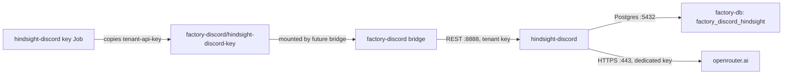

# Discord memory

[HOME-163](https://factory-plan.jomcgi.dev/factory/issue/HOME-163) defines a
separate Hindsight 1.2.1 process and database for Discord memory.



The bridge is HOME-162; its runtime is blocked by the pinned kagent version's
mandatory Substrate harness. See the [runtime finding](../../factory/ARCHITECTURE.md#discord-runtime-blocker).
The only consumer copy of the tenant key is Secret
`factory-discord/hindsight-discord-key`, field `tenant-api-key`. The key grants
REST access to every bank in this process. The bridge must enforce channel
access and supply strict tag filters; tags alone do not authorize a caller.
MCP is disabled.

The 1Password operator syncs `factory-discord-llm` into
`hindsight-discord/hindsight-openrouter`. Its `api-key` and `base-url` fields
set the LLM credential and endpoint (`https://openrouter.ai/api/v1`). HOME-163
requires a $250 monthly limit on this item. The model ID is a literal in
`resources/hindsight.yaml`; change it through a PR.

Embeddings and the decision model match the factory Hindsight
(`projects/factory/ARCHITECTURE.md`, "Memory"), on the same `api-key`: Voyage 4
Large through OpenRouter (1,024 dimensions, `data_collection: deny`), and
TypeSafe Jev 1.14 through OpenRouter's System One endpoint, which ranks recall
with no local fallback. No model loads in the pod. The `hindsight-preflight`
Sync hook runs a copy of the factory's `preflight.py` (`keys_test` keeps the
two equal). It checks the key, that the decision model answers from one
endpoint, and that stored vectors match the embedding dimension. A failure
stops the sync and keeps the running pod.

### Models and rollback

While no bank holds vectors, reverting #8170 (HOME-204) is enough: Hindsight
resizes an empty vector column at startup. After the first retain, the local
model cannot start on 1,024-dimensional rows, so re-embed first. No API pod
has to run:

1. `KUBECONFIG=~/.kube/factory.yaml kubectl apply -f
   projects/platform-factory/hindsight-discord/recovery/reembed-local.yaml`
   re-embeds every row in `factory_discord_hindsight` with the image's local
   model. ArgoCD never applies this Job.
2. Merge the revert of #8170.
3. In the running `hindsight-discord` pod, run
   `hindsight-admin reembed --all-schemas --finish`.

The factory Hindsight's `rollback_test` proves these steps in this image, and
`keys_test` pins the Job to the same command and settings.

The API permits ingress only from pods in `factory-discord` labelled
`app.kubernetes.io/name: factory-discord-bridge`. The client egress policy
selects that same workload. An agent or another pod in the namespace gets
no memory access. The API's egress reaches only `factory-db:5432` and
`openrouter.ai:443`; the cluster baseline also permits DNS through CoreDNS.
Key Jobs have separate labels and API-server egress. The consumer Application
creates the namespace, Secret placeholder, writer Role and client egress rule
before the bridge exists. These selectors assume that agents cannot create or
relabel pods; the bridge and agent must have no Kubernetes API credentials.

## Validate after rollout

These checks need cluster access and the populated 1Password item. Local
tests do not prove deployment readiness or the provider's startup check.
Credential and startup verification remain pending. The repository declares
the item reference; it does not prove that the item is populated or usable.

1. Confirm the OnePasswordItem fetched successfully. Check that Secret
   `hindsight-discord/hindsight-openrouter` has nonempty `api-key` and
   `base-url` fields without printing either value. Record only field names,
   presence, and the OnePasswordItem's sync status on HOME-163.
2. Confirm Applications `hindsight-discord` and `hindsight-discord-key` are
   Synced and Healthy. Confirm Deployment `hindsight-discord/hindsight` has
   one Ready replica on the pinned image.
3. Check the startup log for successful LLM verification. Record the model ID,
   pod UID, deployed revision, and result on HOME-163 without credentials.
   Keep verification enabled. If the provider rejects the completion limit, lower
   `HINDSIGHT_API_RETAIN_MAX_COMPLETION_TOKENS` through a PR, then repeat.
4. Use a temporary debug pod in `factory-discord`, labelled
   `app.kubernetes.io/name: factory-discord-bridge`. Mount only
   `hindsight-discord-key`, and read `tenant-api-key` from its file. Keep the
   key out of command arguments and logs. Send it as a Bearer token to
   `http://hindsight-api.hindsight-discord.svc:8888`.
5. POST the following body to `/v1/default/banks/discord-test/memories`.
   Synchronous retain must finish successfully.

   ```json
   {
     "items": [
       {
         "content": "The Discord acceptance test channel has a cobalt otter mascot.",
         "document_id": "HOME-163-acceptance",
         "tags": ["channel:test"]
       }
     ],
     "async": false
   }
   ```

6. POST this body to `/v1/default/banks/discord-test/memories/recall`.
   Confirm `results` includes the cobalt otter fact.

   ```json
   {
     "query": "What is the acceptance test channel mascot?",
     "tags": ["channel:test"],
     "tags_match": "all_strict"
   }
   ```

7. Repeat recall with `tags: ["channel:other"]`. Confirm `results` is empty.
8. From an unlabelled pod in `factory-discord`, a pod labelled
   `app.kubernetes.io/name: factory-discord-agent` in that namespace, and a
   pod in `factory-r-homelab`, attempt the same service's `/health` endpoint
   with a short connection timeout. None must connect. Give the factory pod
   the bridge's workload label as well: the namespace must still block it.
   Do not copy the tenant key into any of these pods.
9. Record the deployed revision and results on HOME-163. Remove the debug pods.

`keys_test.py` renders both Kustomize directories and exercises the key Job
against the rendered RBAC, including reruns and stale copies. It also checks
that both Jobs mount the generated script ConfigMap. `boundary_test.py` runs
the pinned image in PR CI with dummy credentials and LLM verification disabled
only in the test process.
It checks REST authentication, recall and both disabled MCP routes.
