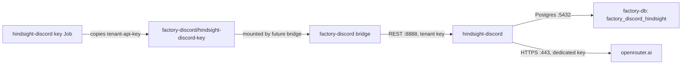

# Discord memory

HOME-163 gives Discord a separate Hindsight 1.2.1 process and database.
Joe chose this boundary and the dedicated OpenRouter credential in
[HOME-162](https://factory-plan.jomcgi.dev/factory/issue/HOME-162) on 2026-11-17.



The bridge is HOME-162. The only consumer copy of the tenant key is Secret
`factory-discord/hindsight-discord-key`, field `tenant-api-key`. The key grants
REST access to every bank in this process. The bridge must enforce channel
access and supply strict tag filters; tags alone do not authorize a caller.
MCP is disabled.

The 1Password operator syncs `factory-discord-llm` into
`hindsight-discord/hindsight-openrouter`. Its `api-key` and `base-url` fields
set the LLM credential and endpoint (`https://openrouter.ai/api/v1`). The item
has a $250 monthly limit. The model ID is a literal in
`resources/hindsight.yaml`; change it through a PR.

The API permits ingress only from `factory-discord` and egress only to
`factory-db:5432` and `openrouter.ai:443`. The cluster baseline also permits
DNS through CoreDNS. Key Jobs have separate labels and API-server egress.
The consumer Application creates the namespace, Secret placeholder, writer
Role and client egress rule before the bridge exists.

## Validate after rollout

These checks need cluster access and the populated 1Password item. Local
tests do not prove deployment readiness or the provider's startup check.

1. Confirm Applications `hindsight-discord` and `hindsight-discord-key` are
   Synced and Healthy. Confirm Deployment `hindsight-discord/hindsight` has
   one Ready replica on the pinned image.
2. Check the startup log for successful LLM verification. Keep verification
   enabled. If the provider rejects the completion limit, lower
   `HINDSIGHT_API_RETAIN_MAX_COMPLETION_TOKENS` through a PR, then repeat.
3. Use a temporary debug pod in `factory-discord`. Mount only
   `hindsight-discord-key`, and read `tenant-api-key` from its file. Keep the
   key out of command arguments and logs. Send it as a Bearer token to
   `http://hindsight-api.hindsight-discord.svc:8888`.
4. POST the following body to `/v1/default/banks/discord-test/memories`.
   Synchronous retain must finish successfully.

   ```json
   {
     "items": [
       {
         "content": "The Discord acceptance test channel has a cobalt otter mascot.",
         "document_id": "HOME-163-acceptance",
         "tags": ["channel:test"]
       }
     ],
     "async": false
   }
   ```

5. POST this body to `/v1/default/banks/discord-test/memories/recall`.
   Confirm `results` includes the cobalt otter fact.

   ```json
   {
     "query": "What is the acceptance test channel mascot?",
     "tags": ["channel:test"],
     "tags_match": "all_strict"
   }
   ```

6. Repeat recall with `tags: ["channel:other"]`. Confirm `results` is empty.
7. From a debug pod in `factory-r-homelab`, attempt the same service's
   `/health` endpoint with a short connection timeout. It must not connect.
   Do not copy the tenant key into that namespace.
8. Record the deployed revision and results on HOME-163. Remove the debug pods.

`keys_test.py` exercises the key Job against manifest RBAC, including reruns
and stale copies. `boundary_test.py` runs the pinned image in PR CI with
dummy credentials and LLM verification disabled only in the test process.
It checks REST authentication, recall and both disabled MCP routes.
