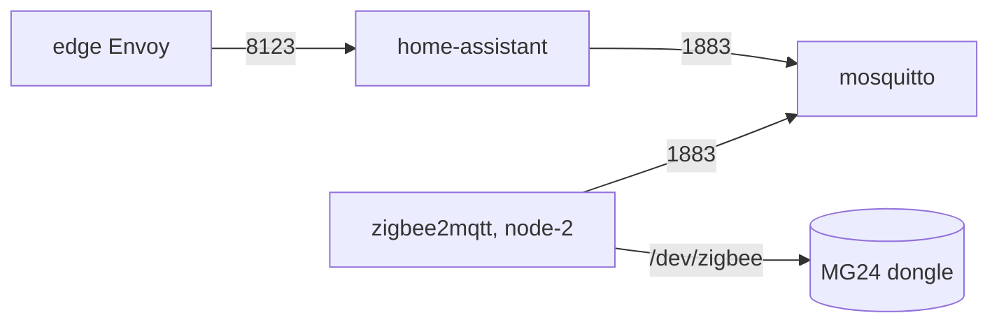
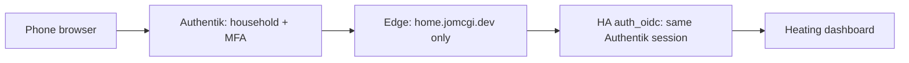

# Home Assistant

Home Assistant runs at home.jomcgi.dev for the Authentik Admins group.
Zigbee2MQTT opens the SONOFF Dongle Max MG24 on node-2 and talks to Home
Assistant through Mosquitto. Joe chose Zigbee2MQTT over ZHA
([decision](https://factory-plan.jomcgi.dev/factory/issue/HOME-913#comment-12891)).

## First setup

1. Open home.jomcgi.dev and create the owner account.
2. Add the MQTT integration with broker `mosquitto` and port `1883`.

## Pair a device

1. In Home Assistant, turn on the Zigbee2MQTT Bridge **Permit join** switch.
2. Power the device near node-2. It appears in Home Assistant when it joins.
3. Rename the device to its room.

The Zigbee2MQTT web UI has no route. Reach it with
`kubectl -n home-assistant port-forward deploy/zigbee2mqtt 8080`.

## Family access

The **Heating** dashboard (`resources/heating-dashboard.yaml`) has one dial per
room and Comfort, Night and Away buttons for the whole house. Change it in
git; the UI shows it read-only.

Home Assistant signs people in through Authentik with the
[hass-oidc-auth](https://github.com/christiaangoossens/hass-oidc-auth)
integration. The `auth-oidc` init container installs a pinned release. The
first sign-in creates the person's HA user: `authentik Admins` become admins,
`household` become users.
HA sets the role only at that first sign-in. To change it later, edit the
user in Settings → People.

To add a person:

1. In Authentik, add their account to the `household` group.
2. On their phone, open home.jomcgi.dev, sign in, open **Heating** and add it
   to the home screen. Profile → **Dashboard** sets it as their default.

The owner's password login is the break-glass:
`https://home.jomcgi.dev/?skip_oidc_redirect=true`.

## HTTP settings

Home Assistant keeps its HTTP settings in `/config/.storage/http`. The
`http-settings` init container writes `resources/http-storage.json` there on
every start, so the edge proxy stays trusted. Change those settings in git;
a change in Settings → System → Network is lost at the next restart.

## Moving the dongle

The zigbee2mqtt-data volume holds the network key and paired devices on
node-2. If the dongle moves to another node, move the volume data and change
the nodeSelector, or pair every device again.
