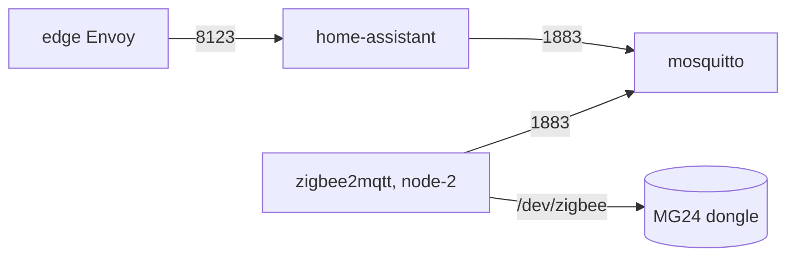
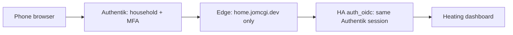
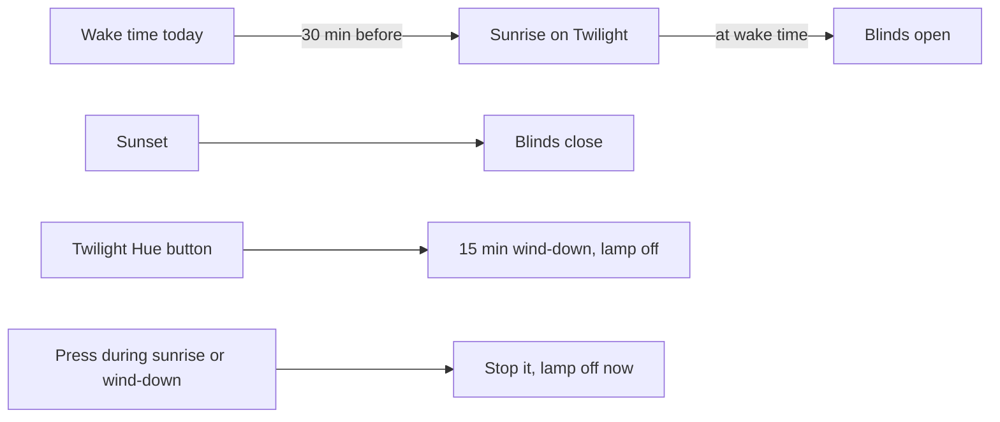

# Home Assistant

Home Assistant runs at home.jomcgi.dev for the Authentik Admins group.
Zigbee2MQTT opens the SONOFF Dongle Max MG24 on node-2 and talks to Home
Assistant through Mosquitto. Joe chose Zigbee2MQTT over ZHA
([decision](https://factory-plan.jomcgi.dev/factory/issue/HOME-913#comment-12891)).

## First setup

1. Open home.jomcgi.dev and create the owner account.
2. Add the MQTT integration with broker `mosquitto` and port `1883`.

## Pair a device

1. In Home Assistant, turn on the Zigbee2MQTT Bridge **Permit join** switch.
2. Power the device near node-2. It appears in Home Assistant when it joins.
3. Rename the device to its room.

The Zigbee2MQTT web UI has no route. Reach it with
`kubectl -n home-assistant port-forward deploy/zigbee2mqtt 8080`.

## Family access

The **Heating** dashboard (`resources/heating-dashboard.yaml`) has one dial per
room and Comfort, Night and Away buttons for the whole house. Change it in
git; the UI shows it read-only.

Home Assistant signs people in through Authentik with the
[hass-oidc-auth](https://github.com/christiaangoossens/hass-oidc-auth)
integration. The `auth-oidc` init container installs a pinned release. The
first sign-in creates the person's HA user: `authentik Admins` become admins,
`household` become users.
HA sets the role only at that first sign-in. To change it later, edit the
user in Settings → People.

To add a person:

1. In Authentik, add their account to the `household` group.
2. On their phone, open home.jomcgi.dev, sign in, open **Heating** and add it
   to the home screen. Profile → **Dashboard** sets it as their default.

The owner's password login is the break-glass:
`https://home.jomcgi.dev/?skip_oidc_redirect=true`.

## Bedroom routines

`resources/bedroom-package.yaml` holds the routines and
`resources/bedroom-dashboard.yaml` the **Bedroom** dashboard. Change both in
git.

1. On the Bedroom dashboard, set a wake time and turn on the alarm for each
   day you want. Days with the alarm off do nothing.
2. Press the Twilight's Hue button during the sunrise to cancel it. The lamp
   turns off and the blinds stay closed.

The Bedroom Nest Mini is at 192.168.4.36 (Cast ports 8008, 8009, 8443). mDNS
does not reach the pod, so the Google Cast integration needs that address
under **Known hosts**. Keep a DHCP reservation for it. The Mini can play
only media it can fetch itself, such as internet streams: Home Assistant is
behind Authentik, so text-to-speech and local media do not play.

The button automation listens on the Twilight's Zigbee2MQTT topic. Keep its
Zigbee2MQTT name as the IEEE address `0x001788010e4a2b1b`, and rename it in
Home Assistant only.

## HTTP settings

Home Assistant keeps its HTTP settings in `/config/.storage/http`. The
`http-settings` init container writes `resources/http-storage.json` there on
every start, so the edge proxy stays trusted. Change those settings in git;
a change in Settings → System → Network is lost at the next restart.

## Backup and restore

Two CronJobs copy each volume to the Garage bucket `home-assistant-backups`
(`resources/backup.yaml`). Garage keeps a copy on each of the three nodes.

| CronJob | Volume | UTC | Object |
| --- | --- | --- | --- |
| `backup-zigbee2mqtt` | `zigbee2mqtt-data` | 03:15 | `zigbee2mqtt/zigbee2mqtt-<time>.tar.gz` |
| `backup-home-assistant` | `home-assistant-config` | 03:30 | `home-assistant/home-assistant-<time>.tar.gz` |

Each run deletes the archives older than 30 days, after its upload succeeds.
The Zigbee2MQTT archive must hold `configuration.yaml` (the network key),
`database.db` and `coordinator_backup.json`, or the run fails. Zigbee2MQTT
keeps running during the copy. If `database.db` is incomplete,
`coordinator_backup.json` still restores the network. The Home Assistant
archive leaves out the recorder database (history only), logs, `deps`,
`.cache`, `tts` and Home Assistant's own `backups`. Home Assistant creates them again.

An off-site copy in R2 is not configured yet: it needs a private R2 bucket
and a token for it.

To restore a volume from its newest archive (Zigbee2MQTT shown; for Home
Assistant use `home-assistant`), with an operator kubeconfig:

1. Stop ArgoCD self-heal for the app:
   `kubectl -n argocd annotate application home-assistant argocd.argoproj.io/skip-reconcile=true`.
2. Stop the app:
   `kubectl -n home-assistant scale deploy/zigbee2mqtt --replicas=0`.
3. Start the restore:
   `kubectl -n home-assistant create job --from=cronjob/restore-zigbee2mqtt restore-1`.
4. Wait for `restored <archive> into /data` in
   `kubectl -n home-assistant logs job/restore-1`.
5. Delete the Job: `kubectl -n home-assistant delete job restore-1`.
6. Start ArgoCD again; it scales the app back to 1:
   `kubectl -n argocd annotate application home-assistant argocd.argoproj.io/skip-reconcile-`.

The restore extracts over the volume and keeps files that the archive does
not hold. A new local-path volume binds on the node of the first pod that
mounts it, so let the app start once before step 1. If the adapter then
holds a different network, Zigbee2MQTT writes `coordinator_backup.json` back
to the adapter at its next start.

## Moving the dongle

The zigbee2mqtt-data volume holds the network key and paired devices on
node-2. If the dongle moves to another node, move the volume data and change
the nodeSelector, or pair every device again.
