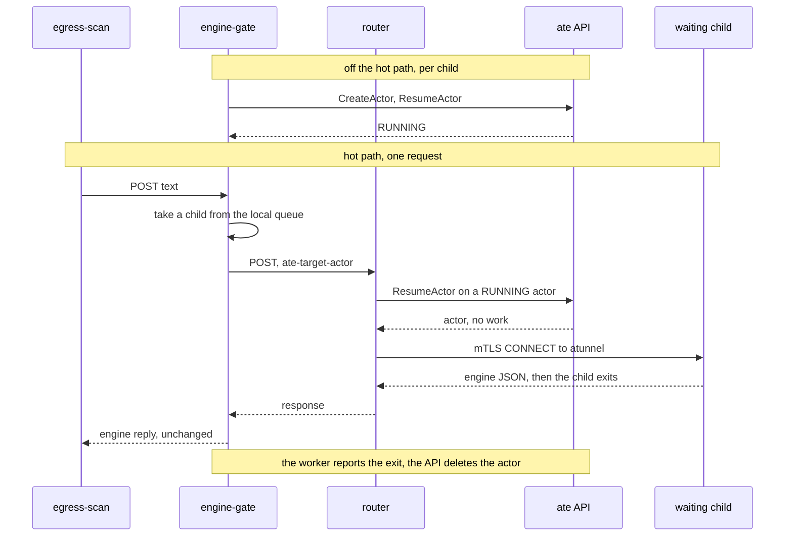
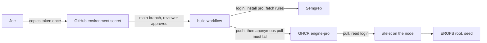

# Egress scanner architecture

The egress scanner decides whether an actor's outbound HTTP request carries a
credential. It is an Envoy External Authorization v3 gRPC server in `ate-system`
that the egress gateway calls before it forwards a request. It matches Gitleaks
rules in process. A second scan tier (`semgrep.go`, `staged off`) posts the
scanned text to one HTTP endpoint and merges the engine verdict. This note
designs that endpoint: a warm pool of single-use gVisor children that run the
Semgrep Pro Secrets engine. Nothing in the engine path is enabled.

| Component | Role | Code | Pin | Untrusted input | Credentials held |
| --- | --- | --- | --- | --- | --- |
| egress-scan | Gitleaks verdict, plus the engine tier when on. Gitleaks and the engine run at the same time | `main.go`, `scan.go`, `semgrep.go` | chart `0.4.32`, image by digest | Request bytes from actors, through the gateway | None. `automountServiceAccountToken` is false |
| engine-gate | Designed StatefulSet. Keeps a pool of waiting children, sends one body to one child, relays the engine reply | none yet | none yet | Text from egress-scan, which holds actor bytes | ate API token (editor of one atespace), router client certificate |
| atenet-router | Routes a request to an actor by `ate-target-actor`. Resumes a suspended actor | `../resources/upstream/substrate/atenet-router.yaml` | Substrate chart `1.0.1` | Any client with an allowed SPIFFE ID | Pod identity certificate for atunnel |
| Pool worker | Staged off. Holds the seed and forks the children | `../gvisor-fork/kvm-pool.yaml` | fork build `b6b0ec3e217c`, gVisor `0250f9acf` | None: only the router reaches it | KVM device, capabilities for forkd |
| Engine image | Designed. Semgrep Pro Secrets engine, rules and a small server | none yet | Semgrep `1.186.0` | Request text, after the child's seccomp filter is on | A token file, real or placeholder (see "Pro engine image") |

## Engine path

Three paths can carry a body to a child. All three use the same seed and the
same single-use child. They differ in who creates the child and who addresses
it.

| Path | How a request reaches a child | Gained | Lost |
| --- | --- | --- | --- |
| A: fork per request | Scanner creates an actor, the router resumes it, the body goes through the router | No pool to run | The fork and its control-plane cost sit on the hot path |
| B: warm pool | A controller keeps N running children that wait. A request takes one | The hot path skips create, schedule and fork | A pool controller, and a child lifetime that must cover its wait |
| C: bypass the actor API | A service in the KVM pod talks to `forkd` and posts to the child's veth | One hop, no router | Authorization, scheduling, accounting, crash reports and the explicit egress block |

**Decision for v1: path B, behind a new `engine-gate` StatefulSet. Path A is
the pool-miss code path. Path C is rejected.** State: `designed`.

**Input and verdict.** `egress-scan` already posts the text it builds for
Gitleaks: host, path, query, headers, the body and the decoded JSON strings. It
runs Gitleaks and the engine at the same time. A Gitleaks finding cancels the
engine call. The gate relays the engine reply without parsing it. The scanner
reads only the rule id and the offsets, so no matched text reaches a log. Any
finding denies. If the scanner cancels before the gate sends the body, the gate
puts the child back. After that the child is spent.

### Why path B

- The fork path is fast and measured. `Fork()` takes 25 ms. A fork to a result
  takes 100 to 115 ms at one request with the Pro engine.
- The control plane is not measured. A create, a resume that schedules and
  books, an atelet call and a worker call all run before the child exists. The
  design note counts the database transactions and expects them to rival the
  fork (X10). Path B moves them off the request.
- A request to a RUNNING actor is cheap on the control plane. The resume
  workflow returns at once for a RUNNING actor
  (`workflow_resume.go`, `loadActorForResume`), after one authorization check and
  one read. The wakeup probe polls every 1 ms (`internal/wakeupprobe`), so
  probe polling adds no latency.
- A waiting child holds 3.5 MB of memory. It books a full child, as the
  capacity section shows.
- Path A remains the fallback for a pool miss, so one create code path serves
  both.

### Why not path C

- **Network block.** A normal child gets its network from `actornet`. An
  nftables redirect sends all TCP to atunnel, which refuses it when no egress
  policy exists. The `forkd` veth mode (`createVethNet`) adds no redirect. A
  search of `runsc/forkd` finds no nftables, iptables, masquerade or forwarding
  rule. A child then has no egress only because the pod forwards nothing, and
  nobody tested that.
- **Authorization.** Atespace checks, the same-atespace rule and the
  `can_create_fork_template` relation live in the ate API. A bypass skips them.
- **Lifecycle.** Seed rebuild after a worker restart, the crash report, the
  lifetime reaper and capacity booking all belong to the control plane.
- **Pod shape.** A KVM pod needs `/dev/kvm`, `CAP_SYS_ADMIN`, an Unconfined
  seccomp profile and delegated cgroups. The WorkerPool controller shapes
  such a pod in a labelled namespace. A hand-written pod needs its own
  exemption from the admission controls (unverified which policy applies).

### Why a separate `engine-gate`

The router checks a client by its SPIFFE ID alone. `atenet-router.yaml`
(`frontendPolicies.networkAuthorization`) allows the IDs in
`ingressAllowedSPIFFEIDs`. No per-atespace rule limits which actor a client
may name. An ID on that list can send a request to any actor's port 80 in any
atespace.

`egress-scan` reads untrusted request bytes. If it held the router identity,
a bug in its parser would reach every actor. So the identity goes to a small
workload that never parses a body and never accepts an actor name from its
caller. State of this boundary: `designed`.

| Identity | Grant | Scope |
| --- | --- | --- |
| `egress-scan` | None. Network rules only | Egress to `engine-gate` on one port |
| `engine-gate` ServiceAccount | Editor role from the atespace access policy `default` | Atespace `egress-scan-engine` only: create, resume, get, list and delete actors |
| `engine-gate` pod certificate | Entry in `ingressAllowedSPIFFEIDs` | Cluster-wide actor ingress. Joe approved this grant (Decided 2) |
| Template owner | Global owner (`ate-client`) | Creates the atespace and the fork template. An editor cannot: `can_create_fork_template` needs a global owner |

Network rules are new, because the cluster default-deny blocks egress. The
scanner needs an egress rule to the gate. The gate needs an ingress rule from
the scanner, and egress rules to the router (port 8443) and the ate API (port
443). The ate API needs an ingress rule for the gate, as for the conformance
Job. The scanner adds no TLS and no credential on its call (HOME-254 tracks
mTLS).

**Residual.** The model has no role narrower than `editor` that creates actors
(`can_create_actor: editor`). An editor can also create templates, including a
template with an arbitrary image (`can_create_actor_template: editor`), and
egress policies in its atespace. A compromised gate could start an ordinary
actor with an egress policy and send bodies out through it. The atespace
holds no credential injection, no Secret and no other tenant. Cilium cannot see
actor creation, so it cannot guard this. The compensating control is an alert
from an ate API list or audit. It fires on any non-fork actor in
`egress-scan-engine`, and on any template other than the pinned fork template. A narrower role needs a
Substrate change. State: `designed`.

### Pool lifecycle

The API has no claim operation, and pool settings (`min_ready`, `ready_ttl`)
do not exist in the fork build. The gate owns its pool, so a claim is a local
queue pop.

| Rule | Reason |
| --- | --- |
| The gate runs as a StatefulSet and names children `eg-<pod name>-<start epoch>-<n>` | The pod name survives a restart, so the new gate can find old children. A Deployment pod gets a new name, so its children would stay booked. The start epoch keeps a new name from meeting an old child that is still deleting |
| On start the gate lists the atespace and deletes every actor with its pod prefix and another epoch | A leftover child keeps its booking until it expires |
| The template sets `maxLifetimeSeconds: 900`. The gate deletes a waiting child at 600 s and creates a new one | The worker reports a child that ends by `max_lifetime` as a crash (`ReportCrashed`, "forked sandbox ended: max_lifetime"). A delete is no crash |
| Every API call carries the preview opt-in header (`Ate-Preview-Allowed`) | `CreateActor` of a fork template needs it (`forkForCreate`) |
| One replica in v1 | The pool books 8 children (see capacity). A second replica needs its own pool |

## Latency budget

The tier has two modes (observe mode is merged and the tier is still off). In
observe mode the engine call runs off the request path. It is detached and
bounded, and nobody waits for it. The gateway `requestTimeout` stays 80 ms, so a
Hindsight call sees no added latency. `resources_test.py` requires a timeout of
at least the deadline plus 10 ms in enforce mode only. In enforce mode the tier
waits for the engine. The deadline is 300 ms and `requestTimeout` is 310 ms. The
PR that flips the mode to enforce raises the timeout in the same change. The
budget below is the enforce-mode path. In observe mode it is the time the
detached call takes.

Path B, pool hit, 16 KiB body, Pro engine with all 1586 rules, at most 4 requests
in flight. Gitleaks runs beside the engine call and is not on this path.

| # | Hop | p95 budget (ms) | Basis |
| --- | --- | --- | --- |
| 1 | Gateway to `egress-scan`, body included | 10 | Estimate. Not measured |
| 2 | Decode and build the text | 5 | Estimate |
| 3 | `egress-scan` to `engine-gate`: DNS lookup and a new connection | 8 | Estimate. The tier disables keep-alive |
| 4 | Take a child, open a connection | 3 | In process |
| 5 | Gate to router, TLS and routing | 10 | Estimate. The router keeps no backend connection |
| 6 | Router resume check on a RUNNING actor | 15 | One authorization check and one read. Not measured |
| 7 | Router to atunnel to child: mTLS, CONNECT, dial | 15 | Estimate. Not measured. The local connect to a waiting child took 0.4 to 1.6 ms |
| 8 | Scan, body in to result out | 137 | Measured at p95 123 to 127 ms with the 221-rule subset (N=4). Add 12 ms for 1586 rules: unmeasured at p95, +9 to +16 ms at the median |
| 9 | Response back to the scanner | 10 | Estimate |
| 10 | Verdict to the gateway | 3 | Estimate |
| | Total | 216 | Hops 3 to 9 sum to 198 ms against the 300 ms deadline. The gateway has 94 ms of slack in 310 |

Path A, or path B on a pool miss, replaces hop 6 with these steps:

| Step | p95 (ms) | Basis |
| --- | --- | --- |
| `CreateActor`: authentication, two authorization checks, one insert | 20 | Estimate |
| `ResumeActor` control plane: lease, assign and book, atelet call, finalize | 40 to 80 | Estimate. This is X10, the largest unknown |
| Worker: namespace and veth (3 to 6 ms), `Fork()` (25 to 30 ms), guest listens | 36 to 45 | Measured: 33 to 36 ms median at N=1 to 4 through the real worker path |
| Sum | 96 to 145 | Total p95 is 297 to 346 ms: at or over the 300 ms deadline |

Path C forks per request inside the pod, with no gate and no router. Fork to
result replaces hops 4 to 8. It took 161 ms at p95 for N=4 with the 221-rule
subset, so 173 ms with 1586 rules. The total p95 is 209 ms. Nothing can build
path C safely today.

Body size, end to end, with the 1586 rules. The engine scans the engine text, not
the raw body. When a JSON body holds a backslash, `scan.go` appends the decoded
JSON strings (`engineText`), so escaped JSON can reach twice the raw body. The
limit `semgrep.maxBodyBytes` applies to the raw body.

| Raw body | Engine text, plain | Engine text, escaped JSON | Total p95, plain (ms) | Total p95, escaped (ms) |
| --- | --- | --- | --- | --- |
| 16 KiB | about 17 KiB | about 33 KiB | 216 | about 226 |
| 32 KiB | about 33 KiB | about 65 KiB | about 226 | about 241 |
| 64 KiB | about 65 KiB | about 129 KiB | about 241 | about 267 |
| 128 KiB | about 129 KiB | about 257 KiB | about 267 | about 324, over the deadline |
| 512 KiB | | | Over 300: 276 to 292 ms for the scan alone at N=1 | |

The scan grows by about 0.35 ms per KiB of engine text, and each copy across a
hop adds about 3 ms per 64 KiB. Gitleaks on a large body runs beside the engine
and adds nothing while it stays under its 75 ms deadline. The v1 limit is 32 KiB
of raw body (`semgrep.maxBodyBytes: 32768`). Its worst case, escaped JSON, costs
what a plain 64 KiB body costs. That leaves about 77 ms under the 300 ms
deadline. A larger body is `oversize`, and deny mode returns 503. Observe mode
sets the final limit from real sizes. It records them in
`factory_egress_scan_semgrep_observe_size_bytes{kind}` (raw body and engine
text), with a dashboard panel.

- **CPU.** A child uses one vCPU for 60 to 80 ms. The measurements ran on a
  12-core host. N=16 was CPU bound there (239 ms median). Inference: a pod with
  fewer cores than scans in flight stretches the scan.
- **In-flight cap.** The gate admits 4 scans at once. The scanner allows 2 engine
  calls in each of its 2 pods (`semgrep.concurrency: 2`). The gate queues a fifth
  for up to 25 ms, then sheds.
- **Not reachable.** 75 ms is not reachable. Even a warm normal sandbox needs
  52 ms for the scan.

## Failure modes

The scanner tier owns the failure mode, the breaker and the load shedding
(`semgrep.go`, README "Second scan tier"). The default `failureMode: deny`
returns 503 with the body `secondary scan unavailable`. The gate adds the rows
below. Each row ends in the tier's no-verdict result.

| Failure | What the gate does | Tier outcome | Signal |
| --- | --- | --- | --- |
| No worker (pool at `replicas: 0`, pod pending) | Last create failed within 5 s: refuse at once | `error` | `engine_ready_children == 0` |
| Seed missing or rebuilding | A create fails with `Unavailable`. The reaper removes the actor | `error` | Seed wait in the pool log |
| `forkd` crashes | Worker reports every seed and child crashed. The API deletes them. Retry once on the next child if more than 120 ms remain | `error` if no retry fits | `engine_child_errors_total` |
| Node drain, one worker | Same as `forkd` down, until the pod runs elsewhere and the seed is ready | `error` for that time | Node drain event |
| Gate restarts | The scanner gets no answer until the gate lists and cleans its leftovers and refills | `error`, then `breaker_open` | Gate readiness |
| Pool empty, below the in-flight cap | Create a child now (path A) if more than 200 ms remain | Verdict, or `timeout` | `engine_pool_misses_total` |
| Burst above the cap | Queue up to 25 ms, then answer 503 | `error` | `engine_shed_total` |
| Child dies while it waits (OOM kill) | Connection error. Drop it, take the next | Verdict, or `error` | `engine_child_errors_total` |
| Engine reports `errors` or `paths.skipped` | The gate relays the reply | `error`, as the tier README says | `engine_errors_total` |
| Router or ate API down | Nothing to do on the hot path | `error` | Gate health |
| Token file missing in the image | The engine exits with code 13 and the seed never becomes ready | `error` | Seed wait, build smoke test |

The pool pod must never scale to zero. The factory coder pools do, through a
HorizontalPodAutoscaler on `factory_worker_pool_workers_wanted`. This pool
needs no autoscaler: the in-flight cap is 4 and `replicas` stays fixed. The
factory autoscaler would need `minReplicas: 1` to serve this pool.

Joe decided that an engine outage denies the request. The Hindsight route has
the only policy today, and a deny there blocks memory writes, not safety. In
observe mode no engine failure changes a verdict.

## Capacity and scheduling

The scheduler books CPU and memory. A seed books `seed_resources`. A child books
its template limits plus 16 MiB of memory, whether it waits or scans. A worker's
capacity is its pod limits, and a placement must cover both (`Covers`). A served
child keeps its booking until the worker reports its exit. The API then deletes
the actor. Until then a replacement can be refused.

| Item | Value | Basis |
| --- | --- | --- |
| Seed | 1000m CPU, memory cap 512 MiB | 358 MB resident (PSS) and 368 MB anon with 1586 rules |
| Child | 1000m CPU limit, 128 MiB memory limit | A `cpu.max` below 1000m would throttle a 60 to 80 ms scan. The memory limit covers 80 MB at 512 KiB |
| Child, measured use | 31 MB scanning at 16 KiB, 3.5 MB waiting | Measured |
| Pool | 2 waiting, 4 scanning, 2 of headroom: 8 children | Matches the in-flight cap. Headroom covers served children that wait for deletion |
| Booked CPU | Seed 1000m + 8 children x 1000m = 9000m | All of the 9000m pod capacity |
| Booked memory | Seed 512 MiB + 8 x 144 MiB = 1664 MiB | 128 MiB limit plus 16 MiB overhead. Capacity is the pod limit minus a 64 MiB reserve: 1984 MiB for 2 GiB |
| Expected use | 358 + 4 x 37 + 4 x 4 + 64 = 586 MB | 16 KiB bodies, `forkd` and worker 64 MB |
| Pod request | 1 GiB memory, 4 CPU | Scheduling reservation. Memory is the tight dimension. CPU requests are 19%, 36% and 49% of the three nodes (design review, 2026-11-23), so 4 CPU fits |
| Staged pool today | 2 CPU limit, 1280Mi limit, 256Mi request | Books the seed and one child. It cannot hold the engine pool |
| Latency Jobs, default | K up to 4, batches of 4, one child of headroom: 5 children | 6000m booked with the seed. K=16 needs 17000m and 2816 MiB |

The pool needs a resize before any latency run. That is a change to
`kvm-pool.yaml`, in its own PR, after a request-room check.

Placement: the pod has no node selector. Node-1 had about 4.9 GiB of memory
request room and nodes 2 and 3 about 2 GiB. A 1 GiB request fits any node. Under CPU
contention a pod gets shares in proportion to its request. A 500m request would
give four scans the shares of half a core. A 4 CPU request matches the
in-flight cap. One replica runs in v1, so a drain is an outage.

**Atespace pin.** A worker pins the atespace of its first seed for the life of
the process (`cmd/ateworker-gvisor/fork.go`, `seed`). It refuses a seed of
another atespace with `PermissionDenied`, and nothing resets the pin, not even a
dropped seed. The rollout uses three atespaces on one single-replica pool:
`fork-conformance`, `fork-latency` and `egress-scan-engine`. The pool pod
restarts between them, after the templates of the previous atespace are deleted.
The seed reconciler seeds every live fork template on a restarted worker, so a
leftover template pins its atespace again. A Job that dies before its cleanup
leaves its template. Delete it by hand before the restart. One shared atespace is not an option: the conformance
Job deletes its atespace, and test actors would share the engine's atespace
and its editor grant.

## Pro engine image

The Pro engine cannot be public. The image is private and built in CI by hand.
State: `designed`.

| Question | Choice | Why |
| --- | --- | --- |
| Where it is published | Private GHCR package `ghcr.io/jomcgi-org/homelab/substrate-fork/engine-pro` | atelet already pulls private `ghcr.io` images with the `ghcr-imagepull-secret` read login (`values/atelet.yaml`, HOME-539). The repo runs no registry, and a new one adds a stateful service |
| How atelet pulls it | The same credential plugin. No change | Check once that the read login can read an `engine-pro` test tag |
| Where it is built | A manual workflow, `main` only, in a GitHub environment with a required reviewer | PR workflows and forks cannot read an environment secret. No workflow reads a repository secret today |
| Where the real token lives | Joe copies a dedicated Semgrep token from 1Password into the environment secret | An in-cluster build needs a registry write login and a builder. The repo has no builder such as kaniko, buildkit or buildah |
| How the build gets the engine | `semgrep login`, then `semgrep install-semgrep-pro`, with the wheel pinned in `engine/pins.env` | The CLI documents this path. The Pro binary must match `1.186.0` |
| How the build gets the rules | The Secrets config of the Semgrep deployment, fetched with the real token | The spike used `GET /api/agent/deployments/scans/config?is_secrets_scan=true` |
| What is pinned | The Pro binary sha256 in `pins.env` after the first build. The rules sha256 as an image label and in the tag | The rules are proprietary content and stay out of the public repo |
| What the build checks | Fail if `install-semgrep-pro` or the rules fetch fails. Run the engine once, expect exit 0 and a finding on a fake secret | The build proves the engine works with the token file the image holds |
| Private package check | After the push, an anonymous pull must be refused. If it succeeds, the workflow fails and deletes the pushed version | The repo is public, and a package published by a workflow can inherit the repo's visibility |

Details of the check:

- The workflow uses `GITHUB_TOKEN` with `packages: write`, as
  `substrate-fork-engine.yml` does. Whether that token can delete a version it
  just created is unverified.
- The anonymous `crane manifest` runs with a fresh, empty `DOCKER_CONFIG`.
- The package API URL needs the slashes of the package name encoded (`%2F`).
- The image is public between the push and the check. With the placeholder
  token, that exposes the Pro binary and the rules. With option (a), a failed
  check forces a token rotation.
- Confirm that the package setting "inherit access from repository" is off. That
  state lives outside the repo and is unverified here.

**Token handling: a placeholder token in the image (decided).** A fork template
has no volumes (`validateForkTemplate`) and no egress. The API refuses env names
that hold `TOKEN`, `KEY`, `SECRET` or `PASSWORD`, and every child can read the
template env. So no mounted-secret option exists. The engine needs a file at
start (`/semgrep/.tok`), and that file lives in the image.

| | (a) Real token in the image | (b) Placeholder token in the image. Chosen |
| --- | --- | --- |
| What the image holds | The real token, mode 0444 | A dummy token file. The real token stays in the build environment secret |
| Who can read the real token | Anyone with pull access, the node's image cache, and every child through seed memory | Nobody outside the build workflow |
| Rotation | Rebuild the image and roll the template | Rotate the environment secret. No image change |
| Depends on | Nothing | The engine checking only that a token is present at start |
| Licence | The token is used as issued | Joe handles the terms himself. This note assumes nothing |

The evidence for (b) is a spike run of Semgrep 1.186.0. A native `strace` of the
engine showed no `connect` or `socket` call. Without a token file the engine
exited with code 13 and the message "You must log in with `semgrep login` to
use the Pro features". The engine never checked the token again after the fork.
A Semgrep update could add an online check. The build smoke test must prove the
engine accepts the placeholder on every build, and the build fails if it does
not. A failure then returns the choice to option (a).

The real token is a dedicated token, not a personal one, with the narrowest scope
that `install-semgrep-pro` and the rules fetch accept. Rotate it on any change of
package access.

**Rule set: use all 1586.** Detection coverage is the point of an egress
gate. The cost is small:

| | 221-rule test subset | All 1586 |
| --- | --- | --- |
| Seed resident (PSS) | 148 MB | 358 MB |
| Seed ready | 0.55 to 0.74 s | 1.9 to 2.4 s |
| Child private memory | 31 MB | 30 MB |
| Fork to result, N=1 / 4 / 16 (ms, median) | 110 / 126 / 239 | 119 / 142 / 247 |

The 1586-rule run was not repeated for a waiting child at p95. The totals above
add 12 ms from the median difference. The expected 0.9 GB engine for the
original 221-rule set did not reproduce. It came from a microVM that included
the guest kernel and page cache. The engine runs without secret validation,
because a child has no egress and the candidate secret must not leave. A finding
means "matches a rule", and the v1 verdict denies on any finding. The scanner has
an observe mode (`semgrep.mode: observe`) that counts the engine verdict and
enforces Gitleaks only. The existing `failureMode: allow` does not do that,
because an engine finding still denies.

**Rebuild and rotation.** A new template is a new template UID, so the seed is
new. Rebuild on a Semgrep version bump, a rules refresh, a base image fix or a
new `runsc` or `forkd` build. Roll it blue and green by template name. The seed reconciler seeds every live
fork template, so `engine-v2` needs a second seed (1000m, 512 MiB) while
`engine-v1` lives. At peak, `engine-v1` books all 9000m and `engine-v2` gets no
seed. Roll at low traffic with the `engine-v1` pool drained to its minimum, or
size the pod at 10 to 11 CPU. Create `engine-v2` and wait for its seed. Point the
gate at it with one config value. Drain the pool, then delete `engine-v1`.

## Measurement

`../gvisor-fork/latency/` is a kustomization that the `gvisor-fork` directory
does not list. It holds two suspended Jobs. They follow the conformance Job:
ServiceAccount `ate-client`, `kubectl-ate` from the fork image, the public OSS
engine image and no new RBAC. Output lines start with `LATENCY ` and hold
`key=value` pairs.

| Job | Reaches | New grant | Measures |
| --- | --- | --- | --- |
| `gvisor-fork-latency-1` | The ate API | None | `create_ms`, `resume_ms`, `create_to_ready_ms`, `delete_ms`, sequential and at K at once |
| `gvisor-fork-latency-data-1` | The API and the router | `ate-client` SPIFFE ID in `ingressAllowedSPIFFEIDs` for the run | The above, plus `send_to_result_ms` on a pool child, `total_ms` on demand, and `total_ms` cold |

Each metric prints a `stats` line with n, p50, p95, p99, max in ms, and a
`sample` line for every measurement. A `cli_floor_ms` line gives the cost of
one CLI call. Subtract it from the API timings. `send_to_result_ms` goes
straight to the router and has no CLI cost. The harness reaches the actor on
port 80 and uses one new connection for each request; `connect_ms` is kept
apart.

The script reads the worker's free CPU and memory after the seed is ready. It
stops with a capacity error when the largest burst plus one child of headroom
does not fit. It prepares waiting children in batches of `POOL_BATCH`. The
defaults are K of 2 and 4, so a run needs 5 children and the resized pool.

The harness cannot split the control plane into hops, because the fork path
writes no phase log and the traces are off (`values/common.yaml`). A split needs
the `ateapi` step spans sent to a collector for one run.

Read the result with these rules:

| Result | Action |
| --- | --- |
| On-demand `total_ms` p95 at k=4, floor subtracted, at most 200 ms | Path A is enough. Defer the pool |
| Pool `send_to_result_ms` p95 at k=4 above 160 ms | Raise the pool pod CPU or lower the in-flight cap |
| `control_k4` throughput under 5 times the peak request rate | Run two replenishers, or defer the pool |

Each burst runs 5 rounds (`ROUNDS`), so the p95 of K=4 comes from 20 samples. The
p95 of one burst of 4 would equal its maximum.

## Rollout

Each step stays off until its predecessor is verified. Steps 1 to 8 of
[gVisor sandbox fork](../../../factory-cluster/README.md#gvisor-sandbox-fork-staged-off)
come first: they end with the conformance Job. The isolation gates X1 to X7 and
X9, and the X8 waiver (README steps 9 and 10), come before step 6 below, the
engine atespace. They do not come before the latency runs.

1. Resize the pool in a PR for `kvm-pool.yaml`: 9 CPU and 2 GiB limits, 4 CPU and
   1 GiB requests. This comes before every run.
2. Run the conformance Job (atespace `fork-conformance`).
3. Delete the conformance template and atespace. Restart the pool pod, because
   the worker pinned `fork-conformance`. List `latency` in the `gvisor-fork`
   kustomization and run `gvisor-fork-latency-1` (atespace `fork-latency`).
4. Add the `ate-client` SPIFFE ID to `ingressAllowedSPIFFEIDs`, run
   `gvisor-fork-latency-data-1`, then remove it. Each change rolls the router, so
   this is two router rollouts.
5. Delete the latency template and atespace. Restart the pool pod. Build
   `engine-pro` and check that an anonymous pull fails.
6. After the X gates and the waiver pass, a global owner creates the atespace
   `egress-scan-engine`, its access policy for the gate and the fork template.
   Check that the read login pulls the image.
7. Build the `engine-gate` StatefulSet and the network rules. Point the tier at
   the gate.
8. Turn the tier on in observe mode (`semgrep.mode: observe`) for 7 days. The
   engine call runs off the request path, the gateway timeout stays 80 ms and
   Gitleaks alone decides. The scanner records the engine verdict and the body
   sizes.
9. One PR flips the tier to enforce. It sets `semgrep.mode: enforce`,
   `semgrep.deadline: 300ms`, `semgrep.maxBodyBytes`, `semgrep.concurrency: 2` and
   the gateway `requestTimeout: 310ms`. `resources_test.py` fails if the timeout
   and the mode do not move together.

To roll back from enforce, set `semgrep.mode: observe` and restore the 80 ms
timeout in the same PR. To turn the tier off, set `semgrep.enabled: false`. Delete
the pool templates only after that.

## Decided

Joe decided these on 2026-11-23, after review of this PR. No HOME issue records
them yet.

| # | Decision | Record |
| --- | --- | --- |
| 1 | The cluster steps package is approved after review: the `ForkSeed` gate (fork README step 7), the X8 waiver for gVisor-only use, factory use of fork templates (step 10) and the pool resize to 9 CPU and 2 GiB with a pod restart between atespaces | Joe, 2026-11-23 |
| 2 | The `engine-gate` SPIFFE ID and its editor role in one atespace, and the `ate-client` SPIFFE ID for one data run (two router rollouts) | Joe, 2026-11-23 |
| 3 | Policy: all 1586 rules, deny on any finding, observe mode for 7 days first, deny when the engine is out | Joe, 2026-11-23 |
| 4 | Token: a placeholder in the image, the real dedicated token only in the build environment secret. Joe handles the licence terms himself | Joe, 2026-11-23 |
| 5 | The `engine-pro` package is private | Joe, 2026-11-23 |

Still open: the engine body limit and the Hindsight route timeout. The enforce
PR sets them from observe data. The v1 values are 32 KiB of raw body and 310 ms.

## Direction

Decided and not yet live. A row leaves when the work ships or its issue
closes.

| Direction | Tracks | State |
| --- | --- | --- |
| Pool of waiting children for the engine path | HOME-TBD | `designed` |
| `engine-gate` StatefulSet | HOME-TBD | `designed` |
| Pro engine image, private package | HOME-TBD | `designed` |
| The private `engine-pro` workflow | HOME-TBD | `designed` |
| Latency Jobs `gvisor-fork-latency-1` and `-data-1` | HOME-TBD | `staged off`, suspended and unwired |
| Per-client atespace rule in the router | HOME-TBD | `designed`, replaces the two router grants (Decided 2) |

## Decision history

| Decision | Date | Record |
| --- | --- | --- |
| Fork pools run on the KVM platform in a dedicated WorkerPool | 2026-11-22 | [Fork README, Tenancy](../../../factory-cluster/README.md#tenancy) |
| One seed serves one atespace. No per-tenant pool, because the code is ours | 2026-11-22 | [Fork README, Tenancy](../../../factory-cluster/README.md#tenancy) |
| The request body travels over HTTP into the child's own network | 2026-11-22 | [Fork README, enable steps](../../../factory-cluster/README.md#gvisor-sandbox-fork-staged-off) |
| Request path B with a separate gate | 2026-11-23 | This note, reviewed with the cluster steps package |
| Cluster steps, policy, placeholder token and private package | 2026-11-23 | The "Decided" table above. No HOME issue yet |
