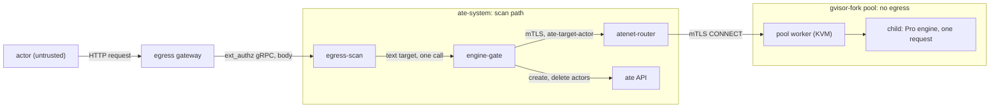
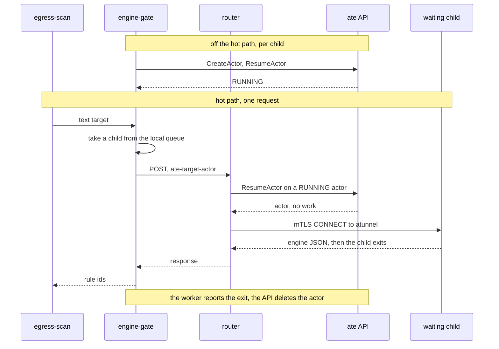
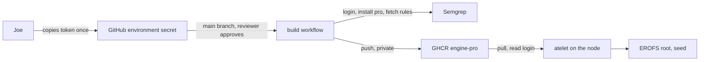

# Egress scanner architecture

The egress scanner decides whether an actor's outbound HTTP request carries a
credential. It is an Envoy External Authorization v3 gRPC server in `ate-system`
that the egress gateway calls before it forwards a request. Today it matches
Gitleaks rules in process. This note designs a second verdict from the Semgrep
Secrets engine. The engine runs in a single-use gVisor sandbox, forked from a
warm seed, inside a 300 ms budget. Nothing in the engine path is enabled.

| Component | Role | Code | Pin | Untrusted input | Credentials held |
| --- | --- | --- | --- | --- | --- |
| egress-scan | Gitleaks verdict today. Calls engine-gate when the engine path is on | `main.go`, `scan.go` | chart `0.4.32`, image by digest | Request bytes from actors, through the gateway | None. `automountServiceAccountToken` is false |
| engine-gate | Designed. Keeps a pool of waiting children, sends one body to one child, returns rule ids | none yet | none yet | Text from egress-scan, which holds actor bytes | ate API token (editor of one atespace), router client certificate |
| atenet-router | Routes a request to an actor by `ate-target-actor`. Resumes a suspended actor | `../resources/upstream/substrate/atenet-router.yaml` | Substrate chart `1.0.1` | Any client with an allowed SPIFFE ID | Pod identity certificate for atunnel |
| Pool worker | Staged off. Holds the seed and forks the children | `../gvisor-fork/kvm-pool.yaml` | fork build `b6b0ec3e217c`, gVisor `0250f9acf` | None: only the router reaches it | KVM device, capabilities for forkd |
| Engine image | Designed. Semgrep Pro Secrets engine, rules and a small server | none yet | Semgrep `1.186.0` | Request text, after the child's seccomp filter is on | Semgrep token, in the image |

## Engine path

Three paths can carry a body to a child. All three use the same seed and the
same single-use child. They differ in who creates the child and who addresses
it.

| Path | How a request reaches a child | Gained | Lost |
| --- | --- | --- | --- |
| A: fork per request | Scanner creates an actor, the router resumes it, the body goes through the router | No pool to run | The fork and its control-plane cost sit on the hot path |
| B: warm pool | A controller keeps N running children that wait. A request takes one | The hot path skips create, schedule and fork | A pool controller, and a child lifetime that must cover its wait |
| C: bypass the actor API | A service in the KVM pod talks to `forkd` and posts to the child's veth | One hop, no router | Authorization, scheduling, accounting, crash reports and the explicit egress block |

**Decision for v1: path B, behind a new `engine-gate` Deployment. Path A is
the pool-miss code path. Path C is rejected.** State: `designed`.

**Input and verdict.** `egress-scan` sends the text it already builds for
Gitleaks: host, path, query, headers, the body and the decoded JSON strings. It
calls the gate only after Gitleaks finds nothing, so an obvious match never
claims a child. The gate returns rule ids and line ranges, never matched text.
A finding means deny, with today's reason "request contains a credential
pattern".

### Why path B

- The fork path is fast and measured. `Fork()` takes 25 ms. A fork to a result
  takes 100 to 115 ms at one request with the Pro engine.
- The control plane is not measured. A create, a resume that schedules and
  books, an atelet call and a worker call all run before the child exists. The
  design note counts the database transactions and expects them to rival the
  fork (X10). Path B moves them off the request.
- A request to a RUNNING actor is cheap on the control plane. The resume
  workflow returns at once for a RUNNING actor
  (`workflow_resume.go`, `loadActorForResume`), after one authorization check and
  one read. The wakeup probe polls every 1 ms (`internal/wakeupprobe`), so
  probe polling adds no latency.
- A waiting child holds 3.5 MB. Ten of them cost 35 MB.
- Path A remains the fallback for a pool miss, so one create code path serves
  both.

### Why not path C

- **Network block.** A normal child gets its network from `actornet`. An
  nftables redirect sends all TCP to atunnel, which refuses it when no egress
  policy exists. The `forkd` veth mode (`createVethNet`) adds no redirect. A
  search of `runsc/forkd` finds no nftables, iptables, masquerade or forwarding
  rule. A child then has no egress only because the pod forwards nothing, and
  nobody tested that.
- **Authorization.** Atespace checks, the same-atespace rule and the
  `can_create_fork_template` relation live in the ate API. A bypass skips them.
- **Lifecycle.** Seed rebuild after a worker restart, the crash report, the
  lifetime reaper and capacity booking all belong to the control plane.
- **Pod shape.** A KVM pod needs `/dev/kvm`, `CAP_SYS_ADMIN`, an Unconfined
  seccomp profile and delegated cgroups. The WorkerPool controller shapes
  such a pod in a labelled namespace. A hand-written pod needs its own
  exemption from the admission controls (unverified which policy applies).

### Why a separate `engine-gate`

The router checks a client by its SPIFFE ID alone. `atenet-router.yaml`
(`frontendPolicies.networkAuthorization`) allows the IDs in
`ingressAllowedSPIFFEIDs`. No per-atespace rule limits which actor a client
may name. An ID on that list can send a request to any actor's port 80 in any
atespace.

`egress-scan` reads untrusted request bytes. If it held the router identity,
a bug in its parser would reach every actor. So the identity goes to a small
Deployment that never parses a body and never accepts an actor name from its
caller. Cilium admits the gate to the router and the ate API only. State of
this boundary: `designed`.

| Identity | Grant | Scope |
| --- | --- | --- |
| `egress-scan` | none | Calls `engine-gate` on one port |
| `engine-gate` ServiceAccount | Editor role from the atespace access policy `default` | Atespace `egress-scan-engine` only: create, resume, get and delete actors |
| `engine-gate` pod certificate | Entry in `ingressAllowedSPIFFEIDs` | Cluster-wide actor ingress. This is the grant Joe decides |
| Template owner | Global owner (`ate-client`) | Creates the fork template. An editor cannot: `can_create_fork_template` needs a global owner |

**Residual.** The model has no role narrower than `editor` that creates actors
(`can_create_actor: editor`). An editor can also create templates and egress
policies in its atespace. A compromised gate could start an ordinary actor
with an egress policy and send bodies out through it. The atespace holds no
credential injection, no Secret and no other tenant. A Cilium alert on any
non-fork actor in `egress-scan-engine` is the compensating control. A narrower
role needs a Substrate change. State: `designed`.

The gate picks the actor, so its caller cannot. The gate names its children
`eg-<pod hash>-<n>`, so each replica owns its own pool and no claim crosses
replicas. Claiming is a local queue pop. The API has no claim operation, and
pool settings (`min_ready`, `ready_ttl`) do not exist in the fork build.

## Latency budget

The gateway timeout is 80 ms today. The engine path needs 300 ms. The gateway
policy then sets `requestTimeout: 300ms`, and the scanner stops its own work
at 270 ms. Each Hindsight call through the gateway can wait that long. Joe
decides this change (item 8 below).

Path B, pool hit, 16 KiB body, at most 4 requests in flight:

| # | Hop | p95 budget (ms) | Basis |
| --- | --- | --- | --- |
| 1 | Gateway to `egress-scan`, body included | 10 | Estimate. Not measured |
| 2 | Decode and Gitleaks, in process | 20 | Estimate. Today's cap is 75 ms. Read the live histogram |
| 3 | `egress-scan` to `engine-gate` | 5 | Estimate |
| 4 | Take a child, open a connection | 3 | In process |
| 5 | Gate to router, TLS and routing | 10 | Estimate. The router keeps no backend connection |
| 6 | Router resume check on a RUNNING actor | 15 | One authorization check and one read. Not measured |
| 7 | Router to atunnel to child, mTLS and CONNECT | 15 | Connect through a veth took 3 to 13 ms |
| 8 | Scan, body in to result out | 125 | Measured: 72 ms at N=1, 100 ms at N=4, p95 123 ms, Pro, 16 KB |
| 9 | Response back to the scanner | 10 | Estimate |
| 10 | Verdict to the gateway | 3 | Estimate |
| | Total | 216 | 84 ms of slack in 300 |

Path A, or path B on a pool miss, replaces hop 6 with these steps:

| Step | p95 (ms) | Basis |
| --- | --- | --- |
| `CreateActor`: authentication, two authorization checks, one insert | 20 | Estimate |
| `ResumeActor` control plane: lease, assign and book, atelet call, finalize | 40 to 80 | Estimate. This is X10, the largest unknown |
| Worker: namespace and veth (3 to 6 ms), `Fork()` (25 to 30 ms), guest listens | 36 to 45 | Measured: 33 to 36 ms median at N=1 to 4 through the real worker path |
| Sum | 96 to 145 | Total p95 is 297 to 346 ms: at or over the budget |

Path C forks per request inside the pod, with no gate and no router. Fork to
result replaces hops 4 to 8 and takes 161 ms at p95 for N=4 with the Pro engine.
The total p95 is 212 ms. Nothing can build path C safely today.

Findings that shape the design:

- **Body size.** A 512 KiB body takes 276 to 292 ms at N=1 and 328 ms at N=4.
  The scan grows by about 0.35 ms per KiB. The 84 ms of slack covers at most
  about 230 KiB more. The engine path limit is 128 KiB, which adds about 40
  ms. The scanner refuses a larger body with its existing "request exceeds scan
  limit" reason, and the route policy sets `maxRequestBytes: 131072`. No metric
  records body sizes today. Shadow mode adds one before the limit is final.
- **CPU.** A child uses one vCPU for 60 to 80 ms. The measurements ran on a
  12-core host. N=16 was CPU bound there (239 ms median). The pool pod needs
  about as many cores as scans in flight. Inference: the limit of 2 CPUs in
  `kvm-pool.yaml` today would stretch N=4 well past 160 ms.
- **In-flight cap.** The gate admits 4 scans at once, queues a fifth for up to
  25 ms, then sheds with the existing capacity reason.
- **Rules.** The full rule set adds 9 to 16 ms to a fork to result and 210 MB
  to the seed (table below). A child's private memory stays at 30 MB.
- **Not reachable.** 75 ms is not reachable. Even a warm normal sandbox needs
  52 ms for the scan.

## Failure modes

The gateway policy is `failureMode: deny`. Every row ends in a deny with a
reason. No row falls back to a weaker scan unless Joe chooses that below.

| Failure | What the gate does | What the scanner returns | Signal |
| --- | --- | --- | --- |
| No worker (pool at `replicas: 0`, pod pending) | Last create failed within 5 s: refuse at once, no wait | 503, "engine unavailable" | `engine_ready_children == 0` |
| Seed missing or rebuilding | A create fails with `Unavailable`. The reaper removes the actor | 503, as above | Seed wait in the pool log |
| `forkd` crashes | Worker reports every seed and child crashed. The API deletes them. Retry once on the next child if more than 120 ms remain | 503 if no retry fits | `engine_child_errors_total` |
| Node drain, one worker | Same as `forkd` down, until the pod runs elsewhere and the seed is ready | 503 for that time | Node drain event |
| Pool empty, below the in-flight cap | Create a child now (path A) if more than 200 ms remain | Verdict, or 503 | `engine_pool_misses_total` |
| Burst above the cap | Queue up to 25 ms, then shed | 503, capacity reason | `engine_shed_total` |
| Child dies while it waits (lifetime, OOM kill) | Connection error. Drop it, take the next | Verdict, or 503 | `engine_child_errors_total` |
| Engine reports `errors` or exits non-zero | No verdict | 503 | `engine_errors_total` |
| Router or ate API down | Nothing to do on the hot path | 503 | Gate health |
| Scan passes 270 ms | Cancel the request, delete the child | 503, budget reason (as `scanBudgetResponse` today) | `engine_deadline_total` |
| Token file missing in the image | The engine exits with code 13 and the seed never becomes ready | 503 | Seed wait, build smoke test |

The pool pod must never scale to zero. The factory coder pools do, through a
HorizontalPodAutoscaler on `factory_worker_pool_workers_wanted`. This pool
needs no autoscaler: 4 scans at once is the cap, and `replicas` stays fixed.
The factory autoscaler would need `minReplicas: 1` to serve this pool.

**Open decision.** After an outage, the scanner could use Gitleaks alone
instead of denying. Joe decides. Fail closed is the recommended default
because the Hindsight route has the only policy today and denying it blocks
memory writes, not safety.

## Capacity and scheduling

The scheduler books a child at its declared private limit plus 16 MiB, and a
seed at `seed_resources`. It does not overcommit. A waiting child is booked
like a scanning one. The pod limit therefore covers the worst case, and the
pod request covers the expected use.

| Item | Value | Basis |
| --- | --- | --- |
| Seed, 1586 rules | 358 MB resident, cap 512 MiB | Measured PSS 358 MB, anon 368 MB |
| Scanning child | 31 MB at 16 KiB, 80 MB at 512 KiB, limit 128 MiB | Measured |
| Waiting child | 3.5 MB | Measured |
| `forkd` and worker | 64 MB | Estimate in `kvm-pool.yaml` |
| Pool size | 4 waiting and 4 scanning | Matches the in-flight cap |
| Booked | 512 + 8 x 144 = 1664 MiB | 128 MiB limit plus 16 MiB overhead |
| Expected use | 358 + 4 x 37 + 4 x 4 + 64 = 586 MB | 16 KiB bodies |
| Pod request / limit | 1 GiB / 2 GiB memory. 500m / 6 CPU | Booking plus margin. CPU from the budget |

Placement: the pod has no node selector. Node-1 had about 4.9 GiB of request
room and nodes 2 and 3 about 2 GiB. A 1 GiB request fits any node. CPU room per node is not measured. One replica
runs in v1, so a drain is an outage. A second replica on another node needs
1 GiB more request room. The seed reconciler lets one worker hold seeds of one
atespace only. This pool serves `egress-scan-engine` alone.

## Pro engine image

The Pro engine cannot be public. The image is private, built in CI by hand, and
holds the token. Every child inherits the token through the seed's memory.
That is acceptable inside one trust domain: our own pinned image, as Joe
decided on 2026-11-22. State: `designed`.

| Question | Choice | Why |
| --- | --- | --- |
| Where it is published | Private GHCR package `ghcr.io/jomcgi-org/homelab/substrate-fork/engine-pro` | atelet already pulls private `ghcr.io` images with the `ghcr-imagepull-secret` read login (`values/atelet.yaml`, HOME-539). The repo runs no registry, and a new one adds a stateful service |
| How atelet pulls it | The same credential plugin. No change | Check once that the read login can read an `engine-pro` test tag |
| Where it is built | A manual workflow, `main` only, in a GitHub environment with a required reviewer | PR workflows and forks cannot read an environment secret. The repo has no 1Password path into Actions today |
| Where the token comes from | Joe copies a dedicated Semgrep token from 1Password into the environment secret | An in-cluster build needs a registry write login and a builder. The repo has no builder such as kaniko, buildkit or buildah |
| Why not env in the template | The API refuses secret-named env (conformance check C2), and a viewer of the atespace can read a template | The image is the narrower place |
| How the build gets the engine | `semgrep login`, then `semgrep install-semgrep-pro`, with the wheel pinned in `engine/pins.env` | The CLI documents this path. The Pro binary must match `1.186.0` |
| How the build gets the rules | The Secrets config of the Semgrep deployment, fetched with the token | The spike used `GET /api/agent/deployments/scans/config?is_secrets_scan=true` |
| What is pinned | The Pro binary sha256 in `pins.env` after the first build. The rules sha256 as an image label and in the tag | The rules are proprietary content and stay out of the public repo |
| What the build checks | Fail if `install-semgrep-pro` or the rules fetch fails. Run the engine once, expect exit 0 | The engine checks only that a token file exists, so the download is the real token check |

**Token.** The engine reads the token once, at start, from `/semgrep/.tok` (mode
0444 in the image). It makes no network call, and it never reads the token
again after the fork. Use a dedicated token with the narrowest scope that
`install-semgrep-pro` and the rules fetch accept, not a personal token.
Anyone who reads the image, or the node's cached root image, reads the token.
Rotate it on any change of package access.

**Rule set: use all 1586.** Detection coverage is the point of an egress
gate. The cost is small:

| | 221-rule test subset | All 1586 |
| --- | --- | --- |
| Seed resident (PSS) | 148 MB | 358 MB |
| Seed ready | 0.55 to 0.74 s | 1.9 to 2.4 s |
| Child private memory | 31 MB | 30 MB |
| Fork to result, N=1 / 4 / 16 (ms, median) | 110 / 126 / 239 | 119 / 142 / 247 |

The expected 0.9 GB engine for the original 221-rule set did not reproduce. It
came from a microVM that included the guest kernel and page cache. The engine
runs without secret validation, because a child has no egress and the
candidate secret must not leave. A finding then means "matches a rule". The
v1 verdict denies on any finding, as the Gitleaks path does. A shadow period
counts the findings on live traffic, and a person reviews them before
enforcement.

**Rebuild and rotation.** A new template is a new template UID, so the seed
is new. Rebuild on a Semgrep version bump, a rules refresh, a token rotation, a
base image fix or a new `runsc` or `forkd` build. Roll it blue and green by
template name. Create `engine-v2` and wait for its seed. Point the gate at it
with one config value. Drain the pool, then delete `engine-v1`.

## Measurement

`../gvisor-fork/latency/` is a kustomization that the `gvisor-fork` directory
does not list. It holds two suspended Jobs. They follow the conformance Job:
ServiceAccount `ate-client`, `kubectl-ate` from the fork image, the public OSS
engine image and no new RBAC. Output lines start with `LATENCY ` and hold
`key=value` pairs.

| Job | Reaches | New grant | Measures |
| --- | --- | --- | --- |
| `gvisor-fork-latency-1` | The ate API | None | `create_ms`, `resume_ms`, `create_to_ready_ms`, `delete_ms`, sequential and at K at once |
| `gvisor-fork-latency-data-1` | The API and the router | `ate-client` SPIFFE ID in `ingressAllowedSPIFFEIDs` for the run | The above, plus `send_to_result_ms` on a pool child, `total_ms` on demand, and `total_ms` cold |

Each metric prints a `stats` line with n, p50, p95, p99, max in ms, and a
`sample` line for every measurement. A `cli_floor_ms` line gives the cost of
one CLI call. Subtract it from the API timings. `send_to_result_ms` goes
straight to the router and has no CLI cost. The harness reaches the actor on
port 80 and uses one new connection for each request; `connect_ms` is kept
apart.

The harness cannot split the control plane into hops, because the fork path
writes no phase log and the traces are off (`values/common.yaml`). A split needs
the `ateapi` step spans sent to a collector for one run.

Read the result with these rules:

| Result | Action |
| --- | --- |
| On-demand `total_ms` p95 at k=4, floor subtracted, at most 200 ms | Path A is enough. Defer the pool |
| Pool `send_to_result_ms` p95 at k=4 above 160 ms | Raise the pool pod CPU or lower the in-flight cap |
| `control_k4` throughput under 5 times the peak request rate | Run two replenishers, or defer the pool |

## Rollout

Each step stays off until its predecessor is verified. Steps 5 to 10 of
[gVisor sandbox fork](../../../factory-cluster/README.md#gvisor-sandbox-fork-staged-off)
come first.

1. Joe decides the items below. Nothing changes the cluster.
2. After the fork steps and the conformance Job, list `latency` in the
   `gvisor-fork` kustomization and run `gvisor-fork-latency-1`.
3. If Joe approves the grant, add the `ate-client` SPIFFE ID to
   `ingressAllowedSPIFFEIDs`, run `gvisor-fork-latency-data-1`, then remove it.
4. Build `engine-pro`. Create the fork template and the access policy. Check
   the read login pulls the image.
5. Build `engine-gate` and the scanner client behind an empty `--engine-addr`.
6. Shadow mode for 7 days: the scanner records the engine verdict and enforces
   Gitleaks only.
7. Enforce on the Hindsight route. Set `requestTimeout: 300ms` and
   `maxRequestBytes: 131072`.

To roll back, set `--engine-addr` empty and restore the 80 ms timeout. Both
are config changes. Delete the pool templates only after that.

## Needs Joe

| # | Decision | Rule that requires it | Recommended |
| --- | --- | --- | --- |
| 1 | Turn on the `ForkSeed` gate, which rolls the control plane and every worker pool | Fork README step 7 | Yes, after the conformance run |
| 2 | Waive X8 for gVisor-only use, and allow factory use of fork templates | Fork README step 10 | Yes |
| 3 | Allow the `engine-gate` SPIFFE ID in `ingressAllowedSPIFFEIDs` (reaches every actor), and give its ServiceAccount the editor role in one atespace | Router allowlist is cluster-wide. Editor is the narrowest role that creates actors | Yes, with the separate gate |
| 4 | Which Semgrep token, with what scope, and copying it to the GitHub environment secret | Token never enters the repo | A dedicated token |
| 5 | Private `engine-pro` package, and whether Semgrep's terms allow the Pro binary in your private registry | Package visibility and licence | Private |
| 6 | Rule set and verdict: 1586 rules, deny on any finding, shadow first | Coverage against false positives | 1586, shadow 7 days |
| 7 | After an outage: deny, or fall back to Gitleaks alone | Fail-closed gate | Deny |
| 8 | On the Hindsight route, raise the timeout from 80 ms to 300 ms and lower the body limit from 512 KiB to 128 KiB | Added latency on each call, and larger bodies denied | Yes, after the shadow period |

## Direction

Decided and not yet live. A row leaves when the work ships or its issue
closes.

| Direction | Tracks | State |
| --- | --- | --- |
| Pool of waiting children for the engine path | HOME-TBD | `designed` |
| `engine-gate` Deployment | HOME-TBD | `designed` |
| Pro engine image, private package | HOME-TBD | `designed` |
| Latency Jobs `gvisor-fork-latency-1` and `-data-1` | HOME-TBD | `staged off`, suspended and unwired |
| Per-client atespace rule in the router | HOME-TBD | `designed`, replaces decision 3 |

## Decision history

| Decision | Date | Record |
| --- | --- | --- |
| Fork pools run on the KVM platform in a dedicated WorkerPool | 2026-11-22 | [Fork README, Tenancy](../../../factory-cluster/README.md#tenancy) |
| One seed serves one atespace. No per-tenant pool, because the code is ours | 2026-11-22 | [Fork README, Tenancy](../../../factory-cluster/README.md#tenancy) |
| The request body travels over HTTP into the child's own network | 2026-11-22 | [Fork README, enable steps](../../../factory-cluster/README.md#gvisor-sandbox-fork-staged-off) |
| Request path B with a separate gate | 2026-11-23 | This note. No Joe decision recorded yet |
