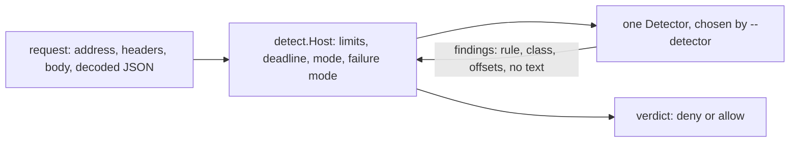

# Detector tiers and the Betterleaks spike

> **Updated 2026-11-24 (Joe, "Decided" 10).** The scanner has one detector call path and a
> swappable `Detector` interface (`detect/`). Betterleaks is the single entrypoint after the
> flip. Multi-detector merging, Pipelock, windows and the Pro engine tier are deferred. The
> spike results below stay as the evidence for the choice.

Status: spike result (2026-11-24). No code or cluster change. It belongs to
[ARCHITECTURE.md](ARCHITECTURE.md). Joe's goals: block credentials at all
egress, and keep the scanner generic enough to propose to Agent Substrate. The
Semgrep Pro engine stays private behind the generic HTTP engine interface.

## Result

- Betterleaks `scan` is a Go library. It scans a string, loads the same TOML
  rules as Gitleaks, makes no network call, and brings 8 modules.
- On a 63-sample fake corpus it found 38 of 45 secrets. The pinned Gitleaks
  found 29. The Pro engine found 32. All three raised no false positive on 18
  clean samples. Every Gitleaks catch was also a Betterleaks catch.
- Betterleaks adds one thing the other two lack: it decodes base64, hex,
  percent and Unicode text before it matches. The Pro engine adds two catches
  that neither regex tool made (a Bearer header and a Basic header).
- Recommendation: add Betterleaks beside Gitleaks in observe mode behind a
  flag, then replace Gitleaks. Betterleaks v2 is a release candidate today, so
  the switch waits for a stable v2 or an accepted pin.
- Nothing found makes the Gitleaks tier unsafe. Two gaps are in "Findings
  about the current tier".

## Embeddability

| Item | Betterleaks | Gitleaks (pinned) |
| --- | --- | --- |
| Module | `github.com/betterleaks/betterleaks/v2` | `github.com/zricethezav/gitleaks/v8` |
| Version | `v2.0.0-rc.11` (2026-11-23). Latest stable: `v1.10.1` (2026-11-12) | `v8.24.3` (2025-04-11). Latest: `v8.30.1` (2026-03-21) |
| Licence | MIT | MIT |
| API | `config.Default()` or `config.LoadFile()`, then `scan.New(cfg, opts...)`. `Scanner.ScanString(text)` returns findings. `Scanner.Scan(ctx, source, handler)` takes a context. Options: decode depth, workers, minimum confidence, regex engine | `config` and `detect` packages. The scanner uses only `config` and its own matcher |
| Rules | 483 embedded rules, Aho-Corasick keyword prefilter, RE2-style rule regexes (stdlib engine). Reads `.gitleaks.toml` | 203 embedded rules loaded by the scanner (217 in `v8.30.1`) |
| Decoding | base64, hex, percent, Unicode, nested up to `WithMaxDecodeDepth`. The codec is in `internal/`, so a caller cannot use it alone | None |
| Network | None in `scan` and `config`. The run of the corpus worked in an empty network namespace. Validation (`analyze`) is a separate package that we would not import | None |
| Dependencies | `scan` plus `config` pull 8 modules besides itself: `expr-lang/expr`, `dlclark/regexp2`, `rrethy/ahocorasick`, `go-toml/v2`, `hashicorp/go-version`, `go-isatty`, `x/sync`, `x/sys`. The Git, Docker and archive modules sit in `sources/` and stay out. Binary of the probe: 16 MB | Viper and its modules |
| Go | 1.26.0, the same as our `go.mod` | |
| Maintainers | Org `betterleaks`. 293 of the commits are the original Gitleaks author's. Aikido Security is a listed sponsor, and a contributor with an `aikido` handle has 13 commits | The same author, who now works on Betterleaks. No release in the last 8 months (the last is `v8.30.1`) |
| Cadence | 33 releases since 2026-02-20. v2 had 11 release candidates in 8 weeks (rc.10 and rc.11 on the same day) | None in the last 8 months |
| Provenance | Releases carry `checksums.txt` and a Sigstore bundle (cosign keyless, in `release.yml`). No SLSA attestation seen | Not checked |
| Issues | 150 open, 1 published advisory (2026-11-18, Git `textconv` helpers when scanning a repository, high). It is in the Git source and not in `scan` | |

The library fits an in-process tier. There is no CLI-only limit. `ScanString`
has no context, so a deny-path caller uses `Scan` with a `sources.Reader` to
get cancellation. The scanner checks the context between rules, not inside a
regex. The rule regexes use the Go standard engine, which runs in linear time,
so body size bounds the time. The confidence tokenizer uses `regexp2`, a
backtracking engine, and rule filters run in `expr`. Both see short inputs.

## Corpus

The corpus holds 63 fake samples in a scratch directory. It is not in the
repository: a public repository must not hold token-shaped text. It has 45 secret
samples (plain tokens of 12 kinds, JSON with escapes, base64, double base64,
hex, percent, split lines, PEM, JWT, Authorization headers, `.env`, kubeconfig,
Kubernetes Secret manifests, tool logs, a Docker config) and 18 clean samples
(prose, code, hashes, UUIDs, random base64, a certificate, an image digest,
logs). Three values are not real shapes: `jwt` is a malformed token, and all
three tools miss it by design. A valid JWT (`jwt-valid`) is in the set.

Gitleaks ran as the scanner runs it: the `rules.go` matcher with the embedded
`v8.24.3` rules, on the body and the decoded JSON strings. Betterleaks ran on
the same two texts with decode depth 8. The library default is 0, which turns
decoding off, so the caller must set a depth. The Pro engine ran through
`engine-gate` (`X-Deadline-Ms: 5000`) from an ephemeral container on an
`egress-scan` pod, with the engine text the scanner builds. 178 gate scans in
all, one at a time. Gitleaks `v8.30.1` ran on the same samples as an upgrade
baseline.

| Sample | Expected | Gitleaks 8.24.3 (pinned) | Gitleaks 8.30.1 | Betterleaks rc.11 | Pro engine |
| --- | --- | --- | --- | --- | --- |
| plain-github | secret | yes | yes | yes | yes |
| plain-aws | secret | yes | yes | yes | yes |
| plain-slack | secret | yes | yes | yes | yes |
| plain-stripe | secret | yes | yes | yes | yes |
| plain-gcp-apikey | secret | yes | yes | yes | yes |
| plain-sendgrid | secret | yes | yes | yes | yes |
| plain-npm | secret | yes | yes | yes | yes |
| plain-openai | secret | yes | yes | yes | yes |
| plain-anthropic | secret | no | yes | yes | yes |
| json-github | secret | yes | yes | yes | yes |
| json-escaped-unicode | secret | yes | yes | yes | yes |
| json-escaped-slack | secret | yes | yes | yes | yes |
| json-code-in-string | secret | yes | yes | yes | yes |
| json-nested-array | secret | yes | yes | yes | yes |
| b64-github | secret | no | no | yes | no |
| b64-bare-github | secret | no | no | yes | no |
| b64-aws-pair | secret | no | no | yes | no |
| b64-double-github | secret | no | no | yes | no |
| url-encoded-github | secret | yes | yes | yes | yes |
| url-encoded-key | secret | no | no | yes | no |
| b64-in-json | secret | no | no | yes | no |
| hex-github | secret | no | no | yes | no |
| split-lines-json-concat | secret | no | no | no | no |
| split-across-lines | secret | no | no | no | no |
| pem-private-key | secret | yes | yes | yes | yes |
| pem-in-json | secret | yes | yes | yes | yes |
| jwt | secret | no | no | no | no |
| auth-bearer-40 | secret | no | no | no | yes |
| auth-basic | secret | no | no | no | yes |
| auth-token-header | secret | yes | yes | yes | yes |
| env-dump | secret | yes | yes | yes | yes |
| kubeconfig-token | secret | yes | yes | yes | yes |
| k8s-secret-b64 | secret | yes | yes | yes | yes |
| k8s-secret-b64-pw | secret | yes | yes | yes | yes |
| log-tool-output | secret | yes | yes | yes | yes |
| db-url | secret | no | no | no | no |
| generic-password | secret | yes | yes | yes | yes |
| clean-prose | clean | no | no | no | no |
| clean-go-code | clean | no | no | no | no |
| clean-sha256 | clean | no | no | no | no |
| clean-uuids | clean | no | no | no | no |
| clean-b64-random | clean | no | no | no | no |
| clean-b64-png | clean | no | no | no | no |
| clean-json-memory | clean | no | no | no | no |
| clean-k8s-ca | clean | no | no | no | no |
| clean-lockfile-integrity | clean | no | no | no | no |
| clean-hex-ids | clean | no | no | no | no |
| clean-docs-token-word | clean | no | no | no | no |
| clean-placeholder | clean | no | no | no | no |
| clean-long-words | clean | no | no | no | no |
| clean-logs | clean | no | no | no | no |
| clean-base64-text | clean | no | no | no | no |
| jwt-valid | secret | yes | yes | yes | yes |
| github-fine-grained | secret | yes | yes | yes | yes |
| azure-conn-string | secret | yes | yes | yes | yes |
| docker-config-auth | secret | yes | yes | yes | yes |
| b64-pem | secret | no | no | yes | yes |
| gzip-b64-github | secret | no | no | no | no |
| aws-split-json-keys | secret | yes | yes | yes | yes |
| slack-webhook | secret | yes | yes | yes | no |
| clean-git-diff | clean | no | no | no | no |
| clean-helm-values | clean | no | no | no | no |
| clean-curl-docs | clean | no | no | no | no |

| Result | Gitleaks 8.24.3 | Gitleaks 8.30.1 | Betterleaks | Pro engine |
| --- | --- | --- | --- | --- |
| Secrets found, of 45 | 29 | 30 | 38 | 32 |
| Betterleaks with decoding off | | | 31 | |
| False positives, of 18 | 0 | 0 | 0 | 0 |
| Only this tool found it | none | none | 7: `b64-github`, `b64-bare-github`, `b64-aws-pair`, `b64-double-github`, `url-encoded-key`, `b64-in-json`, `hex-github` | 2: `auth-bearer-40`, `auth-basic` |
| Missed by all three | `split-lines-json-concat`, `split-across-lines`, `jwt` (malformed), `db-url`, `gzip-b64-github` | | | |

Other differences: Gitleaks `8.24.3` misses the Anthropic key (found by
`8.30.1`). The Pro engine misses the Slack webhook URL and the AWS key split
over two JSON fields, which both regex tools find. Betterleaks and the Pro
engine find an encoded private key, and Gitleaks does not. A database URL with a
password is missed by all.

## Latency

In-process, on node-1 with `GOMAXPROCS=2`, not under gVisor. Median of 15 runs,
the worst run differed by under 10% except where shown. Gitleaks is the
scanner's matcher. Betterleaks uses decode depth 8.

| Body | Text kind | Gitleaks | Betterleaks |
| --- | --- | --- | --- |
| 1 KiB | prose | 0.1 ms | under 0.1 ms |
| 64 KiB | prose | 6.2 ms | 0.2 ms |
| 512 KiB | prose | 49.8 ms | 1.2 ms |
| 1 KiB | keyword-heavy | 0.5 ms | 0.4 ms (worst 4.5 ms) |
| 64 KiB | keyword-heavy | 33.4 ms | 24.4 ms |
| 512 KiB | keyword-heavy | 235.6 ms | 197.6 ms |

The keyword-heavy text repeats `token`, `secret`, `password` and `key` on every
line, so every rule with those keywords runs. Betterleaks is faster on prose
because its prefilter skips rules with no keyword in the text. The cost of
decoding was under 0.5 ms on these bodies.

## Findings about the current tier

1. Rule drift. The scanner pins Gitleaks `8.24.3` (April 2025). It misses the
   Anthropic key shape, and the Pro engine covers it in enforce mode. Moving to
   `8.30.1` needs a code change (`config.Config.Allowlist` became `Allowlists`),
   and adds one catch on this corpus.
2. A keyword-heavy body of 512 KiB takes about 236 ms in the Gitleaks matcher,
   over its 75 ms deadline, so the scanner denies it (fail closed). The engine
   limit of 64 KiB keeps Hindsight below this (33 ms). Windows or a larger
   limit must keep the Gitleaks cost in view (DESIGN-large-bodies.md).
3. 7 encoded samples pass both the Gitleaks tier and the Pro engine (base64,
   double base64, hex, a percent-encoded name). Betterleaks with decoding finds
   all 7. The scanner decodes JSON strings only.

## Detector interface (built)

The scanner calls exactly one detector. The contract, the registry, the host
that enforces limits and the swap procedure are in the doc comment of package
`detect` (`detect/doc.go`). This section is the summary.

| Part | What it is |
| --- | --- |
| `Input` | `Bytes` (not necessarily UTF-8), `Source`, `Filename` (may be empty), `Via` (decoders applied) |
| `Finding` | `Detector`, `RuleID`, `Class` (`block` by default, or `report`), `Start` and `End` (or `NoOffset`). Never the matched text |
| `Detector` | `Name()` and `Detect(ctx, Input)`. It stops when the context ends, never skips a finding because the input asks it to, and is safe for concurrent calls |
| `Config` | Per detector: `Mode` (enforce or observe), `FailureMode` (deny or allow), `Limits` (max input bytes, deadline), `DataPath`, `Options`. All of it comes from flags and chart values |
| `Host` | Enforces the limits for every detector the same way: an input over the cap is a failure and never a skip, the deadline holds even for a detector that ignores its context, a panic is a failure, observe mode never denies |
| `PrivateData` | Optional: `Load(path)`, `Reload()`, `Health()`, for a detector with data kept outside the public repository. Betterleaks and Gitleaks do not use it |
| Registry | `Register(name, Factory)` in a package `init`. `detectors.go` imports the public ones. A private build adds a file such as `detectors_private.go` that imports its own package, and the public code does not change |
| Conformance | `detecttest.Conformance` is the table every detector passes: clean input allowed, a finding denied, an allow marker next to a secret still denied, observe mode, the size cap, the deadline, a canceled caller, the context respected, concurrent calls, and no matched text in a verdict or a log. Gitleaks and Betterleaks run it. A new detector reuses it with a fixture of its own. `detecttest.Corpus` builds the fake samples at run time |

### Swap procedure

1. Write a package that implements `Detector` and registers itself.
2. Import it in the binary (`detectors.go` for a public one).
3. Pass `detecttest.Conformance` with a fixture of your own.
4. Set `detector.name` in the chart values of the Application.
5. Keep the previous detector for one release: the revert is the value.

### Betterleaks settings that a test pins

- **Allow markers off.** `betterleaks:allow` and `gitleaks:allow` are on by
  default in the library, and a request could put one beside a secret. The
  adapter passes `WithAllowSignatures()` with no signature. A test shows the
  secret is found with the markers present, and fails when the option is removed.
- **Decode depth 3.** Base64, hex, percent and Unicode text decode up to 3
  passes. The host caps the input at 512 KiB, which bounds the decoded size. A
  test fails when decoding is off.
- **Work bound.** The call takes the request context, which the library checks
  between rules, and the host stops waiting at the 75 ms deadline. A 512 KiB
  keyword-heavy body fails at the deadline and is denied (failure mode deny).
- **Extra rules as data.** `detect/betterleaks/extra_rules.toml` extends the
  default rules with a database URL that holds a password and an Authorization
  header with a bearer token or a basic credential. These are the gaps that the
  Pro engine and Pipelock covered on the spike corpus.
- **Version.** Module `v2.0.0-rc.11`, exact pin in `go.mod`. The latest stable
  line is `v1.10.1`. Its `detect.Detector` can ignore only `gitleaks:allow`
  (`IgnoreGitleaksAllow`): `betterleaks:allow` is a fixed package variable
  there, so a marker beside a secret would still hide it (read in the `v1.10.1`
  source). Only v2 has `WithAllowSignatures()` to turn both markers off. A
  release candidate pins an API that can change before 2.0.0: the upgrade is a
  reviewed change, and the conformance test and the corpus catch a regression.
  The checksum is in `go.sum` and was checked against the Go checksum database
  when the module was added.

## Plan

| # | PR | State |
| --- | --- | --- |
| 1 | Remove the Semgrep tier code: one detector call path (#8662) | Done |
| 2 | The `detect` package, the Gitleaks and Betterleaks detectors, `--detector`, the conformance test and the corpus. Default stays `gitleaks` | Done in this change |
| 3 | Flip `detector.name` to `betterleaks`. Run the synthetic table and the fake corpus against the live scanner. Gitleaks stays for one release as the revert lever | Done in this change (live results in the PR) |
| 4 | Remove the Gitleaks adapter after one release | Later |

Deferred (Joe, 2026-11-24), kept as notes only: a second detector joined to the
first, the decoder chain of our own, the windowed scan, the Pro engine tier, the
Pipelock trial, git push scanning, scanning all egress, the HA policy. A
Mandoline-based detector (exact match of known private content from a private
index) is the planned second plug-in, in a private build, through `PrivateData`.

## Risks

- v2 is a release candidate. See the version note above.
- A new dependency on a deny path. It runs in process with no network. The host
  recovers a panic and fails the call (deny with failure mode deny).
- More rules (483 against 203) can raise false positives on real agent text. The
  corpus and the synthetic replay measure it before the flip, and the revert is
  one value.
- The extra Authorization rules deny a bearer or basic credential that the actor
  sends in a header or a body. The gateway injects the real credential after the
  scanner, so an actor holds none (the placeholder `Bearer -` stays allowed). The
  flip PR checks the live counters and Hindsight health, and the revert is one
  value.
- The library scans a stream in chunks of about 100,000 bytes, and a secret that
  crosses a cut is missed. The adapter hands over the whole input as one fragment
  (a test puts a token at six cut offsets). Any detector that reads a stream has
  the same risk: `detect/doc.go` says to pass the whole input.
- Calls past their deadline keep running until the detector looks at its context.
  The host bounds the calls in flight (4 for each scan slot, 32 now). If an actor
  sends bodies that hold the detector past its deadline 32 times, every request
  fails with reason `budget` and is denied (failure mode deny) until the calls end.
  That fails closed and shows in `factory_egress_scan_detector_failures_total`.
- The Gitleaks match budget (64) is per input now: address, body and decoded text
  each get one, where the old code shared one. The deadline still bounds the work.
- With failure mode allow, a failure on one input lets the whole request through
  unscanned. The scanner runs with failure mode deny.
- Decoding at depth 3 adds work. The 75 ms deadline and the 512 KiB cap bound it.
- The corpus is small and ours. It shows direction, not rates.
- Facts about Betterleaks (release dates, counts, the advisory) come from the
  GitHub API and a shallow clone on 2026-11-24. They age.
