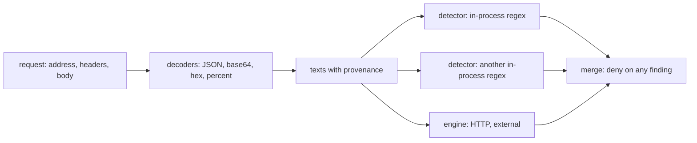

# Detector tiers and the Betterleaks spike

Status: spike result (2026-11-24). No code or cluster change. It belongs to
[ARCHITECTURE.md](ARCHITECTURE.md). Joe's goals: block credentials at all
egress, and keep the scanner generic enough to propose to Agent Substrate. The
Semgrep Pro engine stays private behind the generic HTTP engine interface.

## Result

- Betterleaks `scan` is a Go library. It scans a string, loads the same TOML
  rules as Gitleaks, makes no network call, and brings 8 modules.
- On a 63-sample fake corpus it found 38 of 45 secrets. The pinned Gitleaks
  found 29. The Pro engine found 32. All three raised no false positive on 18
  clean samples. Every Gitleaks catch was also a Betterleaks catch.
- Betterleaks adds one thing the other two lack: it decodes base64, hex,
  percent and Unicode text before it matches. The Pro engine adds two catches
  that neither regex tool made (a Bearer header and a Basic header).
- Recommendation: add Betterleaks beside Gitleaks in observe mode behind a
  flag, then replace Gitleaks. Betterleaks v2 is a release candidate today, so
  the switch waits for a stable v2 or an accepted pin.
- Nothing found makes the Gitleaks tier unsafe. Two gaps are in "Findings
  about the current tier".

## Embeddability

| Item | Betterleaks | Gitleaks (pinned) |
| --- | --- | --- |
| Module | `github.com/betterleaks/betterleaks/v2` | `github.com/zricethezav/gitleaks/v8` |
| Version | `v2.0.0-rc.11` (2026-11-23). Latest stable: `v1.10.1` (2026-11-12) | `v8.24.3` (2025-04-11). Latest: `v8.30.1` (2026-03-21) |
| Licence | MIT | MIT |
| API | `config.Default()` or `config.LoadFile()`, then `scan.New(cfg, opts...)`. `Scanner.ScanString(text)` returns findings. `Scanner.Scan(ctx, source, handler)` takes a context. Options: decode depth, workers, minimum confidence, regex engine | `config` and `detect` packages. The scanner uses only `config` and its own matcher |
| Rules | 483 embedded rules, Aho-Corasick keyword prefilter, RE2 regexes (linear time). Reads `.gitleaks.toml` | 203 embedded rules loaded by the scanner (217 in `v8.30.1`) |
| Decoding | base64, hex, percent, Unicode, nested up to `WithMaxDecodeDepth`. The codec is in `internal/`, so a caller cannot use it alone | None |
| Network | None in `scan` and `config`. The run of the corpus worked in an empty network namespace. Validation (`analyze`) is a separate package that we would not import | None |
| Dependencies | `scan` plus `config` pull 8 modules besides itself: `expr-lang/expr`, `dlclark/regexp2`, `rrethy/ahocorasick`, `go-toml/v2`, `hashicorp/go-version`, `go-isatty`, `x/sync`, `x/sys`. The Git, Docker and archive modules sit in `sources/` and stay out. Binary of the probe: 16 MB | Viper and its modules |
| Go | 1.26.0, the same as our `go.mod` | |
| Maintainers | Org `betterleaks`. 293 of the commits are the original Gitleaks author's. Aikido Security is a listed sponsor, and a contributor with an `aikido` handle has 13 commits | The same author, who now works on Betterleaks. No release in the last 8 months (the last is `v8.30.1`) |
| Cadence | 33 releases since 2026-02-20. v2 had 11 release candidates in 8 weeks (rc.10 and rc.11 on the same day) | None in the last 8 months |
| Provenance | Releases carry `checksums.txt` and a Sigstore bundle (cosign keyless, in `release.yml`). No SLSA attestation seen | Not checked |
| Issues | 150 open, 1 published advisory (2026-11-18, Git `textconv` helpers when scanning a repository, high). It is in the Git source and not in `scan` | |

The library fits an in-process tier. There is no CLI-only limit. `ScanString`
has no context, so a deny-path caller uses `Scan` with a `sources.Reader` to
get cancellation. The scanner checks the context between rules, not inside a
regex, and Go regexes run in linear time, so body size bounds the time.

## Corpus

The corpus holds 63 fake samples in a scratch directory. It is not in the
repository: a public repository must not hold token-shaped text. It has 45 secret
samples (plain tokens of 12 kinds, JSON with escapes, base64, double base64,
hex, percent, split lines, PEM, JWT, Authorization headers, `.env`, kubeconfig,
Kubernetes Secret manifests, tool logs, a Docker config) and 18 clean samples
(prose, code, hashes, UUIDs, random base64, a certificate, an image digest,
logs). Three values are not real shapes: `jwt` is a malformed token, and all
three tools miss it by design. A valid JWT (`jwt-valid`) is in the set.

Gitleaks ran as the scanner runs it: the `rules.go` matcher with the embedded
`v8.24.3` rules, on the body and the decoded JSON strings. Betterleaks ran on
the same two texts with its default decode depth. The Pro engine ran through
`engine-gate` (`X-Deadline-Ms: 5000`) from an ephemeral container on an
`egress-scan` pod, with the engine text the scanner builds. 178 gate scans in
all, one at a time. Gitleaks `v8.30.1` ran on the same samples as an upgrade
baseline.

| Sample | Expected | Gitleaks 8.24.3 (pinned) | Gitleaks 8.30.1 | Betterleaks rc.11 | Pro engine |
| --- | --- | --- | --- | --- | --- |
| plain-github | secret | yes | yes | yes | yes |
| plain-aws | secret | yes | yes | yes | yes |
| plain-slack | secret | yes | yes | yes | yes |
| plain-stripe | secret | yes | yes | yes | yes |
| plain-gcp-apikey | secret | yes | yes | yes | yes |
| plain-sendgrid | secret | yes | yes | yes | yes |
| plain-npm | secret | yes | yes | yes | yes |
| plain-openai | secret | yes | yes | yes | yes |
| plain-anthropic | secret | no | yes | yes | yes |
| json-github | secret | yes | yes | yes | yes |
| json-escaped-unicode | secret | yes | yes | yes | yes |
| json-escaped-slack | secret | yes | yes | yes | yes |
| json-code-in-string | secret | yes | yes | yes | yes |
| json-nested-array | secret | yes | yes | yes | yes |
| b64-github | secret | no | no | yes | no |
| b64-bare-github | secret | no | no | yes | no |
| b64-aws-pair | secret | no | no | yes | no |
| b64-double-github | secret | no | no | yes | no |
| url-encoded-github | secret | yes | yes | yes | yes |
| url-encoded-key | secret | no | no | yes | no |
| b64-in-json | secret | no | no | yes | no |
| hex-github | secret | no | no | yes | no |
| split-lines-json-concat | secret | no | no | no | no |
| split-across-lines | secret | no | no | no | no |
| pem-private-key | secret | yes | yes | yes | yes |
| pem-in-json | secret | yes | yes | yes | yes |
| jwt | secret | no | no | no | no |
| auth-bearer-40 | secret | no | no | no | yes |
| auth-basic | secret | no | no | no | yes |
| auth-token-header | secret | yes | yes | yes | yes |
| env-dump | secret | yes | yes | yes | yes |
| kubeconfig-token | secret | yes | yes | yes | yes |
| k8s-secret-b64 | secret | yes | yes | yes | yes |
| k8s-secret-b64-pw | secret | yes | yes | yes | yes |
| log-tool-output | secret | yes | yes | yes | yes |
| db-url | secret | no | no | no | no |
| generic-password | secret | yes | yes | yes | yes |
| clean-prose | clean | no | no | no | no |
| clean-go-code | clean | no | no | no | no |
| clean-sha256 | clean | no | no | no | no |
| clean-uuids | clean | no | no | no | no |
| clean-b64-random | clean | no | no | no | no |
| clean-b64-png | clean | no | no | no | no |
| clean-json-memory | clean | no | no | no | no |
| clean-k8s-ca | clean | no | no | no | no |
| clean-lockfile-integrity | clean | no | no | no | no |
| clean-hex-ids | clean | no | no | no | no |
| clean-docs-token-word | clean | no | no | no | no |
| clean-placeholder | clean | no | no | no | no |
| clean-long-words | clean | no | no | no | no |
| clean-logs | clean | no | no | no | no |
| clean-base64-text | clean | no | no | no | no |
| jwt-valid | secret | yes | yes | yes | yes |
| github-fine-grained | secret | yes | yes | yes | yes |
| azure-conn-string | secret | yes | yes | yes | yes |
| docker-config-auth | secret | yes | yes | yes | yes |
| b64-pem | secret | no | no | yes | yes |
| gzip-b64-github | secret | no | no | no | no |
| aws-split-json-keys | secret | yes | yes | yes | yes |
| slack-webhook | secret | yes | yes | yes | no |
| clean-git-diff | clean | no | no | no | no |
| clean-helm-values | clean | no | no | no | no |
| clean-curl-docs | clean | no | no | no | no |

| Result | Gitleaks 8.24.3 | Gitleaks 8.30.1 | Betterleaks | Pro engine |
| --- | --- | --- | --- | --- |
| Secrets found, of 45 | 29 | 30 | 38 | 32 |
| Betterleaks with decoding off | | | 31 | |
| False positives, of 18 | 0 | 0 | 0 | 0 |
| Only this tool found it | none | none | 7: `b64-github`, `b64-bare-github`, `b64-aws-pair`, `b64-double-github`, `url-encoded-key`, `b64-in-json`, `hex-github` | 2: `auth-bearer-40`, `auth-basic` |
| Missed by all three | `split-lines-json-concat`, `split-across-lines`, `jwt` (malformed), `db-url`, `gzip-b64-github` | | | |

Other differences: Gitleaks `8.24.3` misses the Anthropic key (found by
`8.30.1`). The Pro engine misses the Slack webhook URL and the AWS key split
over two JSON fields, which both regex tools find. Betterleaks and the Pro
engine find an encoded private key, and Gitleaks does not. A database URL with a
password is missed by all.

## Latency

In-process, on node-1 with `GOMAXPROCS=2`, not under gVisor. Median of 15 runs,
the worst run differed by under 10% except where shown. Gitleaks is the
scanner's matcher. Betterleaks uses decode depth 8.

| Body | Text kind | Gitleaks | Betterleaks |
| --- | --- | --- | --- |
| 1 KiB | prose | 0.1 ms | under 0.1 ms |
| 64 KiB | prose | 6.2 ms | 0.2 ms |
| 512 KiB | prose | 49.8 ms | 1.2 ms |
| 1 KiB | keyword-heavy | 0.5 ms | 0.4 ms (worst 4.5 ms) |
| 64 KiB | keyword-heavy | 33.4 ms | 24.4 ms |
| 512 KiB | keyword-heavy | 235.6 ms | 197.6 ms |

The keyword-heavy text repeats `token`, `secret`, `password` and `key` on every
line, so every rule with those keywords runs. Betterleaks is faster on prose
because its prefilter skips rules with no keyword in the text. The cost of
decoding was under 0.5 ms on these bodies.

## Findings about the current tier

1. Rule drift. The scanner pins Gitleaks `8.24.3` (April 2025). It misses the
   Anthropic key shape, and the Pro engine covers it in enforce mode. Moving to
   `8.30.1` needs a code change (`config.Config.Allowlist` became `Allowlists`),
   and adds one catch on this corpus.
2. A keyword-heavy body of 512 KiB takes about 236 ms in the Gitleaks matcher,
   over its 75 ms deadline, so the scanner denies it (fail closed). The engine
   limit of 64 KiB keeps Hindsight below this (33 ms). Windows or a larger
   limit must keep the Gitleaks cost in view (DESIGN-large-bodies.md).
3. Encoded secrets pass the Gitleaks tier and the Pro engine in 7 of 7 samples
   (base64, double base64, hex, percent-encoded names). The scanner decodes
   JSON strings only.

## Generic design

The scanner calls tiers that share one shape. It names nothing from this
repository, so it can move to Agent Substrate.



```go
// Input is one text to scan, with where it came from.
type Input struct {
	Text   string
	Source string   // "path", "query", "header", "body"
	Via    []string // decoders applied, in order, such as "json", "base64"
}

// Finding names a rule and where the match sits in Input.Text.
type Finding struct {
	Detector, RuleID string
	Start, End       int
}

// Detector scans one Input. It stops when ctx is done and never logs the match.
type Detector interface {
	Name() string
	Detect(ctx context.Context, in Input) ([]Finding, error)
}

// Decoder derives more Inputs from one Input, with depth and size caps.
type Decoder interface {
	Decode(ctx context.Context, in Input) ([]Input, error)
}
```

- **Tiers.** Gitleaks, Betterleaks and any other regex tool are `Detector`
  values. The HTTP engine is a `Detector` that posts the text and reads
  findings. Each tier has a mode (observe or enforce), a failure mode and a
  deadline.
- **Decoding.** One `Decoder` chain makes the texts for every tier, so the
  engine sees decoded forms too. The Betterleaks codec is internal, so the
  chain is ours (base64, hex, percent, Unicode, depth 3, a size cap). Betterleaks
  keeps its own decoding for its own findings.
- **Merge.** Any finding denies. A tier failure follows the failure mode. This
  is the rule of DESIGN-large-bodies.md.
- **Counters.** `detector_requests_total{detector,outcome}` and
  `detector_agreement_total{a,b}` give the observe window its data.

What to say in an upstream issue first (Agent Substrate; do not open it yet):

1. The gap: an egress gateway can call an `ext_authz` scanner for a route, but
   the repository ships none that blocks credentials.
2. The proposal: a small scanner with the interfaces above, rules from TOML
   (Gitleaks and Betterleaks format), no network call, fail closed.
3. The engine contract: `POST` the text, an `X-Deadline-Ms` header, a JSON reply
   with a list of findings (rule and offsets). A private engine can sit behind it.
4. Questions: does Substrate want it in tree or as a sample; what policy API
   names a route and a mode; which licence terms for bundled rules.

For Betterleaks (a separate issue, also not opened): export the codec or a
`Decode` view, add a context to `ScanString`, and state when v2 reaches a stable
tag.

## Recommendation

Add Betterleaks beside Gitleaks, switch after an observe window, and keep the
Pro engine. It finds more (38 against 29 here), makes no false positive on this
set, is as fast or faster, and its decoding is the one gap no other tier covers.
Replace Gitleaks only after a stable v2 tag, or accept an exact rc pin with a
digest.

| # | PR | Tests |
| --- | --- | --- |
| 1 | The `Detector` interface and the Gitleaks matcher behind it. No behavior change. Per-detector counters | Existing scanner tests pass. A fake detector shows merge, deadline and failure mode |
| 2 | The decoder chain (base64, hex, percent, Unicode, depth 3, size cap) feeding every tier, behind a flag | A corpus test: each encoded sample decodes, a clean random base64 sample does not make a finding, caps hold |
| 3 | The Betterleaks detector in observe mode, off the request path, with `recover()`. Pin the exact version in `go.mod` | Build and image size. A panic test. The agreement counter moves on the corpus |
| 4 | Observe window: 1 day of Hindsight traffic plus a corpus replay Job each night through the live check | The counters in `detector_agreement_total`. No Betterleaks-only finding on clean traffic. Review them |
| 5 | Enforce Betterleaks with Gitleaks as the fallback flag | The synthetic table of the enforce PR. Roll back with the flag |
| 6 | Drop the Gitleaks dependency, or keep it as a second detector | Image size, latency table |

Risks:

- v2 is a release candidate. The API can change before 2.0.0. An exact pin and
  the observe window cover this.
- A new dependency on a deny path. It runs in process with no network, but a
  panic or a slow regex would deny requests. `recover()`, a deadline and observe
  mode first cover this.
- More rules (483) means more false positives on real agent text. The observe
  window measures it. A custom config that pins the rule set keeps upgrades
  stable (the Betterleaks README advises it).
- The corpus is small and ours. It shows direction, not rates.
