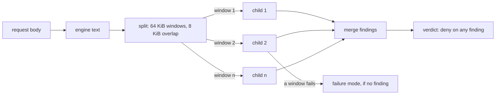

# Large bodies in the egress scanner

Status: design, not built. It belongs to [ARCHITECTURE.md](ARCHITECTURE.md),
section "Large bodies". Joe's direction (2026-11-24) has three parts. The scan
is generic, and a large payload may take longer. The scanner eventually defers
to Gitleaks for a body that is too large. A large body is broken up. This note holds the
limits today, the windowed scan, the alternative, the over-limit policy, the
build plan and the future detectors. It changes no code.

## Limits today

| Limit | Value | Where it comes from | Behavior over the limit |
| --- | --- | --- | --- |
| Gateway body | 512 KiB | `includeRequestBody.maxRequestBytes: 524288` and `allowPartialMessage: false` in `gateway-policy.yaml` | The gateway does not send a partial body. With `failureMode: deny` the request fails before the scanner sees it |
| Scanner hard cap | 512 KiB | `maxBody` in `scan.go` | The scanner denies with 413, before Gitleaks or the engine run |
| Engine body limit | 64 KiB | `semgrep.maxBodyBytes: 65536` in the Application values (Decided 8) | `oversize`. In enforce mode with failure mode `deny`: 503 |
| Gate request | 1.2 MiB | `--max-body` (default 1258291) | 413. It holds 512 KiB of body, up to 512 KiB of decoded JSON text and the headers |
| Gate response | 1 MiB | `--max-response` (the scanner has the same limit) | The call fails: failure mode applies |
| Child memory | 144 MiB booked | 128 MiB limit and 16 MiB overhead | The child dies: the call fails |
| Deadline | 300 ms | `semgrep.deadline` | `timeout`: failure mode applies |
| Gateway timeout | 310 ms | `requestTimeout` in `gateway-policy.yaml`, deadline plus 10 ms | The gateway denies |

Latency through the gate, worst of 5 runs (after the sizing roll, 2026-11-24):

| Raw body | Worst of 5 |
| --- | --- |
| 1 KiB | 76 ms |
| 64 KiB | 151 ms |
| 256 KiB | 278 ms |
| 512 KiB | 464 ms |

The engine alone costs about 0.35 ms for each KiB of engine text (ARCHITECTURE.md,
"Latency budget"). The table above is the whole round trip, which adds the
copies between hops: it slopes at 0.66 to 0.73 ms for each KiB. The limits sit in
global flags. Every scanned route shares them.

## Windowed parallel scan

The scanner splits the engine text (`engineText` in `semgrep.go`) into windows
of 64 KiB. Each window overlaps the next by 8 KiB, because a secret is short (a
PEM private key is about 4 KiB). The scanner moves a cut to the nearest newline
inside the overlap, so a cut rarely falls inside a token. Each window goes to
the gate as its own call and runs on its own child. Latency stays near one
window while the windows run at once.

- **Merge.** A finding holds a rule and an offset inside its window. The
  scanner adds the window start, so the offset is relative to the engine text.
  It drops a finding that has the same rule and offset as another (the overlap
  produces these). Any finding denies. The log holds the rule and the offset
  and never the matched text.
- **All or nothing.** If a window fails (timeout, error, shed, oversize) and no
  window has a finding, the call has no verdict. The failure mode applies to the
  whole request. A finding in any window denies, whatever the failure mode says.
  This keeps today's precedence, where Gitleaks wins (`scan.go`). The scanner
  cancels the other windows only after a finding, or after a failure when the
  failure mode is `deny`.
- **Header context.** The address and the headers (`fields`) go in window 1
  only. A rule that pairs a header or the host with a body secret loses that
  context in later windows. Build step 3 tests this.
- **Cost, children.** Each window books one child (1000m CPU, 144 MiB). The
  pool keeps 2 waiting children (`--target-waiting=2`) and 8 in all. A window
  without a waiting child takes path A. Path A replaces the router resume
  check with 96 to 145 ms of steps (the budget table above), so its total p95
  is 297 to 346 ms, at or over the deadline. The gate allows 2 path A calls at
  once (`--max-fallback`). A request of 4 windows with 2 waiting children
  sends 2 windows to path A, which likely fail, and one failure fails the
  request. So windows need `--target-waiting` at or above the window count.
  Pool nodes are at about 98% of their requests, and the pool holds 8
  children. More waiting children need a request-room check and a resize of
  the worker (now 640Mi and 4 CPU), each in its own PR.
- **Cost, capacity.** The scanner runs 2 engine calls in each of its 2 pods
  (`semgrep.concurrency: 2`), and the gate admits 4 scans (`--max-inflight`).
  A call that needs 10 windows runs in 3 waves of 4 at most. Four parallel
  64 KiB calls took 124 to 215 ms, so 10 windows would take about 650 ms. That
  is no better than one 512 KiB call (464 ms). Windows pay off only when
  the windows of one request run at once. Four windows cover
  232 KiB of engine text: a plain body of about 230 KiB, or an escaped JSON
  body of about 116 KiB. That fits the in-flight cap, and it needs 4 waiting
  children. A larger body needs both caps and the worker
  raised. A run at 10 parallel children is unmeasured. Inference: it is CPU
  bound, because each child needs one vCPU for 60 to 80 ms.
- **Window count.** A 512 KiB plain body gives about 10 windows. Escaped JSON
  doubles the text (`engineText` adds the decoded strings when the body has a
  backslash) and gives about 19. Open question 6 covers a smaller decoded copy.
- **What a window edge can miss.** A match that spans more than the 8 KiB
  overlap. A multi-line rule whose lines sit in two windows with more than
  8 KiB between them. A rule that needs a name far before the value (a
  `key =` line and the secret more than 8 KiB later). An attacker controls
  that gap. So padding can hide a context rule from the engine under windows,
  until build step 3 shows which of the 1586 rules need context. Gitleaks
  runs on the whole body and still reads the secret.

## Alternative: a deadline that grows with size

The scanner sends one call and allows `300 ms + k ms` per KiB. The gateway
timeout follows it for the route. This is simpler, but weaker:

- The scan grows by 0.35 ms per KiB, so 512 KiB already takes 464 ms and an
  escaped body takes twice that. One child has 1 vCPU and 128 MiB (80 MB used
  at 512 KiB), so a larger body risks the memory limit.
- A gateway `requestTimeout` is one value for a route. It must fit the
  largest body, so every failure on that route waits that long before it
  denies.
- A slow call holds one of 4 in-flight slots for longer.

A hybrid helps: windows keep each call short, and the deadline grows with the
number of waves. The deadline is then 300 ms for one wave plus 250 ms for each
extra wave (a wave of 4 took up to 215 ms). A run must confirm it. The route
timeout follows, so a failure on that route waits the full deadline. Only a
route with windows pays this.

## Over-limit policy by route

The default is deny. A body over the limit gets 503, so padding cannot push a
secret past the limit. A route can opt in to a second policy, `gitleaks-only`.
The scanner then passes a body over the limit when Gitleaks finds nothing. It
logs the size and the route, and it counts `oversize_passed{route}`. An alert
fires when a route passes more than a set count in 10 minutes. A named bulk
route (a bulk import, a backup upload) gets this policy by name. Joe decides
each route. The accepted risk: a secret that only the engine detects passes on that
route, and padding hides it. Gitleaks has a 75 ms deadline and a 64-match
budget, and it denies when it exceeds either one, so a very large body can
be denied by Gitleaks alone. The policy cannot apply above 512 KiB, where the
gateway or the scanner (413) stops the request first.

Today the flags are global: `semgrep.mode`, `maxBodyBytes`, `deadline` and
`failureMode` in the Application values, and one `requestTimeout` for the
Hindsight route. The goal to scan all egress (Joe, 2026-11-24) needs them per
route:

| Setting | Home | Why per route |
| --- | --- | --- |
| `requestTimeout` | `gateway-policy.yaml`, one per route | A route with windows needs a longer timeout |
| Engine on or off, mode, failure mode | scanner config file (ConfigMap), keyed by host and path prefix | A new route starts in observe mode |
| Body limit, window count, over-limit policy | same file | A bulk route differs from a chat route |
| Deadline | same file, with the coupling check | `render_egress_gateway.py` and `resources_test.py` check that each timeout is at least the deadline plus 10 ms |

The scanner reads the host and the path from the `Check` request. It does not
match a route today, because the gateway calls it for one route only. A route
default holds today's values, so the first change alters no behavior.

## Open questions

1. Window size and overlap: 64 KiB with 8 KiB, or 32 KiB with 4 KiB for more
   parallel children. A latency run decides.
2. Which capacity to buy for 10 parallel windows: the 4 CPU request of the
   worker, the pool size of 8 children, `--max-inflight`, `--max-fallback`,
   `semgrep.concurrency` and `--target-waiting`.
3. Above 512 KiB the gateway denies the request. A bulk route needs either no
   ext_authz body (headers only, a gateway change) or a larger
   `maxRequestBytes`. Does the gateway support a per-route body limit?
4. Does the gateway pass a per-route value (`context_extensions`) to the
   scanner, or must the scanner match on host and path?
5. Which routes get `gitleaks-only`, and which count and size trip its alert.
6. Whether the decoded JSON strings go in the windows whole, or only the
   strings that differ from the raw text.

## Build plan

Each step is one PR. Each keeps behavior the same until the last.

| # | PR | Tests |
| --- | --- | --- |
| 1 | Per-route config in the scanner (ConfigMap, route match, defaults equal to today). `render_egress_gateway.py` and `resources_test.py` check the coupling for each route | A route with no entry gets the defaults. Mutations: wrong timeout for a route, unknown route, a route that disables the engine |
| 2 | A pure function that splits text into windows and merges findings. Not wired | Unit tests: a secret at each edge and in the middle, a secret at the overlap limit, a cut at a newline, offsets, duplicate removal, 0 and 1 windows |
| 3 | A rule check: run the 1586 rules on a window with a known secret and its context at both edges (live check Job, no merge gate) | Report the rules that miss at an edge. A miss goes in this section |
| 4 | Parallel dispatch in the scanner, behind a flag that is off. Window metrics and waves. Cancel on the first failure | Fake gate: all windows ok, one window fails, one finding, shed, a slow window. The deadline for each wave |
| 5 | Capacity: worker, `--target-waiting`, `--max-inflight`, `semgrep.concurrency`, each after a request-room check | A latency run with 4, 10 and 19 parallel windows (the pool needs 19 children for the last run). Stop if 4 windows pass 300 ms |
| 6 | The `gitleaks-only` policy, its counter and its alert | promtool tests. A test that deny stays the default |
| 7 | Turn windows on for the Hindsight route and raise its body limit | The synthetic table of #8648 plus a 200 KiB and a 500 KiB body |

## Future detectors

These are not part of this design:

- **Exact match of our own secrets.** The scanner holds a set of hashes (or a
  Bloom filter) of the credentials that the 1Password Operator and the
  External Secrets Operator mint. A match on a request body is a certain
  finding, with no false positive. It needs a safe feed of the hashes.
- **Decode, then scan.** Base64, gzip and URL decoding before the scan, with a
  cap on depth and on decoded size, so an encoded secret does not pass.
- **A secret split across requests.** A window never spans two requests. A
  secret sent in two halves passes. A per-actor sliding window is a separate
  design.
